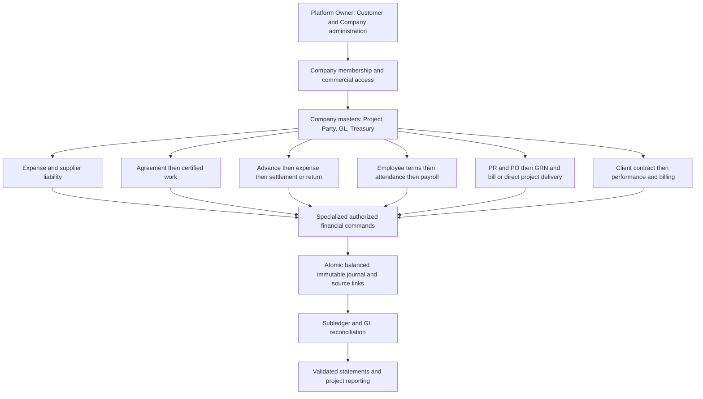

## 2026-11-20 — Procurement lifecycle implemented locally; Migration108 activation/publication pending

Continues Purchase Orders V1 without replaying CR07 or prior52 purchasing checks. GitHub main verified at `c61810366f677b9101012a264eadd84df48d78bf`; hosted107 applied, linked dry-run lists only108. Implemented bilingual requisitions (submit/review/approve/reject/cancel), actual multi-Supplier RFQ comparison/selection, single canonical PO conversion, partial/multiple goods receiving, partial receipt-first Supplier AP invoices, reviewed price variance, canonical corrections/returns and complete quantity/commitment/reporting visibility. Existing Inventory valuation, AP/GL, fiscal/annual controls, Party/Project/warehouse masters, authorization and canonical commands reused; no parallel ledger or payment workflow.

**Migration108 `20261126120000_procurement_lifecycle.sql` PREPARED / NOT APPLIED.** **69 focused checks PASS** (42 accounting/preservation,5 native concurrency,13 bilingual browser,4 export-content,2 final quotation/Enter,3 return-selector checks); TypeScript and Production build PASS. Local verification and exact accounting results are in [procurement verification](docs/procurement-verification.json), with [workflow/policy/limits](docs/PROCUREMENT_LIFECYCLE.md). No real Company data, hosted financial transactions, prior accounting evidence, push or deployment changed. VERIFIED: supported local business/accounting/security/database/testing/docs. DEFERRED: explicit108 activation, compatible publication and genuine authenticated route smoke. NOT APPLICABLE: real financial postings or new recovery infrastructure. One Material per receipt/one receipt per invoice (partial quantities supported); consolidated multi-receipt invoices, alternate-UOM ordering, issued amendments, external RFQ delivery and new attachment uploads remain outstanding. Invoice-first is explicitly blocked. Entire original commercial roadmap, Maker evidence-dependent/payroll work, entity onboarding, HR/WPS, statutory, subscription/security/operations and deferred DR/USB requirements are preserved.

## 2026-11-20 — Product continuation: purchasing commitments implemented;107 prepared

Production5689e2aa86b9793d58f405f55b302ee0be578eeb and hosted106 are the current Product Owner-confirmed baseline; read-only hosted history106 aligned. Development continues in `/media/nagham/msn4ever/www.downloadly.ir/NARVO`; CR-07/V1 remediation, Docker and historical simulations are not reopened. The next genuine I1 gap selected is **Purchase Orders**: `/purchase-orders` now supports incomplete editable drafts, Supplier/Project/catalog/service lines, exact quoted AED totals, review, accountant approval/issue, audited cancellation/history, bilingual shared Excel/PDF and responsive workspace navigation. Company roles, canonical reference/serialization/audit and existing masters/components are reused. Orders create commercial commitments only—no stock, invoice/liability, VAT, Project cost, cash or GL effect. Procurement prepares/reviews; authorized Accounting approves; Management Viewer remains read-only.

Additive **Migration107 `20261125120000_purchase_order_commitments.sql` PREPARED, NOT APPLIED**. Hosted records/configuration remain untouched. Local financial, permission, concurrent approval, bilingual browser/recovery/export and build evidence is recorded in [purchase-order verification](docs/purchase-orders-verification.json); [scope and release gates](docs/PURCHASE_ORDER_WORKFLOW.md). Existing books/stock preserved; no prior183-check replay, hosted migration, push or deploy. VERIFIED: bounded business/security/local database/testing/docs; DEFERRED: authorized107 activation and compatible publication/runtime smoke. Remaining I1/I3 work includes PR/RFQ and PO receipt/invoice/fulfillment matching; these are not misrepresented as completed. Entire original commercial roadmap, advanced HR/WPS, private documents, statutory and operational/security requirements and deferred DR/USB work remain preserved.

Next release action: obtain explicit107 activation authorization, apply only107 with preservation, then owner publishes the prepared isolated release. Next product work continues the remaining Procurement lifecycle; no automatic real-company posting or V1 setup correction is authorized.

## 2026-11-20 — Existing populated Company certification implemented locally; hosted activation pending

Continued CR-07 from deployed `b637893f2fbbe93d785cbb057ca53b97eafe502c` without rerunning the85-scenario simulation or previous183 checks. Added bilingual existing-foundation review/certification to canonical Platform Owner onboarding/Companies, using existing fresh MFA, requests, serialization and audit boundaries. No account, Treasury, journal, opening balance, user or membership is created/rewritten by certification. Existing customer association and explicitly dated trial setup remain canonical workflows. Additive **Migration106 `20261124120000_existing_foundation_certification.sql` PREPARED, NOT APPLIED**; hosted105/version alignment read-only VERIFIED. No hosted configuration mutations, financial postings, push or deployment.

Actual scoped READ ONLY V1 preview: Company ACTIVE,12 accounts,117 journals, debit=credit1,822,122 minor; **NOT CERTIFIABLE yet**. Six existing keyed controls have `requires_party=false` instead of required true (`CUSTODY_ADVANCE`, `SALARY_PAYABLE`, `SUBCONTRACTOR_ADVANCE`, `SUBCONTRACTOR_PAYABLE`, `SUBCONTRACTOR_RETENTION_PAYABLE`, `SUPPLIER_PAYABLE`); Bank `DEMO-BANK` lacks bank name and has negative recorded balance; platform BUSINESS enrollment/customer association and trial subscription are absent. Certification rejects these conditions without silent repair or fabricated funding. Accounting Admin membership already passes. Required next scope: approve106 activation, publish compatible release, approve evidenced/configuration remedies and fictional customer association, then Platform Owner reviews/certifies and saves PO-approved trial dates. Unrestricted hosted new-business acceptance remains pending these gates; prior genuine authenticated correction acceptance is preserved.

[Implementation, exact blockers, scope and activation steps](docs/existing-foundation-certification.md); [targeted verification](docs/foundation-certification-verification.json); [bilingual/native/read-only evidence](docs/foundation-certification-evidence). VERIFIED: local business/security/database/targeted testing; DEFERRED: hosted106, actual configuration fixes, publication and genuine post-release certification/new-business gate; no new accounting policy or parallel onboarding engine. Original commercial roadmap and deferred recovery requirements remain unchanged.

## 2026-11-20 — CR07 connected accounting VERIFIED LOCALLY; final commercial acceptance NOT READY

CR06 release `e8d2efb4f93f47f7a77f2e1dc0522dbf9812767a` is published per Product Owner; hosted history through104 is confirmed by linked read-only dry-run. This supersedes earlier publication/activation-pending statements below without rewriting their history.

One isolated **NARVO DEMO — Trading & Contracting LLC** (`a00fff7a-43d8-4775-9f51-05ccd0c7574b`), first short fiscal year September1–October31, executed **85 independently declared scenarios,90 persisted journals and3 linked reversals;183 distinct focused assertions PASS**. Actual opening subsidiaries carry from canonical September transactions. Final Trial Balance movements Dr=Cr AED261,504.20; assets105,232.66=liabilities762.50+closed equity104,470.16. Full-year loss1,529.84 is transferred once; October loss1,629.84. Cash Flow opening103,800.00, operating-1,762.34, investing-1,245.00, financing1,000.00, closing101,792.66. Final Bank88,892.66 reconciles statement90,682.66 +deposit210 −unpresented2,000. AR/AP,84 stock units/840 value, Custody1,000, Payroll, Contractor, asset and WIP controls reconcile. Canonical close, audited reopen and final lock executed. Prior65/CR05/CR06 archives preserved, not replayed.

Confirmed fixes: Inventory's server-calendar-month restriction incorrectly rejected open historical fiscal dates; prepared forward105 uses configured fiscal periods and preserves moving-average chronology, including journal-free count/transfer protection. Commercial register dates/amounts now stay readable on one line. **Migration105 `20261123120000_integrated_accounting_acceptance_corrections.sql` PREPARED / NOT APPLIED**, SHA256 `daebec8d16d3cd3cb40a498d91ca770c6a63004a1ed1a286e6702c3fbbd9af16`; only105 pending in linked dry-run. Native fixture preserves149 pre-existing tables and verifies concurrent excess settlement rejection. TypeScript/Production build PASS; focused lint has only an unchanged ref-cleanup warning; build chunk-size warning is non-blocking. No real-Company/configuration/financial mutation, hosted migration activation, push or deployment.

**Commercial readiness: NOT READY for unrestricted go-live.** Accounting execution/reconciliation is locally verified, but full Supabase Auth → protected application route operational acceptance has not been executed. Actual rendered production components used a synthetic Auth/master transport to persisted canonical commands; this is not full Auth E2E. Both languages, selectors, accounting preview/post/correction,390px layouts and actual PDF/Excel totals verified. Hosted105 activation and compatible runtime verification remain deferred. Single-obligation construction, statutory tax/compliance, commercial onboarding, specialist accounting and final DR/restore limitations remain explicit; no claim that the entire original commercial roadmap is complete.

Evidence: [consolidated accounting learning report](docs/cr07-accounting-learning-report.md), [verification/limitations](docs/cr07-integrated-verification.json), [actual GL and subsidiaries](docs/cr07-evidence/actual-ledger.json), [journal references](docs/cr07-evidence/journals.csv). Business/accounting, local security/authorization/database, focused tests and documentation VERIFIED for stated scope; deployment and full authenticated operational acceptance DEFERRED; real-data changes NOT APPLICABLE. Release branch `release/cr07-integrated-acceptance`, parent CR06; final SHA is the isolated commit containing this record. Publication command after required gates: `git push origin release/cr07-integrated-acceptance:main`.

**Immediate next:** explicitly authorize only105 activation when ready; complete full authenticated isolated application acceptance before commercial go-live. Preserve original commercial requirements, Maker Payroll, other-entity onboarding, advanced HR/WPS and deferred DR/USB tasks.

## 2026-11-20 — CR06 essential accounting gaps VERIFIED LOCALLY;104 NOT APPLIED

CR05 release `be689cdae488f871b337795fb105767079a4156d` is published per Product Owner; hosted history through103 is verified. This supersedes earlier prepared103 statements without rewriting phase history.

CR06 closes the evidenced Treasury transfer, source-linked AP asset acquisition, month-end depreciation, taxable Customer deposit, construction AR settlement/paid credit, recognition correction, actual-day prepayment, asset sale, allocated Supplier price-credit and asset Cash Flow gaps through existing canonical commands. No parallel ledger or real Company data changes. **100 focused checks PASS** (82 accounting, 7 native, 11 browser), TypeScript/build PASS. Trial Balance Dr=Cr AED27,915.00; assets103,625.00=liabilities2,115.00+equity100,500.00+profit1,010.00. Cash opening100,000.00, net-750.00, closing99,250.00; AR/AP/WIP/asset controls reconcile. Original65 and CR05 evidence preserved, not replayed.

Additive **Migration104 `20261122120000_essential_accounting_gap_closure.sql` PREPARED / NOT APPLIED**, SHA256 `a269e962138171fef760a80b991d93597c6a380cbcaaed3cc7cd38db5d177630`. Linked dry-run lists only104. No hosted financial/configuration mutation, migration activation, push or deploy. Release branch `release/cr06-accounting-gap-closure`, parent CR05; exact push after authorized activation: `git push origin release/cr06-accounting-gap-closure:main`. Final release SHA is the isolated Git commit containing this record.

Evidence: [CR06 verification](docs/cr06-gap-verification.json), [actual entries/answer key/limits](docs/cr06-accounting-learning-report.md). Business/accounting, local security/RLS/authorization, database, focused testing and documentation VERIFIED for stated scope; hosted104 and frontend/Production runtime acceptance DEFERRED. Single-obligation construction, component/revaluation/physical asset return after sale, statutory tax/restatement and full commercial operations limitations remain explicit. No verified core blocker remains unresolved in this bounded phase. The entire original commercial roadmap, Maker Payroll, entity onboarding, advanced HR/WPS and deferred DR/USB requirements remain preserved.

**Next:** one-time explicit authorization to activate104, then compatible publication; CR07 final integrated fictional acceptance follows and was NOT started. Do not declare overall commercial go-live.

## 2026-11-18 — CR-05 construction accounting / WIP VERIFIED locally; Migration103 prepared

CR04 `99305ef4ec79b441f8014308d23d52e43f53675d` is deployed per Product Owner; hosted102 is APPLIED (earlier prepared102 descriptions below are superseded). Existing Projects, Customer AR, Supplier AP, Inventory, Payroll, subcontract advances/certificates/retention, Treasury, GL, fiscal controls and shared reports are reused. Added explicit customer-contract policy, approved same-obligation variations, cumulative certification, separate billing/earned revenue/cash, conditional/unconditional customer retention, selective future-performance WIP, opening allocation from certified assets, valuation/release/impairment and audited closeout/reversal. Ordinary AR invoicing cannot bypass contract recognition; Inventory/WIP cannot capitalize the same Expense twice. Existing customer receivables remain collectible after administrative Project closure; new recognition stays blocked. Bilingual workflow is in existing Project details, with canonical previews/journal drilldown and shared PDF/Excel exports. No Maker-specific accounting rule or parallel GL.

**127 focused checks PASS**: 65 coherent accounting/report/reconciliation, 38 policy/authorization/privacy/negative, 4 native preservation/concurrency/RLS, 14 actual bilingual browser/export/mobile, 6 report-model checks.33 distinct lifecycle events create29 journals plus one certified opening (30total). Earned/billed/received AED100,000 each; costs30,500; margin/profit69,500; Bank168,000; Inventory2,000; assets170,000 = liabilities0 + opening equity100,500 + profit69,500; TB debit=credit413,000. Interim WIP4,500 / final0 equals GL; all customer/Supplier/contractor/Payroll controls settle to0. Existing Project Cost Ledger and Cash Flow reconcile. Original65-scenario archive and real Company financial records are preserved. TypeScript/Production build PASS; focused lint PASS; nonblocking bundle-size advisory retained.

Additive **Migration103 `20261121120000_construction_contracts_wip.sql` PREPARED / NOT APPLIED**, SHA256 `bf0b5313893d99e362a390ec8f678712d5aec1ea0bd7638d5b918cd948d34ddd`. Linked read-only dry-run aligns through102 and lists only103. Explicit hosted activation/preservation approval must precede compatible frontend publication; no migration, push or deployment performed. Isolated release branch `release/cr05-construction-wip` includes CR04. Local accounting/security/database/testing/documentation VERIFIED; hosted activation, frontend publication and Production runtime acceptance DEFERRED; real-company postings NOT APPLICABLE. [Exact evidence](docs/cr05-construction-verification.json), [policy/limits](docs/CR05_CONSTRUCTION_ACCOUNTING.md), [actual Accounting Learning Report](docs/CR05_ACCOUNTING_LEARNING_REPORT.md).

Limits: one integrated obligation per Project; separate-obligation allocation, taxable deposit tax points, settled-billing credit/rebill and existing customer-history adoption need separately supported assessment/workflows. WIP valuation remains evidenced/manual; no automatic overhead capitalization or write-off. Contract closeout does not waive administrative Project, bank, subcontract-completion or Payroll-assignment controls. **Next: CR06 remaining essential scenarios, then CR07 integrated fictional acceptance.** Entire original commercial roadmap, Maker operational/Payroll acceptance, Green/Villa13/Al Mazraa onboarding and deferred DR/USB requirements remain preserved.

## 2026-11-18 — CR-04 Supplier Purchase Returns VERIFIED locally; Migration102 prepared

Published baseline `1ff0ad4fce8e101d432652c9e50361fe98a5cd50` verified at GitHub main; hosted migrations through101 applied. Complete physical Supplier return → existing Supplier credit note → credit allocation/actual Treasury refund integration. Reuses canonical inventory movements, moving-average location valuation, ACW-01 AP documents/payments/statements, Company authorization/locks and canonical journal/reversal/fiscal/annual/bank controls. Separate physical, credit and actual refund events prevent duplicated stock, cost or cash recognition. Unique actual dispatch references and credit/refund/request identities prevent duplicate effects. Financial request receipts use the existing private command registry; AP/Bank refund events never enter Procurement-readable inventory history. Canonical journals point to their actual AP credit/refund business documents. Incomplete/reviewed return drafts can be completed without rewriting posted events.

**84 focused checks PASS** across22 scenario/control groups:43 financial/reconciliation,16 dispatch/recovery/helper-grant,6 native migration-preservation/concurrency/RLS,11 actual EN/AR browser,6 bilingual Supplier report model and2 actual refund/reversal receipt replay checks. Illustrative100units×AED50 less20returned =80units/AED4,000 stock/AED4,000 AP; native concurrent60unit returns leave40units/AED2,000 stock/AP. Actual refund Dr Bank/Cr AP; allocated/refunded credits cannot be reused. Documented VAT adjusts only original proportional tax; carrying/invoice difference uses existing variance control. Supplier subledger/control difference0 and inventory/GL match; all journals balanced. Screenshots at1366×768 and390px inspected; mobile table wrapping corrected with contained horizontal scrolling. TypeScript/Production build PASS (existing bundle advisory; validation-only browser-safe build config); focused lint no errors, recovery-effect/ref advisories documented. [Exact scenarios, journals, screenshots and limits](docs/cr04-supplier-returns-verification.json).

Additive **Migration102 `20261120120000_supplier_purchase_returns.sql` PREPARED / NOT APPLIED**; exact checksum in evidence. Linked dry-run lists only102; hosted activation needs explicit approval. Maker/Green/Villa13/Farm financial data, Auth, Payroll and original65-scenario archive never mutated. Local native activation preserves populated historical financial/master rows. No code push/deployment. Local business/accounting/security/database/testing/docs VERIFIED; hosted activation, frontend publication and Production runtime acceptance DEFERRED. One material/receipt per return; live invoice linked by GRNI match or prior paid-Expense capitalization required; non-proportional credits need separate evidenced treatment; later stock movements require controlled recovery/dependency order. Moving-average pooling retained, no new lot system.

Next approved milestone: **CR-05 Construction Accounting / WIP**, not started here; then remaining specialist scenarios and final integrated fictional-company acceptance. Preserve all original commercial requirements and deferred DR/USB work. Earlier prepared101 descriptions below are superseded:101 is APPLIED.

## 2026-11-18 — CR-03 Bank Reconciliation VERIFIED locally; Migration101 prepared

GitHub main and successful Vercel Production deployment both freshly verified at `a5793111454b6493abe49c485f4cc479fada191a` (deployment status18/11/2026 10:50:48UTC). No unnecessary republication. Hosted95–100 are applied; read-only linked dry-run is aligned through100 and lists ONLY101. Earlier prepared95–100 text below is superseded by the [hosted activation/preservation evidence](docs/commercial95-100-hosted-activation.json).

Implemented `/bank-reconciliation`, linked from the existing financial sidebar: bounded UTF-8 CSV/XLSX import, explicit column/date/decimal/worksheet mapping and preview, preserved original row evidence/file hash, canonical semantic/file duplicate and overlapping-period protection. Imports/matching create NO journals. Deterministic exact amount/reference/date-window suggestions never guess ambiguous matches; manual same-Bank/Company/sign/cutoff matching supports partial allocations, immutable audited unmatch and duplicate/race protection. Statement lines distinguish unmatched/matched and adjustment matches; GL drilldown, outstanding deposits/unpresented payments and exact statement-to-GL bridge. Later clearing preserves prior statement as-of outstanding figures.

Fee/interest Enter→Classify→Preview→Approve & Post uses typed Company controls plus existing authenticated actor, Treasury funding check, canonical request/journal/reversal engine and universal fiscal/annual guards. No arbitrary journal lines/accounts or fabricated balancing entries. Explicit gross-cost/no-input-VAT fees and evidenced non-taxable interest only; other accounting treatments use existing canonical business commands and match their Bank lines. Finalization requires every statement item matched and zero difference, is Accounting Admin audited, and blocks backdated Bank movements until audited reopen. Matched adjustments require unmatch before canonical reversal. Original journals never edited/deleted.

**75 focused assertions PASS:**27accounting/preservation/cutoff/reversal/replacement checks,14parser/mapping/matching/report-model checks,7native independent-session activation/concurrency/RLS checks,18actual EN/AR browser checks,6actual XLSX/PDF artifact checks,1bounded audit-projection regression and2final Bank-scoped export browser checks. Prior142foundation/176commercial checks reused, not repeated. Native import/match/post-transition waits actually observed; no simulated race claims. Fictional answer key: opening10,000; statement10,895 +deposit500 −unpresented200 = **GL11,195**, difference0; bank fee10 /interest5 posted once. Separate browser Company reconciles10,595 with actual fee/interest/reversal/replacement commands. Cancelled accounting pairs retain journal audit but do not masquerade as outstanding cash. Malformed-file stale-preview and lost-refresh same-key recovery regressions PASS; stored final snapshots do not recursively expand audit payloads. Final TypeScript/Production build and scoped lint PASS (existing bundle-size advisory only). Later-clearing regression and exact reversal entries verified. [Exact scenarios/results/screenshots/limits](docs/cr03-bank-reconciliation-verification.json).

Original65-scenario/63-journal simulation and Learning Report remain unchanged. CR03 uses a separate disposable fictional Company because existing certified openings must not be reapproved/recreated. Maker/Green/Villa13/Farm records, Auth, permissions and operational data NOT mutated. New tables force Company RLS/read grants only; complete Bank reconciliation requires existing Accounting Admin/Accountant and Payroll ledger coverage, preventing confidential Payroll cash leakage to Viewer. Seven new tables remain empty on activation; no financial backfill.

Additive **Migration101 `20261119120000_bank_statement_reconciliation.sql` PREPARED / NOT APPLIED**. Exact checksum in verification artifact. Explicit hosted101 authorization is required before activation, preservation and compatible frontend publication; no push/deploy/migration automatically performed. Unsupported formats/formulas/1904-date books, bank feeds/FX and overlapping extracts are explicit limitations, not guessed data. Business/accounting, focused security/DB/tests/docs VERIFIED locally; hosted activation/publication/Production runtime acceptance DEFERRED. Full commercial readiness remains PARTIAL. Next: **supplier physical returns →construction accounting/WIP policy →remaining essential scenarios →final integrated fictional acceptance**, preserving all original roadmap/deferred DR/USB obligations.

## 2026-11-18 — Commercial accounting operational core and integrated simulation VERIFIED locally; publication DEFERRED

Continues prepared foundation `5f356538e13c72c0dbf1a67ab0e98450b43000fe`, included by release ancestry. No restart, hosted financial changes or142-foundation-check rerun. Existing canonical kernel, Inventory, Supplier AP, Contracts, Custody, HR and Reports reused. Implemented earned-service/goods AR, deposits/partial receipts/credits/refunds/aging, paid fixed assets/depreciation/disposal, accrual/prepayment schedules, direct Cash Flow and audited retained-earnings annual close/reopen/final lock. EN/AR Enter →Classify →Preview →Approve & Post, canonical journal drilldown and Excel/PDF exports. No arbitrary browser journal lines or GL accounts.

Corrected demonstrated defects: Project Treasury scope/Project journal dimensions; partial-credit residual VAT; sale ISSUE/RETURN links to COGS without duplicate expense; opening balances wrongly counted as financing; annual transfers erasing operational/monthly Project costs; Payroll-derived annual close/reversal confidentiality. Existing source uniqueness, typed idempotency, tenant/role/period/balance checks remain authoritative. Audited annual reopening reverses closing transfers only, preserving original business journals; later-year activity blocks reopening pending separately approved correction policy.

Primary isolated fictional Company `35866f1d-2888-40f2-9690-015802ec13a8`, 01/10/2026–17/11/2026: **65 operation scenarios,63 journals/180lines,3reversals**. Original24 scenarios retained; original disposed in-memory database restored once through canonical commands with explicit ID map, not relabeled original IDs. Closing TB Dr=Cr **AED104,011**; assets97,111 = liabilities3,011 + net equity94,100; sales1,020 −COGS60 −other expenses7,860 = loss6,900. AR421/AP1,300; Inventory74units/AED740; Bank84,550/Custody9,700; Payroll payable400; Contract advance400/payable1,000/retention150. Cash Flow opening100,000 −operating6,550 −investing200 +actual owner contribution1,000 =94,250. A separate fictional Payroll Company verifies absence/paid leave/partial hours/overtime,4journals; it is not combined with primary balances. [Accounting Learning Report](docs/COMMERCIAL_ACCOUNTING_SIMULATION.md), [exact journal lines](docs/commercial-integrated-journals.csv), [actual snapshots/scenarios and verification](docs/commercial-completion-verification.json).

**176 valid new focused assertions PASS** across continued module execution, reconciliation, permissions/privacy, precision, Project scope,9native migration/concurrency assertions and28actual EN/AR browser assertions. Original142 reused separately. One obsolete cutover-as-financing expectation was explicitly retired and superseded by correct opening/actual-owner-funding regressions; not counted as passing. Actual browser canonical commands execute only against disposable clones; fixture/test counts are not Production runtime acceptance. Final TypeScript/Production build PASS; scoped lint0errors, existing ref/effect/compiler and bundle-size advisories. Actual rendered screenshots and exports checked. Local native populated migration chain preserves existing records/memberships. No broad audit repeated.

**Migrations95–100 PREPARED / NOT HOSTED APPLIED**.95 unchanged checksum `ceb192e8700b576066cb03c7c29c6ccdbc5f8fdc18de299d45cbba844359605c`;96customer receivables;97assets/accruals/prepayments;98annual close;99previews/report continuity;100goods/COGS/return/control/Project scope integration. Exact filenames/checksums in verification JSON. Fresh read-only hosted history ends94; linked dry-run lists ONLY95–100, no seeds or roles. Activation order: explicit scoped hosted authorization →95,96,97,98,99,100 with preservation →compatible release publication →separately authorized real Company mappings/policies. No migration, Company setup, push or deployment performed. Maker370sources/55journals/Barq364,365.77 remains historical checkpoint, NOT freshly queried/certified; no hosted financial write path used.

**Commercial roadmap remains PARTIAL**, despite supported five-module operational completion. Genuine remaining essentials/specialist limits: external bank-statement matching; supplier physical purchase returns; construction billing/retention/progress/WIP recognition policy; taxable customer-advance tax point; AP-funded/impairment/revaluation/tax asset policies; daily continuous-prepayment proration; subsequent-year correction/restatement policy. Tested prepayments are discrete month-end services, not silently prorated continuous coverage. Full statutory/WPS/security/operations acceptance, original Procurement/Inventory/AR/AP scope, Maker Payroll/operational acceptance, entity onboarding and deferred DR/USB remain preserved. No commercial go-live claim.

Definition of Done: business/accounting **VERIFIED** supported core, specialist policy **DEFERRED**; focused actor/role/Company/RLS/privacy/concurrency **VERIFIED**, full pre-production audit **DEFERRED**; local DB/migrations **VERIFIED**, hosted activation **DEFERRED**; testing/build/documentation **VERIFIED**; publication and real tenant configuration **DEFERRED**. No unrelated work discarded. Earlier foundation-only missing-module descriptions below are historical checkpoints superseded within this bounded scope.

## 2026-11-18 — Commercial foundation VERIFIED locally; complete Roadmap V3 program remains PARTIAL

Read the approved Commercial Readiness Program; local development/disposable testing only. Read-only GitHub verification confirms main `dc430087c9d2c585ab17cb031a0100c2b95a1c91` and successful Production deployment metadata (2026-11-17T19:19:02Z); no unnecessary ACW-02 republication or Maker posting/review. The prior Maker checkpoint remains 370sources,55journals,41Expenses,Barq AED364,365.77; this is reused historical evidence, not a new hosted balance query. Root unrelated work preserved through isolated release development.

Implemented the confirmed foundation gaps through existing accounting authority: **Trial Balance, Income Statement and Balance Sheet** in `/accounting-reports`, exact minor-unit/keyset ledger reads, posting-date/cutoff distinction, cumulative unclosed result, EN/AR Excel/printable PDF and explicit unavailable scope when Payroll RLS prevents a complete ledger. No certification of complete historical openings, cash-flow classifications, statutory presentation or automatic profit transfer. Existing shared UI/exports/GL remain authoritative.

Product Owner selected **Accounting Admin audited close/reopen; Accountants post only to open periods**. Additive **Migration95** `20261117120000_fiscal_period_controls.sql`, SHA256 **`ceb192e8700b576066cb03c7c29c6ccdbc5f8fdc18de299d45cbba844359605c`**, is **PREPARED / NOT APPLIED**. Adds opt-in Company fiscal dates/contiguous periods, immutable administrative audit, active actor/Admin authority, optimistic versions, normalized request replay and a universal journal-date gate using shared nonblocking admission with exclusive close/reopen; an in-progress transition fails atomically with retryable40001 to avoid domain-lock ordering cycles. Configuration/closure/reopening create no financial journals. Existing unconfigured Companies retain existing controls. Closure records explicit full-ledger reconciliation evidence and a balanced snapshot; it is not an annual retained-earnings closing entry. New bilingual operational controls reuse the Reports workspace. No real Company setup is authorized/performed.

**142 focused assertions PASS**, comprising49canonical-cycle checks (24distinct economic scenarios,26journals,1reversal),12date/precision/pagination/session-model checks,21EN/AR statement browser checks,4actual Excel/PDF artifact checks,33isolated fiscal activation/role/RLS/close/reopen/preservation checks,7native independent-session checks including observed close waits, retryable transitions, rollback, parallel shared guards and the queued-close lock-order case,16EN/AR fiscal browser checks including lost-response same-key recovery. These are not142independent accounting events. TypeScript and Production build PASS; scoped lint0errors/two nonblocking ref-cleanup hook advisories; existing bundle-size advisory retained. Actual rendered EN/AR screenshots inspected. Completed ACW-01/02 suites reused; no broad audit or new real financial activity.

Fictional **NARVO DEMO — Trading & Contracting LLC** uses disposable local PostgreSQL only. Independently declared answer key reconciles opening Bank/Equity AED100,000; ending TB debit=credit AED102,900; assets AED95,650 = liabilities AED2,900 + recorded equity AED100,000 − cumulative loss AED7,250. AP AED1,300,Inventory AED800,Custody AED8,700,Contract advances AED400,Contract payable AED1,000,retention AED200,Employee advance AED100,salary payable AED400 reconcile. The 24-event cycle and separately executed fiscal controls do not yet constitute the requested complete single-company full ERP period-end simulation. Missing AR/assets/accruals/cash flow/year-end closing and remaining specialist scenarios are NOT PASSED.

Single [completion matrix](docs/commercial-readiness-completion.json), [executed evidence/limits](docs/commercial-foundation-verification.json), [Accounting Learning Report with exact fictional journals](docs/COMMERCIAL_ACCOUNTING_SIMULATION.md). Business/accounting, focused authorization/RLS/concurrency, local DB activation/preservation, browser/artifact/build verification and documentation **VERIFIED for this foundation subset**. Hosted95 activation/new frontend publication/real Company fiscal setup and entire commercial readiness **DEFERRED**. Exact release order: scoped95 authorization and activation preservation → separately authorized compatible frontend publication → separately authorized real Company fiscal configuration. None performed automatically. Continue approved FIN-05 AR/customer cycle and remaining V3 foundation requirements; full original commercial scope, Maker operational/Payroll acceptance, entity onboarding and deferred DR/USB requirements retained. No migration application, push or deployment.

## 2026-11-17 — ACW-02 owner-confirmed historical Expenses ACTUALLY POSTED:25 / AED5,934.93

Product Owner supplied final standing confirmation for genuine outgoing records within the two existing approved SOURCE_SET scopes: actual Barq payment, received/performed goods/services, valid underlying historical facts; original shorthand is preserved. Executed through the existing authenticated Maker ACCOUNTING_ADMIN session and canonical `append_source_note`, audited source completion and source-bound Expense **Save → Review/preview → Post**. No administrative Supabase bypass or arbitrary journal writes. Each preview matched exact supported gross cost, with **no recoverable input VAT claim**; no assertion that original actual VAT was zero. Original amounts, dates, description, raw evidence, classifications, Company, cash-reference provenance and existing dimensions remain intact.

**25additional Expenses / AED5,934.93 ACTUALLY POSTED**,7small idempotent batches reconciled. Reused the existing G-2026-09-87 office draft (AED27.90): original «غير واصل» wording retained, subsequent goods-received/Barq resolution separately audited, Expense `MAKER-EXP-2026-000017`, journal `ce07bed9-93fa-4d51-8468-c8e089c20d5a`. Other independently supported fuel, completed vehicle services and Company overhead/admin costs used existing categories and canonical Company Expense / Barq accounts.24new source-bound Expense drafts were required; none duplicated the existing office document. [Exact25 sourceUUIDs, document IDs, journal IDs and source links](docs/acw02-actual-posted-expenses.csv); [execution and reconciliation evidence](docs/acw02-owner-confirmed-posting-execution.json).

Barq Custody **AED370,300.70 → AED364,365.77**.55journals/110lines balance: Company total debits=credits **AED417,554.63**. Funding AED390,960.20 less unchanged Electrical Advances AED16,500 and all41posted Expenses AED10,094.43 reconciles to Custody AED364,365.77. All30pre-existing journals, original12owner-funded receipts,2Electrical Advances and all prior posted financial rows are unchanged. All370sources retained; only25authorized working source records/posted links and2specific pending-duplicate metadata records updated. Company/COA/Supplier/Contract/Project/Treasury/Payroll/settings preserved. No new Supplier invoice obligation, Supplier Payment, new funding, Payroll, Advance, Inventory movement, Project cost, tax recovery or reversal. Supplier control/AP outstanding remains zero. The existing Supplier reader intentionally includes15fully paid Supplier-linked Expenses as invoice-shaped report rows; those are **not newly created unpaid AP liabilities**.

**287outgoings remain unposted**:118Expense candidates needing genuine allocation/recognition/date/duplicate evidence;139other unclassified/specialist records;9excluded Payroll/salary-transfer fees;16Owner/Partner movements;3classified Employee Advances;2refundable deposits. Saved raw nature counts and original review families are recorded separately, without repeating the330-source review. Four Employee Advance drafts remain unchanged (one still has an unresolved source nature). G-2026-09-86 and G-2026-09-101 were both held: same23/09/2026date, AED50 and Supplier. Precise bilingual yellow-review reasons were saved through existing audited nonfinancial workflows; no payment was invented and neither was posted. Routine payer/receipt facts are now standing-confirmed and must not be requested again. Genuine Project/Contract, stock/asset/valuation, legal-entity exception, date or distinct-payment uncertainty remains unresolved individually.

Seven batch reconciliations and final scoped preservation PASS;937row/field, journal-balance and exact-link assertions are preservation checks, not937independent business scenarios. Actual Production source detail displays the new posted office document and original wording. Existing75focused assertions are reused. Final Production inspection demonstrated a narrow UI defect: original-cost drafts suppressed detailed source-review warnings. A locally verified correction now keeps an explicitly audited duplicate issue visible beside its draft and reuses the existing distinct-payment evidence field.14new EN/AR browser assertions, final TypeScript and Production build PASS; screenshots inspected. Only the two held working records gained the audited text issue flag; no financial/RLS/SQL change. **Warning visibility requires operator frontend publication; it is not yet live.** No broad test restart or new migration;94remains applied. Business execution, accounting reconciliation, authenticated authorization, scoped data preservation and documentation **VERIFIED**; database change **NOT APPLICABLE**; remaining evidence-dependent processing and compatible frontend publication **DEFERRED**. Local UI implementation commit `8b627c7cccec2fc6c0f3b67c4b9c0aa9c3bf36e4` is preserved by ancestry; release evidence updated without pushing or deploying. Earlier zero-posting/receipt-blocker text below is a historical checkpoint superseded by this execution. Preserve approved RoadmapV3, separate Payroll, Maker acceptance, onboarding, original commercial requirements and deferred restoration/USB work.

## 2026-11-17 — ACW-02 Smart Expense flow implemented locally; financial execution remains evidence-gated

Continues Product Owner-published ACW-01 release `07a96fef912ef0be6f6a86ae9fa939cb46106d40` and applied Migration94. Maker's separately approved account setup is now verified: **210000 Supplier Payables / ذمم الموردين**, account `3c3318db-36da-4da1-a7af-92b7c028fcc2`, ACTIVE LIABILITY, credit-normal, Party required, canonical `SUPPLIER_PAYABLE`; initial AP/control balances zero. That completed setup is not repeated here and supersedes the earlier missing-mapping prerequisite below.

Existing source/Expense UI now follows **Enter → Classify → Preview → Approve & Post**. Preview uses the existing canonical Save/Review commands and stops before POST; the explicit approval reuses the reviewed snapshot. Edits invalidate preview; lost-response requests retain exact identities. Confirmed source date, amount, Party, scope and invoice/tax fields are reused without guessing. Explicit no-recovery treatment reuses the paid gross amount, while unknown VAT remains unresolved. Direct Expense Supplier stays optional; unpaid invoices require Supplier and show the correct existing AP mapping. Supplier invoice source navigation targets `/supplier-invoices`. Source/version conflicts request refresh. Confirmed Category-C defect fixed: empty duplicate-candidate arrays were truthy and displayed unnecessary clearance fields (117 captured source rows); real flags/nonempty candidates and database duplicate controls remain protected.

**75 focused assertions PASS** across18 disposable canonical accounting checks,7 final input checks,40 EN/AR browser assertions and10 final rendered-preview checks. Browser transport is synthetic/capture-only; actual SQL posting verification uses a disposable synthetic Company, not hosted Maker. Numeric dates, source/payer context, reviewed debit/credit, stale-preview guidance, mobile layout, optional Supplier, excluded classifications and Management Viewer tested. Final TypeScript and Production build PASS against final code (browser-safe synthetic build configuration; existing bundle-size advisory). Exact evidence is recorded in `docs/acw02-smart-expense-verification.json`. Scoped lint0errors/3existing effect/dependency advisories. Earlier broad ACW suites reused, not restarted.

**Actual hosted new postings:0 / AED0 / no new journal IDs.** Current authenticated ACCOUNTING_ADMIN checkpoint and15 scoped postflight fingerprints preserve370sources,30journals/60lines,16Expenses,2Electrical Advances,69Supplier Parties,21source draft bindings/66draft events and existing Payroll. Barq Custody **AED370,300.70**, unchanged; GL debit=credit **AED411,619.70**.18/330outgoings already posted;312remain unposted (34excluded,278pending), with completed saved review/reason groups carried forward rather than repeated. Five existing Expense drafts remain: four excluded salary-transfer fees and G-2026-09-87 AED27.90 office fragrance explicitly marked not received, unresolved gross-cost evidence and saved Main Cash-versus-Barq contradiction. A narrowly scoped factual question is pending; no receipt, VAT or payer override invented. Party enrichment does not itself verify economic recognition. No new draft/source/Company configuration change or AP business event. No arbitrary batch limit and no eligible posting claimed without evidence.

Database/migration change **NOT APPLICABLE**; Migration94 remains the applied dependency, no new migration. Canonical SQL, Auth, RLS, permissions, financial calculations and private financial primitives unchanged. Local workflow implementation, focused financial/authorization evidence, rendered verification, hosted preservation and documentation **VERIFIED**; final frontend publication and further evidence-dependent Maker execution **DEFERRED**. Maker PROJECT_COST mapping remains absent; no unapproved account/configuration created. Next work continues approved Roadmap V3 and remaining Maker operational acceptance, separate Payroll, entity onboarding and the full original commercial ERP roadmap. Deferred restoration/USB requirements remain preserved. No automatic push/deploy.

## 2026-11-17 — ACW-01 final focused acceptance and fixes (local release)

Published baseline `0eec66e96ee3345b4ad1d4757a7b55be6836ae03` and applied Migration94 reused. Final isolated tests exercised canonical SQL, actual application routes/forms and real native concurrency. Browser accounting results were NOT mocked: six invoices and four settlements posted only in a disposable synthetic Company, including AED5,000 → AED2,000 payment → AED3,000 remaining → final zero, Inventory/GRNI matching and immediate paid purchases. Separate SQL scenarios verified multi-invoice allocation, advances/applications, credits/VAT, reversals/dependencies, idempotency, authorization, tenant isolation and periods. Evidence separates fresh tests, synthetic Auth/master adapters and Production read-only checks: `docs/acw01-final-acceptance.json`.

Confirmed in-scope presentation fixes: Inventory mode had a misleading Service placeholder and unstable accessible label; actual receipt selection is now explicitly labeled/required. Accountant could preview Inventory matching but the posting action then hit the existing database Admin-only stock/cost rule; the UI now explains and guards that SAME rule. No grant/role change. Missing Supplier Payable configuration previously appeared as zero GL reconciliation; screen/exports now show setup required / reconciliation unavailable and suppress an invented numeric difference. Historical reporting remains available for inactive mapped controls. Supplier AP scope now explicitly distinguishes canonical invoices/settlements, source-linked activity and posted GL in both screen and shared Excel/PDF output.

Fresh focused results: canonical accounting42, integration20, credit15, independent native concurrency11, actual browser/canonical SQL57, changed-control browser20, report semantics12, export-file inspection5 — all PASS. Counts are separate suites, not claims of unique business scenarios. EN/AR at1366×768 and1920×1080; actual XLSX/PDF invoice/amount content inspected. TypeScript and final Production build PASS; scoped lint0errors/2existing state-effect advisories; existing bundle-size advisory. No broad unrelated audit or full183check suite restart.

Authenticated Production read-only before/after: 15 scoped table fingerprints, AP response and all captured GL dimensions unchanged; 370sources, 69Supplier parties (74total), 30journals/60lines, 16Expenses, 21draft bindings/66events, payroll postings0. Barq Custody **AED370,300.70** unchanged. Native Supplier dropdown opened, remained open and accepted selection; spontaneous closing was not reproduced. No hosted financial/configuration writes or administrative impersonation. ADNOC's zero AP invoices is consistent with the current canonical invoice register (0Supplier invoices); historic Supplier associations do not create AP. **Maker lacks the Supplier Payable control mapping**: authorized Company accounting setup remains an operational prerequisite for credit purchases/settlements; no account/code or balance was invented.

No migration required; Migration94 and all schema/RLS/Auth/permissions unchanged. All financial command payloads/idempotency/math preserved; sole command-entry guard mirrors existing Admin stock authority. Implementation/testing/documentation and read-only preservation **VERIFIED**; database change **NOT APPLICABLE**; publication and patch Production acceptance **DEFERRED**. Maker AP operational readiness is conditional on its separate approved setup. Preserve specialist stock return/price-credit, refund and fixed-asset limits; all original commercial requirements and deferred restoration/USB work. After this release, stop expanding ACW-01 and continue existing approved Roadmap V3 separately; no future phase implemented here. No push/deploy.

## 2026-11-14 — ACW-01 focused Supplier usability correction (local release)

Continues deployed navigation release `01782691757e95c217df36d5790bbaff01c00f6a`. The former Full GL link opened the generic Company reports collection; the Party parameter only initialized a buried form and did not load results. The primary action now opens `/supplier-statements?party=<id>&as_of=<snapshot-date>` and renders the **existing** Supplier report model (invoices, payments, credits, advances, allocations, aging and reconciliation). Posted GL detail is a distinct action: the existing Party reader auto-loads in a focused reports route with the selected Party. No parallel reporting/accounting engine.

Supplier labels/search/table headers previously inherited muted 13–14px shared styling. Scoped premium styles now use readable 16px labels/headers, stronger text contrast, spacing and bounded mixed-language Supplier controls. Selection is URL-backed, filter and export/action rows are separated, master loading disables the native selector, and changing Supplier clears stale table search/detail state. Native select and canonical financial forms remain in use.

**Selector evidence limitation:** in the real authenticated Production accountant browser (financial writes blocked), the 70-option native selector opened, stayed open, retained its DOM/focus and selected successfully by keyboard. The reported spontaneous closing was not reproduced; no focus/authentication/RLS defect is claimed or speculative bypass introduced. Loading and selection/layout weaknesses are corrected, but the original intermittent symptom still requires operator confirmation after publication.

Verification details and exact limits: `docs/acw01-ux-verification.json`. 50 focused browser checks PASS. TypeScript and final Production build PASS; scoped lint has 0 errors and 2 existing effect-state advisories. Synthetic EN/AR screenshots and focused local browser checks cover populated Supplier-specific views, native selection, report/GL navigation, font sizes, preview entry and Viewer visibility. Completed broad accounting tests are reused, not repeated. Production publication and post-publication UI acceptance remain **DEFERRED**. Source comparison confirms canonical preview/post/idempotency block, accounting report readers/calculations, Auth and all migrations unchanged. No hosted financial mutation, Supplier creation, invoice/payment posting, balance change, configuration change or migration. Migration94 remains the existing applied dependency.

Lifecycle: presentation/report navigation **VERIFIED locally**; unchanged accounting/authorization boundaries **VERIFIED by focused source comparison**; database changes **NOT APPLICABLE**; deployment **DEFERRED — no push/deploy**; original intermittent-close diagnosis **UNRESOLVED / not reproduced**. Preserve all original ACW specialist limits, Maker acceptance/Payroll, entity onboarding, commercial ERP roadmap and deferred recovery/USB work.

## 2026-11-14 — ACW-01 explicit Supplier navigation FIXED locally; publication pending

Confirmed presentation defect: `/supplier-invoices` was unregistered and reached the wildcard deferred screen, producing “Company access verified / Accounting records are not available.” It was not a Supabase authorization error. The deployed ACW-01 workspace exists under `/supplier-payments`; Product Owner confirms the observed legacy screen displayed no warning. No authenticated read failure or RLS defect was established, and no real-user JWT impersonation was performed. Public Production bundle contains ACW-01; CLI history confirms94aligned and hosted Supplier reader matches Migration94 with correct execution grants. The reported legacy-only browser screen was not independently reproduced in an attached authenticated session.

Small routing correction reuses the SAME existing workspace and canonical commands: sidebar **Supplier invoices** `/supplier-invoices` → Invoices; **Accounts Payable** `/accounts-payable` → Aging & statement; **Supplier statements** `/supplier-statements` → Aging & statement (select Supplier for existing exports/GL link); **Supplier payments** `/supplier-payments` → Payments. Existing tabs remain available. Route selection preserves current accounting intent and existing user/Company/role keying; no parallel forms, reports or accounting engine. Icons and EN/AR labels use the existing premium shell. Accounting Admin/Accountant retain entry actions; Management Viewer stays read-only; other roles receive no Supplier financial links/reads. Existing settlement availability is preserved; invoice module metadata identifies new-business requirements.

**26 focused browser checks PASS** through actual ProtectedApplication routes, CompanyWorkspaceShell/sidebar, TenantReadyApplication and Supplier workspace, using synthetic read responses and0hosted requests/financial commands. Covers four routes, EN/AR sidebar and invoice drawer, route-to-tab selection, Accountant/Admin/Viewer/non-accounting presentation boundaries. EN/AR screenshots inspected. TypeScript/Production build PASS; scoped lint0errors/2nonblocking state-effect advisories (existing async load and route synchronization); existing bundle-size advisory retained. Canonical input/preview/post/retry block, Auth, financial repositories and entire migration tree match base `269b4f9a628ee3ded238da6cf50e4622ac2d3592` exactly. No broad183check accounting suite repeated.

**Migration94 remains APPLIED; no new migration or hosted data/configuration change.** Prior activation preservation evidence is included at [Migration94 activation](docs/acw01-migration94-hosted-activation.json); [navigation evidence/limits](docs/acw01-navigation-verification.json). Base269b4f9 Production deployment is Product Owner-confirmed; this new navigation correction is prepared locally and NOT pushed/deployed. Operator publication and refreshed Production UI validation remain required. Existing Maker source/Party/financial/Payroll records untouched.

Lifecycle: presentation implementation, focused runtime, role visibility, unchanged accounting/authorization and documentation **VERIFIED locally**; database changes **NOT APPLICABLE**; publication and current-session Production acceptance **DEFERRED**. Existing AP specialist limits, remaining Maker acceptance and Payroll, entity onboarding, commercial roadmap and deferred restoration/USB requirements remain preserved. Earlier prepared-only Migration94 entries below are historical and superseded by its successful activation.

## 2026-11-13 — ACW-01 Supplier accounts / credit purchase cycle VERIFIED locally; Migration94 PREPARED, NOT APPLIED

Continued Supplier Integration release `5d7fcf90cdabb53890c2dcad8b084f736f72d1ed` and ACW-00 ancestry. Existing canonical Expenses, Supplier Payments, Treasury/Custody funding, Inventory GRNI matching, Party/Project GL statements and premium shared UI are reused. `/supplier-payments` now provides Supplier invoice → authoritative preview → Approve & Post → partial/full/multi-invoice settlement, dedicated Supplier advances and applications, service credit notes, paid-invoice Supplier credits and applications, controlled previewed reversals, complete as-of AP balances/aging/statements and Arabic/English Excel/PDF output. No duplicated cash, cost or stock recognition. Missing due dates remain distinguishable. Valid Company DEFAULT payer only; historical Barq SOURCE_SET preferences are not a global purchase default.

**183 focused checks PASS**: accounting42, integration20, credit accounting15, native concurrent races11, additive activation preservation30, bilingual core browser21, credit/retry browser11, exports browser9, reversal browser11, final funding/master/preview controls8, actual export artifact inspection5. Native PostgreSQL checks use independent connections and observed waits. Actual rendered EN/AR previews, statement/mobile and credit layouts inspected. TypeScript/Production build PASS; scoped lint0errors with2 nonblocking effect advisories (one new async-read loading-state effect, one existing shared workspace effect); existing bundle-size advisory retained. [Detailed implementation and limits](docs/ACW_01_SUPPLIER_ACCOUNTS_PAYABLE.md), [exact check register and migration checksum](docs/acw01-verification.json).

Additive **Migration94** `20261113140000_supplier_accounts_payable_cycle.sql` is **PREPARED / NOT APPLIED**. Linked hosted dry-run against existing `eqnzueginpkskbnqvgoc` lists only94; hosted remains through93. Adds empty metadata/configuration tables and extends canonical financial/report commands; activation performs no seed, configuration, source change or financial posting. Isolated activation preserves original financial/master/source/Auth-membership records and legacy payment replay. Required order: explicit hosted94 authorization → scoped activation/preservation → compatible frontend publication → focused Production validation. No push/deploy/migration application performed.

**No real Maker AP business activity executed.** Existing69Supplier creations,2reusedParties,131source links,1draft enrichment and7posted-source references were not repeated.193identity-review exceptions preserved. **AED370,300.70 is the prior verified Barq checkpoint, not a new hosted balance query.** Supplier invoices, payments, payroll, existing journals and balances untouched. Narrow read-only Git check found main `3fb13e4040222c19a9667622f437c1c0c599a96e`; supplier-linking base remains pending publication. Vercel metadata returnedHTTP403: actual deployed SHA **UNVERIFIED**.

Lifecycle: accounting, authorization/Company isolation, canonical database behavior, concurrency/idempotency, focused local runtime/export verification and release documentation **VERIFIED**; hosted94 activation, publication/Production smoke and separately authorized Maker AP execution **DEFERRED**. Physical stock returns/capitalized-stock credits, actual Supplier cash refund receipts, fixed-asset recognition and expanded historical Inventory matching remain genuine specialist limitations; do not substitute service credits or reversals. Existing Inventory period/master restrictions retained. Full procurement/commercial ERP roadmap, remaining Maker acceptance and separate Payroll, subsequent Green/Villa13/Al Mazraa onboarding, deferred restoration and USB requirements remain preserved.

## 2026-11-13 — Supplier/source Party linking EXECUTED; compatible UI release prepared, unpublished

Under explicit Product Owner authorization, reused the authenticated Maker accountant session and original Excel supplier fields/import evidence. **69 SUPPLIER Parties created; 2 existing SUBCONTRACTOR identities reused; 131 sources linked in audited working metadata; 1 existing Expense draft enriched; 7 posted sources received idempotent audited Party identity references.** Existing five Parties preserved. Actual Production Expenses source **G-2026-09-87** displays **LULUAT GIFTS**, verified in the rendered Counterparty column. No financial postings, invoices, liabilities or payments created. All370 sources,21 source/draft bindings, prior65 draft events,16 posted Expenses,2 Contractor Advances,30 journals/60 lines and Payroll preserved; exactly one new nonfinancial draft SAVE. **Barq Custody remains AED370,300.70.**

The330 outgoing records reconcile to130 working links +7 posted-source audit references +193 pending (120 missing original counterparty;73 identity/alias/role/evidence issues). One additional non-outgoing invoice/commitment source received a Party metadata link only; no recognition or payment.128 distinct nonempty original spellings /122 after whitespace/case normalization are candidates, not verified legal-entity counts. No speculative fuzzy merges or Employee/Other identities. September–November workbook SHA verified;74 populated supplier rows reconciled directly. Earlier workbook's preserved raw source fields/hash reused; standalone original workbook was not located in this run.

Compatible frontend fixes: source names no longer disappear solely because canonical IDs are absent; confirmed source Supplier defaults into new drafts; posted Expense tables/details show separately labeled read-only Excel provenance without rewriting posted supplier dimensions; explicit Counterparty/Project column widths fix demonstrated EN/AR letter stacking; supplementary audit-note text and workbook references now render in the existing source history. Supplier/AP review creates no liability from paid Custody costs. Posted subledger supplier reassignment is **not performed**; supplementary audit references and display provenance are not financial reassignment.

**41 new focused checks PASS** (16 logic +13 source/draft browser +6 posted-provenance browser +6 audit-note browser);25 exact preservation checks PASS; TypeScript and Production build PASS; scoped lint0errors/6existing hook advisories; existing bundle-size advisory retained. Actual EN/AR screenshots inspected; live authenticated name check PASS. No broad completed suites repeated. [Exact source/Party IDs, pending reasons and verification](docs/supplier-source-linking-execution.json).

Lifecycle: business/master execution, unchanged accounting, existing authenticated authorization/RLS boundaries, focused verification and documentation **VERIFIED**; database changes **NOT APPLICABLE** (Migration93 unchanged/APPLIED, no new migration); alias/legal-name resolution and matching frontend publication/Production smoke **DEFERRED**. Isolated release includes ACW-00 final release `3fb13e4040222c19a9667622f437c1c0c599a96e` by ancestry. No Git push/deployment, privileged access, policy configuration or financial-data correction. Existing Maker acceptance, separate Payroll, subsequent entity onboarding, full commercial roadmap and deferred restoration/USB requirements remain preserved.

## 2026-11-13 — ACW-00 FINAL RELEASE PACKAGING READY; frontend NOT PUBLISHED

Product Owner confirms the ACW-00 frontend has not been published. Finalized the existing clean isolated `release/acw00-one-click` release, preserving implementation commit `427e3dbfdc548955cf7410139177bdbb8ab5cb24` and prerequisite `c4776f89a6eef892d26bea450a64a97defeed2cd` by ancestry. No application code, dependency, permission, accounting-command or migration change in this packaging step. Includes **Approve & Post / اعتماد وترحيل**, scoped historical payer preference readers/setup, elimination of redundant matched-payer confirmation gates, concise prioritized guidance, simplified Expense editing/review and existing canonical accounting safeguards. Genuine funding contradictions and specialized separation of duties remain protected.

Both approved historical Barq SOURCE_SET preferences are **already saved hosted metadata**. Deployment must reuse them; no seed, reconfiguration or financial posting runs on publication. **Migration93 is APPLIED** and unchanged. The three specifically authorized Company Expenses were **already posted directly to hosted accounting**, total **AED1,050**, with exact source/document/journal links in [execution evidence](docs/acw00-confirmed-posting-execution.json). Barq Custody checkpoint **AED370,300.70**;16posted Expenses,30balanced journals/60lines; prior owner funding, Contractor Advances and Payroll preserved. Original Main Cash source links remain as provenance with the approved audited actual-Barq resolution. Earlier blocked/pre-posting entries below are historical.

Reused **58passing implementation checks**, TypeScript/Production build and **24focused live postflight checks**. Packaging checks: intended-feature/source presence, existing dependency ancestry, JSON/evidence consistency, exact Migration93 checksum, whitespace, unchanged application/migration trees and preservation of unrelated local work. No broad tests or hosted queries repeated. Known existing bundle-size advisory retained; deployed frontend smoke remains **DEFERRED until operator publication**. [Final verification/register](docs/acw00-verification.json).

Lifecycle: business/accounting implementation and preservation **VERIFIED**; unchanged authorization/database boundaries **VERIFIED**; additional schema work **NOT APPLICABLE**; release packaging/documentation **VERIFIED**; publication/Production frontend validation **DEFERRED**. No hosted financial changes, migration application, Git push or deployment in this step. Existing Maker operational acceptance, Payroll, entity onboarding, commercial roadmap and deferred restoration/USB requirements remain preserved.

## 2026-11-13 — Three specifically authorized ACW-00 Expenses ACTUALLY POSTED; AED1,050 reconciled

Reused both existing SOURCE_SET preferences and the authenticated Maker accountant session. Product Owner explicitly resolved the Main Cash-versus-Barq source conflict, preserving Main Cash as original provenance and authorizing actual Barq Custody payment accounting for exactly the three confirmed gross Company costs. Audited source-specific resolution saved through `complete_historical_source`; canonical `command_source_expense_draft` Save → Review → Post commands created exactly three source-bound Expenses and journals, with frozen request identities and per-item reconciliation. **Actual new postings:3; totalAED1,050; no holds.**

- **G-2026-09-56**, 2026-09-14, AED240.00: Expense `MAKER-EXP-2026-000014` (`f061b87a-fbd7-43f6-96d5-6af7bcd8e147`), journal `63866ca8-ab7f-4d9a-b3a1-bbde96648a87`.
- **G-2026-08-156**, 2026-08-31, AED800.00: Expense `MAKER-EXP-2026-000015` (`4a6fa58c-0698-4098-872f-09ff1d4a066f`), journal `2c9a56f5-2421-4061-bfe7-8b325079e1e7`.
- **G-2026-09-99**, 2026-09-26, AED10.00: Expense `MAKER-EXP-2026-000016` (`f24f3650-af6f-4add-8171-10fe7171291a`), journal `3020d620-69ca-4d22-abac-e1acf0714b04`.

Each journal **Dr Company Expense / Cr Barq Custody**, no recoverable input VAT, no Treasury entry and no Project cost. Barq Custody **AED371,350.70 → AED370,300.70**. Full reconciliation: owner fundingAED390,960.20 − all posted ExpensesAED4,159.50 − Contractor AdvancesAED16,500 =AED370,300.70. All30journals balance; exactly6new lines. Original27journals/54lines,13Expenses,18source-draft links/56draft events and2Contractor Advances preserved; now16Expenses,21source-draft links/65draft events and30journals/60lines. All370sources retained;367unrelated source rows unchanged. The three target original dates, amounts, raw evidence, classifications, Companies and Main Cash links remain unchanged. No Payroll/advance/master/Contract changes; no repeated owner funding.

Continuation brief transcribed the AED240 residency source as `G-2026-09-66`; actual previously approved UUID belongs to **G-2026-09-56**. `G-2026-09-66` is a separate AED367.50 stone-material record and was left untouched. No speculative reference replacement or date/amount correction performed.

**24focused live preservation/accounting checks PASS**; reused completed58implementation checks, no broad review/tests. Of330outgoing sources:3newlyposted,15previouslyposted,34excluded and278pending by existing primary reason. Remaining five prior drafts are four excluded salary-transfer/AlFardan fees and one fragrance item lacking receipt/receipt-of-goods support; no further independently eligible saved draft. Other existing review packets remain pending for economic classification89, Project/labor/receipt/tax support85, inventory/assets69, entity15, dates14, Contract3 and duplicate3. No unknown accounting facts invented to increase posting counts.

Local execution adapter mishandled the source-review RPC's valid empty response and stopped before posting; handling was corrected, persisted state checked, same frozen commands resumed. No Production application-code fix required. The unchanged policy reader still flags the preserved legacy Main Cash link; the owner's explicit source-specific resolution is in audit/completion, and the posted canonical Expense/GL identify Barq as actual payer. No policy/RLS/financial safeguard weakened and no new hosted migration applied.

[Exact journals, source/document links and reconciliation](docs/acw00-confirmed-posting-execution.json). Isolated UI release **427e3dbfdc548955cf7410139177bdbb8ab5cb24** unchanged; no push/deploy. No additional frontend release/migration required for these completed postings; separate prepared ACW-00 UI publication remains with the operator. Earlier blocked entries below are historical and superseded. These are working-tree operational records. Payroll, advances, remaining Maker acceptance/onboarding/commercial priorities and deferred restoration/USB requirements remain preserved.

## 2026-11-13 — ACW-00 one-action Expense posting VERIFIED locally; two approved payer settings SAVED

Continued isolated release `c4776f89a6eef892d26bea450a64a97defeed2cd` without repeating its185 focused checks or the historical330-source review. Confirmed UI defect: a valid source-set payer hid the payment checkbox but the action still required its false local checkbox state. Also confirmed no Company payer preferences had been configured. The new **Approve & Post / اعتماد وترحيل** action performs the existing audited source-review and canonical draft Save → Review → Post lifecycle after one deliberate accountant approval. Reuses existing drafts, mapped accounts, exact business inputs and source links; preserves server authorization, period, VAT, duplicate/idempotency, balance and immutable-journal controls. Unknown economic types open existing routing; Contractor/Employee advances and materials cannot become Expenses. Real separation of duties, split allocations and specialized corrections retain their established workflows.

Normal Expense editing exposes essential economic/date/amount/category/Project fields, a concise priority requirement and the primary action. Payment overrides, technical provenance, invoice references, supplementary evidence and cancellation live in disclosures. The final action explicitly attests Company ownership and a distinct original cost; no repeated ownership/original-cost checkbox or browser confirmation is required. Unmatched/contradictory payment evidence still requires completion. Existing matching categories and confirmed source-set payer are reused. Lost responses retain the frozen canonical request; stale source versions/session changes fail closed. Posted receipts update the drawer and remove the posting action. Accounting preview remains display-only; no financial engine or stored calculation changed.

**58 focused checks PASS =30 isolated canonical accounting/orchestration +28 EN/AR browser assertions**, including actual synthetic balanced journal, exact Custody reduction, duplicate/replay and stale-version rejection, closed-period/VAT/Company/Viewer denial, original-source/prior-journal preservation, specialized routing, mobile readability and filled primary action. TypeScript/Production build PASS with browser-safe supabase-auth configuration; scoped lint0errors/6existing advisories; whitespace/private-credential checks PASS. Synthetic screenshots and exact evidence: [ACW-00 verification](docs/acw00-verification.json). No broad suites repeated.

Under the subsequent explicit Product Owner authorization, used the existing secure NARVO application login and authenticated Maker accountant to save **exactly two SOURCE_SET settings**: `03_General_Expenses_Aug_Sep_2026_No_Farm_Only.xlsx`, August–September2026,208 outgoing records, policy `c5ade18b-e0d2-414c-b975-7f2ccd78f8f0`; `NARVO_Maker_All_Outgoings_Review_V2.xlsx`, September–November2026,122 outgoing records, policy `a32bbe61-7ca0-4778-964d-147bb086cd54`. Both reference the existing active B1/Bareq Custodian and the owner's batch confirmation. Used the exact64-character hashes from the approved preview; the second hash in the follow-up reply was shortened. No future default saved. Contradictory sources remain unresolved; policy does not classify, post or establish unknown Project/Contract/VAT facts.

Authenticated settings postflight: all15 scoped Company/business table snapshots IDENTICAL; **370 sources,18 source-draft links,56 draft events,13 posted Expenses,2 posted Contractor Advances,27journals/54lines and0Payroll postings** preserved. Twelve owner-funding journals unchanged. Barq Custody opening/closing **AED371,350.70**. **New financial postings:0; new journals:none; source/draft edits:0.** The specific residency/visa/telecom candidates `G-2026-09-56`, `G-2026-08-156`, `G-2026-09-99`, totalAED1,050, remain blocked: automatic approval review rejected irreversible posting while business-benefit/beneficiary/tax-support facts remain unresolved. Exact factual confirmation requested; no rejected action executed or workaround used. Of330 outgoing sources,15are already posted (13Expenses+2Advances),34excluded and281pending by their saved primary accounting reason; no repeated historical classification audit.

**No new migration. Migration93 is APPLIED**, activation evidence retained. Local branch `release/acw00-one-click` includes `c4776f89` and all preceding approved visual/workspace releases by ancestry. No push/deploy. Lifecycle: implementation, focused accounting/authorization and local testing/build **VERIFIED**; database changes **NOT APPLICABLE**; scoped authenticated Company configuration/preservation **VERIFIED**; new real postings **BLOCKED on the specific requested facts**; publication/Production frontend smoke **DEFERRED**. Original Maker operational/Payroll/evidence/reporting acceptance, Green/Villa13/AlMazraa onboarding and the commercial roadmap remain preserved; restoration rehearsal/USB remain deferred.

## 2026-11-13 — Migration93 APPLIED; preservation postflight PASS; compatible frontend ready

Product Owner explicitly authorized **Migration93 only** on **eqnzueginpkskbnqvgoc**. Applied `20261113120000_payment_workflow_preferences.sql` through the existing linked Supabase CLI workflow after exact checksum/target verification and sole-pending dry-run. SHA256 **1c2d1c412749704e4b0f913bb30013d05061baa1754bd71f40d2ce6adc213752**. Final linked dry-run: **no pending migrations**, canonical history aligned through93.

Read-only pre/post comparisons: all **101 existing public/Auth table fingerprints**, existing RLS/policies/grants/function bodies and all Company/account/Party/Project/Treasury GL balances **IDENTICAL**. Maker preserved: **370 sources,18 source-draft links,27 journals/54 lines,13 posted Expenses,2 posted Contractor Advances,12 owner-funding journals,0 Payroll postings,25 salary sources,0 unbalanced journals**. Barq Custody remains **AED371,350.70**. Existing Auth identities, memberships, permissions, Treasury/Contractor/Project/Payroll records unchanged. New metadata table is empty, forced RLS/accountant-only read policy verified; four new functions have fixed empty search paths, authenticated-only execution and no direct table-write grants to application roles. **No Company configuration, source edits, notes or financial transactions created.**

Database activation/preservation **VERIFIED**; completed185 implementation checks reused, no broad audit or repeat suite. Frontend **c4776f89a6eef892d26bea450a64a97defeed2cd** remains unchanged and **READY FOR OPERATOR PUBLICATION**. Push/deployment and deployed-client smoke **DEFERRED**; no push/deploy/new commit performed. Company policy configuration remains a separate authenticated operational action outside this approval. [Activation evidence](docs/accounting-without-complexity-migration93-activation.json). These are working-tree operational records; earlier PREPARED/NOT APPLIED entries below describe historical state. All original roadmap priorities and deferred restoration/USB requirements remain preserved.

## 2026-11-13 — Accounting without complexity VERIFIED locally; Migration93 and isolated release PREPARED

Continued the Product Owner-confirmed deployed baseline `77a9097de53fc14b1e7c032f6b45ff97c3b260f2` without restarting Premium design or repeating its554/895/795-check suites. Fixed the stacked main1700px / cycle1550px / Dashboard1580px width limits with scoped Dashboard/data/report variants; forms and reading views retain deliberate limits. Shared top-layer menus escape card/table stacking contexts, fit viewport edges, honor RTL/LTR and keyboard/outside dismissal, and stay accessible inside native dialogs. Expenses now use **eight essential columns**, two-line descriptions, compact lifecycle/actions and an optional source-totals disclosure. Funding is removed from the primary list and retained with net/VAT, full descriptions, documents/journals and blockers in details. Existing drafts open directly; canonical correction/reversal controls remain intact. Protected Payroll retains its ten-column source table.

Implemented generic, opt-in **Company future payment suggestions** for Expense entry/drafts and audited **exact source-file/hash/original-source-month payer confirmations**. Matching historical facts prefill the actual payer and remove redundant payer checkboxes/obsolete warnings; overrides and contradictions restore independent verification. No financial source facts, dates, classifications or statuses are changed by projections. The current owner decision is recorded: genuine Maker historical Company expenditures in the imported August–November2026 set were paid by Barq unless contradicted. **Production policy is not configured yet**; after activation, save one scoped setting per actual imported fingerprint through the existing accountant workflow, using the verified Maker/Barq masters. Do not request the same business fact again. Other Companies, receipts, future unrelated activity, disputed payments and Payroll execution remain excluded.

Readable reviewed DR/CR previews use existing mapped accounts and exact canonical reviewed amounts. Additional Expense action narrative is optional with a deterministic action audit reason; cancellation reasons, original-cost evidence, Company ownership, distinctness, dates/periods, funds, VAT, required dimensions and all canonical posting safeguards remain enforced. New enrichment appends supplementary notes/optional references to existing source audit history, including posted linked general sources, without editing any source/document/journal row. No new attachment workflow or financial correction authority is introduced.

**185 focused checks PASS**, including local SQL activation preservation/idempotency/permission/tenant/scope controls; closed-period, VAT, wrong-payer, duplicate and classification safeguards; actual EN/AR1366×768/1920×1080/390×844 UI, full funding details, existing-draft reuse, Contractor confirmation labels, Management Viewer/Payroll restrictions and modal/edge menus. Final TypeScript and Production build PASS; scoped lint0errors/12advisories; existing bundle advisory retained. Canonical financial engines, calculations, Payroll/reports, source runtime/date logic and every applied migration remain unchanged. Exact final evidence and real rendered synthetic screenshots: `docs/accounting-without-complexity-verification.json`; coverage register: `docs/premium-system-ui-coverage.json` → `accountingWithoutComplexity`.

**Migration93 PREPARED, NOT APPLIED:** `20261113120000_payment_workflow_preferences.sql`, SHA256 `1c2d1c412749704e4b0f913bb30013d05061baa1754bd71f40d2ce6adc213752`. Verified linked target `eqnzueginpkskbnqvgoc`; read-only dry-run lists **only93** pending. Additive metadata table/functions and append-only audit notes; no backfill, destructive SQL or existing financial-function replacement. Migration92 remains applied per confirmed baseline and byte-identical. Full new workflow requires one-time hosted authorization, then publication and scoped Company configuration. No push/deployment, hosted migration application, real journal/source/draft/Payroll write, Company preference save or fresh Maker balance reconciliation occurred. **ACTUALLY POSTED:0.** Isolated branch `release/accounting-without-complexity`; unrelated local work preserved.

Lifecycle: business/accounting **VERIFIED** locally; focused authorization/RLS/tenant boundaries **VERIFIED**; database migration **VERIFIED locally / PREPARED for hosted activation**; testing/build/documentation **VERIFIED**; hosted activation, publication and read-only Production smoke **DEFERRED**. Future default suggestions currently cover Expenses/drafts; specialized standalone modules retain existing funding selectors. Posted enrichment is source-audit notes/references only. Original Maker operational/Payroll/evidence/reporting acceptance, Green/Villa13/AlMazraa onboarding and the full commercial ERP roadmap remain preserved. Deferred backup-restoration rehearsal and USB tasks remain deferred.

## 2026-11-13 — Data Workspace & Table UX overhaul COMPLETE locally; isolated release prepared

Resumed the existing implementation on `03be3c92bc17f3f41562482249779652a935d728` (includes approved Premium release `133bf0c6048d87f3cddb00832917da7b5fd4967c` by ancestry). Shared data tables/cells, search/filters/stable sorting/10–25–50 paging, compact actions and focus-contained selected detail drawers now replace cramped master/document cards while retaining the approved navy/blue/cyan/teal/violet identity. Subcontracts show human references and actual canonical Contract/certification/advance/settlement metrics; missing metrics remain unavailable. Expenses separate sources, drafts, posted records and entry; preserve source trace, yellow **غير مرحّل — يحتاج مراجعة**, corrections and reversals; full financial forms leave list cells. Existing Treasury/Custody, Projects/Parties, Inventory, Employee/Attendance/Payroll, report/settings and Platform tables reuse the shared conventions without rebuilding specialized workflows. Removed page-only Expense summary cards; original complete report exports and Migration92/server pagination remain authoritative.

Closed the demonstrated posted-Expense page overflow with a bounded grid/table viewport; wide tables scroll horizontally in RTL/LTR while the page or drawer owns vertical scrolling. Contract drawer refreshes propagate canonical summary results to its list. Source type labels reuse existing EN/AR journal translations. All existing mutation handlers and financial command inputs remain preserved; no source/draft/journal, accounting calculation, VAT, Payroll, inventory valuation, RLS or permission changes.

**795 focused checks PASS**, reusing recovered evidence: 524 Company route checks (29 destinations × EN/AR × three viewport sizes),45 interaction checks,114 Platform checks (eight directories × EN/AR × three sizes),11 exact-money/filter/page checks,12 handler/engine-preservation checks and89 final changed-state checks. Actual synthetic screenshots inspected at1366×768,1920×1080,390×844, including long names, source status/actions, Expense reversal acknowledgement and real RTL/LTR horizontal scrolling. **Final TypeScript and Production build PASS**; scoped lint0errors/15advisories; existing bundle advisory remains. Prior554/895 Premium suites were not repeated. Exact status, inherited/not-applicable surfaces and limitations: `docs/premium-system-ui-coverage.json` → `dataWorkspaceMilestone`; reproducible evidence and screenshot paths: `docs/data-workspace-verification.json`.

**No new migration; Migration92 unchanged**, SHA256 `d1b8349960007e21d6952e94b720a7c9f0417113b4d7490cfb5a5d1754efb250`. No hosted access or real business writes, push or deployment. Earlier Maker AED371,350.70 checkpoint is not a fresh reconciliation. Clean release branch `release/data-workspaces` includes the completed Premium baseline by ancestry; unrelated root work is preserved. Publication and read-only Production smoke remain **DEFERRED**. Wide tables intentionally scroll; complete values and full text remain accessible in details; only currently supported collection/server filters are claimed. No new financial statement or business module is implied.

Lifecycle: business/accounting preservation **VERIFIED**; unchanged security/tenant boundaries and focused Viewer behavior **VERIFIED**; new database work **NOT APPLICABLE**; scoped local tests/build **VERIFIED**; publication/Production smoke **DEFERRED**; canonical documentation **VERIFIED**. Existing Maker operational/Payroll/evidence/reporting acceptance, Green/Villa13/AlMazraa onboarding and the full commercial ERP roadmap remain preserved. Deferred backup restoration and USB tasks remain deferred.

## 2026-11-12 — Premium Production UI coverage COMPLETE locally; updated isolated release prepared

Continued release `133bf0c6048d87f3cddb00832917da7b5fd4967c` without redesigning or repeating its554 checks. The existing coverage register now closes **30Company destinations,10Platform destinations and6authentication surfaces (46/46)**. Populated master/financial/Contract/Inventory/Employee/Attendance/Payroll/report states, existing posting/reversal/correction confirmations, detail/edit forms, administrative command dialogs and identity/recovery transitions use the same approved navy/blue/cyan/teal/violet system. Shared Production Field controls and Company selection are completed; the mobile Company header now reserves readable identity space instead of wrapping the name into isolated letters; an observed single-control dialog Tab escape is fixed with one shared keyboard-containment helper. Industry-neutral Company fallback branding preserves configured customer logos.

**895 focused completion checks PASS**, including populated EN/AR laptop/mobile states, required financial acknowledgements, canonical input serialization into capture-only transport, funding-neutral/source-correction warnings, all six remaining supplier/contract/retention reversal variants, protected Payroll/viewer behavior, recovery/MFA forms, printable financial/Payroll output, and30 presentation-boundary preservation checks. TypeScript and Production build PASS; existing bundle advisory and12 pre-existing scoped lint warnings remain (0errors). Exact checks/surfaces are retained in `docs/premium-system-ui-verification.json`; `docs/premium-system-ui-coverage.json` is the final coverage register. Synthetic fixture alias/read/locator issues were corrected locally; no Production accounting defect or rule change was introduced.

The13local-demo route patterns are **NOT APPLICABLE to Production acceptance**: DemoApplication is isolated from the supabase-auth application. Shared Card/Field identity is covered; demo-only AppShell/Sidebar/Modal/StatCard modernization is intentionally out of scope.

**No new migration.** Applied Migration92 and its SHA256 `d1b8349960007e21d6952e94b720a7c9f0417113b4d7490cfb5a5d1754efb250` are unchanged. No hosted connection, real financial/source/draft/Payroll mutation, migration application, push or deployment occurred. AED371,350.70 remains the earlier Maker checkpoint, not a fresh reconciliation. Local release branch `release/premium-complete` carries the approved completed design by ancestry plus this closure; publication and a read-only Production smoke are DEFERRED. Unrelated root work and root HEAD/branch are preserved.

Lifecycle: business/accounting preservation VERIFIED; unchanged authorization/tenant boundaries plus focused viewer checks VERIFIED; new database work NOT APPLICABLE; local testing/build VERIFIED; publication/Production visual smoke DEFERRED; documentation VERIFIED. This supersedes only the prior premium UI PARTIAL checkpoint; original Maker operational acceptance, remaining Payroll/evidence/reporting priorities, Green/Villa13/AlMazraa onboarding, the full commercial ERP roadmap and deferred restoration/USB work remain preserved.

## 2026-11-12 — Approved NARVO Premium identity implemented across shared Production UI; coherent local phase VERIFIED, full visual acceptance PARTIAL

The supplied navy/blue/cyan/teal/violet reference image is the approved visual authority. It was actually inspected. This phase carries forward the valid functionality of `f1aee4ef27913aad5a8ac6bf529a510e737429cc`, whose previous presentation was not approved for publication, and replaces its visual foundation. One semantic token palette replaces five conflicting appearance palettes; shared NARVO vector branding, industry-neutral welcome banner, Lucide module icons, navy Company/Platform navigation, readable Arabic/English typography, gradient Dashboard KPIs, refined tables/forms/statuses/drawers and restrained print/export styles are implemented. Company-specific construction imagery is not mandatory product branding. The appearance menu becomes an honest identity indicator; old appearance preferences are preserved without controlling the approved identity.

Actual component work includes shared page/module headers; Inventory and Payroll view navigation with selected states; Company and Platform shells; public authentication and Platform sign-in/recovery-link composition; compact expandable posted-Expense actions using the existing handlers; formal financial and Payroll Excel branding. Existing routes, authorization, financial inputs, canonical commands, read models, dates, amounts, calculations, source evidence and financial lifecycle semantics remain intact. Four operational KPIs, six-month chart, Needs Attention, five recent posted entries, detail drawers and separate detailed paginated reports are preserved. Unposted review warnings remain distinct from posted Expenses.

Focused evidence: **554 passing checks** comprising 348 actual Company route/viewport assertions,17 focused source/Expense/Contract/Employee/Inventory/Payroll/viewer interactions,111 Platform/auth visual checks,55 Dashboard regression/contrast/RTL/responsive checks,15 existing read/model checks,4 financial PDF/XLSX artifact checks and4 new financial/Payroll workbook style/value/direction checks; additionally **9 private Maker snapshot preview checks**. Company navigation has **30 concrete destinations including Dashboard**, Platform has **10**; all were rendered in EN/AR at 1366×768,1920×1080,820×1180 and390×844. A failed test locator was corrected and only unfinished interactions were rerun; completed route assertions were retained. Actual screenshots were inspected across all required module families; screenshot files and private snapshots remain local outside Git. TypeScript/Production build PASS with the existing large-bundle advisory. Focused lint:0 errors,5 existing hook warnings in unchanged effect bodies. Whitespace and changed-file credential checks PASS. No new dependencies.

**Coverage is explicitly partial, not full system completion.** Shared identity reaches Production module bodies, but populated workflow-specific subviews and every posting/reversal/correction or administrative dialog have not individually completed visual acceptance or bespoke component consolidation. Five identity-transition/recovery surfaces inherit the new AuthFrame but lack independent captures. The isolated local-demo shell/Modal/Field/StatCard composition and its13 route patterns retain legacy composition. These are recorded as PREMIUM PARTIAL / NOT YET UPDATED, not silently counted as complete. [Exact route/component inventory](docs/premium-system-ui-coverage.json) and [verification/release evidence](docs/premium-system-ui-verification.json) identify the remaining surfaces. Complete these within the same approved visual direction before claiming full-application acceptance; no new design exploration or competing roadmap.

**No new migration; existing applied Migration92 remains unchanged**, SHA256 `d1b8349960007e21d6952e94b720a7c9f0417113b4d7490cfb5a5d1754efb250`. No hosted read/write, financial transaction, source edit, draft save, payroll operation, migration application, push or deployment occurred in this visual phase. Maker AED371,350.70 in previews is the previously verified private checkpoint, not a fresh hosted reconciliation. No deployment-status audit or broad accounting/security audit repeated. Isolated branch **release/premium-system**, parent `f1aee4ef27913aad5a8ac6bf529a510e737429cc`; the new phase is locally reviewable, publication and Production smoke remain DEFERRED. Root branch and unrelated work are preserved.

Lifecycle: business/accounting preservation VERIFIED; unchanged security/tenant boundaries plus focused Management Viewer checks VERIFIED; new database/schema work NOT APPLICABLE; local build/testing VERIFIED with the listed coverage limitations; publication/Production visual validation DEFERRED; canonical documentation VERIFIED. This is a coherent presentation release, not final Maker or full-product acceptance. Existing Maker evidence/Payroll/reporting acceptance priorities, Green/Villa13/AlMazraa entity onboarding and the entire original commercial ERP roadmap remain preserved. Restore rehearsal and USB work remain deferred.

## 2026-11-12 — Reference-led operational Dashboard VERIFIED locally; isolated release PREPARED; visual acceptance/publication pending

Replaced the rejected eight-card overview with the approved hierarchy: **four primary cards** (Cash/Bank closing ledger, Custody closing receivable, selected-period operating/Project GL costs, selected-month unposted review count); a **six-month funding/payments/expense chart beside Needs Attention**; **five recent posted entries at most**, each with date, description, type, verified journal value, funding/account, status and a specific read-only detail drawer; compact canonical workspace links. Primary New Transaction uses existing supported module routes and existing writer/subscription controls. Review flags are never added together; unconfirmed dates are explicitly all-period. Owner contributions are not revenue and expense/payment views are not added.

Separated operational overview from detailed accounting: moved the existing comprehensive monthly component to **/accounting-reports?view=transactions**, retaining server-side10/25/50-row pagination, filters/search/sort, active Company and Project scope, source/document/journal trace and existing numeric Excel/PDF exports. Existing reports landing, audit/provenance exports, /accounting-cycle and canonical financial modules remain available. No worksheet-month selector or full paginated source table on the homepage. Month/year navigation, current-month shortcut, future/empty months and calendar-year transitions preserved. Numeric dates remain DD/MM/YYYY; GL posting date, verified source transaction date, payroll period and original import evidence remain distinct.

Reference pages actually reviewed: Xero modular financial widgets; QuickBooks Needs Attention/quick actions; Zoho structured summaries/report drilldowns. Applied to NARVO's existing branding and actual CompanyWorkspaceShell, not copied screens. Removed duplicate Dashboard heading and compacted only verified FULL-access subscription information; operational warnings remain fully visible. Four-column desktop/two-column mobile cards, deliberate RTL/LTR, numeric month picker, readable compact chart axes, restrained section/table headings and mobile recent rows with visible amounts/funding. Visual review corrected inherited register typography, wrapped currency, English native-month text, tiny axes and horizontal hiding of mobile transaction values. Real local EN/AR captures at **1366×768,1920×1080,390×844**, including empty/populated fixtures and actual previously verified read-only Maker snapshot previews. Customer-data screenshots remain private local artifacts outside Git.

Focused PASS: **64 checks (15 read/model +45 actual-shell browser +4 actual EN/AR XLSX/PDF artifacts)**, plus six Maker snapshot viewport captures and fresh compiled-reader execution through the existing authenticated Maker accountant session. Latest live read: **Custody AED371,350.70**, November recent journal AED4,800, five eligible recent August entries,7 November unposted review items and25 unconfirmed-date items. New overview/row queries are bounded; only the five visible journals are enriched and incomplete/oversized reads withhold amounts. This is presentation/read-only execution, not another source classification or general accounting audit. Existing Company RLS, source uniqueness, immutable posted accounting, Payroll confidentiality and period/approval/posting commands unchanged. **No real business/source/Payroll/VAT record changed or posted.** [Reproducible verification](docs/operational-dashboard-verification.json).

**No new migration. Migration92 is already APPLIED**, unchanged SHA256 `d1b8349960007e21d6952e94b720a7c9f0417113b4d7490cfb5a5d1754efb250`; successful activation/preservation evidence retained. TypeScript/Production build, boundary and scoped lint/whitespace checks PASS; existing large-bundle advisory remains. Isolated **release/operational-dashboard** starts at **9541795f1b5260794d436f036e91f348d5868746**, preserving that compatible frontend dependency whether or not it was separately published. No general deployment audit, automatic push/deployment or hosted migration application in this UX milestone.

Lifecycle: business/read semantics, focused security/authorization and privacy, actual local browser/visual/export checks, build and documentation **VERIFIED**. New schema/migration **NOT APPLICABLE**. Product Owner visual acceptance, manual publication and deployed-client smoke **DEFERRED**; implementation-complete does not claim Production visual acceptance. Preserve all remaining Maker source evidence/accounting/Payroll/operational acceptance work, then appropriate Super Admin onboarding for Green,Villa13,Al Mazraa, then the entire commercial ERP roadmap. Restoration rehearsal and USB tasks remain deferred.

## 2026-11-12 — Professional accounting overview VERIFIED locally; isolated release PREPARED; Migration92 NOT APPLIED

Production baseline **71be5181682119c70b78d10c632204b573c961be** and Migrations1–91 are LIVE/APPLIED as confirmed by the Product Owner. Earlier “monthly dashboard correction pending” entries below are historical and superseded. No deployment audit or previous release repeated.

The standard Dashboard now shows one selected calendar month, eight concise posted-accounting KPIs, distinct closing balance/period movement labels, source action counts, a clickable compact6/12-month comparison, expandable reconciliation help and existing reporting/workspace links. Previous/next, month/year selection, current month and explicit empty/future months work across years. Imported claims never enter posted totals. GL follows posting date; sources follow verified transaction dates and payroll entitlement periods. The worksheet-month selector and comprehensive legacy audit view remain available on the existing **/accounting-cycle** screen, outside the standard overview; original source evidence/provenance remains in **/expenses**. Existing URLs and full report/export models retained.

Detailed Dashboard rows load on demand through server-side10/25/50-row pages with exact matching counts, search, selected-month/unknown-date, status, event-type, active Company/Project and sorting filters. Source/document/journal references navigate existing canonical workspaces/reports. Summary metrics do not depend on the row page and do not download transaction history. Company changes use the existing authenticated tenant switch. Excel/PDF reuse the existing renderer; summary/comparison cover the complete period, while exported details explicitly identify the current filtered page. Unknown dates stay separate, and unposted review records retain yellow **غير مرحّل — يحتاج مراجعة** warnings. Arabic/English, RTL/LTR and mobile/laptop layouts verified, including readable horizontally scrolling tables.

Necessary additive **Migration92 `20261112120000_accounting_dashboard_reads.sql`**, SHA256 **`d1b8349960007e21d6952e94b720a7c9f0417113b4d7490cfb5a5d1754efb250`**, prepares read-only invoker projections for database-side aggregates and bounded detail. There was no existing aggregate endpoint supporting the scalability requirement. No new accounting engine, financial command, table/backfill, source/date modification, posted-journal change, RLS weakening or table-write permission added. Existing canonical RLS, role checks, document-link reader, shared Custody taxonomy and numeric financial utilities reused. Confidential HR remains restricted; complete Treasury/Project totals are withheld when payroll visibility would make them partial, and Custody coverage retains its existing check. Shared Cash/Bank display classification now respects canonical CASH/PETTY_CASH/PROJECT_CASH_BOX types.

Focused evidence PASS: **64 checks = 19 local PostgreSQL +15 client/model +26 actual Dashboard-entry browser +4 actual EN/AR XLSX/PDF artifacts**. TypeScript/Production build and dependency boundary PASS; scoped lint/whitespace PASS. Existing large-bundle advisory remains. SQL financial metrics and balances match the previously verified canonical model, including the **AED371,350.70** Custody closing checkpoint, **AED390,960.20** funding and **AED16,500** Contractor Advances. These are reused checkpoints/synthetic parity evidence, not a new hosted financial audit. Local migration/read-only transaction tests preserve seeded financial/source/membership records. **No real Maker business/Payroll records changed; no financial posting performed.** [Detailed reproducible evidence](docs/accounting-overview-verification.json).

Lifecycle: business/accounting read semantics, local security/authorization, canonical additive database preparation, focused tests and documentation **VERIFIED**; hosted Migration92 activation, deployed-client smoke verification and publication **DEFERRED pending explicit authorization/operator release**. Hosted dry-run lists **only Migration92**. It remains **NOT APPLIED**; no automatic push/deployment. Safe sequence: explicitly authorize/apply only92 with preservation postflight, then publish the compatible **release/accounting-dashboard-ux** commit and verify Production. No full-report/journal-screen/financial-statement capabilities beyond existing workspaces are claimed.

Next: Maker financial/operational review and remaining supported source completion; historical Payroll remains separately deferred and November salaries unpaid. Preserve Maker acceptance → correct Super Admin onboarding for Green, Villa13 and Al Mazraa → entire original commercial ERP roadmap, including all Procurement/Inventory/AR/AP/closing/construction/HR/WPS/subscription/security/operations requirements. Backup restoration rehearsal and USB tasks remain deferred.

## 2026-11-12 — Monthly financial dashboard correction VERIFIED; isolated frontend release PREPARED

Actual code cause: CycleFoundation initialized2026-08 and cycleMonths returned only3 months; November was outside the fixed default range. Custody, contractor and materials monthly rows were explicitly unsupported, not integrated with posted accounting. Transaction-date normalization, Company filtering and current370-source pagination size were not the cause of the observed November omission. Existing source/GL/period semantics and completed330-row review retained.

Replaced that mechanism with authoritative data-driven month discovery (source transaction dates/payroll periods, GL posting dates and stock movement dates), explicit inclusive from/through controls, all-activity reset and accessible6-card page navigation. Default actual coverage is **08/2026,09/2026,10/2026,11/2026**, discovered from data rather than tenant-specific constants. Unknown/unconfirmed dates remain in **بدون تاريخ مؤكد**; no dates invented or source facts changed. Source and ledger reads use stable keyset paging to the final page with Company/duplicate checks, preserving source-reference display order; partial/unbalanced or changed journal captures fail closed. This also fixes reachable source truncation under lower server page caps, though that was not the observed370-row Maker cause.

Posted accounting and imported-source activity are separate sections and export sheets. Never add imported claims to posted events or add overlapping accounting views. Reused canonical journal/account read authority, Custody movement taxonomy, business-document links, report export infrastructure and numeric date/money utilities. Monthly GL views cover real Cash/Bank Treasury movements, Custody funding/payments/returns/other adjustments and cumulative opening/closing, Company Expense, Project GL cost, contractor Advances/settlements, Employee Advances, Payroll cost/payment/period counts, and stock movement counts/GL inventory-asset value. No Project cost is inferred from an Advance, owner equity is not revenue, and payroll-period information is not treated as paid. Reversals/corrections affect their posting months. Project scope uses recorded lines/locations/confirmed source assignments; unassigned funding is not allocated. Holder selection changes Custody figures only. Role/session/Company checks and existing HR RLS remain authoritative; complete Custody/HR figures are withheld when restricted.

Fresh authenticated READ-ONLY Production evidence: **27 posted journals/54 balanced lines,370 source records,12 owner funding receipts AED390,960.20,13 Operating Expenses AED3,109.50,2 electrical Contractor Advances AED16,500**. The electrical account is approved13100; original27/08 and12/09 dates remain unchanged. Verified posted monthly Custody funding: August184,000.00; September120,981.20; October81,179.00; **November4,800.00 on03/11/2026**. Month-end Custody ledger debit: August177,169.50; September285,550.70; October366,550.70; **November371,350.70**. Physical cash remains unverified. The prior dashboard/activation pending notes below are historical; Migration91 is APPLIED and release47460341 is the current LIVE baseline. This reporting correction itself is not yet LIVE.

Focused verification PASS: **23 model/reader checks +18 actual-component browser checks +4 actual EN/AR XLSX/PDF artifact checks =45**, plus live new-reader execution through the existing authenticated accountant session using only GET and existing read RPCs. Covers all four months/extended navigation, month/year boundaries, provenance vs actual date, unknown dates/amounts, source/document separation, Custody/contract accounting, reversals and replacement without duplicate outflow, stock/Payroll date bases, partial paging, role/Company/session boundaries, RTL/LTR/mobile and shared export values. Production TypeScript/Vite build and dependency boundary PASS; scoped lint0 errors with an existing source-hook effect warning; whitespace/secret checks performed for release packaging. No unrelated audits or completed implementation suites repeated. [Detailed evidence](docs/monthly-financial-dashboard-verification.json).

Lifecycle: business/accounting read semantics, focused authorization, runtime/export verification and documentation VERIFIED. Database/migration changes NOT APPLICABLE; **no migration prepared/applied, no real financial/source/master record changed, no posting or financial command executed**. Clean branch **release/monthly-financial-dashboard** is prepared from Production47460341; no automatic push/deploy. Production UI smoke/operational acceptance DEFERRED until publication; existing chunk-size advisory and deferred restoration/USB work remain unchanged. Next action: publish this compatible frontend release through the existing GitHub/Vercel workflow and verify the monthly Production view before Maker accounting review.315 historical outgoing sources retain their existing unposted evidence/configuration holds; historical Payroll remains separate and November salaries unpaid. Preserve the remaining Maker acceptance → entity onboarding → entire commercial roadmap and all deferred requirements.

## 2026-11-11 — Custody-funded source settlements CODE COMPLETE; Migration91 PREPARED / NOT APPLIED

**Production baseline `befab94ae9245027acaa11f1374fd713ec399909` is COMPLETE/LIVE**, Owner-confirmed and verified against the actual GitHub main ref. It must not be republished as a pending release. Canonical1–90 remain APPLIED. Existing12 owner-funded Custody receipts AED390,960.20 and9 Expenses AED2,930.50 remain POSTED; last verified Barq ledger debit AED388,029.70, not verified physical cash. No historical-source review was restarted.

Exact demonstrated blocker: `command_source_settlement`85 required `treasury_id`, and contractor payment/advance plus HR advance documents also required Treasury. A selector-only change would be invalid accounting. Additive91 extends those existing documents with Company-consistent Custodian/control-account funding and an exclusive Treasury-or-Custody constraint; no financial backfill or second ledger. Existing contractor payable allocations/advance assets and HR receivable/recovery commands remain authoritative. Shared private funding validation derives CUSTODY_ADVANCE by stable key, locks actual holder/Company, enforces open periods and dated/future-minimum pooled balances, and rejects mixed/foreign/arbitrary-GL inputs. Source date/amount, approval, uniqueness, normalized idempotency and permanent posted lineage remain enforced. Source Expense drafts reuse the dated funding guard and existing post_expense. Existing Treasury signatures and completed request hashes remain compatible. Destination control and HR receivable mappings must already be approved/configured; this release does not invent GL mappings.

Generic EN/AR UI selects Treasury or actual Custody holder/mapped control, reuses existing source drafts, separates Draft→Review→Approval→Posting, preserves exact-request recovery and displays **غير مرحّل — يحتاج مراجعة** with source/date/amount and precise missing-data actions. Exports retain unknown dates/amounts instead of invented values and distinguish source/draft from posted documents. Existing contractor histories and Custody register/reconciliation include Custody-funded advances/settlements as spending movements, never extra Project costs. Specialized contractor/HR reversals remain authoritative, preserve original funding, enforce closed-period restrictions and retain successful retry receipts. Correction metadata now preserves Custody instead of falsely labelling it Treasury; existing approved correction scope remains unchanged.

HR journal RLS/confidentiality is unchanged. Management Viewer has no settlement mutation or confidential HR read. Complete Custody/Party reporting explicitly fails when HR-funded movements are hidden by the user's permissions, rather than showing a falsely complete balance. An accountant with payroll.manage retains complete statements; a redacted management aggregate is outside this release. No new payroll accrual/payment/recovery or change to salary source data is authorized by this milestone.

Focused evidence PASS:42 disposable canonical DB checks,4 native PostgreSQL transaction-race checks,12 actual-component browser checks,4 EN/AR Excel/PDF artifacts and9 presentation/unknown-data checks (**71 total**). Production build/typecheck, production dependency boundary, scoped secret scan and diff whitespace check PASS; focused lint0 errors/1 existing intentional generation-ref cleanup warning. Prior broad audits/completed suites reused. Tests verify Treasury request compatibility, source draft reuse, correct Custody/asset/liability/Project-cost entries, no duplicate outflows/costs, insufficient/historical/future balances, concurrent requests, Company/role/Viewer boundaries, VAT, period/reversal/dependency/retry controls, Arabic/English states/reports and Payroll preservation. [Detailed verification](docs/custody-source-settlements-verification.json).

Migration91 `20261111140000_custody_funded_source_settlements.sql` is **PREPARED / NOT APPLIED**, SHA256 `cb7e6bd994d6274028406693e2093a01d6598b60ea53ae89c5c0a3d8468c48d4`. Exact linked target eqnzueginpkskbnqvgoc verified; read-only dry-run lists ONLY91. Canonical1–90 unchanged. Host activation is not authorized by this request. Publication order: explicit authorization + preservation preflight → apply ONLY91 → preservation postflight → publish compatible frontend release → confirm Production compatibility → resume eligible real postings through the deployed authenticated accountant workflow. Keep the current client on Treasury-compatible operations until the new frontend is deployed; do not use local code to bypass this release boundary.

**Actual new Maker execution in this milestone:0 real drafts saved,0 financial documents POSTED, AED0, exact new journal IDs:none.** No hosted business command, financial/source mutation, migration application, push or deployment. Synthetic posting successes are tests only. Additional GL/Custody/Project movement0; last verified Custody debit remains AED388,029.70. Existing5 Expense drafts +4 Employee Advance drafts remain the saved unposted draft set.321 sources remain yellow/unposted:143 Expense candidates,75 Materials/Assets,4 contractor candidates,4 Employee Advances,5 salary-related and90 other review items. Independent holds remain Company/Project/substance and date/duplicate evidence, materials/asset facts, Electrical advance-versus-certified-settlement treatment, missing Stone Contract/certification, Employee identity/recoverability/recovery-cap and contrary-payer evidence. Barq's historical payer confirmation remains valid; do not request it again or retain a blanket unknown-payer blocker for genuine Maker items. November payroll is unpaid; dedicated original August–November workbooks/September correction remain deferred.

Lifecycle: business/accounting, focused security/authorization, additive DB engineering, isolated tests and documentation VERIFIED for code completion; hosted activation, compatible frontend deployment, real draft saves/postings and Maker acceptance DEFERRED at the explicit release boundary. Next operator action is one-time authorization to activate ONLY91 on the established target, using this exact migration hash; do not repost the12 receipts or9 completed Expenses. Preserve Maker acceptance → Green/Villa13/Al Mazraa onboarding → full original commercial roadmap/all35 requirement families and all deferred DR/USB requirements. No broad audit or unrelated work added.

## 2026-11-11 — Owner-confirmed Barq funding:9 real Expenses POSTED / AED2,930.50

This actual execution checkpoint supersedes the earlier zero-Expense-post state. Reused the completed330-source review, existing drafts and existing authenticated Maker ACCOUNTING_ADMIN session. Owner confirmation establishes Barq as the conditional historical payer for genuine Maker Company outgoings without contradictory source evidence; it does not establish uncertain transactions or other Companies. The Owner additionally confirmed the exact four Company fee/electricity sources totaling AED2,570 after their specific benefit/provider holds were surfaced. All mutations used existing authenticated canonical commands and audited source completion; no administrative financial writes or permission bypass.

**Actual result:9 operating Expenses POSTED, AED2,930.50,9 distinct journals/18 balanced lines.** Reused5 existing Expense drafts and created4 distinct source-linked canonical documents; each used SAVE→REVIEW→POST under current Accounting Admin authority. Full gross paid amount debited to existing COMPANY_EXPENSE; Barq CUSTODY_ADVANCE receivable credited once. Input VAT claimed0; source VAT/invoice facts retained, no invented tax invoice or assertion that a supply is zero-rated. Existing source references/descriptions/amounts/dates retained. Owner contribution journals were not replayed. Exact source/document/request/journal IDs are in the private ignored posting receipts/CSV. No source was financially posted merely by review or draft saving.

Immediate per-item/batch reconciliation and authenticated final postflight PASS at19:04:24 UTC: Owner equity credit AED390,960.20 = Barq ledger receivable AED388,029.70 + Company operating expense AED2,930.50. All12 previous funding journals/24 lines unchanged; total21 journals/42 lines. Historical Custody running balance never negative. Treasury, Project cost, contractor and Employee Advance effects0; all other captured financial/master tables unchanged. All370 original source facts preserved;25 Payroll source rows and5 salary-labelled outgoings exactly unchanged. November payroll remains unpaid per Owner and the dedicated four-spreadsheet Payroll/September-correction milestone remains DEFERRED. Physical cash remains UNVERIFIED.

**Remaining321 yellow/unposted:**143 Expense candidates,75 Materials/Asset candidates,4 contractor candidates,4 Employee Advance candidates,5 salary-labelled records and90 other reviews. Original10 Expense drafts now5 POSTED/5 DRAFT;4 new Expenses POSTED;4 Employee Advance drafts preserved. Source-linked canonical links18. Electrical2 sources total AED16,500; Stone2 sources total AED10,000 (actual source amounts5000 each; supersedes earlier incorrect narrative5000 total). No false certification, contractor advance/settlement, employee identity/recovery schedule, warehouse movement or asset capitalization was invented. Holds remain specific: legal Company/beneficiary and Project/purpose ambiguity, date conflicts/missing dates, duplicate evidence, material consumption/ownership/valuation, contractor economic treatment and Stone Contract evidence, Employee identity/recovery and contrary-payer evidence. The existing source settlement command requires Treasury funding; Custody advances/payments cannot be represented as fictitious Treasury transfers. Project-cost control mapping is not currently configured and source Project assignments still need confirmation.

Recorded175 audited conditional payer-default annotations on applicable unposted original Maker review items; original raw/classification/date/amount/Company/Treasury claims and PENDING states retained. Salary rows, conflicting/private-source cases and posted sources excluded. Prior notes remain in audit history. Actual UI defect fixed generically: Company-source Custody payer confirmation now overrides an imported Treasury display claim and clears the unknown-funding issue, while remaining explicitly conditional, unposted, amber and subject to actual Company/payment/duplicate/period checks. Contrary evidence suppresses the default; canonical posted payment takes precedence; Payroll unchanged. EN/AR list, filter and Excel/PDF expose the default without granting posting authority. No Maker-specific product logic, new schema, migration or financial validation relaxation.

Focused21 unit +8 actual-component browser +4 EN/AR export checks PASS (33 checks); isolated production build/typecheck PASS. Existing2 unrelated Hook lint warnings retained; no new lint errors. Production boundary, scoped secret scan and diff whitespace checks PASS. Prior accounting/database suites reused rather than repeated. A transient empty-response parser failure was reconciled before retry; only an audit note had committed and fixed request IDs were retained. The last annotation batch's order-sensitive journal comparison was resolved through ID-based final postflight: all175 annotations saved and all posted journals preserved; no retry or duplicate source mutation required. [Execution/preservation evidence](docs/maker-owner-confirmed-expenses-verification.json).

Lifecycle: authorized accounting execution, focused security/tenant boundaries, database preservation, testing and documentation VERIFIED; actual remaining transactions and final Maker acceptance DEFERRED for stated evidence/configuration; new schema NOT APPLICABLE; release publication DEFERRED. Prepared branch `release/owner-confirmed-expenses` builds on94ceb21; no hosted migration, Git push or deployment. Next: resolve precise held evidence and supported Custody settlement limitations; continue independently eligible canonical postings and reconciliation; dedicated historical Payroll remains separate. Preserve Maker acceptance → Green/Villa13/Al Mazraa onboarding → complete original commercial roadmap/all35 requirement families and deferred DR/USB work.

## 2026-11-11 — Expense execution eligibility checked; specific unposted warnings implemented

Resumed actual execution using the existing authenticated active Maker ACCOUNTING_ADMIN session and completed330-row review/14 draft packets; no repeated source analysis. Current authenticated capture at 15:48:42 UTC exactly matches the completed owner-posting snapshot and source links. All12 Owner→Barq receipts remain POSTED/reconciled (AED390,960.20); migration90 remains APPLIED. No authentication blocker.

**Actual Expense posting result:0 / AED0 / new journal IDs:none.** The saved review contains152 Expense candidates (150 allocation/purpose reviews +2 bank-fee reviews), with0 evidenced posting-ready rows. The10 existing Expense drafts remain DRAFT/version1, with net/VAT/category/funding and original-cost/payment/ownership assertions incomplete; funding Barq does not establish that Barq paid any particular outgoing. All330 outgoings remain unposted, including152 Expense candidates,75 materials/asset reviews,4 contractor advance-versus-settlement reviews,4 Employee Advance drafts,5 salary-labelled transactions deferred untouched and90 other unresolved classifications. These are disjoint review families, not certified economic classifications. Holds overlap:330 payment/Company/VAT/recognition/document-completion findings,18 unconfirmed dates,122 unconfirmed funding assignments,3 flagged duplicate secondary records; the208 recorded Treasury-balance holds are historical review findings and must be reassessed against the evidenced funding route, never solved by automatically assigning Barq.

Reused10 Expense +4 Employee Advance drafts; new drafts/approvals/postings0. Electrical2 source-to-Contract/Project matches and Stone2 counterparty matches preserved; no contractor payable/payment documents exist to link, so no invented certifications, settlement/advance decision or new financial routing.69 material +6 asset candidates retained for Inventory/asset workflow evidence. Employee identity/recovery terms remain incomplete. No salary/payroll source, recovery, posted journal or financial balance changed. Existing12 journals/24 lines,370 sources and all captured financial/master tables and14 links exactly preserved. Barq ledger receivable AED390,960.20; Treasury/Project cost effect0. Physical cash remains UNVERIFIED.

Demonstrated UI gaps fixed within the existing source list/detail/report workflows: distinct Unclassified and Classified—not posted states alongside canonical Draft/Review/Approval/Posted; exact yellow Arabic **غير مرحّل — يحتاج مراجعة** and English warning; expandable, translated specific saved evidence requirements alongside current source checks; existing Accountant edit/draft actions and Management Viewer read-only retained. Original evidence, source dates and GL posting basis unchanged. Saved findings are explicitly labelled as saved review requirements and do not override live canonical posting controls. EN/AR Excel/PDF include the warning and specific reasons. No financial command, RLS, authorization or schema changes; no new migration.

Focused14 unit +14 actual-component browser +4 EN/AR export artifact checks PASS (32 new checks). Root typecheck PASS; focused lint has0 errors and2 existing unchanged Hook warnings in HistoricalImports. Isolated production build, production dependency boundary, scoped secret scan and diff whitespace check PASS. Clean release branch `release/expense-review-holds` is prepared from `339c217fe5e2112808bc584afc66cb1a872ff169`; not pushed/deployed. Completed prior accounting/database suites reused, not repeated. [Verification and preservation](docs/maker-expense-posting-verification.json). Exact152 source IDs, existing drafts and missing-evidence codes remain in the private ignored operator CSV `docs/maker-expense-posting-blockers.csv.local`.

Lifecycle: business/accounting preservation, authenticated authorization, focused UI/report verification and documentation VERIFIED; actual Expense posting DEFERRED solely for evidence/completion; schema/migration work NOT APPLICABLE; UI publication and final Maker acceptance DEFERRED. No real financial/source mutation, hosted migration, Git push or deployment in this batch. Next: complete source-specific actual payer/payment, legal Company, VAT/invoice, period, account/dimension and duplicate evidence in existing drafts, then post independently eligible rows through canonical commands and reconcile each small batch. Keep all payroll processing deferred. Maker operational acceptance → Green/Villa13/Al Mazraa onboarding → full original commercial roadmap/all35 requirements; deferred DR/USB work preserved.

## 2026-11-11 — Finalized90 APPLIED; all12 Owner equity receipts POSTED / reconciled

This actual-execution checkpoint supersedes the earlier pending-authorization/zero-posting and Treasury-transfer interpretations below. The Product Owner explicitly authorized ONLY finalized90 SHA25604569a7efda790ace6f0a476d0712e7f5e391a709797827e17874eeaa18dfea7 on eqnzueginpkskbnqvgoc. Exact target/release/hash and immediate dry-run verified ONLY90 pending; canonical90 applied through CLI, then dry-run up-to-date. Pre-posting authenticated preservation compared32 existing Maker tables: unchanged, all370 sources/14 drafts preserved,0 new journals from migration. No other migration, privileged financial write, push or deployment.

Actual accounting execution COMPLETE for the12 owner-confirmed receipts:12 unique canonical drafts saved, reviewed, approved and POSTED through the existing authenticated Maker ACCOUNTING_ADMIN commands, in six two-receipt batches with immediate reconciliation.48 immutable lifecycle events,12 financial evidence/review/document links,12 balanced journals /24 lines. Exact dates and amounts retained, including the two separate09/10 receipts. Total debits=credits **AED390,960.20**: Dr130000 Custody advances / B1 Bareq; Cr320100 Owner Contributions — Equity (Pending Capitalization). No registered Share Capital, revenue, loan, Treasury transfer, VAT claim or Project expense.0 duplicate funding documents;0 unposted Owner receipts.

Final authenticated read-only reconciliation PASS at2026-11-11T12:18:52.840Z. Custody receivable debit390,960.20 = Owner Contributions equity credit390,960.20; Main Cash Treasury movement0; Project-cost and payroll movement0. Existing370 sources,330 review notes,14 incomplete Expense/Employee Advance drafts, prior master rows and unrelated financial rows preserved. All330 outgoing sources remain PENDING; old14 source links unchanged. The ledger receivable is NOT certified physical cash and unposted outgoing claims have not been deducted as posted payments.

Posted Owner funding by actual date: August184,000.00; September120,981.20; October81,179.00; November4,800.00 AED. Custody closes cumulatively184,000.00 →304,981.20 →386,160.20 →390,960.20. Posted expenditures/returns/adjustments0. Owner identity was checked against current parties/local verified documents; no match found, one canonical Owner record created from the provided provisional name; legal_name and registration fields remain blank. Legal-name verification is flagged in the12 evidence records/private workpaper. No ownership percentages or legal identifiers invented. Existing Custodian reused; dedicated non-repayable equity mapping configured with withdrawals prohibited.

No further sufficiently evidenced non-payroll expense or Contractor event qualifies from the saved packets:10 Expense drafts still lack verified net/VAT/actual payer/required assertions;4 Employee Advance drafts remain incomplete, with payroll recovery deferred. Four contractor identity matches retained: Electrical2/existing Contract still needs advance-vs-certified-settlement, payer and VAT evidence; Stone2 still lacks canonical Contract/certification and accepted cumulative measurement/retention treatment; PROMPT has no evidenced payment. Funding availability does not establish that Barq paid an outgoing. No speculative classification, false certification, extra cost, source reimport, automatic posted correction or payroll posting.

47 focused owner-route database/browser/export checks and isolated Production build/typecheck/lint PASS; prior40 checks reused, not rerun. Activation used only essential target/hash/alignment checks and preservation postflight; financial posting verified each batch and final exact journal/document/ledger trace, without broad audits or repeated completed tests. Canonical roadmap, register, handoff and phase evidence reconciled. Backend90/live accounting execution VERIFIED; frontend publication remains owner-controlled/pending; full historical-expense completion/Maker acceptance DEFERRED for specific evidence. The entire commercial roadmap/all35 families and deferred recovery/USB requirements remain preserved.

Minimum next business inputs: contributor legal-name document verification; per-outgoing actual payer/source and supporting VAT/expense/Project evidence; Electrical advance/settlement support; Stone signed Contract, accepted cumulative quantities and written-vs-actual retention treatment. No extra Treasury opening/funding is required for the12 already posted direct Owner contributions. Payroll waits for its dedicated real-spreadsheet milestone. Continue independent eligible non-payroll transactions under standing authorization, then Maker acceptance → Green/Villa13/Al Mazraa → full commercial roadmap. [Activation/evidence](docs/barq-custody-activation.json); exact journal IDs and monthly reconciliation remain in ignored local operator files, not the release.

## 2026-11-11 — Final owner-equity decision; revised90 prepared, activation approval required

This checkpoint supersedes the earlier reported Treasury-transfer interpretation. Owner confirms all12 historical receipts / AED390,960.20 were paid directly by Maker's owner to Barq as permanent, non-repayable **Owner Contributions — Equity, pending formal capitalization**. They are not revenue, loans, registered Share Capital or Treasury transfers. Correct entry per receipt: Dr Custodian Receivable / Cr dedicated Owner Contributions Equity. Main Cash funding is not required for this direct route and no fictitious Treasury receipt/transfer may be created. Payroll remains DEFERRED.

Actual canonical authenticated setup: checked existing parties and local verified-document availability; no matching Owner record/document was found. Created one Owner party using the owner-provided provisional name, left legal_name/registration fields blank, and flagged legal-name verification in the12 receipt packets and owner workpaper. Configured dedicated Party-required EQUITY control320100, withdrawals prohibited, using existing PARTNER_ADDITIONAL_CAPITAL configuration (separate from PARTNER_CAPITAL). Existing B1/Bareq Custodian and Custody control reused. Real postings/draft saves/journals:0. No authorization to apply the revised90 has yet been given.

Revised unapplied90 retains the Treasury-transfer draft path and adds a generic direct Owner contribution route with Company-valid Owner identity, explicit funding evidence, Admin approval, immutable source reference and version/idempotency controls. Owner POST atomically reuses existing submit_financial_operation_evidence → review_financial_operation_evidence → post_reviewed_financial_operation, classification ADDITIONAL_CAPITAL/PARTNER_ADDITIONAL_CAPITAL, DIRECT_CUSTODY and null Treasury. No new ledger/journal engine or Maker-specific product logic. Bilingual forms/exports identify the contributor and equity route, separate registered capital, flag name verification and prevent mixed Treasury/Owner inputs. Treasury transfers keep historical balance safeguards; all routes retain date/period/role/Company controls.

Migration90 is still **PREPARED / NOT APPLIED**, revised SHA256 `04569a7efda790ace6f0a476d0712e7f5e391a709797827e17874eeaa18dfea7`; old90 hash9eee6a48… and Treasury-only prepared release f86e777… are SUPERSEDED and must not be activated/published. Latest linked dry-run lists ONLY90; canonical1–89 unchanged/applied. Production baseline44 remains COMPLETE/LIVE. Exact12 dates/amounts, two09/10 receipts and fixed source/draft identities preserved; packets now link the confirmed contributor and direct equity route with no Treasury/method invented.

Focused owner-route checks PASS: 34 disposable database, 9 actual-component EN/AR browser, 4 export artifacts (47 new checks). These include synthetic posting of all12 exact remapped receipts, correct balanced two-line equity journals, no Treasury/cost/payroll/source change, duplicates/replays/authorization/period checks and retained Treasury safeguards. Prior40 checks are reused, not claimed rerun. Production build and focused zero-warning lint PASS; isolated release build is the final packaging check. Authenticated read-only preservation PASS: all370 sources,14 existing source drafts/links, existing financial rows and prior master rows unchanged; only the explicitly approved Owner/equity setup rows added. No hosted financial test fixture, migration, push or deployment.

Next: obtain one-time authorization for this finalized90 on eqnzueginpkskbnqvgoc; then SAVE→REVIEW→APPROVE→POST each eligible Owner receipt through the existing accountant session in small idempotent batches, reconcile every journal/Owner equity/Custody balance immediately, and continue independently eligible non-payroll outgoings. Source-specific payer/VAT/Contract evidence remains necessary; no automatic assignment of330 expenses to Barq, false certifications, duplicate costs or payroll recovery. Legal-name verification remains explicitly pending without invented details. Preserve Maker acceptance → Green/Villa13/Al Mazraa → all35 commercial requirement families and deferred DR/USB requirements.

## 2026-11-11 — Maker Treasury / Barq Custody execution; draft workflow prepared, activation required

Owner confirms `044fbc6a82f597f818c4e19fcd57dea9c1423bbc` pushed to main and LIVE on Vercel Production: COMPLETE; do not republish. Current exact-target read-only alignment confirms89 migrations applied; all89 local files unchanged. Earlier unpublished statuses below are historical. Normal secure login re-established active Maker ACCOUNTING_ADMIN authority; no token export, administrative mutation or impersonation.

Actual Production action: reused existing B1/Bareq Custodian identity and MAIN_CASH Treasury; canonical `configure_company_accounting` created the missing CUSTODY_ADVANCE control (130000, ASSET, Party-required). No new holder, Treasury, opening, funding, transfer or financial journal. Authenticated postflight PASS: all370 source records, original provenance,10 Expense drafts,4 Employee Advance drafts,14 source links and31 existing financial/master tables unchanged; prior accounts unchanged apart from the one new control. Auth/Company membership/permission write commands0. Salary-related records/effects unchanged. Payroll accounting and advance recovery explicitly DEFERRED to the dedicated later spreadsheet milestone.

Twelve separately identified owner-confirmed Barq receipts total AED390,960.20; the two09/10 receipts remain distinct. No existing posted receipts/advances match. Main Cash has0 posted funding,0 journal lines and0 recorded available historical funding; no opening/Partner funding documents found. No closed-period events were found; absence of closure is not a certification of complete fiscal setup. Actual Treasury funding origin/route remains unverified. No payment-method or Project allocation is invented. Existing source matching does not establish which outgoings Barq paid; no mass custody reassignment, source reimport or repeated330-row review.

Demonstrated operational gap: Custody had direct posting but no durable editable funding draft. Implemented generic draft capture in the existing Custody workspace, canonical Draft→Review→Accounting Admin Approval→Posting, original reference uniqueness, normalized idempotency, version/concurrency control, Company/holder scope, period and historical/future Treasury-balance checks. Posting delegates only to existing `post_custody_advance`: Dr Custodian receivable / Cr actual Treasury; no expense, payroll or Project cost. Posted events remain immutable and use existing specialized reversals. Bilingual edits, missing-date preservation, monthly draft exports, Viewer read-only and exact-request recovery are included. No parallel ledger or Maker-specific product logic.

Migration90 `20261111120000_custody_funding_drafts.sql` is additive, PREPARED / NOT APPLIED; linked dry-run lists ONLY90. Twelve exact fixed-ID SAVE packets are private/prepared, **not saved canonical funding documents**: hosted draft saves0, transfers posted0/AED0, new journals none, debit/credit0. Existing14 source drafts remain preserved. Saving the12 funding drafts requires explicit hosted90 activation authorization; posting additionally requires evidenced actual Treasury funding/route and passing controls. No Production migration, push or deployment was performed.

Focused23 database checks,13 actual-component browser checks and4 EN/AR Excel/PDF artifact checks PASS (40 total, including the optional private receipt-total check); completed prior tests reused, no broad audit. Local business behavior, focused authorization/database invariants and preservation VERIFIED; hosted90 activation, UI publication, real receipt draft saves/posting and final Maker acceptance DEFERRED; new payroll/backup-restore/USB work NOT APPLICABLE to this batch. See [phase/evidence](docs/BARQ_CUSTODY_EXECUTION.md). Monthly owner-only reconciliation and exact source/request IDs remain private/local.

Next: authorize ONLY90 on eqnzueginpkskbnqvgoc, then save12 incomplete drafts through the authenticated canonical command; independently establish real historical Treasury funding before any posting. Obtain payer/voucher/VAT/Contract evidence for eligible outgoings; Electrical advance-vs-settlement and Stone Contract/measurement/retention evidence remain unresolved; PROMPT has no evidenced payment. Keep all existing uncertain sources and salary-labelled items unposted. Maker acceptance precedes Green, Villa13 and Al Mazraa onboarding, then the complete commercial roadmap/all35 requirement families. No deferred requirement removed.

## 2026-11-11 — Maker historical outgoing review; local workflow corrections verified; real preparation/posting blocked by session and evidence

Owner reports89 and financial-date correction LIVE; GitHub main confirmed at5c0bfd0f98973f5c634579cf254a8f7eee8f827c. Current exact-target read-only capture:370 sources,345 General and25 separate Payroll sources;330 General outgoing records examined, all PENDING.168 have imported non-NEEDS_REVIEW natures, which are proposals rather than newly verified classifications. No existing Maker journals, Expenses, source drafts, certifications, contractor payments/advances, employee-advance postings or inventory movements were found in the relevant canonical capture. No captured source is thereby a posted financial transaction.

Evidence workpaper covers all330 exact IDs/amounts/provenance and specific unresolved requirements. Four contractor sources (AED26,500 total claims) match actual identities: Electrical2/AED16,500 also match the existing contract notes and Project; Stone2/AED10,000 match Al Sajour but no Stone contract/certification exists. PROMPT contract exists with no matched outgoing payment. Neither advance-vs-certified settlement nor retention/VAT/payment evidence is invented.3 flagged duplicate pairs retained;18 outgoing dates unconfirmed;122 outgoing Treasury sources unconfirmed. Other-entity/materials/asset/employee/partner items remain review proposals, not invented Company expenses or intercompany balances.

Standing Product Owner authorization permits real postings only through an existing authenticated Maker accountant session and only with all evidence/mapping/funding/period/uniqueness requirements satisfied. Exact proposed financial batch is **EMPTY:0 transactions, AED0.00,0 journals,0 expected GL/Treasury/Custody/Contract/Project movement**. No authenticated Maker accountant session is available; the administrative connection was used only in read-only transactions and never to impersonate an actor.330 audited nonfinancial note-save packets and14 incomplete canonical draft-save packets are prepared privately but NOT executed. Actual new classifications, source edits, drafts, links, approvals, postings and corrections:0. Historical operational completion remains BLOCKED on genuine credentials/evidence; no extra routine approval is requested. Posted corrections still need separate exact authorization.

Demonstrated generic defects fixed locally: reviewed source formerly appeared as Draft without a canonical document; approved documents were merged with reviewed states and unavailable as distinct filters; source detail/filter/EN/AR exports now show separate lifecycle and specific review requirements; linked Expense guidance now directs classification errors to existing86 atomic funding-neutral correction instead of suggesting standalone reversal plus New Expense. Affected assignment/history date displays remain numeric. Existing accounting commands, role/Company boundaries, private primitives, RLS/grants and immutable journals are reused unchanged.

Focused41 checks PASS:16 readiness/report,8 synthetic cumulative100→200m²/two-installment/idempotency/accounting/authorization/traceability,13 actual-component browser and4 actual bilingual export artifacts. Production build/typecheck, focused zero-error lint (existing lifecycle warnings), production boundary and diff/secret checks PASS. Prior source/HR/Inventory/Custody/personal-funding/reclassification evidence reused; no broad audit or unrelated completed suite repeated. Necessary schema changes: NONE; canonical89 migrations unchanged, current hosted versions/names align; no migration applied, push or deploy.

Local workflow implementation/testing/security boundary/database compatibility/documentation VERIFIED; real data classification/draft/posting execution BLOCKED on authenticated operator/evidence, not marked complete. Publication/live operator acceptance and final Maker operating acceptance DEFERRED; real financial execution NOT PERFORMED. Recorded Main Cash GL movement is zero; no certified opening/physical cash or complete Custody balance is inferred. Next: resolve the specific operator packet holds and complete Maker operational acceptance → Green, Villa13 and Al Mazraa through the correct Super Admin entity model → the entire original commercial ERP roadmap/all35 requirement families. Preserve deferred commercial, fiscal/statutory, security/operations/DR/USB requirements; no competing roadmap.

[Implementation, evidence and boundaries](docs/MAKER_FINANCIAL_OPERATIONS.md); [sanitized verification](docs/maker-financial-operations-verification.json). Exact business-data workpapers remain local/ignored.

## 2026-11-11 — Financial transaction dates and monthly reporting corrected locally; publication pending

Current release base is GitHub main89 `a01def446424ef7a71951bb03efc9598850f15c8`. Existing local activation evidence records89 APPLIED/preservation PASS;83–88 frontend LIVE is owner-reported. This checkpoint makes no new Vercel89/live acceptance claim. Older prepared-migration statuses below are historical.

Imported financial lists, overview and financial-dashboard monthly metrics now default to authoritative transaction-date months; missing/invalid/ambiguous dates stay in **بدون تاريخ مؤكد / Without a confirmed date**. Worksheet grouping is explicitly import-provenance analysis only. Original worksheet/file/source IDs remain separate, including exports. Numeric **DD/MM/YYYY** formatting covers affected source/detail, Expense, Treasury/Custody, Contract/payment and Project/GL report surfaces and bilingual Excel/PDF. Calendar formatting performs no timezone conversion. Canonical journal posting-date filters/accounting periods and Payroll salary-period rules remain unchanged.

Read-only Maker capture:370 sources (345 General +25 Payroll),2 General worksheet/date-month mismatches (September worksheet → August transaction month),25 General sources without valid confirmed dates. All320 valid normalized ISO source evidence comparisons agree; no supported data correction proposed or executed. Exact affected IDs are retained in a local operator impact preview, outside the publishable release. Requested October→November and September→October transitions pass synthetic acceptance cases. No reimport, source mutation, journal rewrite, payment, Company move or hosted business command.

Focused verification:23 date/report checks,12 actual-component browser checks and4 bilingual export-artifact checks PASS; Production build, typecheck, focused lint (zero errors; existing lifecycle warnings), production boundary and diff/secret checks PASS. Read-only exact-target canonical1–89 version/name/SQL alignment PASS; all89 migration files unchanged. **No migration required/prepared/applied.** No push or deployment.

Business/date reporting, affected authorization boundary, database compatibility, focused verification and documentation: VERIFIED locally. Schema/accounting-command changes: NOT APPLICABLE. Publication/live operator acceptance, evidence review of25 undated sources and final operational acceptance: DEFERRED. Any later Production working-date correction requires a scoped impact preview, explicit approval and the existing authorized audited workflow; immutable source facts/posted dates remain protected.

Next action: owner publishes this isolated frontend correction, then Maker operational accounting/date review and acceptance → Green, Villa13 and Al Mazraa via the appropriate Super Admin accounting-entity model → the complete remaining original commercial ERP roadmap. Preserve all35 requirement families, Procurement/Inventory, AR/AP, statements/fiscal closing, construction/WIP, advancedHR/WPS, subscriptions, security/operations and deferred final disaster recovery/USB work. No completed audit or unrelated suite reopened.

[Scope, evidence and release procedure](docs/FINANCIAL_DATE_REPORTING_CORRECTION.md); [focused verification](docs/financial-date-reporting-verification.json).

## 2026-11-06 — Maker operational HR/payroll/reporting completion implemented locally;89 pending

Product Owner reports83–88 APPLIED and frontend releases LIVE. Existing84 Employee master, effective employment/policy/attendance, canonical Payroll calculation/review/accrual/payment/reversal,85 source-linked employee advances/recovery and GL/Project reports are reused. No parallel Employee, Payroll, financial engine or role model. Registration/terms/attendance do not create salary cost; accrual creates it once, recovery settles an employee receivable, and salary payment creates no second expense.

Demonstrated88 defect: recovery's salary-payable debit omitted its entitlement Project, leaving offsetting Project/unallocated balances after full payment. Prepared89 derives that dimension from the same authoritative entitlement as accrual/payment. No old journal rewrite/backfill. Other corrections: confirmed HR rejection unlocks editing; uncertain requests remain frozen across reload with identical retry; Attendance links to Employees; explicit payroll register separates earned cost/recovery/net cash with dynamic15-column EN/AR Excel/PDF, preserving13-column Lite; authorized current advance/recovery export distinguishes actual balances from proposed plans. Viewer keeps salary-free directory and read-only permitted reports; confidential payroll/terms/journals remain restricted. Treasury's Viewer coverage remains explicitly partial; no confidentiality policy is weakened.

Focused62 checks PASS:35 lifecycle/accounting/report/authorization/compatibility cases,5 native concurrency,16 actual UI and6 actual Excel/PDF artifact checks. Complete synthetic Employee→Terms→Attendance→Payroll→Approval→Accrual→Payment→GL→Reports cycle, ordinary/source advances, recovery without duplicate cost/cash, exact Project payable closure, reversals, Contract/Custody preservation and Accountant/Viewer boundaries verified. No broad audit or unrelated suite repeated. Production build/focused lint and release checks are recorded in the verification artifact.

Canonical89 `20261106160000_payroll_recovery_project_dimension.sql` PREPARED / NOT APPLIED. Read-only exact-target/history check verifies canonical1–88 SQL/names/versions and main88 `d321f3fe`; linked dry-run lists ONLY89. Targeted hosted aggregate found0 recoveries/0 dimension mismatches; no historical repair or real Maker mutation performed. No hosted business command, migration application, push or deployment. Isolated candidate is based directly on88 in `/tmp/narvo-maker-operational-release-20261106`. Explicit89 target authorization and fresh activation/preservation checks must precede owner publication; prior88 authorization is not reusable for89.

Supported local business/accounting, focused security/authorization, database design, verification and documentation VERIFIED;89 hosted activation, frontend publication and genuine live/operator acceptance DEFERRED; hosted business execution NOT APPLICABLE. Real Company policy/employment/attendance/opening/source evidence is not fabricated or certified by synthetic tests. Existing Viewer-report coverage restrictions and advanced legal HR/WPS, fiscal statements/closing/WIP, security/operations/final audit/DR requirements remain deferred. Restore/USB remain deferred and were not reopened.

Next after release and Maker operational acceptance: Green, Villa13 and Al Mazraa onboarding through the appropriate Super Admin accounting-entity model → entire remaining original commercial NARVO ERP roadmap. All35 requirement families, completed features and deferred obligations remain preserved. Older prepared88/publication-pending direction below is historical and superseded by the owner's83–88 live report.

[Implementation and readiness boundaries](docs/MAKER_OPERATIONAL_COMPLETION.md); [focused verification](docs/maker-operational-completion-verification.json).

## 2026-11-06 — Inventory and Materials ManagementV1 implemented locally;88 pending

Product Owner reports83–87 APPLIED and frontend releases LIVE. Bounded InventoryV1 now reuses the canonical GL, Supplier invoices/payments, Treasury/Custody/source records, Project cost mapping/reporting, audited corrections and Company/permission controls. Material/UOM/conversion/category/status/reorder masters and Company/Project warehouses have audit history. Editable draft→review→post receiving, consumption, transfers, original-issue returns, physical counts, approved adjustments, unrecognized physical openings and exact existing-invoice capitalization/matching are implemented with bilingual sidebar/workspaces/Excel/PDF.

Perpetual moving average by Company/material/location uses BIGINT base micro-quantities and minor-unit values. Stock quantity/value and canonical inventory GL reconcile at every command. Receiving is separate from invoice/payment; consumption creates Project/Company cost without another cash outflow. Current-period eligible existing cost is capitalized once without changing original posted lines, payment or canonical Input VAT. New accrued-receipt invoices use existing canonical Supplier invoice creation and matching atomically, preserving actual VAT with no committed second cost. Unpaid corrections reverse both legs atomically; paid invoices retain existing settlement dependencies. Existing Supplier payment settles gross once. Historical source/Expense pickers and immutable purchase references never reimport sources or invent remaining stock. Unsupported prior-period/partial/multi-material invoice conversions remain reference-only/blocked. Negative stock, stale review/counts, duplicate requests/source receipts, UUID-case bypass, over-returns and concurrent over-issues reject; correction reversals respect dependencies. Foreman identity grants no financial permission.

Focused71 database/accounting/integration checks,6 independent native PostgreSQL concurrency cases and28 actual-component UI checks cover100 received→40 issued→60 bags remaining, stock/GL reconciliation, AP/VAT preservation, source history, returns/rounding/reversals, counts/approved gain/loss, authorization/tenant boundaries, masters/warehouses, bilingual mobile/exports and frozen retry/session changes. Build and focused lint are recorded in verification evidence; no completed broad audit or unrelated suite repeated.

Additive88 `20261106150000_inventory_materials_v1.sql` PREPARED / NOT APPLIED. Exact shared target `eqnzueginpkskbnqvgoc`, canonical1–87 SQL/names/versions and main87 `f30ee525` align; read-only linked dry-run lists ONLY88. No real Maker mutation, hosted business command/fixture, schema application, push or deployment. Explicit88 target authorization and fresh preservation preflight/activation/postflight must precede owner publication. Isolated release is based directly on87 in `/tmp/narvo-inventory-v1-release-20261106`.

Supported local business/accounting, focused security/authorization, database, verification and documentation VERIFIED;88 hosted activation, frontend publication and genuine live/operator acceptance DEFERRED; hosted financial execution NOT APPLICABLE. This does not complete advanced Procurement/Inventory, NRV/WIP/landed-cost/supplier-credit-note policies, prior-period cutover, complete statements or final readiness. No historical financial rewrite; restore/USB remain deferred and were not reopened.

Next after InventoryV1 release/acceptance: remaining Maker Employee/Attendance/Payroll, financial reports, permissions and operational acceptance → Green, Villa13 and Al Mazraa through the appropriate Super Admin accounting-entity model → complete the original commercial NARVO ERP roadmap, including advanced Procurement/Inventory, AR/AP, statements, fiscal closing, construction/WIP, advancedHR/WPS, subscriptions, security and operations/final readiness. All35 original requirement families and completed features remain preserved; older next-Inventory/prepared87 statements below are historical.

[Inventory implementation, accounting scope and lifecycle](docs/INVENTORY_MATERIALS_V1.md); [focused verification](docs/inventory-materials-verification.json).

## 2026-11-06 — Maker operational integration implemented locally;87 pending

Product Owner reports83–86 APPLIED and their frontend releases LIVE. This checkpoint completes the supported local Treasury/Bank, Custody/funding, Project-cost and Contract settlement integration milestone using existing canonical commands. Demonstrated fixes: reimbursement Project/document/GL consistency; direct Partner funding in Custody history without fictional Treasury; contract advances in operational history; accounting-only86 correction pairs distinguished from funding receipts/payments and physical payment history across reports/EN/AR exports. Journals and source truth remain immutable; Company/role/payroll boundaries remain authoritative.

Focused44 database/allocation checks,4 native PostgreSQL concurrency cases and14 actual-component browser checks PASS; Production build PASS; focused lint zero errors/three existing non-blocking lifecycle warnings. Existing83 source expenses,85 settlements,86 corrections, personal reimbursement, shared Project allocation, balances and no duplicate cost/cash effects verified in disposable synthetic fixtures. No real Maker data mutation, hosted business command, broad audit, push or deployment.

Additive87 `20261106140000_operational_financial_integration.sql` PREPARED / NOT APPLIED. Exact hosted target `eqnzueginpkskbnqvgoc` and canonical1–86 SQL/names/versions align; current GitHub main is86 `fc9138d6`; linked read-only dry-run lists ONLY87. Explicit87 target authorization and fresh preservation preflight/activation/postflight must precede owner publication. Isolated release is based directly on86 in `/tmp/narvo-operational-integration-release-20261106`. Earlier86 publication-pending notes are superseded by the Product Owner live report; this does not independently claim fresh Vercel acceptance.

Supported local accounting/security/database/testing/documentation VERIFIED;87 activation, frontend release and live operator acceptance DEFERRED; hosted financial execution NOT APPLICABLE. Contract creation/payment retains real Treasury/Cash/Bank scope; unsupported Custody/personal contract payments and existing86 prior-period/tax/reconciled/split policies remain specialized/blocked. Reports remain GL/permission scoped, not bank/physical cash certification or complete statements. No historical rewrite. Restore/USB remain deferred.

**Latest approved sequence:** release/accept this milestone → **Materials, Inventory and Warehouse Management V1** (catalog/UOM; warehouses/Project locations; receipts/issues/transfers/returns; counts; stock history/balances; historical purchase references; valuation and GL/Project-cost integration without recognizing previously posted material purchases twice) → remaining Maker Employee/Attendance/Payroll operations and reporting/permissions/operational acceptance → Green, Villa13 and Al Mazraa onboarding through the appropriate Super Admin entity model → complete the remaining commercial NARVO ERP roadmap. Earlier next-onboarding sequencing is superseded. Preserve all original commercial Procurement, Inventory, AR/AP, statements, fiscal closing, construction accounting, advancedHR/WPS, subscriptions, security and operational requirements and all35 requirement families.

[Implementation/scope/lifecycle](docs/OPERATIONAL_FINANCIAL_INTEGRATION.md); [focused verification](docs/operational-financial-integration-verification.json). Earlier dated checkpoints below remain historical evidence.

## 2026-11-06 — Priority2 transaction reclassification implemented locally;86 pending

Product Owner reports83–85 APPLIED and LIVE. Priority2 now provides audited unposted routing across Operating Expense, Project Cost, contractor payment/advance, Employee advance, Custody/Treasury, Supplier and other existing financial destinations. Existing83/85 draft claims cancel atomically, preserving raw sources, amounts/dates/attachments/history and requiring fresh source review; routing creates no financial effect.

Posted whole-document correction uses saved/reviewed/Admin-approved plans and canonical atomic reversal/replacement, deriving original amount/funding and enforcing zero net change per funding account/location/holder. AED5,000 Operating Expense→existing contractor liability removes the wrong expense and settles payable without another cash outflow. Original journal lines and first physical payment history remain; source→approval→reversal→replacement trace, exact retry, concurrency, period controls, dependency and persistent HR confidentiality boundaries are enforced. Existing direct allocation and specialized Payroll corrections remain intact.

Supported execution is current-period/today/open-period, zero-VAT, unsplit, verified unreconciled scope. Prior/closed-period, VAT/reconciled/split/dependent/unsupported funding cases stay blocked or specialized; one selected liability per payment. Treasury/other routing does not invent financial events or missing commands. Broader financial, commercial, security and operations obligations remain preserved, including all35 requirement families.

Canonical86 `20261106130000_source_transaction_reclassification.sql` PREPARED / NOT APPLIED. Focused63 DB/5 native concurrency/15 source-drawer browser checks PASS; build PASS; focused lint zero errors/eight non-blocking warnings. Read-only canonical1–85 alignment and sole86 linked dry-run recorded. No real Maker data mutation, hosted fixture/schema application, broad audit, push or deployment; restore/USB remain deferred.

[Scope, policy and lifecycle](docs/SOURCE_TRANSACTION_RECLASSIFICATION.md); [focused evidence](docs/source-reclassification-verification.json). Supported local business/security/DB/testing/documentation VERIFIED;86 activation, frontend release and genuine live acceptance DEFERRED. Isolated release is based on85 in `/tmp/narvo-reclassification-release-20261106`; explicit86 activation/preservation must precede owner publication. After acceptance, next Maker priority3 is Super Admin onboarding for Maker, Green, Villa13 and Al Mazraa. Earlier priority2-not-started/next-step statements below are historical.

## 2026-11-06 — Source-linked contractor settlement / Employee advance increment prepared (85 LOCAL)

Product Owner reports83/84 APPLIED and both frontend releases LIVE on Vercel Production. Fresh READ-ONLY release preparation confirms GitHub main `b084dcc` and exact hosted canonical1–84 alignment; no independent fresh Vercel/browser-live acceptance claimed. This supersedes earlier83/84 publication-pending notes below for owner-reported live status.

Maker priority1 now has versioned source-linked contractor payable settlement/advances and Employee advances, exact existing-document matching without new cash, Company/contract/Project/Treasury validation, duplicate fencing, audited draft→review→approval→posting, source/document/journal lineage, and existing Employee recovery planning/posting/reversal traceability. Reuses canonical Contracts/HR/GL commands; no duplicate work/payroll cost, generic journal endpoint or new subledger. Incomplete source records remain editable; posted truth stays immutable. Existing Custody semantics are preserved, with no fictional Treasury transfer for unsupported payer modes.

Canonical85 `20261106120000_source_settlement_workflows.sql` is PREPARED / NOT APPLIED; read-only linked dry-run lists only85. Focused evidence:47 isolated database checks,4 real native concurrency cases,14 actual source-drawer browser checks PASS; build PASS; focused lint zero errors/two non-blocking warnings. No Maker financial/employee/business mutation, hosted fixture/schema change, push or deployment. Earlier completed suites/full audits were not repeated; restore/USB remain deferred.

Scope limits remain explicit: one whole source/document and one selected certified liability per source payment; Treasury-funded creation or exact existing-document matching; Employee recovery uses the existing approved Payroll cycle, not a second cash/expense command. Multi-source/multi-certificate matching, new Custody/personal-funded command variants and cash employee repayment remain deferred, with warnings. Broader Procurement/Inventory/AR/AP/statements/fiscal closing/construction/advanced HR/WPS/subscription/security/operations obligations and all35 requirement families are preserved.

Evidence and lifecycle: [source workflow phase record](docs/SOURCE_SETTLEMENT_WORKFLOWS.md), [focused verification](docs/source-settlement-verification.json). Supported business/security/local DB/testing/documentation VERIFIED;85 activation, frontend release and genuine operational acceptance DEFERRED. Isolated release is based directly on b084dcc in `/tmp/narvo-source-settlements-release-20261106`; explicit85 activation/preservation and successful postflight must precede owner publication. No automatic push/deployment. After release/acceptance, next approved implementation: priority2 pre-posting reclassification and audited posted corrections; retain the disclosed priority1 integration limits.

## 2026-11-06 — Employee master management implemented locally; migration84 pending

Dedicated `/employees` list/search/registration/profile/details/status and scoped employment/history workspace now reuse Company Parties/person roles, dated HR terms, existing Payroll profile editor, Attendance, payroll entitlement history and employee advance commands. Dashboard Employee card and People sidebar now point to the actual route; Attendance/Payroll remain. Name plus audit reason suffice for registration; no salary, legal ID, Project or payroll cutover is invented. Admin manages; Accountant has authorized HR reads; Viewer receives only salary-free directory with no confidential HR requests. Metadata/terms changes are audited; duplicate/retry/optimistic/Company guards and exact existing payroll semantics preserved. No financial journal from registration or terms.

Additive84 `20261106110000_employee_master_management.sql` is LOCAL / NOT APPLIED. Hosted83 verified; GitHub main76298d5 and the historical served app still lack verified83 frontend publication. HR is a separate candidate based on reviewed03df444; first complete83 publication/acceptance, then explicitly authorize84 activation/preservation postflight before publishing HR. No Maker employee/payroll mutation, hosted migration, import, financial posting, push or deployment occurred. Earlier83 release worktree and all unrelated dirty development work are preserved. Restore/USB drills remain explicitly deferred until BOTH roadmaps complete.

Focused evidence:28 database/two native concurrency/16 browser checks and Production build PASS; lint zero errors/one known warning. See `docs/EMPLOYEE_MASTER_MANAGEMENT.md` and `docs/employee-master-verification.json` for exact checks and lifecycle status. Locally implemented is not Production available. Broader legal/statutory HR, WPS and prior advanced deferrals remain incomplete; no entire HR-roadmap completion claimed.

## 2026-11-06 — Imported sources to canonical original-cost drafts (local)

Implemented the bounded original-cost workflow using existing Expense drafting, review, posting, journals and reversals: create or link an unposted draft; progressive completion; owner/payment/distinct-cost attestations; duplicate evidence; atomic cash, Bank, Custody or personal-liability posting; source/document/journal/report lineage. Existing draft linking invalidates prior review. Cancelled unposted claims retain history. Management Viewer remains read-only; generic/legacy entry points cannot bypass a source claim. Project Bank payment metadata is corrected forward.

Migration83 `20261105140000_historical_source_expense_drafts.sql` is LOCAL ONLY / NOT APPLIED. Hosted82 and Maker345 General sources (122 supplemental) were read-only verified; no real conversions, journals or business writes occurred. Deployment is NOT authorized or performed. Matching frontend publication requires separate83 activation approval and successful preservation postflight. GitHub main76298d5 was verified; Vercel was not independently verified.

Original-cost accounting/authorization/DB invariants are VERIFIED locally; broader automatic non-cost binding, partial/multiple-source documents and unsupported asset treatment are DEFERRED. Existing contractor settlement, HR advance, Custody and Partner commands remain specialized handoffs, not newly integrated source documents. Actual Maker posting still requires ownership, date, payer, classification, duplicate clearance and evidence; no posting batch is approved. Focused verification: 51 database checks, 5 native concurrency scenarios and 15 browser checks PASS; Production build PASS; focused lint zero errors (six warnings). See `docs/IMPORTED_SOURCE_CANONICAL_DOCUMENTS.md` and `docs/source-document-verification.json` for focused evidence and limitations. Full go-live/security/DR acceptance remains separate.

## 2026-11-05 — Source review operator UI correction prepared; no financial posting

Fresh read-only source/financial preservation PASS:345 General sources, including122 pending supplemental records, unchanged. Bounded UI fixes cover unconfirmed payment status, visible duplicate/candidate navigation, filename search, current module-review links and readable nested evidence. No accounting logic, tenant authorization, RLS, migration, Company configuration, actual source completion or posting changed. Private122-row operator queue prepared; zero new canonical Expense drafts, zero accounting-ready transactions and zero posted amount. Existing evidence/ownership/funding holds remain. Local build PASS; focused actual-component checks and isolated owner-push release recorded separately. No automatic push/deployment; authenticated Production operator acceptance remains pending. See [operator readiness](docs/SOURCE_REVIEW_OPERATOR_READINESS.md).

## 2026-11-05 — FOUNDATION82 APPLIED / PRESERVATION VERIFIED / OWNER PUBLICATION PENDING

Canonical82 `20261105130000_existing_company_accounting_setup.sql` (SHA256 `2b908163a0d8dbde7155df45b823b3eaaf4b47b686e7f72e6dd3149aae6145f2`) was applied only to `eqnzueginpkskbnqvgoc` at 2026-11-05T14:49:49.469685+00:00. Actual hosted history1–82 and setup schema were re-read before resuming;82 was not reapplied. Strict read-only postflight PASS at 2026-11-05T15:38:13.623301+00:00: all85 existing financial/business/access/Auth/MFA/Owner/HR tables and complete per-identity Auth hashes preserved against the explicitly approved separate current baseline. Existing functions/grants/guards and payroll confidentiality remain intact; journals balance, Treasury journal lines are unchanged, new setup table empty. No Maker configuration, opening, journal, transfer, historical rewrite or Excel import occurred.

The Product Owner explicitly approved the independent current-preservation criterion in `docs/MIGRATION82_PRESERVATION_DECISION.md`. Original historical Auth fingerprint/discrepancy remain unchanged and NOT RECOVERABLE FROM AVAILABLE EVIDENCE; current integrity is not represented as proof of that historical delta. A separate timestamp-only change during fresh capture was exactly classified and corroborated by same-account successful refresh logs before baseline acceptance. Immediate and resumed postflight retained full Auth equality; no material or unexplained new drift was accepted.

Previously verified47 database/five native concurrency/ten bilingual browser/build/focused lint evidence reused; application/SQL unchanged. One reviewed isolated release is prepared in `/tmp/narvo-foundation82-release-20261105` on verified GitHub main `e7fa1a83df0ff42ca9e1d8b98a4af5db5b8a8845`; owner performs the normal push and Vercel Production acceptance. Source branch/unrelated dirty work preserved. No push/deployment claimed. Backup75 integrity is verified but predates82 and restoration remains untested; existing final audit/DR gates remain deferred. Both confirmed setup software gaps are implemented/hosted-enabled; actual Company mappings/evidence remain P1. Recommend closing Phase1 after successful matching Production publication/acceptance, then separately authorized Excel preparation. Earlier blocked/local-only entries below are historical.

## 2026-11-05 — Existing-Company foundation / Treasury fix locally verified;82 activation BLOCKED

The confirmed readiness P0-01/02 now have bounded local implementations in authenticated Accounts/Treasury screens: explicit approved canonical controls or unused eligible account adoption; atomic additional Cash/Bank GL provisioning through the existing Treasury command. Existing keys/used accounts, amounts, periods, journals, financial commands and payroll privacy are preserved.47 isolated DB checks, five real native concurrency scenarios, ten bilingual browser checks, Production build/focused lint/secret/whitespace checks PASS. No Company data was configured.

Canonical82 `20261105130000_existing_company_accounting_setup.sql` is LOCAL/NOT APPLIED. Read-only hosted1–81/six dependencies/backup ciphertext integrity and fresh85-table preservation baseline verified. Automatic approval review rejected the migration process before execution because it requires direct user authorization for82 on the shared project; no bypass/retry, hosted schema/business write,82 postflight, release commit, push or deployment. Current verified GitHub main is e7fa1a83df0ff42ca9e1d8b98a4af5db5b8a8845; isolated uncommitted candidate /tmp/narvo-foundation82-release-20261105. Direct82 approval → fresh mandatory preflight → sole82 activation → read-only postflight → isolated commit → owner push/Vercel acceptance remain required. Recommend Phase1 closure only after successful publication and acceptance; no Maker Excel work begun. Full DR remains deferred, backup75 is not a current82 recovery point and restoration remains untested. See `docs/EXISTING_COMPANY_ACCOUNTING_SETUP.md` and `docs/company-accounting-setup-verification.json`.

**2026-11-05 — OPERATIONAL EXPENSE LIFECYCLE: MIGRATION80 APPLIED / HOSTED POSTFLIGHT VERIFIED; FRONTEND PENDING OWNER PUSH.** Product Owner authorized exact canonical80 (`20261105110000_operational_expense_drafts.sql`, SHA256 `e4895288bb829714c77580907b2affa775615c4b7a79a2c82bc5479e1082da41`). Isolated Supabase CLI applied only80 to `eqnzueginpkskbnqvgoc`; canonical1–80 versions/names/SQL align and no migration remains pending. Focused READ-ONLY postflight:55 existing financial/business/access/MFA/profile/Owner table fingerprints unchanged, balanced journals, Maker legacy access retained, new draft table empty, forced RLS/immutability/minimal grants/exact new function bodies and all14 direct dependencies/old guards verified. A concurrent Auth user-row fingerprint change is separately disclosed: account count290, availability, memberships and protected access remain intact; cause is not attributed and full Auth hash equality is not claimed. Existing43 database/five native concurrency/13 browser/eight bilingual export/build checks reused; application/migration bytes unchanged. One isolated local commit is prepared on current GitHub main652bc37 for the owner's authenticated normal push; no GitHub push/Vercel deployment is performed or claimed. Existing backup75 ciphertext integrity/scope verified; restoration untested under the unchanged risk-based policy. Asset/inventory recognition, full fiscal close and final operational/security/DR acceptance remain deferred. Earlier80-local checkpoints below are historical and superseded for hosted activation only. [Actual release and owner handoff](docs/OPERATIONAL_EXPENSE_RELEASE.md).

**2026-11-05 — MAKER GO-LIVE PHASE1 / ESSENTIAL EXPENSES: SCOPED LOCAL IMPLEMENTATION; MIGRATION80 REQUIRED / UNAPPLIED.** Development is safely aligned with fetched published GitHub main `652bc37ba372bf4fa8bbf454da0bba921f5758fa`; prior working-file bytes preserved. Existing Treasury/Custody/Supplier Credit/personal reimbursement posting, journals, reversals, allocations and reports are reused. Expenses now adds durable incomplete source capture, versioned edits, explicit evidence review and net/VAT/gross preview, once-only canonical posting, cancellation and same-request recovery. Review/edits create no financial posting; original source/invoice duplication, exact money, active accountant authority, Company RLS and immutable history remain enforced. Project-cost UI/Excel/PDF exposes category/code, payment source and supporting references without changing journal-derived totals. Asset/inventory, contract costs/payments, Partner withdrawals and custody transfers cannot post as ordinary expenses; unsupported cases remain draft-only. Hosted canonical1–79 SQL alignment and read-only linked dry-run listing only80 verified. Migration80 is local only; no hosted business write, commit, push or deployment. Published GitHub79 baseline supersedes earlier frontend-pending79 checkpoints for Git publication only; Vercel was not re-verified. 43 isolated database checks, five independent native PostgreSQL concurrency checks,13 actual browser checks and eight EN/AR XLSX/PDF artifact inspections PASS. Production build and251-module production-data boundary PASS; focused lint has zero errors and three documented informational lifecycle-effect warnings. Actual focused checks and supported/deferred boundaries: [Expense lifecycle](docs/OPERATIONAL_EXPENSE_LIFECYCLE.md), [verification](docs/expense-lifecycle-verification.json). General fiscal closing, asset workflows, final operational/security/DR validation and real-accounting/operator acceptance remain incomplete; broader M3 is not complete.

**2026-11-05 — PROJECTS & CONTRACTS: MIGRATION79 APPLIED / HOSTED PRESERVATION VERIFIED; FRONTEND PUBLICATION PENDING OWNER PUSH.** Product Owner authorized exact canonical `20261105100000_operational_subcontract_measurements.sql` (SHA256 `2dd8aaf3d9b72a6f1d6761f895b48a4cf7e7302784edae5fd0c674cf49661035`). Isolated Supabase CLI applied only79 to `eqnzueginpkskbnqvgoc`; hosted1–79 canonical versions/names/SQL align; no pending migration. Immediate READ-ONLY postflight preserves47 existing financial/business/contract/access/Auth table fingerprints; all four new tables are empty. Forced RLS, immutable evidence/receipts, minimal command/helper grants, invoker summary, exact approved function extensions and unchanged existing journal guards verified. Journals remain balanced and Maker legacy ready/unmanaged access remains intact. No hosted financial command, historical rewrite, data import, backfill or cleanup. Completed47 database/4 native race/11 browser/4 export/build checks reused without repetition; implementation SQL/application bytes unchanged. One reviewed isolated local package is based on current main ec1c945 for the owner's authenticated push; no push or new Vercel publication is performed/claimed. Secure attachments, advanced closure and unrelated legacy tax-policy work remain deferred, not blockers for this supported release. Backup75 integrity remains verified; restoration untested under the unchanged risk-based policy. Earlier79-local checkpoints below are historical and superseded for database activation only. [Actual release and owner handoff](docs/PROJECTS_CONTRACTS_RELEASE.md).

**2026-11-05 — MAKER GO-LIVE PHASE1 / PROJECTS AND CONTRACTS: SCOPED IMPLEMENTATION LOCAL; MIGRATION79 REQUIRED / UNAPPLIED.** Existing Project creation/edit/activation/lifecycle/history/cost reporting and canonical advance/certificate/payment/retention/reversal workflows are reused. Production contract operations now adds audited/versioned commercial amendments and closure, explicit uncapped signed unit-rate agreements (owner-approved policy), exact cumulative measurements into canonical unposted certificates, once-only existing approval/posting, safe draft withdrawal, and separate contract/work/input-VAT/retention/payable/payment/advance summaries with EN/AR Excel/PDF. Posted unit rates cannot be rewritten; signed additional items price future work only. Fixed-value caps, financial history, Company roles/RLS and Treasury/Custody/openings remain preserved. Hosted1–78 alignment and read-only dry-run listing only79 verified;79 remains local and this frontend is unpublished. Development branch safely aligned to published ec1c945 with all prior contents preserved; no new commit/push/deploy/hosted write. Legacy tax/deduction policy, secure binary documents, hybrid/retroactive repricing, uncapped-project final closure and wider M3/M4 remain incomplete. [Actual scope and verification](docs/MAKER_GOLIVE_PHASE1_CONTRACTS.md). Prior frontend-pending78 checkpoints below are historical; the owner now confirms ec1c945 Production baseline.

**2026-11-05 — CERTIFIED OPENINGS / CASH RECONCILIATION: MIGRATION78 APPLIED; HOSTED PRESERVATION POSTFLIGHT VERIFIED; FRONTEND PUBLICATION PENDING.** Product Owner explicitly authorized only canonical78 activation and an isolated local release commit for manual publication. Migration `20261105090000_certified_opening_cash_reconciliation.sql` (SHA256 `fc5304e36f0bb9a9c430b7eaf9b938ead45dab228628440a5293c0242c4865a0`) was applied individually to `eqnzueginpkskbnqvgoc` using the established isolated CLI workflow. Hosted1–78 canonical SQL matches;22 immediate financial/business/protected-access fingerprints are unchanged; seven new tables are empty; forced RLS, immutable evidence, constrained commands/helpers, invoker view and existing/new journal guards verified READ ONLY. Journals remain balanced and Maker legacy ready/unmanaged access is preserved. No hosted financial command, import, cleanup or historical-data mutation occurred. Existing local tests/build are reused because application and migration source are unchanged. Local release is prepared from current GitHub main945b725 for the owner's push; no push or new Vercel deployment is performed/claimed. Backup75 integrity remains verified, restoration untested/deferred under the explicit risk-based policy. Hosted operator acceptance, supported-scope limits and final disaster-recovery verification remain separate. Earlier78 LOCAL ONLY/unapplied checkpoints below are historical and superseded for database activation only. [Actual release record](docs/CERTIFIED_OPENINGS_RELEASE.md).

**2026-11-05 — FIN-03 / CUS-03: SCOPED CERTIFIED OPENINGS AND PHYSICAL CASH RECONCILIATION IMPLEMENTED / LOCALLY VERIFIED; MIGRATION78 LOCAL ONLY.** Treasury Accounts now provides evidenced target-versus-posted opening review, explicit Accounting Admin confirmation, balanced delta journals or zero-delta certification, duplicate/stale/cutover guards and controlled pre-dependency reversals. Configured Treasury, holder Custody, Partner current/capital/loan and supported ordinary balance-sheet positions are covered; opening-loan principal payments/reversals preserve separate obligations. Timestamped counts retain physical/GL amounts and differences separately; append-only reviews cannot auto-post shortages, and changed dated GL invalidates matches. Actual Treasury/Custody reports separate opening deltas from operating funding/receipts; EN/AR Excel/PDF and audit/outstanding-loan reports reuse existing infrastructure.32 focused SQL/business/report checks,7 native concurrency checks,14 browser checks and4 bilingual artifact inspections PASS; Production build and focused lint PASS (informational warnings recorded). Linked canonical77 alignment and read-only CLI dry-run showing only78 PASS. Migration78 is NOT hosted-applied; no hosted business write, commit, push, deployment or real Maker import. The owner reports preceding945b725 published; prior publication-blocker entries below are historical. Company-wide carry-forward/certification, consumed-opening forward corrections, general fiscal closing, bank matching and integrated operational acceptance remain incomplete. [Scope, limitations and evidence](docs/CERTIFIED_OPENINGS_AND_CASH_RECONCILIATION.md).

**2026-11-04 — FINANCIAL OPERATIONS DATABASE ACTIVATED / HOSTED POSTFLIGHT VERIFIED; FRONTEND PUBLICATION PENDING.** Product Owner explicitly authorized the active-development risk-based release policy and this release. Canonical76 `20261104180000_financial_operation_evidence` and77 `20261104190000_operational_liability_posting` were applied individually through isolated Supabase CLI packages to `eqnzueginpkskbnqvgoc`; each dry-run listed only its intended migration. Hosted77 canonical SQL, schema, RLS/grants/search paths, new money/invoice guards and empty new business/configuration tables verified READ ONLY. Existing financial/business/access records preserved; Maker legacy readiness remains ready/unmanaged. Existing negative balances were neither repaired nor rewritten; legitimate corrective inflows remain allowed and unfunded outflows remain blocked. Full restoration rehearsal is DEFERRED to final operational readiness by explicit owner policy; encrypted migration75 integrity/scope verified, recovery itself untested. Local suites retained; clean release-candidate build and Git/Vercel publication results are recorded separately in [release evidence](docs/FINANCIAL_OPERATIONS_RELEASE.md). No hosted financial command, cleanup, subscription or membership mutation was performed. Earlier LOCAL ONLY statements below are historical and superseded for76/77 hosted activation only.

**2026-11-04 — PRODUCT OWNER RELEASE POLICY UPDATE / FINANCIAL OPERATIONS ACTIVATION AUTHORIZED, NOT YET EXECUTED.** Ordinary active-development releases use risk-based recovery gates under AGENTS.md. Full restoration rehearsal is explicitly deferred to the final comprehensive operational-readiness/disaster-recovery milestone and must not be reinstated as an ordinary release prerequisite. Exact target/history/dependency/compatibility checks, focused accounting/authorization evidence, preservation, non-destructive migrations, backup integrity and read-only postflight remain mandatory. The encrypted migration75 backup has verified integrity/scope; actual restoration remains untested and no recovery guarantee is claimed. Product Owner explicitly authorized canonical76→77 and reviewed Git/main/existing Vercel publication subject to these gates. Actual results will be recorded below; this authorization is not deployment evidence.

**2026-11-04 — OPERATIONAL FINANCIAL INTEGRATION IMPLEMENTED / LOCALLY VERIFIED; MIGRATIONS76/77 LOCAL ONLY.** Classified capital, additional capital, explicitly configured Partner current accounts and documented loans now support actual Treasury or direct-holder funding; authorized current withdrawals/loan repayments and separate personal-cost recognition/reimbursement use canonical journals, bounded balances and reversals. Evidence-only unresolved categories do not block valid flows. Reused CUS-03/04 and Expense posting preserve once-only custody/cost recognition, Supplier/Project references and separate Partner/holder GL statements. A restricted AA control-account/configuration workflow, cross-workflow invoice protection and real database recorded-funds concurrency guards are included. Local accounting, native race, browser/export and build evidence is recorded in [Financial Operations Integration](docs/FINANCIAL_OPERATIONS_INTEGRATION.md). No hosted writes, migrations, frontend publication or Git publishing. Deployment requires recovery/impact/alignment/explicit approval; missing openings, capital returns/dividends, unsupported purchase types and complete physical/bank reconciliation remain separate gates. Earlier CASH-UI and reimbursement limitations below are historical and superseded only within this new local scope. The owner reports preceding CUS-03/04 already published; this increment is unpublished.

**OPERATIONAL GO-LIVE / CUS-04 — SUPPORTED BANK-FUNDED CUSTODY WORKSPACE IMPLEMENTED / LOCALLY VERIFIED; CASH-OUT ENTRY GATED.** Authenticated `/custody` now supports reviewed canonical funding, custody Expenses with VAT/Project or overhead, returns, uniqueness-based settlement recovery, authorized exact reversals, read-only history/journals and bilingual exports. Treasury Accounts adds dated visible GL movements with explicit missing-opening/Payroll-coverage limits. CUS-03 reads new postings unchanged; no parallel ledger. 27 isolated workflow/client checks, four native concurrency/dependency checks,25 browser checks and eight artifact inspections PASS; focused lint/build PASS. Migration NOT REQUIRED; no hosted change or frontend publication. Cash issuance/cash-return reversal await verified cash/opening/sufficiency controls; personal reimbursements, historical imports and wider M3/CON remain incomplete. [Supported scope, gates and evidence](docs/CUSTODY_OPERATIONS.md).

**OPERATIONAL GO-LIVE — IMMEDIATE PRIORITY; CUS-03 POSTED CUSTODY RECONCILIATION IMPLEMENTED / LOCALLY VERIFIED.** Treasury Accounts and Accounting Reports now provide accountable-holder/date/Project statements, exact posted opening/funding/spending/returns/closing, signed period differences, separate settlement status and bilingual Excel/PDF. Negative differences do not invent cash or employee liabilities; historical unknown movements remain separate. Blank August2026 evidence template creates no data. 22 isolated accounting/authorization checks,25 browser checks and five artifact inspections PASS; focused lint/build PASS. Migration NOT REQUIRED; no hosted changes or frontend publication. Next: safe accountant custody funding/Expense/return/settlement entry. Reimbursements, opening/import, Treasury cash sufficiency/reconciliation and remaining M3/CON remain incomplete/deferred. Migration75 and completed M3 work preserved. [Scope and evidence](docs/CUSTODY_RECONCILIATION.md).

**M3 / PRJ-01 — CONTROLLED ADMINISTRATIVE PROJECT CLOSURE IMPLEMENTED / LOCALLY VERIFIED; MIGRATION75 APPLIED / POSTFLIGHT VERIFIED.** Completed→Closed now requires fresh classified readiness, supported contract/financial-review evidence, reason/date, explicit responsibility confirmation and immutable retry-safe audit. Eligible unpaid Supplier/Subcontractor/retention/salary liabilities remain settleable; advances, incomplete work, pending sources/corrections and unsupported reconciliation cases block. Six database guards prevent new cost/assignment races after closure without changing existing posting/period functions or financial history. Canonical75, exact new bodies/guards/RLS and unchanged protected data/functions verified; zero hosted closure events. Bilingual readiness/decision Excel/PDF use existing design. Frontend/hosted operator acceptance and broader M3 remain incomplete. [Scope and evidence](docs/PROJECT_CLOSURE.md).

**M3 / PRJ-01 — CONTROLLED OPERATIONAL PROJECT LIFECYCLE IMPLEMENTED / LOCALLY VERIFIED; MIGRATION74 APPLIED / POSTFLIGHT VERIFIED.** Active→On Hold, On Hold→Active, Active→Completed and Completed→Active now require reason, immediate server date, fresh dependency review, explicit confirmation, normalized retry and immutable audit. Existing Project identity, Planning activation, financial/history/access/subscription behavior and lawful settlement remain intact. Closed transition remains blocked pending closure/reconciliation/reopen policy; no financial postings arise from status. Canonical74 aligned, protected fingerprints/old functions preserved, zero hosted lifecycle events. Bilingual lifecycle/dependency Excel/PDF reuse existing design. Frontend publication/hosted operator acceptance and wider M3 remain incomplete. [Implementation and evidence](docs/PROJECT_LIFECYCLE.md).

**M3 / CON-05 — SCOPED PARTY STATEMENTS IMPLEMENTED / LOCALLY VERIFIED; MIGRATION NOT REQUIRED.** Company reporting now derives separate account/Subcontract opening, activity, running and closing balances from authorized posted journals, with actual Project filters, detail-type filters, source/reversal traceability and bilingual Excel/PDF. Supplier, Subcontractor payable/advance/retention, custody and permitted salary/Owner GL coverage reuse canonical73 and existing RLS. Restricted Payroll, missing mappings and unsupported receivables remain unavailable rather than fabricated zero. No hosted change or frontend publication; broader CON/M3 remains incomplete. [Scope and evidence](docs/PARTY_STATEMENTS.md).

**M3 / CON-03–CON-05 — BUSINESS PARTY MASTER / CONTROLLED LIFECYCLE IMPLEMENTED / LOCALLY VERIFIED; MIGRATION73 APPLIED / POSTFLIGHT VERIFIED. Hosted canonical history73 aligned; original Party/contract/financial/access/subscription data and all previous function definitions unchanged.** Existing Supplier/Subcontractor identities now support optional legal/license/contact/country/terms metadata, reviewed duplicate warnings, reasoned deactivate/reactivate, immutable audit and safe retries. Existing obligations/retention remain settleable; a confirmed Supplier posting/deactivation race has a bounded insert guard. Bilingual register/detail exports and responsive controls reuse the existing product. Financial definitions/history, roles and Company RLS are preserved. Broader M3/CON and frontend publication remain incomplete. [Implementation and evidence](docs/PARTY_BUSINESS_MASTER_LIFECYCLE.md).

**M3 / PRJ-02–PRJ-03 — POSTED SPLIT-COST CORRECTIONS IMPLEMENTED / LOCALLY VERIFIED; MIGRATION72 APPLIED / POSTFLIGHT VERIFIED. Hosted canonical history72 aligned; protected accounting/access, administrators, subscriptions and unrelated functions unchanged.** Eligible originally allocated cash Expenses now support exact cash-neutral cost transfers through the existing correction review/receipt/reversal and Project-cost ledger. Both distributions and net effects are retained; original Expense, cash and posted history remain unchanged. 43 SQL, eight native concurrency, 19 browser and four bilingual artifact checks, focused lint and Production build PASS. No hosted business command or frontend publication. Wider M3 remains incomplete. [Scope and evidence](docs/POSTED_SPLIT_COST_CORRECTIONS.md).

**M3 / PRJ-02–PRJ-03 — PRE-POSTING SHARED-COST INTEGRATION IMPLEMENTED / LOCALLY VERIFIED; MIGRATION71 APPLIED / POSTFLIGHT VERIFIED. Hosted canonical history is aligned at 71; protected data, administrators, subscriptions and unrelated functions are unchanged.** Eligible unposted current-period cash sources now confirm versioned plans, require fresh source review and recognize one original Expense/journal with destination cost debits and one Treasury credit. The existing engine, exact rounding, source idempotency, RLS and reversal are reused; stale/changed/posting conflicts fail closed. 28 SQL, eight native lock schedules, 16 browser checks, eight bilingual artifact checks and focused client/build checks pass. Frontend remains local; no hosted financial command. Originally split posted-cost corrections, unsupported source types/periods and wider M3 remain incomplete. [Implementation and evidence](docs/PREPOSTING_SHARED_COST.md).

**M3 / PRJ-02–PRJ-03 — SHARED COST ALLOCATION IMPLEMENTED / LOCALLY VERIFIED; MIGRATION70 APPLIED.** Eligible current-period cash costs now support direct, percentage, quantity and documented indirect-driver allocation across Projects/Company overhead. Exact largest-remainder rounding conserves source cost; the existing correction receipts, period guards, audit, reversal and ledger are reused. Basis/support/approval and unreconciled evidence are required. 46 SQL, nine native concurrency,18 shared-browser,24 existing single-destination browser and four bilingual export checks, lint and Production build PASS. Linked history70 aligned; schema/grants and unchanged protected financial/access/subscription/function fingerprints verified, zero hosted allocation rows. Migration70 is additive and applied; no original financial/Auth/subscription function changes. Pre-posting split recognition, unsupported sources/corrections, general fiscal closing and wider M3 remain incomplete. Frontend publication and hosted operator acceptance deferred. [Implementation and evidence](docs/SHARED_COST_ALLOCATION.md).

**M3 / PRJ-02–PRJ-03 — MIXED-DESTINATION SOURCE ASSIGNMENT IMPLEMENTED / LOCALLY VERIFIED.** The existing source workspace now assigns different whole Expense sources to different Projects or explicit Company overhead in one reviewed atomic batch. Per-source before/after review, exact destination subtotals, stale-preview prevention and expanded bilingual proposal/audit exports reuse the existing command and event history. 13 canonical SQL integration and18 browser checks, exact-money/eligibility model checks, five export inspections, focused lint and Production build PASS. Migration NOT REQUIRED; migration69 is unchanged and not reapplied. No posted transaction or hosted data is modified. Split/indirect allocation, unsupported source types, period-policy expansion and wider M3 remain incomplete. Frontend publication and real operator hosted acceptance remain deferred. [Workflow and evidence](docs/SOURCE_PROJECT_ASSIGNMENT.md#mixed-destination-expansion--2026-11-03).

**M3 — BOUNDED PROJECT-COST CORRECTION EXECUTION IMPLEMENTED.** Existing reviews now support eligibility, accounting-effect confirmation, audited/idempotent posting and exact correction reversal for current-month, today-dated, unreconciled simple cash Expenses in an explicitly opened correction period. Balanced cost reclassification preserves original Expense/cash/settlements and total Company expense; posted Project-cost ledger and bilingual exports show actual correction dates/references. 43 local SQL, eight native concurrency and24 browser checks pass; bilingual Excel/PDF artifacts verified. Migration69 status: APPLIED; hosted/local histories aligned at69, forced RLS/minimal grants verified, protected financial/access/subscription/administrator rows and pre-existing function hashes unchanged, zero hosted correction/period/reversal rows. Existing protected rows/functions are checked before/after activation; no hosted financial fixture or correction is executed. General fiscal closing, prior-period/bank/settled/classification/split-allocation policies and wider M3 remain incomplete. Frontend not published. Earlier checkpoints below are historical. [Scope, limits and evidence](docs/PROJECT_COST_CORRECTION_EXECUTION.md).

**M3 — CORRECTION REVIEW/AUDIT IMPLEMENTED; MIGRATION68 APPLIED.** Added immutable versioned Expense correction proposals, original/proposed Project/date/reason/operator evidence, dependency snapshots, conflict/replay protection and ledger/bilingual export annotations. No financial correction is executed: method, effective-period and settled/reconciled-document policies remain DECISION REQUIRED. Expenses amount headers/values centered in both languages. 24 SQL, four native concurrency and26 browser checks pass. Linked hosted history now68; review schema/RLS and protected financial/access/subscription/function hashes verified unchanged, zero hosted review rows. Prior65–67 observed already applied; their workflow/release gates remain unverified. Frontend not deployed; wider M3 incomplete. [Scope and evidence](docs/EXPENSE_CORRECTION_REVIEWS.md).

**M3 — POSTED PROJECT-COST LEDGER IMPLEMENTED / LOCALLY VERIFIED.** Accounting Reports now reconciles posted expense-account debit/credit/net movement by Project/Company overhead and date, including Payroll/subcontract costs where authorized and reversals on their own dates. Complete journals, source/Project links, RLS and exact money are preserved; shared bilingual Excel/PDF exports use the displayed captured totals. 23 PostgreSQL/model and22 browser checks, bilingual export artifacts, focused lint and Production build pass; migration NOT REQUIRED. Wider M3, posted-correction/allocation/WIP policies and R0 release gates remain open. [Implementation/evidence](docs/PROJECT_COST_LEDGER.md).

**M3 / PRJ-02 — UNPOSTED SOURCE ASSIGNMENT IMPLEMENTED LOCALLY; MIGRATION REQUIRED.** Added explicit Project/Company-overhead batch selection, review/confirmation, immutable before/after audit, normalized same-key replay and atomic stale/tenant/role rejection. Assignment requires fresh source review; the existing posting form/wrapper preserves the mapping and uses the unchanged balanced expense engine. Bilingual Excel/PDF source-review exports included. Migration `20261103130000_source_project_assignment.sql` is local only (67 canonical files; hosted alignment/activation unperformed). Broader M3/F0 and R0 recovery/release gates remain open. [Implementation and local evidence](docs/SOURCE_PROJECT_ASSIGNMENT.md).

**M3 / PRJ-01 — LOCAL ACTIVATION INCREMENT VERIFIED; MIGRATION REQUIRED.** Implemented audited Planning→Active project activation with stale-state/tenant/role checks and duplicate-safe recovery. Existing Project IDs, financial links, accounting functions and themes preserved. 36 database, 16 browser and seven independent native concurrency checks pass; Production build/focused lint pass. Migration `20261103120000_project_activation.sql` is local only (66 local files; no fresh hosted alignment). Broader M3 and F0 policy decisions remain incomplete; R0 release/recovery gates and hosted activation/verification remain separate. [Implementation and evidence](docs/PROJECT_ACTIVATION.md).

**Product terminology — LOCAL VERIFIED.** Corrected 804 existing English/Arabic text values across the application and localized role displays. Financial summaries distinguish posted accounting from imported activity; Company/certificate/retention terminology aligned. Build and 35 preservation/localization check groups pass; seven bilingual UI routes verified locally. Themes, business rules, API identifiers and hosted data unchanged. [Implementation and file list](docs/PRODUCT_TERMINOLOGY.md).

**Targeted green/contrast correction — LOCAL VERIFIED.** Restored historical medium green `#087E68`; corrected sidebar cascade and month-header foreground/background pairs. Arabic RTL 1366×768: 92 focused checks across five themes pass; Production build passes. No layout, business, hosted, storage or deployment changes. [Correction details](docs/PREMIUM_ENTERPRISE_UI.md#targeted-greencontrast-correction--2026-11-03).

**Premium UI implementation — 2026-11-03: LOCAL IMPLEMENTATION VERIFIED.** Refined Signature Emerald replaces the heavy visual execution; five shared themes and persisted Appearance control are implemented in both consoles. Projects, Parties and Subcontracts have structured record layouts; shared module typography, tables, forms and surfaces updated. No business logic, SQL, hosted data or deployment changes. Earlier R0 candidate/visual checkpoints below are historical and do not include this update. [Scope and verification](docs/PREMIUM_ENTERPRISE_UI.md).

# NARVO ERP — Master Roadmap V2.0

**Latest R0 execution — 2026-11-02: LOCAL CANDIDATE READY / RESTORE GATE BLOCKED.** R0-5e27b3c79600 freezes276 reviewed files; clean Production build/source lint and focused49 SQL/20 browser/18 workspace/11 preactivation checks pass. Existing project credentials and CA enabled an actual streaming-encrypted database/roles backup, integrity-verified and stored privately outside Git. Isolated restoration remains unperformed because a compatible local server/container engine is absent. Static visual Preview is prepared/isolated; functional shared-DB Preview remains unsafe for no-write testing. Migration65, deployments and cleanup remain unexecuted; separate migration/promotion approvals still apply. [Current execution and precise next step](docs/R0_RELEASE_EXECUTION.md). Earlier backup-unavailable labels describe provider metadata or historical checkpoints, not the new local snapshot.

Date: 2026-11-02, Asia/Dubai. Latest update: authorized R0 read-only production-impact/recovery assessment and human visual approval recording. New hosted implementation or deployment is **not authorized** by this document.

**Current R0: Emerald Enterprise identity and local visual implementation HUMAN-APPROVED; activation/release NO-GO.** Maker remains FULL under the exact pending legacy seed; 17 other Companies project to LIMITED (16 active, one inactive). Hosted64/local65 migration alignment and expected SQL hash verified; no backup/restore window evidenced. See [assessment, accessibility review and separate activation/deployment plans](docs/R0_PRODUCTION_IMPACT_AND_RECOVERY_ASSESSMENT.md). No hosted changes.

## Authority, scope and reading order

This is the single consolidated forward product roadmap, succeeding the planning portions of V1.6 and the four November 2 inputs. The [Accounting Requirements Register](NARVO_ERP_ACCOUNTING_REQUIREMENTS_REGISTER.md) is the canonical detailed requirements register; it is not a second execution plan. Read this roadmap, the register IDs for the selected milestone, the latest [handoff](PROJECT_HANDOFF.md), and the applicable technical evidence before future work.

[AGENTS.md](AGENTS.md) remains binding. Actual code and applied canonical migrations determine implementation truth; dated evidence determines the verified scope. Existing `PROJECT_ROADMAP.md` retains frozen architecture, phase history and unfinished obligations; its older sequential instructions are reconciled below, not erased. At consolidation, edits were limited to the two canonical files; the later authorized R0 batch now updates release/handoff pointers. Use this explicit precedence: constitution and actual state → latest dated execution evidence → V2.0 for forward sequencing → register for requirement detail → historical plans for provenance. V2.0 does not override accounting invariants or independently approve new policy.

Current lifecycle stage: R0 release-readiness and recovery assessment. Earlier consolidation/reconciliation statements below retain their historical scope. Fresh hosted SELECT/GET inventory and local accessibility review are recorded in the R0 assessment; genuine hosted onboarding, migration dry-run/application, recovery exercise and deployments remain deferred.

## Product vision and approved decisions

One commercially capable, multi-company, white-label accounting and business platform, initially for construction and contracting, extensible to other sectors through shared modules and explicit policies. Preserve the existing engine and build complete workflows incrementally. Product ambition does not imply current ERP completeness or regulatory certification.

- Company is the security, legal-bookkeeping context and accounting boundary. A commercial Customer groups multiple Companies for platform administration; it does not merge books, subscriptions or permissions. An owner-personal ledger needs an explicitly approved entity model; never infer a legal company from a person's name.
- Platform Owner controls Customers, Companies, invitations, memberships, activation, protected foundation setup and initially manual Company subscriptions. Owner authority is server validated with MFA and is independent of Company financial membership. `SYSTEM_ADMIN` is no financial bypass.
- Maker is the existing internal legacy Company. Preserve its identity, books and authorized users; no duplication, reset, migration or reprovisioning. It need not enter commercial enrollment. Barq/Bareq is a person/custodian/management-viewer example, not a Company. No automatic tenant creation or project relocation follows from this roadmap.
- One codebase, one canonical forward migration history and one accounting engine. Branding, roles, contract terms and policies are data/configuration; no tenant forks or tenant UUID branches.
- Maker currently uses one authorized accounting operator and permitted management reads. Preserve actual permission checks; do not grant every ACCOUNTANT all posting powers or impose new mandatory managerial approvals. Commercial roles may later support optional segregation of duties.
- Project is an analytic cost dimension; Treasury is a real money location permanently mapped to an ordinary GL account. Custody advances are receivables/assets. Supplier/subcontractor settlement never re-recognizes cost; custody settlement groups existing expenses without a journal; cash return does not reverse project cost.
- Persist money as BIGINT minor units and percentages as integer basis points. Numeric intermediates with explicit rounding may be used; no persisted floating financial truth. Journals balance, posted truth is immutable, correction is exact reversal plus a corrected event when appropriate. Account selection uses stable keys/configuration.
- Deliver approved increments through local verification, controlled Preview, human acceptance and separately authorized Production promotion. Deployment, runtime success, accounting acceptance and commercial readiness are separate facts.

## Reviewed inputs and provenance

All four supplied planning documents were read completely as **requirements inputs**, not execution instructions. The pasted Master Roadmap V2.0 request governed consolidation; the subsequent Final Historical Requirements Reconciliation request governs this focused follow-up. Older attachment instructions to wait for M2.2, resume office entry or execute other phases are historical context, not current authorization.

| Ref | Input and review result |
|---|---|
| S1 | `/home/nagham/Downloads/NARVO_ERP_MASTER_EXECUTION_AND_RELEASE_PLAN_2026-11-02.md` — complete; its pending first-release statements are superseded by E2. |
| S2 | `/home/nagham/Downloads/NARVO_HR_ATTENDANCE_PAYROLL_ROADMAP_PROMPT.md` — complete; future expansion, not current payroll specification. |
| S3 | `/home/nagham/Downloads/NARVO_PROCUREMENT_INVENTORY_WAREHOUSE_ROADMAP_PROMPT.md` — complete; integrated future scope and unresolved costing policy. |
| S4 | `/home/nagham/Downloads/NARVO_ERP_LEGACY_REQUIREMENTS_NORMALIZATION_AND_INTEGRATION_2026-11-02.md` — complete; all 23 table IDs retained in the register. |
| S5 | [V1.6](NARVO_ERP_OFFICE_TO_CODEX_MASTER_ACTION_PLAN_V1.6_2026-10-28.md) — complete, 391 lines; identifies V1.0 origin October 22 and embedded October 23–28 revisions. Only one path revision found in available Git history: `16cf326` (October 31). Working copy equals that committed content. No independently available V1.1–V1.5 history was found. |
| S6 | Original V1.0 supplied as `/home/nagham/Downloads/MAKERACC_OFFICE_TO_CODEX_MASTER_ACTION_PLAN_2026-10-22_2.md` — **read completely in final reconciliation**, all 216 lines, sections0–8 and closing references. SHA256 `27b857f5abb62fecac6141709d7246f4f48a6f213507ac255e832e2e50e11b7e`. It identifies itself as October22 V1.0; `_2` is the supplied filename, not proof of another revision. Substantive lines are also in S5; differences are title/version/project/purpose/scope and later office/development sequencing. No later revision appendix exists in this supplied original; later October23–28 updates remain in S5. The preceding unavailable-original limitation is now resolved for this supplied source. |
| S7 | [PROJECT_ROADMAP.md](PROJECT_ROADMAP.md), [PROJECT_HANDOFF.md](PROJECT_HANDOFF.md), [architecture](docs/MULTI_TENANT_WHITE_LABEL_ARCHITECTURE.md), phase evidence and targeted source/migrations — current checkpoints and relevant frozen/future obligations reconciled below. These large historical ledgers contain superseded checkpoints; not every old narrative is a current status. |

Source attachments remain in their original locations; none copied wholesale, deleted or modified. Future archival packaging should retain their original bytes and provenance.

Final historical reconciliation examined **60 explicitly enumerated material source units** (requirements, decisions, examples and acceptance/governance groups), mapped in the register. Before this follow-up: 52 fully represented, 7 partially represented, 0 missing and 1 original repair superseded by verified implementation. The seven partial representations were strengthened under existing IDs; after correction: 59 fully represented, 0 partial, 0 missing and 1 superseded repair. Representation describes documentation coverage, not implementation completion. All **35 stable requirements** remain; no new requirement ID or roadmap version was necessary. Source-specific decision/example classifications remain visible in the reconciliation matrix.

## Evidence index and review limits

| Ref | Evidence inspected and scope |
|---|---|
| E1 | [Commercial onboarding report](docs/COMMERCIAL_CUSTOMER_ONBOARDING.md), [aggregate result](docs/release/local-commercial-onboarding-result.json), its database/browser/native JSON, `src/platform/CommercialOnboarding.tsx`, and migration `20261102120000_commercial_company_onboarding.sql`. All16 recorded source hashes matched at consolidation; the later R0 presentation-only changes have their own evidence manifest (the original E1 artifact remains historical); SQL hash `76aef69124d8eccc6b7df8f6152fcddf5f37b7a17934fe3926b674f71d395f67`. Recorded local test results reviewed, not rerun. |
| E2 | [Production promotion](docs/PRODUCTION_PROMOTION.md), [machine result](docs/release/production-promotion/result.json), [candidate acceptance](docs/PRODUCTION_CANDIDATE_ACCEPTANCE.md), [candidate package](docs/release/controlled-production-candidate-manifest.json). Dated release evidence, not a fresh live inspection. |
| E3 | [M1](docs/M1_OPERATOR_CORRECTNESS.md), [M2.1](docs/COMPANY_WORKSPACE_M21.md), [M2.2](docs/COMPANY_WORKSPACE_M22.md), local result files and E2 later release acceptance. |
| E4 | [Kernel](docs/P5A_ACCOUNTING_KERNEL.md), [expenses](docs/P5B_EXPENSE_COMMANDS.md), [supplier settlement](docs/P5C_SUPPLIER_PAYMENTS.md), [custody funding](docs/P5D_CUSTODY_ADVANCES.md), [settlement/return](docs/P5E_CUSTODY_SETTLEMENTS_RETURNS.md), [subcontract certificates](docs/P5G_SUBCONTRACTOR_CERTIFICATES.md), P5F/H/I and P6D records; canonical migrations and financial source boundaries. Evidence dates differ by flow. |
| E5 | [Attendance Lite](docs/ATTENDANCE_LITE.md), [Payroll 1](docs/PAYROLL_LITE_STEP_1.md), [Payroll 2](docs/PAYROLL_LITE_STEP_2.md), [Payroll 3](docs/PAYROLL_LITE_STEP_3.md); actual attendance source, payroll register and migrations. |
| E6 | [Provisioning](docs/COMPANY_ACCOUNTING_PROVISIONING.md), [hosted execution](docs/COMPANY_ACCOUNTING_PROVISIONING_ACTIVATION_EXECUTION.md), [GL tooling](docs/GL_SYSTEM_ACCOUNT_PROVISIONING.md), subscription lifecycle evidence and handoff. Baseline provisioning is not complete fiscal setup. |
| E7 | `src/master/ProjectsList.tsx`, `ProjectMetadataForm.tsx`, `PartiesList.tsx`, `SubcontractCreationPanel.tsx`; `src/historical/sourcePosting.ts`; `src/workspace/WorkspaceReports.tsx`; `src/reports/postedJournalReport.ts`; migration inventory (65 files). Targeted inspection establishes gaps, not a repository-wide security audit. |

At the original consolidation/reconciliation checkpoint, no application tests, browser sessions, financial commands, migrations or hosted dry-runs were run. The later R0 assessment separately records fresh scoped browser and hosted read-only evidence; all other historical tests remain recorded evidence, never newly executed passes. No legal research or professional accounting signoff was performed; legal/tax/WPS and recognition policies are future validation gates, not assertions of current law.

## Current implementation and release baseline

| Capability | Implementation | Strongest reviewed verification | Release/limit |
|---|---|---|---|
| Platform Owner console, MFA, invitations, manual subscriptions, foundation provisioning | Existing implementation, later onboarding extends it | Development lifecycle/recipient evidence and E2 real owner read-only acceptance | Existing console included in promoted package; fresh commands not executed here. |
| Company workspace, M1/M2.1/M2.2 | Implemented; earlier generic M2 visual direction superseded | Recorded local suites plus real candidate and Production navigation, EN/AR and later human release acceptance | Earlier accepted package live per E2; old visual-pending notices do not reopen that accepted release. Minor accessibility issue remains. |
| Commercial Customer onboarding | Local implementation and focused local verification | E1: 49 database checks, 20 fixture-browser checks, 4 independent PostgreSQL 18.4 concurrency schedules; axe 0 violations; build pass, lint 10 existing warnings | **Local visual implementation human-approved 2026-11-02; not hosted or Preview/Production deployed; genuine hosted onboarding pending.** |
| Accounting kernel and specialized expense/AP/custody/subcontract commands | Substantial canonical DB implementation; P6D V1 cutover frozen | Earlier synthetic/rollback and concurrency evidence by flow; E2 financial definitions/data preserved | Existing frontend live; no new genuine end-to-end financial transaction acceptance in E2 or this review. Custody backend presence does not establish complete workspace workflow. |
| Attendance Lite | Daily half/full deductible absence exceptions, eligible assignments and review | Recorded Development rollback/fixture tests; route loaded in E2 | Not an explicit day-by-day presence/time matrix. UTC day boundary; absence of exception currently implies presence. |
| Payroll Lite | Draft profiles/calculation/review, restricted accrual/payment/reversal and register XLSX/print | Recorded Development 127 draft checks, 114 financial checks and 4 races; isolated output tests | Route live/read-smoked; no expanded HR, employee loans, WPS or split allocation. No new hosted payroll posting. |
| Projects and parties | Creation and scoped descriptive/name edits; Supplier metadata/status | E7; past P6C records | Project lifecycle change absent from inspected metadata form; Subcontractor remains name-only, not full Supplier edit capability. |
| GL/reporting | COA and immutable journals, posted journal/expense exports, source reports | E7 exact string/BigInt report checks in source; older test records | Posted turnover exports are not validated TB/P&L/BS/cash-flow or reconciled openings. Fiscal close and complete statements remain future work. |
| Procurement/stock/WMS | Future scope recorded | No integrated canonical item/PO/GRN/stock workflow found in inspected module/migration inventory | Planned; module labels/diagrams prove no operational functionality. |
| Client AR/revenue, fixed assets, complete fiscal setup | Future/partial foundations only | Historical roadmap obligations | Not verified complete; policy and subledger design required. |

E2 records `maker-eosin.vercel.app` promoted to candidate `dpl_8Jvbmi1GFoVPNhG36CAf1ZGkCfHP` on November 2, with focused Production smoke pass. The release preserved 46 Company-owned tables, 64 applied migrations, catalog/Auth/configuration and the 272-file accepted package. Owner and Company sessions were independently identified. This proves the recorded release and read-only paths, not comprehensive accounting or management-viewer financial acceptance. Earlier recipient misattribution is explicitly corrected in [identity reconciliation](docs/TEST_SESSION_IDENTITY_RECONCILIATION.md); do not reattribute M. Saed's acceptance to Barq or the invited recipient.

**Environment risk:** Production and Development share hosted Supabase `eqnzueginpkskbnqvgoc` (named MakerACC-Development). Names do not isolate Production. Recorded hosted history is 64 applied; local history is 65. Fresh remote alignment was not checked here. Treat every hosted mutation as Production-impacting until isolated infrastructure is actually established. Staging availability is not established.

## Commercial Onboarding: exact remaining release gates — R0

Register: SAAS-01, QA-01, OPS-02. Current status: local implementation/visual acceptance approved; read-only impact assessment complete; recovery and hosted release gates blocked/deferred. [Current evidence](docs/R0_PRODUCTION_IMPACT_AND_RECOVERY_ASSESSMENT.md).

1. **VERIFIED — human local visual approval, 2026-11-02.** Product Owner officially approved Emerald Enterprise and accepted the local visual implementation. [R0 local report](docs/R0_COMMERCIAL_ONBOARDING_VISUAL_ACCEPTANCE.md), [Emerald gallery](docs/release/emerald-enterprise/index.html). Nine incomplete accessibility groups reviewed; no confirmed bounded UI defects, with scan/assistive-technology limits retained in the current assessment. Genuine hosted onboarding acceptance is separate.
2. **VERIFIED — authorized read-only shared impact inventory.** Project eqnzueginpkskbnqvgoc; hosted64 exact local prefix, all64 normalized statement/name comparisons match; pending65 expected SHA256 unchanged. All18 Companies classified: Maker FULL, 17 others LIMITED (16 active, one already inactive). Stage D lacks only its Customer association. No automatic enrollment/exemption or Company change is authorized.
3. **BLOCKED / DEFERRED — recovery and execution preparation.** Provider metadata lists no available backups/PITR window. A later authorized local encrypted database/roles backup is captured and integrity-verified; isolated restoration is still unperformed because the compatible local server/container runtime is missing. Approve scope/frequency/retention/RPO/RTO and demonstrate authorized recovery before activation. Single-file linked dry-run remains unexecuted and must list only65 after renewed alignment/hash checks. No blanket push.
4. Separate explicit shared-hosted/Production-impact authorization before applying only the reviewed migration. Read-only postflight must verify history 65, exact legacy eligibility, empty transient initialization scope, RLS/grants/functions and unchanged Maker/membership/financial rows. No automatic subscription assignment or Customer linkage.
5. Separately authorize the frozen allowlisted frontend candidate. A functional Preview requires backend isolation or a reviewed server-enforced write boundary; the current shared-DB application is not a safe no-write Preview. An inert static visual package is separately prepared. Against the exact reviewed DB/configuration, genuine owner/member read-only acceptance and final visual approval precede Production promotion. Preserve invitation/Auth settings and rollback candidate. Local build is not deployment.
6. Separately scope one synthetic hosted commercial journey with exact Customer/Company/admin/Treasury/subscription inputs. New financial writes need their own approved inputs. Do not provision Maker or create another Maker.

Server readiness requires linked Customer, active Company/platform state, active accepted/assigned Accounting Admin/profile, COMPLETE foundation plus durable provisioning evidence, and effective TRIAL/ACTIVE Company subscription. Existing pending invitations do not satisfy membership. Readiness is derived. Private transaction/actor/Company initialization permits only protected account/Treasury creation, not ordinary business. Existing triggers enforce new-business restrictions; permitted reads and settlement/reversal remain role controlled.

Legacy exception is one private data registry seeded from existing `MAKER` without platform creation evidence, not a universal UNMANAGED bypass. New similarly named Companies cannot inherit it. Explicit enrollment's expiry/cancellation still limits an eligible legacy Company. Applying this migration changes server behavior for the **currently deployed** frontend immediately. Frontend rollback cannot undo it; use reviewed forward correction or separately authorized recovery, never rewrite applied migration or erase audit.

## Milestones, dependencies and measurable exit criteria

These are execution work packages, not promises of delivery dates or implementation permission. Product owner prioritizes/accepts; accountant approves financial policy; engineer implements; verifier validates evidence. Independent review should increase for financial/tenant/irreversible work. Each milestone follows requirements → design → bounded implementation → risk-based verification → release/operations review, revisiting earlier stages when evidence disagrees.

| ID | Priority and work | Requirements | Dependencies | Acceptance and status |
|---|---|---|---|---|
| R0 | Immediate: safely release local commercial onboarding | SAAS-01, QA-01, OPS-02 | E1 package; human acceptance; shared impact/recovery | All six gates above with separate authorizations. **Local visuals human-approved; read-only impact verified; recovery acceptance not revalidated; migration65 observed applied, with release/journey acceptance still unverified.** |
| F0 | Accounting policy and foundation specification | PRJ-03, FIN-03, FIN-07, FIN-08, EXP-02, EXP-03, CON-02, CUS-01, CUS-02, HR-02, INV-01 | Read actual commands and source evidence; accountant/product decisions | Approve recognition/dimensions/rounding/settlement/reversal policy and gap matrix before affected commands. No invented opening or OWNER_CURRENT. **Planned.** |
| M3 | Project lifecycle, allocation and daily operations | PRJ-01, PRJ-02, PRJ-03, PRJ-04, EXP-01, EXP-02, EXP-03, EXP-04, CON-03, CON-05, FIN-01, UX-01, UX-02 | F0 where financial; R0 release checkpoint; current masters | Authorized Planning→Active without ID change; stale/foreign rejection; preview of source project mapping; posted corrections immutable; expanded party edit/archive preserves links. Ownership remediation separately authorized. **Planning→Active increment implemented/verified locally; migration66 observed applied; hosted workflow verification required. PRJ-02 whole-source unposted assignment also implemented/verified locally; migration67 observed applied; hosted workflow verification required. Posted project-cost ledger/reconciliation and bilingual exports also locally verified (no migration). Correction review/audit increment added (migration68 applied and preservation verified); bounded current-period cash allocation execution is now implemented (migration69 status in latest checkpoint); mixed-destination whole-source assignment is now implemented (latest checkpoint); bounded posted shared-cost allocation is implemented (migration70 applied; latest checkpoint); pre-posting split recognition is now implemented for eligible cash sources (migration71; latest checkpoint); originally split posted-cost corrections are now implemented for eligible current-period cash sources (migration72; latest checkpoint); business-party metadata/lifecycle is now locally implemented (CON-03/CON-05; migration73 status in latest checkpoint); scoped Party statements are now locally implemented without a migration (CON-05; latest checkpoint); controlled hold/resume/complete/operational reopen are now locally implemented (migration74 applied; latest checkpoint); supported administrative closure is locally implemented (migration75 applied; latest checkpoint); unsupported reconciliation/closeout cases, Closed reopening and other M3 work remain incomplete.** |
| M4 | Contract, Treasury and custody completion | CON-01, CON-02, CON-03, CON-04, CON-05, CUS-01, CUS-02, CUS-03, FIN-08, EXP-02, QA-01 | F0; M3 dimensions/masters; existing P5/P6 commands | Fixed/unit/hybrid contracts, cumulative 100→200 at 50 yields incremental 5,000 each; no fabricated cap, tax or retention; existing settlement/reversal preserved; custody statement reconciles to control GL. **IN PROGRESS: existing financial core reused; audited commercial amendments, explicit uncapped signed measurements and contract statement locally verified; migration79 hosted-applied/postflight verified, frontend unpublished; wider hybrid/tax/deduction/documents remain incomplete.** |
| M5A | Fiscal foundation and complete source coverage | FIN-02, FIN-03, FIN-07, FIN-08, EXP-02, EXP-03, EXP-04, QA-01 | F0; M3/M4 as needed | Approved opening TB plus subledger schedules, explicit fiscal periods/closed-period policy, supported command per economic event, duplicate-safe source links, no mass Maker posting. **Partial/planned.** |
| H1 | Employee terms, schedules and policy versions | HR-01, HR-02, HR-03 | F0 payroll policy; existing employee/attendance/privacy | Effective dates, calendars/timezone, salary components and leave rules signed off; baseline snapshots preserved. **Essential increment implemented/verified; migration81 applied; frontend publication and Company policy/setup acceptance pending. See `docs/HR_OPERATIONAL_FOUNDATION.md`.** |
| H2 | Explicit attendance matrix and review | HR-01, HR-03, UX-01 | H1; transition from exception-only semantics approved | 28/29/30/31 days, minute facts, explicit unknowns, keyboard/bulk/RTL, conflicts/review/correction/locks and exports meet specification below. **Essential explicit matrix verified; migration81 applied; focused evidence in `docs/hr-operational-verification.json`; frontend/human acceptance pending.** |
| H3 | Expanded payroll, labor allocation and output | HR-02, HR-03, CUS-02 | H1/H2; M5A period controls; existing Payroll Lite | Deterministic policy snapshots; accrual/payment distinct; advance recovery classified separately; split-project totals reconcile; privacy/retry/overpayment/reversal verified. WPS remains separate H4. **Lite reused; essential attendance-backed accrual, split labor cost, separate advance/recovery and outputs implemented locally. Migration81 applied; frontend publication pending; legal/WPS and advanced HR deferred.** |
| H4 | UAE payroll/WPS acceptance | HR-02, HR-03, OPS-02 | Verified current official legal/provider specs and H3 | Approved jurisdiction and agent/bank format, validated examples, authorized submission/rejection/recovery controls; no generic-CSV compliance claim. **Policy/external verification blocked.** |
| I1 | Procurement catalog and document foundation | INV-01, CON-03, PRJ-03 | M3 masters; F0 quantity/accounting decisions | Catalog/base units reused; PO drafts/review/accountant issue/cancellation/history and bilingual outputs implemented locally in107 with no GL on commitment. PR/RFQ, alternate-UOM ordering and PO receiving/invoice matching remain planned. **PARTIAL: PO workflow locally verified;107/publication pending.** |
| I2 | Receiving and operational stock | INV-01 | I1; ownership/receipt policy | Append-only accepted movements, transfers, reservations/issues/returns/counts; reject duplicate/over-issue; valuation explicitly unavailable until I4. **Planned.** |
| I3 | Supplier integration and direct purchase | INV-01, EXP-03, FIN-02 | I1/I2; existing AP commands; approved GRNI/invoice matching | Partial matching/credits; liability and cost recognized once; direct-to-project has no fictional warehouse; payments clear existing payable. **Planned.** |
| I4 | Inventory valuation and project costing | INV-01, PRJ-03, FIN-03 | F0 valuation/WIP/VAT/landed cost; I2/I3; approved openings | Deterministic approved FIFO/average method, returns/reversal dependencies, stock value = control GL; project issue cost recognized once. **Policy blocked.** |
| I5 | Stock reporting and rollout | INV-01, QA-01, OPS-01, UX-01 | I2–I4 and release gates | Quantities/value/GL reconciliation, aging/commitment/issue reports, role/concurrency/export/EN-AR acceptance. **Planned.** |
| T1 | Physical tools and equipment custody | INV-02, FIN-06 | M3 persons/projects; asset policy if financial | Issue/return and condition history, lost/damaged handling; distinct from financial custody advances. **Deferred future scope.** |
| C1 | Client contracts, certificates and receivables | FIN-05, PRJ-03 | F0, M3, M5A | Customer-as-client authority distinct from platform Customer; contract/variations/invoice/retention/advance/collection/reversal subledger and aging reconcile. **Planned.** |
| C2 | Revenue, contract assets/liabilities and WIP | FIN-05, INV-01, PRJ-03 | C1; expert recognition policy; cost completeness | Approved recognition/measurement and evidence; billing, collections and revenue not conflated; profitability only on supported basis. **Policy blocked.** |
| A1 | Fixed assets and broader GL completeness | FIN-06, FIN-03, FIN-08 | F0, M5A | Capitalization/depreciation/disposal and loans/equity schedules reconcile; acquisitions not automatically expensed. **Planned/policy blocked.** |
| M5B | Statements, closing and reconciliation | FIN-01, FIN-04, FIN-07, QA-01 | M5A; relevant M4/H3/I4/C2/A1 scope | GL/TB opening+movement=closing; P&L/BS/cash-flow/aging/project reports reconcile to complete authorized basis; close/reopen/adjust/reverse tested. Can release supported subsets with explicit limitations. **PARTIAL locally: complete-scope TB/P&L/BS and additive95 fiscal close/reopen verified; hosted activation, cash flow, annual closing and full commercial acceptance pending.** |
| O1 | Audit and private document controls | OPS-01, QA-01 | Current P7/P8 gap inventory | Company/project/document-bound signed storage, upload/replacement/retention/version/audit controls; no cross-tenant access. **Partial event audit; storage deferred.** |
| O2 | Release operations and commercial go-live | OPS-02, QA-01, UX-02 | Scope-specific accounting acceptance, O1 as needed, R0 | Required independent integrity audit, backup restore exercise, monitoring/incident/support/legal/hosting/commercial gates; explicit approval. **Not commercially launch-ready on reviewed evidence.** |

Early fiscal/recognition decisions in F0 precede new financial commands; full statements in M5B depend on actual subledger completeness. H and I tracks share masters/GL but HR is not a prerequisite to basic stock. Use one bounded active implementation workstream; dependencies do not require implementing an entire future ERP before a valid small release.

## Integrated business and accounting architecture

All future documents reuse Company, Party, Project and Treasury identities. Client commercial counterparty records must not accidentally inherit Platform Customer administrative access. Quantities may use deterministic fixed decimal precision; exact valuation converts to BIGINT money once under approved rounding. No browser arbitrary journal or system-account endpoint.

| Workflow | Recognition / settlement contract | Required controls and detailed acceptance |
|---|---|---|
| Expense/AP | Valid expense recognizes cost and evidenced VAT; credit purchase creates supplier payable; Treasury settlement clears payable | EXP-01–03, FIN-02; source/doc/journal links, duplicates and role controls. Advance/deposit/drawing never forced through expense. |
| Subcontract | Agreement/terms have no cash journal; certified current work creates cost, retention/recovery/deductions/payable under approved policy; payment clears liability | CON-01/02/04; contract-scoped caps/recovery, cumulative deltas, dependencies; tax/deduction waterfall requires expert review. |
| Custody | Treasury advance Dr custody receivable/Cr Treasury; custodian expense reduces receivable once; settlement no journal; return Dr Treasury/Cr custody | CUS-01, CUS-02, CUS-03; pooled Company/person control, inactive settlement allowed, statement-to-GL and physical reconciliation; no automatic Treasury per person. |
| Payroll | Approved earned salary creates cost/payable; salary payment clears entitlement; loan recovery must clear receivable separately from salary reduction | HR-01, HR-02, HR-03; immutable snapshots and privacy; no re-posting costs on payment; split allocation totals equal one recognized cost. |
| Stock | PO is commitment; approved ownership/receipt event may recognize inventory and receipt liability; bill clears matching and establishes AP; issue transfers value to approved expense/WIP | INV-01; receipt, invoice and payment distinct. Treatment here is design-dependent, not an implemented or signed-off journal template. |
| Client revenue | Performance recognition, billing/retention/advance, cash collection and revenue must remain distinct | FIN-05; expert-approved recognition and tax timing; no copying supplier logic as a complete AR/revenue engine. |

## HR, attendance and payroll target specification

Reuse E5 employee Parties, site assignments, revision review, locks, draft rows, financial plans, immutable entitlements and output adapters. Existing payroll allocates each employee/month to one Project or Company overhead; additions/reductions have narrowly supported meanings. Expanded leave, overtime, personal advances, reimbursements, salary versions and split allocation are not implemented by generic adjustment labels.

**Semantic transition gate (HR-03):** `AttendanceApplication.tsx` currently displays Present when no entry exists; payroll calculates calendar days less absence half-units. Current DB future-date/review boundaries use UTC, while payroll completed-month and commercial dates use Asia/Dubai. The approved future matrix requires explicit unrecorded facts and deterministic Company date/time handling. Decide effective date, historical mode identification and draft conversion; do not reinterpret old reviewed/posted payroll or silently migrate absence-free months to explicit attendance evidence.

Minimum compatible future model: effective-dated employment/salary terms; policy versions; calendar/shifts/holidays; daily facts/time segments; approved leave/overtime; review revisions and correction provenance; frozen calculation/allocation plan. Keep fact capture, expected schedule, approved exceptions and payroll interpretation separate. Extend through reviewed canonical migrations only when implementation is separately authorized.

Five coherent screens: HR overview (real readiness/exceptions), monthly matrix, exception review/lock, payroll processing, and employee profile/payslips. Matrix rows are employees and columns actual month dates; fixed identity columns and sticky date/day headers. Filters: Company/month, Project/site and employee; department only when supported. Cell editor shows expected/actual minutes, absence, reason/evidence and version. Statuses: present, absent, approved leave, partial/hour absence, late, early departure, interruption, rest, holiday and unrecorded. Symbols/text/tooltips supplement color. Keyboard navigation/editing and bounded bulk preview/confirmation must report conflicts and audit each affected row; optional import requires preview and duplicate/conflict resolution. Mobile offers a usable daily/list alternative. No blank defaults or fake zero summaries.

Flow: employee/terms → calendar → attendance facts → exceptions review → controlled lock → calculation preview → approval → posting → payments → payslip/report. Existing lock-on-post behavior remains authoritative until an approved extension defines any earlier lock. Corrections follow dependencies and reversal/replacement rules, not arbitrary unlocking.

Outputs: attendance XLSX with real dates, frozen headers, legend, recorded/expected minutes, absence/overtime/site, filters and review metadata; attendance landscape PDF with repeated headers and page breaks; expanded payroll XLSX/PDF with components, deductions/recoveries, allocation and accrual/payment status; bilingual individual payslip PDF showing actual payment only when settled. Existing register XLSX/print is reused; it is not already all four deliverables. Payroll exports stay restricted; MANAGEMENT_VIEWER currently has no payroll access.

Acceptance: leap February, 30/31-day months, partial minutes, overnight shifts/breaks, missing facts, leave overlap, unauthorized/site/tenant access, stale concurrent edits, locked corrections, duplicate run/payment, recovery versus deduction, split-project reconciliation, exact rounding and reversal; EN/AR keyboard and export pagination. WPS requires separate current official/provider research and domain approval before implementation or a compliance claim.

## Procurement, inventory and warehouse target specification

Two supported target paths: stock procurement (requirement → PR/optional approval/RFQ → PO → accepted receipt → invoice matching/AP → stock issue/return and GL) and direct project purchase (requirement/PO or approved direct expense → site acceptance → invoice/AP/payment → project cost/WIP, **without warehouse fiction**). Invoice/settlement may occur at different times from receipt; do not make payment a prerequisite for recognizing accepted owned goods.

Minimal future model: Company-scoped items/categories/UOM and validated conversions; warehouses/locations/site links; PR, optional quotation, PO lines and revisions; GRN accepted/rejected quantities; supplier bills/credits and matching; append-only movement, reservation, transfer, issue/return; counts/variance approvals; numbering, attachments, actor/version/idempotency/source links. Reuse supplier/Project/Treasury and existing settlement interfaces rather than create duplicate balances.

Explicit quantities: ordered, received, accepted, rejected, invoiced, returned, on-hand, reserved, available and issued. Define precision/conversion and correction rules before coding. Negative stock is not an accidental fallback; any permission for it requires explicit policy. Valuation method, ownership/GRNI timing, expense versus WIP, VAT/landed costs and openings are DECISION REQUIRED. Operational quantity releases must honestly mark value unavailable until validated.

Twelve integrated views: overview; PR; optional RFQ/comparison; PO; receiving/inspection; supplier bills/settlements; catalog; warehouses/locations; stock ledger; transfers/issues/returns; count/reconciliation; reports. Use dense accessible tables, scoped search/filters, responsive EN/AR layouts and explicit states. Reports include position/movement, aging, reorder, commitments, supplier performance, project issues/returns and approved value. Planned cards never masquerade as live modules.

Mandatory acceptance set for INV-01: (1) ordered 100 received 60 then 40 once; (2) only accepted goods usable; (3) 50 direct-to-project without intake; (4) warehouse transfer preserves total Company stock with no premature project expense; (5) issue and unused return trace/cost reconcile; (6) correct Project cannot be silently changed; (7) partial invoice matching and two payments create one payable/cost; (8) cancel/receipt reversal/credit/return obey dependencies; (9) approved count variance; (10) concurrent last-stock issue accepts at most available quantity; (11) absent openings/value show unavailable; (12) historical Maker fingerprints unchanged; (13) accessible EN/AR desktop/tablet. Test liability, inventory and GL effects only against an approved accounting specification. T1 retains the earlier reusable-tool custody requirement separately.

## Original-source acceptance clarifications

The final S6 comparison strengthens existing requirements without new modules or accounting rules: PRJ-01 preserves `ACTIVE` when changing a translated label; UX-01 requires business names/codes/references rather than raw UUIDs and explicit Expenses review at360/390/768px; CON-01/02 preserve contractual/signature/actual-start dates separately, milestone terms and contract-specific release/security/delay conditions; CUS-02 requires a partner statement reconciled to its approved control account. The detailed register preserves the Al-Sajour signature dates, one-month term,5%+5% release schedule, separate guarantee and unresolved unknown-total penalty cap, plus Ahd's exact reported payment dates. These are historical examples and evidence questions, not universal percentages or automated legal calculations.

Confirmed cash occurrence may be documented and linked as evidence while disputed certification, tax, retention or classification remains unresolved. No unrelated missing metadata should force loss of that evidence; no uncertain journal, guessed tax or fictitious withholding is authorized. Post only a supported, unambiguous event through its approved command after verifying it is not already recorded. An entered contract value, a signed agreement, certified work, an invoice and a payment remain distinct. Source-specific tax or retention review cannot be bypassed merely because cash is known to have moved.

## Accounting decisions, gaps and review classifications

| Finding | Classification and evidence | Required resolution |
|---|---|---|
| Shared Development/Production database | Expected documented current topology, high activation risk (E1/E2) | R0 impact/recovery gates; establish real isolation before write-heavy development tests. A project name does not establish safety. |
| Presence inferred from missing absence; UTC versus Company date boundaries | Expected Lite behavior, incompatible future assumption if reused unchanged (E5 and source) | HR-03 transition approval and explicit time/presence evidence; preserve snapshots. |
| Subcontract certificate tax waterfall | Accounting-policy validation gap, not a proven legal defect (E4 SQL computes AUTO_5 after retention/recovery/deductions) | Accountant/tax expert validates recognition, taxable base and timing before extension; do not silently change posted history or assert UAE compliance. |
| All supported subcontract deduction mappings use Revenue accounts | Accounting-design validation gap (E4) | Distinguish material supply, backcharge, compensation/other deduction and tax obligations; define netting/gross treatment, provenance and mapping per event. |
| OWNER_CURRENT/funding excluded from foundation | Expected intentional fail-closed policy gap (E6) | FIN-08/CUS-02 expert-approved nature and account type; existing OWNER expense capability does not approve a new generic funding/drawings path. |
| Fiscal calendar/openings/close and complete financial statements | Significant unimplemented/partial product scope (E6/E7) | M5A/M5B; no source totals as balances or zero openings. |
| Unknown-total unit-rate contract | Confirmed product gap (E7 requires original value; E4 certificate cap uses original+variations) | CON-01 backend and UI design together; removing HTML required alone cannot solve cap/measurement rules. |
| Project status and Subcontractor metadata | Confirmed scoped capability gaps (E7) | M3; Supplier's edit/archive workflow does not prove Subcontractor equivalence. |
| Missing deposit/employee-loan/owner-funding source commands | Confirmed coverage gaps expressly exposed by `sourcePosting.ts` | FIN-02/08, EXP-02; routes with guidance are not implemented posting paths. |
| Expense summary div aria-label lacks group semantics | Confirmed low-impact defect accepted in E2 | Bounded future UX follow-up; does not reopen accepted release. |
| Complete integrity audit, restoration drill, monitoring, private storage and legal scope | Deferred/unverified concerns, not claimed failures | O1/O2 with evidence, exact scope and production authorization; no broad audit performed now. |

Decision ownership: accountant/domain expert signs financial treatment; owner approves product scope and Company policies; qualified jurisdiction/provider review signs applicable tax/labor/WPS details; operator/engineer establishes environment/recovery. IFRS recognition/measurement review is distinct from UAE legal/tax rules, construction practice and configurable company policy. None is certified here. Detailed DECISION REQUIRED entries are in the register.

## Testing, release and operations contract

Every financial implementation must establish actor/active membership/permission, authoritative masters/lifecycle, Company/dimension consistency, normalized idempotency, source uniqueness, deterministic locking, atomic document+journal, immutable results and specialized reversal/dependency rules. Direct REST/table and private-helper paths must be denied where relevant. Test wrong role/tenant, replay with same/changed intent, simultaneous competing commands, overpayment/recovery, closed/inactive settlement, missing evidence, and report privacy.

Use the smallest sufficient mix: source/unit, disposable real SQL, independent DB connections for races, authorized hosted synthetic tests, genuine identity-bound browser acceptance and accounting reconciliation. Fixture browsers do not establish hosted MFA or real posting. Historical matrix results are not a new project-wide pass. Re-run only what changes or unresolved material concerns justify. For implementation, build/lint/diff/secret scans and migration alignment/single-file dry-run apply proportionately. No migration rewriting, no shared SQL Editor patching and no production demo fallback.

Before real production accounting/go-live, the constitution's separately scoped Production Security & Accounting Integrity Audit remains required unless verifiable completed evidence is located. Existing live promotion does not establish that this entire gate was completed. Cover tenant/session/switching, financial abuse/direct-write/replay/races/dependencies, immutable/reconciled balances, private files, report leakage, secrets and domain confusion. Do not repeat that full audit for ordinary UI changes.

O2 must establish backup scope (DB/data/schema/Auth/configuration/storage as applicable), frequency, retention, authorized restore procedure, recovery objectives and restoration verification; define failed-release recovery, incident ownership, command/Auth errors, audit visibility and monitoring. Review commercial hosting limits/cost, support/onboarding/recovery documentation, privacy/terms and NARVO trademark/domain availability. CI/CD maturity is unverified: evaluate existing GitHub/Vercel build/lint/tests/secrets/migration/Preview/approval gates before adding justified automation. A READY rollback frontend cannot restore mutated books.

## Documentation inventory and cleanup recommendation

No originals were removed, moved or rewritten. Apply this classification by path family; it inventories the current root planning set, input set and specialized evidence rather than creating another planning index.

| Paths/family | Classification and disposition |
|---|---|
| `NARVO_ERP_MASTER_ROADMAP_V2.0.md` | Current canonical forward roadmap. |
| `NARVO_ERP_ACCOUNTING_REQUIREMENTS_REGISTER.md` | Current canonical detailed requirements, statuses and decisions. |
| `AGENTS.md`; `PROJECT_HANDOFF.md` | Current constitution and factual handoff. Preserve, do not merge into roadmap. Future handoff updates should link canonical pair. |
| `PROJECT_ROADMAP.md` | Historical phase ledger plus binding frozen decisions; redundant as a competing forward plan. Preserve current bytes; recommend pointer to V2.0 and retain P0–P10 history rather than maintain two future sequences. |
| `NARVO_ERP_OFFICE_TO_CODEX_MASTER_ACTION_PLAN_V1.6_2026-10-28.md` | Historical source, superseded for sequencing; retain all observations and version history. |
| `NARVO_ERP_CODEX_AUTONOMOUS_PLATFORM_OWNER_EXECUTION_2026-10-28.md` | Historical execution authorization/context; not permission for this or future unrelated deployment. |
| Four November2 Downloads inputs plus supplied October22 original S6 | Preserved source requirements, now reviewed/integrated; redundant as independent execution plans. Archive original bytes when separately authorized, with source/date/hash. S6 resolves the prior missing-source limitation; no historical file was modified. |
| `docs/MULTI_TENANT_WHITE_LABEL_ARCHITECTURE.md`, P2–P6, GL/foundation/financial phase records | Supporting technical decisions/evidence; preserve invariants. Early “planned/unimplemented” platform/P6 statements are dated history, superseded by actual later implementation. |
| `docs/M1_*`, `COMPANY_WORKSPACE_REDESIGN.md`, `COMPANY_WORKSPACE_M21.md`, `COMPANY_WORKSPACE_M22.md`, `PLATFORM_OWNER_UI_REDESIGN.md` | Supporting accepted feature history; older visual directions/checkpoints superseded, evidence retained. |
| `docs/PLATFORM_*`, `COMPANY_ACCOUNTING_PROVISIONING*`, `MANUAL_COMPANY_SUBSCRIPTIONS*`, `TEST_*` | Supporting lifecycle/activation/recovery evidence. Earlier pending/failed attempts remain history; latest execution controls status, including identity corrections. |
| `docs/COMMERCIAL_CUSTOMER_ONBOARDING.md`; `CONTROLLED_PRODUCTION_CANDIDATE.md`; `PRODUCTION_CANDIDATE_ACCEPTANCE.md`; `PRODUCTION_PROMOTION.md` | Current scope-specific release evidence, not additional master roadmaps. Promotion supersedes pending initial-release instructions, not onboarding's unapplied state. |
| `docs/ATTENDANCE_LITE.md`, `PAYROLL_LITE_STEP_*.md`, `HISTORICAL_SOURCE_IMPORT.md`, foundation/V1 records | Supporting scope specifications/evidence; preserve intentional limits. |
| `docs/PRE_DEMO_UAT*`, `ENGINEERING_ACCOUNTING_RETROSPECTIVE*`, `POST_P5_FOCUSED_REVIEW.md`, older branding/demo records | Historical acceptance/review and supporting technical lessons; no automatic current production certification. |
| `docs/release/**`, `docs/verification/**`, scripts/SQL fixtures and canonical migrations | Supporting reproducible evidence/artifacts; retain hashes, dated limitations and migration history. No archival rewrite of applied SQL. |
| `README.md` | Entry documentation; recommend canonical pair links in a later scoped pointer update. |

Recommended structure: keep the two canonical files at root; keep factual handoff and constitution; technical decisions under existing `docs/`; execution artifacts under `docs/release/` and `docs/verification/`; original plans eventually in `docs/archive/` with links, only after separately scoped moves/pointer updates. No extra Markdown index is needed. Future work updates roadmap milestone status and register requirement evidence once, referencing phase results rather than duplicating whole plans.

## Review completion and immediate next actions

This batch changes only the two canonical documents. No application/schema/data/configuration/deployment/Git-history actions. The initial dirty tree is preserved. Validation evidence for this batch is limited to source/document comparison, source-hash matching, requirement/relative-link checks, whitespace/secret-pattern checks and preservation hashes; no new accounting execution.

| Lens | Classification for this review |
|---|---|
| Business/accounting | VERIFIED requirements normalization and documented existing semantics; expert decisions and future workflow acceptance DEFERRED. |
| Security/authorization | VERIFIED targeted source/evidence boundaries and preservation; fresh runtime matrix/full integrity audit DEFERRED. |
| Database | VERIFIED local 65-file inventory and pending migration hash; new DB work NOT APPLICABLE; fresh hosted alignment/dry-run DEFERRED. |
| Deployment | VERIFIED reconciliation of recorded promotion versus later local onboarding; new deployment NOT APPLICABLE; live revalidation DEFERRED. |
| Testing | VERIFIED documentation/traceability checks only; application build/lint/business/browser reruns NOT APPLICABLE to unchanged code. |
| Documentation | VERIFIED complete supplied-original review,60-unit dispositions and reciprocal mapping of all35 stable requirements; prior missing-source limitation resolved. Old-file pointer/archive work DEFERRED by edit scope. |

Next **three** execution tasks, each requiring its own appropriate scope:

1. **R0 release preparation:** human local visual approval and read-only impact inventory are complete. Resolve Company-impact and recovery decisions; demonstrate recovery, then authorize the exact single-migration dry-run/activation package and separate frontend Preview/Production stages. No hosted execution is authorized by this roadmap.
2. **F0 accounting decisions:** accountant/product workshop and evidence matrix for fiscal/openings, OWNER_CURRENT and historical event coverage, subcontract tax/deductions, attendance transition/payroll policy, and inventory/WIP valuation. Unresolved policies block only their affected implementation.
3. **M3 bounded design then authorized delivery:** project lifecycle and controlled source-to-project/party workflow first, preserving posted history and tenant boundaries; separately scope Villa 13 evidence/remediation. Reuse existing M1/M2/P5/P6 work rather than repeat completed fixes.

Final reconciliation validation covers all60 source units, all35 requirement IDs and their reciprocal milestone edges, source/evidence hashes, local links, whitespace, focused secret patterns and preservation of every other pre-existing repository file. No application/business/browser suite, hosted query/alignment/dry-run or legal/accounting signoff was run. Commercial Onboarding remains locally implemented/tested, migration65 unapplied hosted, frontend undeployed, human visual/hosted acceptance pending. Maker remains unchanged and exempt from mandatory commercial enrollment under the approved compatibility policy, using the shared engine.

**Master Roadmap V2.0 is ready for product-owner acceptance as a reconciled planning baseline.** This does not approve implementation, unresolved financial policy, commercial onboarding activation, statutory compliance or commercial launch readiness.

### Essential HR/Attendance/Payroll — resumed local increment (2026-11-05)

Recovered and preserved interrupted work; no restart or source reset. H1/H2/H3 essential implementation extends the existing payroll ledger, periods, posting/payment/reversal and export infrastructure. Company-approved explicit scheduled-minute mode is opt-in; existing Lite periods retain their meaning. Effective terms/components/calendars, actual daily minute/leave/overnight facts, bounded bulk preview and revision review feed earned payroll; Project/Company labor allocation conserves one cost. Employee advances/recoveries remain separate receivable settlements. Historical PAYROLL sources/audit and new HR/financial outputs are confidential to payroll-authorized Company staff; Viewer navigation is removed.

Authoritative scope/limits: `docs/HR_OPERATIONAL_FOUNDATION.md`; executed local evidence: `docs/hr-operational-verification.json`. Migration81 `20261105120000_hr_operational_foundation.sql` is LOCAL ONLY; hosted1–80 alignment and linked read-only dry-run verified. No hosted business data, Git publication or frontend deployment changed. H1/H2/H3 are not declared wholly complete: statutory/legal/WPS, multi-shift/intraday sites and salary-free explicit Foreman delegation remain deferred; Company policy/mappings/data and human acceptance remain prerequisites.

Approved sequence remains essential software → Maker Excel preparation → import/verification → daily operations → broader ERP. No Excel processing occurred. Controlled release requires separate Product Owner authorization, focused preservation/postflight and operator acceptance; full recovery rehearsal remains deferred to final operational readiness.

### HR release preflight correction — 2026-11-05

**Production release BLOCKED before activation.** The new STABLE HR workspace RPC uses locking financial authorization and fails in a read-only transaction (SQLSTATE25006), matching PostgREST RPC access semantics. This newly demonstrated API compatibility gap qualifies the previous local verification results; no full H1–H4 completion is claimed. See `docs/HR_OPERATIONAL_RELEASE.md`. Hosted migrations remain1–80;81 is unapplied, its payroll confidentiality fix is not hosted, and no Git publication occurred. Fix only the affected read authorization path, prove read-only role/tenant behavior and re-review its changed migration hash before continuing release.

### HR81 release result — 2026-11-05 (supersedes prior RPC blocker)

**Migration81 APPLIED / hosted read-only postflight VERIFIED; matching frontend pending owner publication.** The bounded private STABLE read authorization correction preserves all actor/profile/tenant/role/permission checks while retaining financial write locks.21 focused real PostgREST/native regressions PASS; original60 DB/five races/18 browser/14 artifact/build evidence reused. Canonical1–81 aligns, all75 existing table fingerprints preserved, journals balanced and legacy sources unchanged. Viewer historical payroll source/audit access is denied; Accountant/Admin HR reads succeed. No real Company HR setup, financial transaction, Maker import, push or frontend deployment occurred. Exact evidence/limits/handoff: `docs/HR_OPERATIONAL_RELEASE.md`, `docs/hr-readonly-rpc-verification.json`, `docs/hr-operational-verification.json`. Essential H1/H2/H3 capability is implemented; full HR/legal/WPS and operational acceptance remain deferred.
