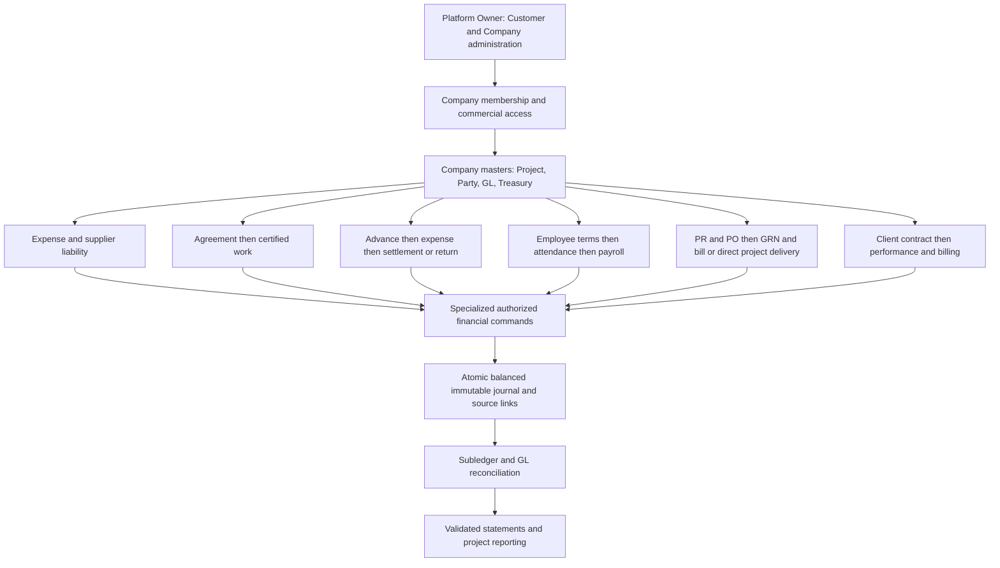

## 2026-11-11 — Maker historical outgoing review; local workflow corrections verified; real preparation/posting blocked by session and evidence

Owner reports89 and financial-date correction LIVE; GitHub main confirmed at5c0bfd0f98973f5c634579cf254a8f7eee8f827c. Current exact-target read-only capture:370 sources,345 General and25 separate Payroll sources;330 General outgoing records examined, all PENDING.168 have imported non-NEEDS_REVIEW natures, which are proposals rather than newly verified classifications. No existing Maker journals, Expenses, source drafts, certifications, contractor payments/advances, employee-advance postings or inventory movements were found in the relevant canonical capture. No captured source is thereby a posted financial transaction.

Evidence workpaper covers all330 exact IDs/amounts/provenance and specific unresolved requirements. Four contractor sources (AED26,500 total claims) match actual identities: Electrical2/AED16,500 also match the existing contract notes and Project; Stone2/AED10,000 match Al Sajour but no Stone contract/certification exists. PROMPT contract exists with no matched outgoing payment. Neither advance-vs-certified settlement nor retention/VAT/payment evidence is invented.3 flagged duplicate pairs retained;18 outgoing dates unconfirmed;122 outgoing Treasury sources unconfirmed. Other-entity/materials/asset/employee/partner items remain review proposals, not invented Company expenses or intercompany balances.

Standing Product Owner authorization permits real postings only through an existing authenticated Maker accountant session and only with all evidence/mapping/funding/period/uniqueness requirements satisfied. Exact proposed financial batch is **EMPTY:0 transactions, AED0.00,0 journals,0 expected GL/Treasury/Custody/Contract/Project movement**. No authenticated Maker accountant session is available; the administrative connection was used only in read-only transactions and never to impersonate an actor.330 audited nonfinancial note-save packets and14 incomplete canonical draft-save packets are prepared privately but NOT executed. Actual new classifications, source edits, drafts, links, approvals, postings and corrections:0. Historical operational completion remains BLOCKED on genuine credentials/evidence; no extra routine approval is requested. Posted corrections still need separate exact authorization.

Demonstrated generic defects fixed locally: reviewed source formerly appeared as Draft without a canonical document; approved documents were merged with reviewed states and unavailable as distinct filters; source detail/filter/EN/AR exports now show separate lifecycle and specific review requirements; linked Expense guidance now directs classification errors to existing86 atomic funding-neutral correction instead of suggesting standalone reversal plus New Expense. Affected assignment/history date displays remain numeric. Existing accounting commands, role/Company boundaries, private primitives, RLS/grants and immutable journals are reused unchanged.

Focused41 checks PASS:16 readiness/report,8 synthetic cumulative100→200m²/two-installment/idempotency/accounting/authorization/traceability,13 actual-component browser and4 actual bilingual export artifacts. Production build/typecheck, focused zero-error lint (existing lifecycle warnings), production boundary and diff/secret checks PASS. Prior source/HR/Inventory/Custody/personal-funding/reclassification evidence reused; no broad audit or unrelated completed suite repeated. Necessary schema changes: NONE; canonical89 migrations unchanged, current hosted versions/names align; no migration applied, push or deploy.

Local workflow implementation/testing/security boundary/database compatibility/documentation VERIFIED; real data classification/draft/posting execution BLOCKED on authenticated operator/evidence, not marked complete. Publication/live operator acceptance and final Maker operating acceptance DEFERRED; real financial execution NOT PERFORMED. Recorded Main Cash GL movement is zero; no certified opening/physical cash or complete Custody balance is inferred. Next: resolve the specific operator packet holds and complete Maker operational acceptance → Green, Villa13 and Al Mazraa through the correct Super Admin entity model → the entire original commercial ERP roadmap/all35 requirement families. Preserve deferred commercial, fiscal/statutory, security/operations/DR/USB requirements; no competing roadmap.

[Implementation, evidence and boundaries](docs/MAKER_FINANCIAL_OPERATIONS.md); [sanitized verification](docs/maker-financial-operations-verification.json). Exact business-data workpapers remain local/ignored.

## 2026-11-11 — Financial transaction dates and monthly reporting corrected locally; publication pending

Current release base is GitHub main89 `a01def446424ef7a71951bb03efc9598850f15c8`. Existing local activation evidence records89 APPLIED/preservation PASS;83–88 frontend LIVE is owner-reported. This checkpoint makes no new Vercel89/live acceptance claim. Older prepared-migration statuses below are historical.

Imported financial lists, overview and financial-dashboard monthly metrics now default to authoritative transaction-date months; missing/invalid/ambiguous dates stay in **بدون تاريخ مؤكد / Without a confirmed date**. Worksheet grouping is explicitly import-provenance analysis only. Original worksheet/file/source IDs remain separate, including exports. Numeric **DD/MM/YYYY** formatting covers affected source/detail, Expense, Treasury/Custody, Contract/payment and Project/GL report surfaces and bilingual Excel/PDF. Calendar formatting performs no timezone conversion. Canonical journal posting-date filters/accounting periods and Payroll salary-period rules remain unchanged.

Read-only Maker capture:370 sources (345 General +25 Payroll),2 General worksheet/date-month mismatches (September worksheet → August transaction month),25 General sources without valid confirmed dates. All320 valid normalized ISO source evidence comparisons agree; no supported data correction proposed or executed. Exact affected IDs are retained in a local operator impact preview, outside the publishable release. Requested October→November and September→October transitions pass synthetic acceptance cases. No reimport, source mutation, journal rewrite, payment, Company move or hosted business command.

Focused verification:23 date/report checks,12 actual-component browser checks and4 bilingual export-artifact checks PASS; Production build, typecheck, focused lint (zero errors; existing lifecycle warnings), production boundary and diff/secret checks PASS. Read-only exact-target canonical1–89 version/name/SQL alignment PASS; all89 migration files unchanged. **No migration required/prepared/applied.** No push or deployment.

Business/date reporting, affected authorization boundary, database compatibility, focused verification and documentation: VERIFIED locally. Schema/accounting-command changes: NOT APPLICABLE. Publication/live operator acceptance, evidence review of25 undated sources and final operational acceptance: DEFERRED. Any later Production working-date correction requires a scoped impact preview, explicit approval and the existing authorized audited workflow; immutable source facts/posted dates remain protected.

Next action: owner publishes this isolated frontend correction, then Maker operational accounting/date review and acceptance → Green, Villa13 and Al Mazraa via the appropriate Super Admin accounting-entity model → the complete remaining original commercial ERP roadmap. Preserve all35 requirement families, Procurement/Inventory, AR/AP, statements/fiscal closing, construction/WIP, advancedHR/WPS, subscriptions, security/operations and deferred final disaster recovery/USB work. No completed audit or unrelated suite reopened.

[Scope, evidence and release procedure](docs/FINANCIAL_DATE_REPORTING_CORRECTION.md); [focused verification](docs/financial-date-reporting-verification.json).

## 2026-11-06 — Maker operational HR/payroll/reporting completion implemented locally;89 pending

Product Owner reports83–88 APPLIED and frontend releases LIVE. Existing84 Employee master, effective employment/policy/attendance, canonical Payroll calculation/review/accrual/payment/reversal,85 source-linked employee advances/recovery and GL/Project reports are reused. No parallel Employee, Payroll, financial engine or role model. Registration/terms/attendance do not create salary cost; accrual creates it once, recovery settles an employee receivable, and salary payment creates no second expense.

Demonstrated88 defect: recovery's salary-payable debit omitted its entitlement Project, leaving offsetting Project/unallocated balances after full payment. Prepared89 derives that dimension from the same authoritative entitlement as accrual/payment. No old journal rewrite/backfill. Other corrections: confirmed HR rejection unlocks editing; uncertain requests remain frozen across reload with identical retry; Attendance links to Employees; explicit payroll register separates earned cost/recovery/net cash with dynamic15-column EN/AR Excel/PDF, preserving13-column Lite; authorized current advance/recovery export distinguishes actual balances from proposed plans. Viewer keeps salary-free directory and read-only permitted reports; confidential payroll/terms/journals remain restricted. Treasury's Viewer coverage remains explicitly partial; no confidentiality policy is weakened.

Focused62 checks PASS:35 lifecycle/accounting/report/authorization/compatibility cases,5 native concurrency,16 actual UI and6 actual Excel/PDF artifact checks. Complete synthetic Employee→Terms→Attendance→Payroll→Approval→Accrual→Payment→GL→Reports cycle, ordinary/source advances, recovery without duplicate cost/cash, exact Project payable closure, reversals, Contract/Custody preservation and Accountant/Viewer boundaries verified. No broad audit or unrelated suite repeated. Production build/focused lint and release checks are recorded in the verification artifact.

Canonical89 `20261106160000_payroll_recovery_project_dimension.sql` PREPARED / NOT APPLIED. Read-only exact-target/history check verifies canonical1–88 SQL/names/versions and main88 `d321f3fe`; linked dry-run lists ONLY89. Targeted hosted aggregate found0 recoveries/0 dimension mismatches; no historical repair or real Maker mutation performed. No hosted business command, migration application, push or deployment. Isolated candidate is based directly on88 in `/tmp/narvo-maker-operational-release-20261106`. Explicit89 target authorization and fresh activation/preservation checks must precede owner publication; prior88 authorization is not reusable for89.

Supported local business/accounting, focused security/authorization, database design, verification and documentation VERIFIED;89 hosted activation, frontend publication and genuine live/operator acceptance DEFERRED; hosted business execution NOT APPLICABLE. Real Company policy/employment/attendance/opening/source evidence is not fabricated or certified by synthetic tests. Existing Viewer-report coverage restrictions and advanced legal HR/WPS, fiscal statements/closing/WIP, security/operations/final audit/DR requirements remain deferred. Restore/USB remain deferred and were not reopened.

Next after release and Maker operational acceptance: Green, Villa13 and Al Mazraa onboarding through the appropriate Super Admin accounting-entity model → entire remaining original commercial NARVO ERP roadmap. All35 requirement families, completed features and deferred obligations remain preserved. Older prepared88/publication-pending direction below is historical and superseded by the owner's83–88 live report.

[Implementation and readiness boundaries](docs/MAKER_OPERATIONAL_COMPLETION.md); [focused verification](docs/maker-operational-completion-verification.json).

## 2026-11-06 — Inventory and Materials ManagementV1 implemented locally;88 pending

Product Owner reports83–87 APPLIED and frontend releases LIVE. Bounded InventoryV1 now reuses the canonical GL, Supplier invoices/payments, Treasury/Custody/source records, Project cost mapping/reporting, audited corrections and Company/permission controls. Material/UOM/conversion/category/status/reorder masters and Company/Project warehouses have audit history. Editable draft→review→post receiving, consumption, transfers, original-issue returns, physical counts, approved adjustments, unrecognized physical openings and exact existing-invoice capitalization/matching are implemented with bilingual sidebar/workspaces/Excel/PDF.

Perpetual moving average by Company/material/location uses BIGINT base micro-quantities and minor-unit values. Stock quantity/value and canonical inventory GL reconcile at every command. Receiving is separate from invoice/payment; consumption creates Project/Company cost without another cash outflow. Current-period eligible existing cost is capitalized once without changing original posted lines, payment or canonical Input VAT. New accrued-receipt invoices use existing canonical Supplier invoice creation and matching atomically, preserving actual VAT with no committed second cost. Unpaid corrections reverse both legs atomically; paid invoices retain existing settlement dependencies. Existing Supplier payment settles gross once. Historical source/Expense pickers and immutable purchase references never reimport sources or invent remaining stock. Unsupported prior-period/partial/multi-material invoice conversions remain reference-only/blocked. Negative stock, stale review/counts, duplicate requests/source receipts, UUID-case bypass, over-returns and concurrent over-issues reject; correction reversals respect dependencies. Foreman identity grants no financial permission.

Focused71 database/accounting/integration checks,6 independent native PostgreSQL concurrency cases and28 actual-component UI checks cover100 received→40 issued→60 bags remaining, stock/GL reconciliation, AP/VAT preservation, source history, returns/rounding/reversals, counts/approved gain/loss, authorization/tenant boundaries, masters/warehouses, bilingual mobile/exports and frozen retry/session changes. Build and focused lint are recorded in verification evidence; no completed broad audit or unrelated suite repeated.

Additive88 `20261106150000_inventory_materials_v1.sql` PREPARED / NOT APPLIED. Exact shared target `eqnzueginpkskbnqvgoc`, canonical1–87 SQL/names/versions and main87 `f30ee525` align; read-only linked dry-run lists ONLY88. No real Maker mutation, hosted business command/fixture, schema application, push or deployment. Explicit88 target authorization and fresh preservation preflight/activation/postflight must precede owner publication. Isolated release is based directly on87 in `/tmp/narvo-inventory-v1-release-20261106`.

Supported local business/accounting, focused security/authorization, database, verification and documentation VERIFIED;88 hosted activation, frontend publication and genuine live/operator acceptance DEFERRED; hosted financial execution NOT APPLICABLE. This does not complete advanced Procurement/Inventory, NRV/WIP/landed-cost/supplier-credit-note policies, prior-period cutover, complete statements or final readiness. No historical financial rewrite; restore/USB remain deferred and were not reopened.

Next after InventoryV1 release/acceptance: remaining Maker Employee/Attendance/Payroll, financial reports, permissions and operational acceptance → Green, Villa13 and Al Mazraa through the appropriate Super Admin accounting-entity model → complete the original commercial NARVO ERP roadmap, including advanced Procurement/Inventory, AR/AP, statements, fiscal closing, construction/WIP, advancedHR/WPS, subscriptions, security and operations/final readiness. All35 original requirement families and completed features remain preserved; older next-Inventory/prepared87 statements below are historical.

[Inventory implementation, accounting scope and lifecycle](docs/INVENTORY_MATERIALS_V1.md); [focused verification](docs/inventory-materials-verification.json).

## 2026-11-06 — Maker operational integration implemented locally;87 pending

Product Owner reports83–86 APPLIED and their frontend releases LIVE. This checkpoint completes the supported local Treasury/Bank, Custody/funding, Project-cost and Contract settlement integration milestone using existing canonical commands. Demonstrated fixes: reimbursement Project/document/GL consistency; direct Partner funding in Custody history without fictional Treasury; contract advances in operational history; accounting-only86 correction pairs distinguished from funding receipts/payments and physical payment history across reports/EN/AR exports. Journals and source truth remain immutable; Company/role/payroll boundaries remain authoritative.

Focused44 database/allocation checks,4 native PostgreSQL concurrency cases and14 actual-component browser checks PASS; Production build PASS; focused lint zero errors/three existing non-blocking lifecycle warnings. Existing83 source expenses,85 settlements,86 corrections, personal reimbursement, shared Project allocation, balances and no duplicate cost/cash effects verified in disposable synthetic fixtures. No real Maker data mutation, hosted business command, broad audit, push or deployment.

Additive87 `20261106140000_operational_financial_integration.sql` PREPARED / NOT APPLIED. Exact hosted target `eqnzueginpkskbnqvgoc` and canonical1–86 SQL/names/versions align; current GitHub main is86 `fc9138d6`; linked read-only dry-run lists ONLY87. Explicit87 target authorization and fresh preservation preflight/activation/postflight must precede owner publication. Isolated release is based directly on86 in `/tmp/narvo-operational-integration-release-20261106`. Earlier86 publication-pending notes are superseded by the Product Owner live report; this does not independently claim fresh Vercel acceptance.

Supported local accounting/security/database/testing/documentation VERIFIED;87 activation, frontend release and live operator acceptance DEFERRED; hosted financial execution NOT APPLICABLE. Contract creation/payment retains real Treasury/Cash/Bank scope; unsupported Custody/personal contract payments and existing86 prior-period/tax/reconciled/split policies remain specialized/blocked. Reports remain GL/permission scoped, not bank/physical cash certification or complete statements. No historical rewrite. Restore/USB remain deferred.

**Latest approved sequence:** release/accept this milestone → **Materials, Inventory and Warehouse Management V1** (catalog/UOM; warehouses/Project locations; receipts/issues/transfers/returns; counts; stock history/balances; historical purchase references; valuation and GL/Project-cost integration without recognizing previously posted material purchases twice) → remaining Maker Employee/Attendance/Payroll operations and reporting/permissions/operational acceptance → Green, Villa13 and Al Mazraa onboarding through the appropriate Super Admin entity model → complete the remaining commercial NARVO ERP roadmap. Earlier next-onboarding sequencing is superseded. Preserve all original commercial Procurement, Inventory, AR/AP, statements, fiscal closing, construction accounting, advancedHR/WPS, subscriptions, security and operational requirements and all35 requirement families.

[Implementation/scope/lifecycle](docs/OPERATIONAL_FINANCIAL_INTEGRATION.md); [focused verification](docs/operational-financial-integration-verification.json). Earlier dated checkpoints below remain historical evidence.

## 2026-11-06 — Priority2 transaction reclassification implemented locally;86 pending

Product Owner reports83–85 APPLIED and LIVE. Priority2 now provides audited unposted routing across Operating Expense, Project Cost, contractor payment/advance, Employee advance, Custody/Treasury, Supplier and other existing financial destinations. Existing83/85 draft claims cancel atomically, preserving raw sources, amounts/dates/attachments/history and requiring fresh source review; routing creates no financial effect.

Posted whole-document correction uses saved/reviewed/Admin-approved plans and canonical atomic reversal/replacement, deriving original amount/funding and enforcing zero net change per funding account/location/holder. AED5,000 Operating Expense→existing contractor liability removes the wrong expense and settles payable without another cash outflow. Original journal lines and first physical payment history remain; source→approval→reversal→replacement trace, exact retry, concurrency, period controls, dependency and persistent HR confidentiality boundaries are enforced. Existing direct allocation and specialized Payroll corrections remain intact.

Supported execution is current-period/today/open-period, zero-VAT, unsplit, verified unreconciled scope. Prior/closed-period, VAT/reconciled/split/dependent/unsupported funding cases stay blocked or specialized; one selected liability per payment. Treasury/other routing does not invent financial events or missing commands. Broader financial, commercial, security and operations obligations remain preserved, including all35 requirement families.

Canonical86 `20261106130000_source_transaction_reclassification.sql` PREPARED / NOT APPLIED. Focused63 DB/5 native concurrency/15 source-drawer browser checks PASS; build PASS; focused lint zero errors/eight non-blocking warnings. Read-only canonical1–85 alignment and sole86 linked dry-run recorded. No real Maker data mutation, hosted fixture/schema application, broad audit, push or deployment; restore/USB remain deferred.

[Scope, policy and lifecycle](docs/SOURCE_TRANSACTION_RECLASSIFICATION.md); [focused evidence](docs/source-reclassification-verification.json). Supported local business/security/DB/testing/documentation VERIFIED;86 activation, frontend release and genuine live acceptance DEFERRED. Isolated release is based on85 in `/tmp/narvo-reclassification-release-20261106`; explicit86 activation/preservation must precede owner publication. After acceptance, next Maker priority3 is Super Admin onboarding for Maker, Green, Villa13 and Al Mazraa. Earlier priority2-not-started/next-step statements below are historical.

## 2026-11-06 — Source-linked contractor settlement / Employee advance increment prepared (85 LOCAL)

Product Owner reports83/84 APPLIED and both frontend releases LIVE on Vercel Production. Fresh READ-ONLY release preparation confirms GitHub main `b084dcc` and exact hosted canonical1–84 alignment; no independent fresh Vercel/browser-live acceptance claimed. This supersedes earlier83/84 publication-pending notes below for owner-reported live status.

Maker priority1 now has versioned source-linked contractor payable settlement/advances and Employee advances, exact existing-document matching without new cash, Company/contract/Project/Treasury validation, duplicate fencing, audited draft→review→approval→posting, source/document/journal lineage, and existing Employee recovery planning/posting/reversal traceability. Reuses canonical Contracts/HR/GL commands; no duplicate work/payroll cost, generic journal endpoint or new subledger. Incomplete source records remain editable; posted truth stays immutable. Existing Custody semantics are preserved, with no fictional Treasury transfer for unsupported payer modes.

Canonical85 `20261106120000_source_settlement_workflows.sql` is PREPARED / NOT APPLIED; read-only linked dry-run lists only85. Focused evidence:47 isolated database checks,4 real native concurrency cases,14 actual source-drawer browser checks PASS; build PASS; focused lint zero errors/two non-blocking warnings. No Maker financial/employee/business mutation, hosted fixture/schema change, push or deployment. Earlier completed suites/full audits were not repeated; restore/USB remain deferred.

Scope limits remain explicit: one whole source/document and one selected certified liability per source payment; Treasury-funded creation or exact existing-document matching; Employee recovery uses the existing approved Payroll cycle, not a second cash/expense command. Multi-source/multi-certificate matching, new Custody/personal-funded command variants and cash employee repayment remain deferred, with warnings. Broader Procurement/Inventory/AR/AP/statements/fiscal closing/construction/advanced HR/WPS/subscription/security/operations obligations and all35 requirement families are preserved.

Evidence and lifecycle: [source workflow phase record](docs/SOURCE_SETTLEMENT_WORKFLOWS.md), [focused verification](docs/source-settlement-verification.json). Supported business/security/local DB/testing/documentation VERIFIED;85 activation, frontend release and genuine operational acceptance DEFERRED. Isolated release is based directly on b084dcc in `/tmp/narvo-source-settlements-release-20261106`; explicit85 activation/preservation and successful postflight must precede owner publication. No automatic push/deployment. After release/acceptance, next approved implementation: priority2 pre-posting reclassification and audited posted corrections; retain the disclosed priority1 integration limits.

## 2026-11-06 — Employee master management implemented locally; migration84 pending

Dedicated `/employees` list/search/registration/profile/details/status and scoped employment/history workspace now reuse Company Parties/person roles, dated HR terms, existing Payroll profile editor, Attendance, payroll entitlement history and employee advance commands. Dashboard Employee card and People sidebar now point to the actual route; Attendance/Payroll remain. Name plus audit reason suffice for registration; no salary, legal ID, Project or payroll cutover is invented. Admin manages; Accountant has authorized HR reads; Viewer receives only salary-free directory with no confidential HR requests. Metadata/terms changes are audited; duplicate/retry/optimistic/Company guards and exact existing payroll semantics preserved. No financial journal from registration or terms.

Additive84 `20261106110000_employee_master_management.sql` is LOCAL / NOT APPLIED. Hosted83 verified; GitHub main76298d5 and the historical served app still lack verified83 frontend publication. HR is a separate candidate based on reviewed03df444; first complete83 publication/acceptance, then explicitly authorize84 activation/preservation postflight before publishing HR. No Maker employee/payroll mutation, hosted migration, import, financial posting, push or deployment occurred. Earlier83 release worktree and all unrelated dirty development work are preserved. Restore/USB drills remain explicitly deferred until BOTH roadmaps complete.

Focused evidence:28 database/two native concurrency/16 browser checks and Production build PASS; lint zero errors/one known warning. See `docs/EMPLOYEE_MASTER_MANAGEMENT.md` and `docs/employee-master-verification.json` for exact checks and lifecycle status. Locally implemented is not Production available. Broader legal/statutory HR, WPS and prior advanced deferrals remain incomplete; no entire HR-roadmap completion claimed.

## 2026-11-06 — Imported sources to canonical original-cost drafts (local)

Implemented the bounded original-cost workflow using existing Expense drafting, review, posting, journals and reversals: create or link an unposted draft; progressive completion; owner/payment/distinct-cost attestations; duplicate evidence; atomic cash, Bank, Custody or personal-liability posting; source/document/journal/report lineage. Existing draft linking invalidates prior review. Cancelled unposted claims retain history. Management Viewer remains read-only; generic/legacy entry points cannot bypass a source claim. Project Bank payment metadata is corrected forward.

Migration83 `20261105140000_historical_source_expense_drafts.sql` is LOCAL ONLY / NOT APPLIED. Hosted82 and Maker345 General sources (122 supplemental) were read-only verified; no real conversions, journals or business writes occurred. Deployment is NOT authorized or performed. Matching frontend publication requires separate83 activation approval and successful preservation postflight. GitHub main76298d5 was verified; Vercel was not independently verified.

Original-cost accounting/authorization/DB invariants are VERIFIED locally; broader automatic non-cost binding, partial/multiple-source documents and unsupported asset treatment are DEFERRED. Existing contractor settlement, HR advance, Custody and Partner commands remain specialized handoffs, not newly integrated source documents. Actual Maker posting still requires ownership, date, payer, classification, duplicate clearance and evidence; no posting batch is approved. Focused verification: 51 database checks, 5 native concurrency scenarios and 15 browser checks PASS; Production build PASS; focused lint zero errors (six warnings). See `docs/IMPORTED_SOURCE_CANONICAL_DOCUMENTS.md` and `docs/source-document-verification.json` for focused evidence and limitations. Full go-live/security/DR acceptance remains separate.

## 2026-11-05 — Source review operator UI correction prepared; no financial posting

Fresh read-only source/financial preservation PASS:345 General sources, including122 pending supplemental records, unchanged. Bounded UI fixes cover unconfirmed payment status, visible duplicate/candidate navigation, filename search, current module-review links and readable nested evidence. No accounting logic, tenant authorization, RLS, migration, Company configuration, actual source completion or posting changed. Private122-row operator queue prepared; zero new canonical Expense drafts, zero accounting-ready transactions and zero posted amount. Existing evidence/ownership/funding holds remain. Local build PASS; focused actual-component checks and isolated owner-push release recorded separately. No automatic push/deployment; authenticated Production operator acceptance remains pending. See [operator readiness](docs/SOURCE_REVIEW_OPERATOR_READINESS.md).

## 2026-11-05 — FOUNDATION82 APPLIED / PRESERVATION VERIFIED / OWNER PUBLICATION PENDING

Canonical82 `20261105130000_existing_company_accounting_setup.sql` (SHA256 `2b908163a0d8dbde7155df45b823b3eaaf4b47b686e7f72e6dd3149aae6145f2`) was applied only to `eqnzueginpkskbnqvgoc` at 2026-11-05T14:49:49.469685+00:00. Actual hosted history1–82 and setup schema were re-read before resuming;82 was not reapplied. Strict read-only postflight PASS at 2026-11-05T15:38:13.623301+00:00: all85 existing financial/business/access/Auth/MFA/Owner/HR tables and complete per-identity Auth hashes preserved against the explicitly approved separate current baseline. Existing functions/grants/guards and payroll confidentiality remain intact; journals balance, Treasury journal lines are unchanged, new setup table empty. No Maker configuration, opening, journal, transfer, historical rewrite or Excel import occurred.

The Product Owner explicitly approved the independent current-preservation criterion in `docs/MIGRATION82_PRESERVATION_DECISION.md`. Original historical Auth fingerprint/discrepancy remain unchanged and NOT RECOVERABLE FROM AVAILABLE EVIDENCE; current integrity is not represented as proof of that historical delta. A separate timestamp-only change during fresh capture was exactly classified and corroborated by same-account successful refresh logs before baseline acceptance. Immediate and resumed postflight retained full Auth equality; no material or unexplained new drift was accepted.

Previously verified47 database/five native concurrency/ten bilingual browser/build/focused lint evidence reused; application/SQL unchanged. One reviewed isolated release is prepared in `/tmp/narvo-foundation82-release-20261105` on verified GitHub main `e7fa1a83df0ff42ca9e1d8b98a4af5db5b8a8845`; owner performs the normal push and Vercel Production acceptance. Source branch/unrelated dirty work preserved. No push/deployment claimed. Backup75 integrity is verified but predates82 and restoration remains untested; existing final audit/DR gates remain deferred. Both confirmed setup software gaps are implemented/hosted-enabled; actual Company mappings/evidence remain P1. Recommend closing Phase1 after successful matching Production publication/acceptance, then separately authorized Excel preparation. Earlier blocked/local-only entries below are historical.

## 2026-11-05 — Existing-Company foundation / Treasury fix locally verified;82 activation BLOCKED

The confirmed readiness P0-01/02 now have bounded local implementations in authenticated Accounts/Treasury screens: explicit approved canonical controls or unused eligible account adoption; atomic additional Cash/Bank GL provisioning through the existing Treasury command. Existing keys/used accounts, amounts, periods, journals, financial commands and payroll privacy are preserved.47 isolated DB checks, five real native concurrency scenarios, ten bilingual browser checks, Production build/focused lint/secret/whitespace checks PASS. No Company data was configured.

Canonical82 `20261105130000_existing_company_accounting_setup.sql` is LOCAL/NOT APPLIED. Read-only hosted1–81/six dependencies/backup ciphertext integrity and fresh85-table preservation baseline verified. Automatic approval review rejected the migration process before execution because it requires direct user authorization for82 on the shared project; no bypass/retry, hosted schema/business write,82 postflight, release commit, push or deployment. Current verified GitHub main is e7fa1a83df0ff42ca9e1d8b98a4af5db5b8a8845; isolated uncommitted candidate /tmp/narvo-foundation82-release-20261105. Direct82 approval → fresh mandatory preflight → sole82 activation → read-only postflight → isolated commit → owner push/Vercel acceptance remain required. Recommend Phase1 closure only after successful publication and acceptance; no Maker Excel work begun. Full DR remains deferred, backup75 is not a current82 recovery point and restoration remains untested. See `docs/EXISTING_COMPANY_ACCOUNTING_SETUP.md` and `docs/company-accounting-setup-verification.json`.

**2026-11-05 — OPERATIONAL EXPENSE LIFECYCLE: MIGRATION80 APPLIED / HOSTED POSTFLIGHT VERIFIED; FRONTEND PENDING OWNER PUSH.** Product Owner authorized exact canonical80 (`20261105110000_operational_expense_drafts.sql`, SHA256 `e4895288bb829714c77580907b2affa775615c4b7a79a2c82bc5479e1082da41`). Isolated Supabase CLI applied only80 to `eqnzueginpkskbnqvgoc`; canonical1–80 versions/names/SQL align and no migration remains pending. Focused READ-ONLY postflight:55 existing financial/business/access/MFA/profile/Owner table fingerprints unchanged, balanced journals, Maker legacy access retained, new draft table empty, forced RLS/immutability/minimal grants/exact new function bodies and all14 direct dependencies/old guards verified. A concurrent Auth user-row fingerprint change is separately disclosed: account count290, availability, memberships and protected access remain intact; cause is not attributed and full Auth hash equality is not claimed. Existing43 database/five native concurrency/13 browser/eight bilingual export/build checks reused; application/migration bytes unchanged. One isolated local commit is prepared on current GitHub main652bc37 for the owner's authenticated normal push; no GitHub push/Vercel deployment is performed or claimed. Existing backup75 ciphertext integrity/scope verified; restoration untested under the unchanged risk-based policy. Asset/inventory recognition, full fiscal close and final operational/security/DR acceptance remain deferred. Earlier80-local checkpoints below are historical and superseded for hosted activation only. [Actual release and owner handoff](docs/OPERATIONAL_EXPENSE_RELEASE.md).

**2026-11-05 — MAKER GO-LIVE PHASE1 / ESSENTIAL EXPENSES: SCOPED LOCAL IMPLEMENTATION; MIGRATION80 REQUIRED / UNAPPLIED.** Development is safely aligned with fetched published GitHub main `652bc37ba372bf4fa8bbf454da0bba921f5758fa`; prior working-file bytes preserved. Existing Treasury/Custody/Supplier Credit/personal reimbursement posting, journals, reversals, allocations and reports are reused. Expenses now adds durable incomplete source capture, versioned edits, explicit evidence review and net/VAT/gross preview, once-only canonical posting, cancellation and same-request recovery. Review/edits create no financial posting; original source/invoice duplication, exact money, active accountant authority, Company RLS and immutable history remain enforced. Project-cost UI/Excel/PDF exposes category/code, payment source and supporting references without changing journal-derived totals. Asset/inventory, contract costs/payments, Partner withdrawals and custody transfers cannot post as ordinary expenses; unsupported cases remain draft-only. Hosted canonical1–79 SQL alignment and read-only linked dry-run listing only80 verified. Migration80 is local only; no hosted business write, commit, push or deployment. Published GitHub79 baseline supersedes earlier frontend-pending79 checkpoints for Git publication only; Vercel was not re-verified. 43 isolated database checks, five independent native PostgreSQL concurrency checks,13 actual browser checks and eight EN/AR XLSX/PDF artifact inspections PASS. Production build and251-module production-data boundary PASS; focused lint has zero errors and three documented informational lifecycle-effect warnings. Actual focused checks and supported/deferred boundaries: [Expense lifecycle](docs/OPERATIONAL_EXPENSE_LIFECYCLE.md), [verification](docs/expense-lifecycle-verification.json). General fiscal closing, asset workflows, final operational/security/DR validation and real-accounting/operator acceptance remain incomplete; broader M3 is not complete.

**2026-11-05 — PROJECTS & CONTRACTS: MIGRATION79 APPLIED / HOSTED PRESERVATION VERIFIED; FRONTEND PUBLICATION PENDING OWNER PUSH.** Product Owner authorized exact canonical `20261105100000_operational_subcontract_measurements.sql` (SHA256 `2dd8aaf3d9b72a6f1d6761f895b48a4cf7e7302784edae5fd0c674cf49661035`). Isolated Supabase CLI applied only79 to `eqnzueginpkskbnqvgoc`; hosted1–79 canonical versions/names/SQL align; no pending migration. Immediate READ-ONLY postflight preserves47 existing financial/business/contract/access/Auth table fingerprints; all four new tables are empty. Forced RLS, immutable evidence/receipts, minimal command/helper grants, invoker summary, exact approved function extensions and unchanged existing journal guards verified. Journals remain balanced and Maker legacy ready/unmanaged access remains intact. No hosted financial command, historical rewrite, data import, backfill or cleanup. Completed47 database/4 native race/11 browser/4 export/build checks reused without repetition; implementation SQL/application bytes unchanged. One reviewed isolated local package is based on current main ec1c945 for the owner's authenticated push; no push or new Vercel publication is performed/claimed. Secure attachments, advanced closure and unrelated legacy tax-policy work remain deferred, not blockers for this supported release. Backup75 integrity remains verified; restoration untested under the unchanged risk-based policy. Earlier79-local checkpoints below are historical and superseded for database activation only. [Actual release and owner handoff](docs/PROJECTS_CONTRACTS_RELEASE.md).

**2026-11-05 — MAKER GO-LIVE PHASE1 / PROJECTS AND CONTRACTS: SCOPED IMPLEMENTATION LOCAL; MIGRATION79 REQUIRED / UNAPPLIED.** Existing Project creation/edit/activation/lifecycle/history/cost reporting and canonical advance/certificate/payment/retention/reversal workflows are reused. Production contract operations now adds audited/versioned commercial amendments and closure, explicit uncapped signed unit-rate agreements (owner-approved policy), exact cumulative measurements into canonical unposted certificates, once-only existing approval/posting, safe draft withdrawal, and separate contract/work/input-VAT/retention/payable/payment/advance summaries with EN/AR Excel/PDF. Posted unit rates cannot be rewritten; signed additional items price future work only. Fixed-value caps, financial history, Company roles/RLS and Treasury/Custody/openings remain preserved. Hosted1–78 alignment and read-only dry-run listing only79 verified;79 remains local and this frontend is unpublished. Development branch safely aligned to published ec1c945 with all prior contents preserved; no new commit/push/deploy/hosted write. Legacy tax/deduction policy, secure binary documents, hybrid/retroactive repricing, uncapped-project final closure and wider M3/M4 remain incomplete. [Actual scope and verification](docs/MAKER_GOLIVE_PHASE1_CONTRACTS.md). Prior frontend-pending78 checkpoints below are historical; the owner now confirms ec1c945 Production baseline.

**2026-11-05 — CERTIFIED OPENINGS / CASH RECONCILIATION: MIGRATION78 APPLIED; HOSTED PRESERVATION POSTFLIGHT VERIFIED; FRONTEND PUBLICATION PENDING.** Product Owner explicitly authorized only canonical78 activation and an isolated local release commit for manual publication. Migration `20261105090000_certified_opening_cash_reconciliation.sql` (SHA256 `fc5304e36f0bb9a9c430b7eaf9b938ead45dab228628440a5293c0242c4865a0`) was applied individually to `eqnzueginpkskbnqvgoc` using the established isolated CLI workflow. Hosted1–78 canonical SQL matches;22 immediate financial/business/protected-access fingerprints are unchanged; seven new tables are empty; forced RLS, immutable evidence, constrained commands/helpers, invoker view and existing/new journal guards verified READ ONLY. Journals remain balanced and Maker legacy ready/unmanaged access is preserved. No hosted financial command, import, cleanup or historical-data mutation occurred. Existing local tests/build are reused because application and migration source are unchanged. Local release is prepared from current GitHub main945b725 for the owner's push; no push or new Vercel deployment is performed/claimed. Backup75 integrity remains verified, restoration untested/deferred under the explicit risk-based policy. Hosted operator acceptance, supported-scope limits and final disaster-recovery verification remain separate. Earlier78 LOCAL ONLY/unapplied checkpoints below are historical and superseded for database activation only. [Actual release record](docs/CERTIFIED_OPENINGS_RELEASE.md).

**2026-11-05 — FIN-03 / CUS-03: SCOPED CERTIFIED OPENINGS AND PHYSICAL CASH RECONCILIATION IMPLEMENTED / LOCALLY VERIFIED; MIGRATION78 LOCAL ONLY.** Treasury Accounts now provides evidenced target-versus-posted opening review, explicit Accounting Admin confirmation, balanced delta journals or zero-delta certification, duplicate/stale/cutover guards and controlled pre-dependency reversals. Configured Treasury, holder Custody, Partner current/capital/loan and supported ordinary balance-sheet positions are covered; opening-loan principal payments/reversals preserve separate obligations. Timestamped counts retain physical/GL amounts and differences separately; append-only reviews cannot auto-post shortages, and changed dated GL invalidates matches. Actual Treasury/Custody reports separate opening deltas from operating funding/receipts; EN/AR Excel/PDF and audit/outstanding-loan reports reuse existing infrastructure.32 focused SQL/business/report checks,7 native concurrency checks,14 browser checks and4 bilingual artifact inspections PASS; Production build and focused lint PASS (informational warnings recorded). Linked canonical77 alignment and read-only CLI dry-run showing only78 PASS. Migration78 is NOT hosted-applied; no hosted business write, commit, push, deployment or real Maker import. The owner reports preceding945b725 published; prior publication-blocker entries below are historical. Company-wide carry-forward/certification, consumed-opening forward corrections, general fiscal closing, bank matching and integrated operational acceptance remain incomplete. [Scope, limitations and evidence](docs/CERTIFIED_OPENINGS_AND_CASH_RECONCILIATION.md).

**2026-11-04 — FINANCIAL OPERATIONS DATABASE ACTIVATED / HOSTED POSTFLIGHT VERIFIED; FRONTEND PUBLICATION PENDING.** Product Owner explicitly authorized the active-development risk-based release policy and this release. Canonical76 `20261104180000_financial_operation_evidence` and77 `20261104190000_operational_liability_posting` were applied individually through isolated Supabase CLI packages to `eqnzueginpkskbnqvgoc`; each dry-run listed only its intended migration. Hosted77 canonical SQL, schema, RLS/grants/search paths, new money/invoice guards and empty new business/configuration tables verified READ ONLY. Existing financial/business/access records preserved; Maker legacy readiness remains ready/unmanaged. Existing negative balances were neither repaired nor rewritten; legitimate corrective inflows remain allowed and unfunded outflows remain blocked. Full restoration rehearsal is DEFERRED to final operational readiness by explicit owner policy; encrypted migration75 integrity/scope verified, recovery itself untested. Local suites retained; clean release-candidate build and Git/Vercel publication results are recorded separately in [release evidence](docs/FINANCIAL_OPERATIONS_RELEASE.md). No hosted financial command, cleanup, subscription or membership mutation was performed. Earlier LOCAL ONLY statements below are historical and superseded for76/77 hosted activation only.

**2026-11-04 — PRODUCT OWNER RELEASE POLICY UPDATE / FINANCIAL OPERATIONS ACTIVATION AUTHORIZED, NOT YET EXECUTED.** Ordinary active-development releases use risk-based recovery gates under AGENTS.md. Full restoration rehearsal is explicitly deferred to the final comprehensive operational-readiness/disaster-recovery milestone and must not be reinstated as an ordinary release prerequisite. Exact target/history/dependency/compatibility checks, focused accounting/authorization evidence, preservation, non-destructive migrations, backup integrity and read-only postflight remain mandatory. The encrypted migration75 backup has verified integrity/scope; actual restoration remains untested and no recovery guarantee is claimed. Product Owner explicitly authorized canonical76→77 and reviewed Git/main/existing Vercel publication subject to these gates. Actual results will be recorded below; this authorization is not deployment evidence.

**2026-11-04 — OPERATIONAL FINANCIAL INTEGRATION IMPLEMENTED / LOCALLY VERIFIED; MIGRATIONS76/77 LOCAL ONLY.** Classified capital, additional capital, explicitly configured Partner current accounts and documented loans now support actual Treasury or direct-holder funding; authorized current withdrawals/loan repayments and separate personal-cost recognition/reimbursement use canonical journals, bounded balances and reversals. Evidence-only unresolved categories do not block valid flows. Reused CUS-03/04 and Expense posting preserve once-only custody/cost recognition, Supplier/Project references and separate Partner/holder GL statements. A restricted AA control-account/configuration workflow, cross-workflow invoice protection and real database recorded-funds concurrency guards are included. Local accounting, native race, browser/export and build evidence is recorded in [Financial Operations Integration](docs/FINANCIAL_OPERATIONS_INTEGRATION.md). No hosted writes, migrations, frontend publication or Git publishing. Deployment requires recovery/impact/alignment/explicit approval; missing openings, capital returns/dividends, unsupported purchase types and complete physical/bank reconciliation remain separate gates. Earlier CASH-UI and reimbursement limitations below are historical and superseded only within this new local scope. The owner reports preceding CUS-03/04 already published; this increment is unpublished.

**OPERATIONAL GO-LIVE / CUS-04 — SUPPORTED BANK-FUNDED CUSTODY WORKSPACE IMPLEMENTED / LOCALLY VERIFIED; CASH-OUT ENTRY GATED.** Authenticated `/custody` now supports reviewed canonical funding, custody Expenses with VAT/Project or overhead, returns, uniqueness-based settlement recovery, authorized exact reversals, read-only history/journals and bilingual exports. Treasury Accounts adds dated visible GL movements with explicit missing-opening/Payroll-coverage limits. CUS-03 reads new postings unchanged; no parallel ledger. 27 isolated workflow/client checks, four native concurrency/dependency checks,25 browser checks and eight artifact inspections PASS; focused lint/build PASS. Migration NOT REQUIRED; no hosted change or frontend publication. Cash issuance/cash-return reversal await verified cash/opening/sufficiency controls; personal reimbursements, historical imports and wider M3/CON remain incomplete. [Supported scope, gates and evidence](docs/CUSTODY_OPERATIONS.md).

**OPERATIONAL GO-LIVE — IMMEDIATE PRIORITY; CUS-03 POSTED CUSTODY RECONCILIATION IMPLEMENTED / LOCALLY VERIFIED.** Treasury Accounts and Accounting Reports now provide accountable-holder/date/Project statements, exact posted opening/funding/spending/returns/closing, signed period differences, separate settlement status and bilingual Excel/PDF. Negative differences do not invent cash or employee liabilities; historical unknown movements remain separate. Blank August2026 evidence template creates no data. 22 isolated accounting/authorization checks,25 browser checks and five artifact inspections PASS; focused lint/build PASS. Migration NOT REQUIRED; no hosted changes or frontend publication. Next: safe accountant custody funding/Expense/return/settlement entry. Reimbursements, opening/import, Treasury cash sufficiency/reconciliation and remaining M3/CON remain incomplete/deferred. Migration75 and completed M3 work preserved. [Scope and evidence](docs/CUSTODY_RECONCILIATION.md).

**M3 / PRJ-01 — CONTROLLED ADMINISTRATIVE PROJECT CLOSURE IMPLEMENTED / LOCALLY VERIFIED; MIGRATION75 APPLIED / POSTFLIGHT VERIFIED.** Completed→Closed now requires fresh classified readiness, supported contract/financial-review evidence, reason/date, explicit responsibility confirmation and immutable retry-safe audit. Eligible unpaid Supplier/Subcontractor/retention/salary liabilities remain settleable; advances, incomplete work, pending sources/corrections and unsupported reconciliation cases block. Six database guards prevent new cost/assignment races after closure without changing existing posting/period functions or financial history. Canonical75, exact new bodies/guards/RLS and unchanged protected data/functions verified; zero hosted closure events. Bilingual readiness/decision Excel/PDF use existing design. Frontend/hosted operator acceptance and broader M3 remain incomplete. [Scope and evidence](docs/PROJECT_CLOSURE.md).

**M3 / PRJ-01 — CONTROLLED OPERATIONAL PROJECT LIFECYCLE IMPLEMENTED / LOCALLY VERIFIED; MIGRATION74 APPLIED / POSTFLIGHT VERIFIED.** Active→On Hold, On Hold→Active, Active→Completed and Completed→Active now require reason, immediate server date, fresh dependency review, explicit confirmation, normalized retry and immutable audit. Existing Project identity, Planning activation, financial/history/access/subscription behavior and lawful settlement remain intact. Closed transition remains blocked pending closure/reconciliation/reopen policy; no financial postings arise from status. Canonical74 aligned, protected fingerprints/old functions preserved, zero hosted lifecycle events. Bilingual lifecycle/dependency Excel/PDF reuse existing design. Frontend publication/hosted operator acceptance and wider M3 remain incomplete. [Implementation and evidence](docs/PROJECT_LIFECYCLE.md).

**M3 / CON-05 — SCOPED PARTY STATEMENTS IMPLEMENTED / LOCALLY VERIFIED; MIGRATION NOT REQUIRED.** Company reporting now derives separate account/Subcontract opening, activity, running and closing balances from authorized posted journals, with actual Project filters, detail-type filters, source/reversal traceability and bilingual Excel/PDF. Supplier, Subcontractor payable/advance/retention, custody and permitted salary/Owner GL coverage reuse canonical73 and existing RLS. Restricted Payroll, missing mappings and unsupported receivables remain unavailable rather than fabricated zero. No hosted change or frontend publication; broader CON/M3 remains incomplete. [Scope and evidence](docs/PARTY_STATEMENTS.md).

**M3 / CON-03–CON-05 — BUSINESS PARTY MASTER / CONTROLLED LIFECYCLE IMPLEMENTED / LOCALLY VERIFIED; MIGRATION73 APPLIED / POSTFLIGHT VERIFIED. Hosted canonical history73 aligned; original Party/contract/financial/access/subscription data and all previous function definitions unchanged.** Existing Supplier/Subcontractor identities now support optional legal/license/contact/country/terms metadata, reviewed duplicate warnings, reasoned deactivate/reactivate, immutable audit and safe retries. Existing obligations/retention remain settleable; a confirmed Supplier posting/deactivation race has a bounded insert guard. Bilingual register/detail exports and responsive controls reuse the existing product. Financial definitions/history, roles and Company RLS are preserved. Broader M3/CON and frontend publication remain incomplete. [Implementation and evidence](docs/PARTY_BUSINESS_MASTER_LIFECYCLE.md).

**M3 / PRJ-02–PRJ-03 — POSTED SPLIT-COST CORRECTIONS IMPLEMENTED / LOCALLY VERIFIED; MIGRATION72 APPLIED / POSTFLIGHT VERIFIED. Hosted canonical history72 aligned; protected accounting/access, administrators, subscriptions and unrelated functions unchanged.** Eligible originally allocated cash Expenses now support exact cash-neutral cost transfers through the existing correction review/receipt/reversal and Project-cost ledger. Both distributions and net effects are retained; original Expense, cash and posted history remain unchanged. 43 SQL, eight native concurrency, 19 browser and four bilingual artifact checks, focused lint and Production build PASS. No hosted business command or frontend publication. Wider M3 remains incomplete. [Scope and evidence](docs/POSTED_SPLIT_COST_CORRECTIONS.md).

**M3 / PRJ-02–PRJ-03 — PRE-POSTING SHARED-COST INTEGRATION IMPLEMENTED / LOCALLY VERIFIED; MIGRATION71 APPLIED / POSTFLIGHT VERIFIED. Hosted canonical history is aligned at 71; protected data, administrators, subscriptions and unrelated functions are unchanged.** Eligible unposted current-period cash sources now confirm versioned plans, require fresh source review and recognize one original Expense/journal with destination cost debits and one Treasury credit. The existing engine, exact rounding, source idempotency, RLS and reversal are reused; stale/changed/posting conflicts fail closed. 28 SQL, eight native lock schedules, 16 browser checks, eight bilingual artifact checks and focused client/build checks pass. Frontend remains local; no hosted financial command. Originally split posted-cost corrections, unsupported source types/periods and wider M3 remain incomplete. [Implementation and evidence](docs/PREPOSTING_SHARED_COST.md).

**M3 / PRJ-02–PRJ-03 — SHARED COST ALLOCATION IMPLEMENTED / LOCALLY VERIFIED; MIGRATION70 APPLIED.** Eligible current-period cash costs now support direct, percentage, quantity and documented indirect-driver allocation across Projects/Company overhead. Exact largest-remainder rounding conserves source cost; the existing correction receipts, period guards, audit, reversal and ledger are reused. Basis/support/approval and unreconciled evidence are required. 46 SQL, nine native concurrency,18 shared-browser,24 existing single-destination browser and four bilingual export checks, lint and Production build PASS. Linked history70 aligned; schema/grants and unchanged protected financial/access/subscription/function fingerprints verified, zero hosted allocation rows. Migration70 is additive and applied; no original financial/Auth/subscription function changes. Pre-posting split recognition, unsupported sources/corrections, general fiscal closing and wider M3 remain incomplete. Frontend publication and hosted operator acceptance deferred. [Implementation and evidence](docs/SHARED_COST_ALLOCATION.md).

**M3 / PRJ-02–PRJ-03 — MIXED-DESTINATION SOURCE ASSIGNMENT IMPLEMENTED / LOCALLY VERIFIED.** The existing source workspace now assigns different whole Expense sources to different Projects or explicit Company overhead in one reviewed atomic batch. Per-source before/after review, exact destination subtotals, stale-preview prevention and expanded bilingual proposal/audit exports reuse the existing command and event history. 13 canonical SQL integration and18 browser checks, exact-money/eligibility model checks, five export inspections, focused lint and Production build PASS. Migration NOT REQUIRED; migration69 is unchanged and not reapplied. No posted transaction or hosted data is modified. Split/indirect allocation, unsupported source types, period-policy expansion and wider M3 remain incomplete. Frontend publication and real operator hosted acceptance remain deferred. [Workflow and evidence](docs/SOURCE_PROJECT_ASSIGNMENT.md#mixed-destination-expansion--2026-11-03).

**M3 — BOUNDED PROJECT-COST CORRECTION EXECUTION IMPLEMENTED.** Existing reviews now support eligibility, accounting-effect confirmation, audited/idempotent posting and exact correction reversal for current-month, today-dated, unreconciled simple cash Expenses in an explicitly opened correction period. Balanced cost reclassification preserves original Expense/cash/settlements and total Company expense; posted Project-cost ledger and bilingual exports show actual correction dates/references. 43 local SQL, eight native concurrency and24 browser checks pass; bilingual Excel/PDF artifacts verified. Migration69 status: APPLIED; hosted/local histories aligned at69, forced RLS/minimal grants verified, protected financial/access/subscription/administrator rows and pre-existing function hashes unchanged, zero hosted correction/period/reversal rows. Existing protected rows/functions are checked before/after activation; no hosted financial fixture or correction is executed. General fiscal closing, prior-period/bank/settled/classification/split-allocation policies and wider M3 remain incomplete. Frontend not published. Earlier checkpoints below are historical. [Scope, limits and evidence](docs/PROJECT_COST_CORRECTION_EXECUTION.md).

**M3 — CORRECTION REVIEW/AUDIT IMPLEMENTED; MIGRATION68 APPLIED.** Added immutable versioned Expense correction proposals, original/proposed Project/date/reason/operator evidence, dependency snapshots, conflict/replay protection and ledger/bilingual export annotations. No financial correction is executed: method, effective-period and settled/reconciled-document policies remain DECISION REQUIRED. Expenses amount headers/values centered in both languages. 24 SQL, four native concurrency and26 browser checks pass. Linked hosted history now68; review schema/RLS and protected financial/access/subscription/function hashes verified unchanged, zero hosted review rows. Prior65–67 observed already applied; their workflow/release gates remain unverified. Frontend not deployed; wider M3 incomplete. [Scope and evidence](docs/EXPENSE_CORRECTION_REVIEWS.md).

**M3 — POSTED PROJECT-COST LEDGER IMPLEMENTED / LOCALLY VERIFIED.** Accounting Reports now reconciles posted expense-account debit/credit/net movement by Project/Company overhead and date, including Payroll/subcontract costs where authorized and reversals on their own dates. Complete journals, source/Project links, RLS and exact money are preserved; shared bilingual Excel/PDF exports use the displayed captured totals. 23 PostgreSQL/model and22 browser checks, bilingual export artifacts, focused lint and Production build pass; migration NOT REQUIRED. Wider M3, posted-correction/allocation/WIP policies and R0 release gates remain open. [Implementation/evidence](docs/PROJECT_COST_LEDGER.md).

**M3 / PRJ-02 — UNPOSTED SOURCE ASSIGNMENT IMPLEMENTED LOCALLY; MIGRATION REQUIRED.** Added explicit Project/Company-overhead batch selection, review/confirmation, immutable before/after audit, normalized same-key replay and atomic stale/tenant/role rejection. Assignment requires fresh source review; the existing posting form/wrapper preserves the mapping and uses the unchanged balanced expense engine. Bilingual Excel/PDF source-review exports included. Migration `20261103130000_source_project_assignment.sql` is local only (67 canonical files; hosted alignment/activation unperformed). Broader M3/F0 and R0 recovery/release gates remain open. [Implementation and local evidence](docs/SOURCE_PROJECT_ASSIGNMENT.md).

**M3 / PRJ-01 — LOCAL ACTIVATION INCREMENT VERIFIED; MIGRATION REQUIRED.** Implemented audited Planning→Active project activation with stale-state/tenant/role checks and duplicate-safe recovery. Existing Project IDs, financial links, accounting functions and themes preserved. 36 database, 16 browser and seven independent native concurrency checks pass; Production build/focused lint pass. Migration `20261103120000_project_activation.sql` is local only (66 local files; no fresh hosted alignment). Broader M3 and F0 policy decisions remain incomplete; R0 release/recovery gates and hosted activation/verification remain separate. [Implementation and evidence](docs/PROJECT_ACTIVATION.md).

**Product terminology — LOCAL VERIFIED.** Corrected 804 existing English/Arabic text values across the application and localized role displays. Financial summaries distinguish posted accounting from imported activity; Company/certificate/retention terminology aligned. Build and 35 preservation/localization check groups pass; seven bilingual UI routes verified locally. Themes, business rules, API identifiers and hosted data unchanged. [Implementation and file list](docs/PRODUCT_TERMINOLOGY.md).

**Targeted green/contrast correction — LOCAL VERIFIED.** Restored historical medium green `#087E68`; corrected sidebar cascade and month-header foreground/background pairs. Arabic RTL 1366×768: 92 focused checks across five themes pass; Production build passes. No layout, business, hosted, storage or deployment changes. [Correction details](docs/PREMIUM_ENTERPRISE_UI.md#targeted-greencontrast-correction--2026-11-03).

**Premium UI implementation — 2026-11-03: LOCAL IMPLEMENTATION VERIFIED.** Refined Signature Emerald replaces the heavy visual execution; five shared themes and persisted Appearance control are implemented in both consoles. Projects, Parties and Subcontracts have structured record layouts; shared module typography, tables, forms and surfaces updated. No business logic, SQL, hosted data or deployment changes. Earlier R0 candidate/visual checkpoints below are historical and do not include this update. [Scope and verification](docs/PREMIUM_ENTERPRISE_UI.md).

# NARVO ERP — Master Roadmap V2.0

**Latest R0 execution — 2026-11-02: LOCAL CANDIDATE READY / RESTORE GATE BLOCKED.** R0-5e27b3c79600 freezes276 reviewed files; clean Production build/source lint and focused49 SQL/20 browser/18 workspace/11 preactivation checks pass. Existing project credentials and CA enabled an actual streaming-encrypted database/roles backup, integrity-verified and stored privately outside Git. Isolated restoration remains unperformed because a compatible local server/container engine is absent. Static visual Preview is prepared/isolated; functional shared-DB Preview remains unsafe for no-write testing. Migration65, deployments and cleanup remain unexecuted; separate migration/promotion approvals still apply. [Current execution and precise next step](docs/R0_RELEASE_EXECUTION.md). Earlier backup-unavailable labels describe provider metadata or historical checkpoints, not the new local snapshot.

Date: 2026-11-02, Asia/Dubai. Latest update: authorized R0 read-only production-impact/recovery assessment and human visual approval recording. New hosted implementation or deployment is **not authorized** by this document.

**Current R0: Emerald Enterprise identity and local visual implementation HUMAN-APPROVED; activation/release NO-GO.** Maker remains FULL under the exact pending legacy seed; 17 other Companies project to LIMITED (16 active, one inactive). Hosted64/local65 migration alignment and expected SQL hash verified; no backup/restore window evidenced. See [assessment, accessibility review and separate activation/deployment plans](docs/R0_PRODUCTION_IMPACT_AND_RECOVERY_ASSESSMENT.md). No hosted changes.

## Authority, scope and reading order

This is the single consolidated forward product roadmap, succeeding the planning portions of V1.6 and the four November 2 inputs. The [Accounting Requirements Register](NARVO_ERP_ACCOUNTING_REQUIREMENTS_REGISTER.md) is the canonical detailed requirements register; it is not a second execution plan. Read this roadmap, the register IDs for the selected milestone, the latest [handoff](PROJECT_HANDOFF.md), and the applicable technical evidence before future work.

[AGENTS.md](AGENTS.md) remains binding. Actual code and applied canonical migrations determine implementation truth; dated evidence determines the verified scope. Existing `PROJECT_ROADMAP.md` retains frozen architecture, phase history and unfinished obligations; its older sequential instructions are reconciled below, not erased. At consolidation, edits were limited to the two canonical files; the later authorized R0 batch now updates release/handoff pointers. Use this explicit precedence: constitution and actual state → latest dated execution evidence → V2.0 for forward sequencing → register for requirement detail → historical plans for provenance. V2.0 does not override accounting invariants or independently approve new policy.

Current lifecycle stage: R0 release-readiness and recovery assessment. Earlier consolidation/reconciliation statements below retain their historical scope. Fresh hosted SELECT/GET inventory and local accessibility review are recorded in the R0 assessment; genuine hosted onboarding, migration dry-run/application, recovery exercise and deployments remain deferred.

## Product vision and approved decisions

One commercially capable, multi-company, white-label accounting and business platform, initially for construction and contracting, extensible to other sectors through shared modules and explicit policies. Preserve the existing engine and build complete workflows incrementally. Product ambition does not imply current ERP completeness or regulatory certification.

- Company is the security, legal-bookkeeping context and accounting boundary. A commercial Customer groups multiple Companies for platform administration; it does not merge books, subscriptions or permissions. An owner-personal ledger needs an explicitly approved entity model; never infer a legal company from a person's name.
- Platform Owner controls Customers, Companies, invitations, memberships, activation, protected foundation setup and initially manual Company subscriptions. Owner authority is server validated with MFA and is independent of Company financial membership. `SYSTEM_ADMIN` is no financial bypass.
- Maker is the existing internal legacy Company. Preserve its identity, books and authorized users; no duplication, reset, migration or reprovisioning. It need not enter commercial enrollment. Barq/Bareq is a person/custodian/management-viewer example, not a Company. No automatic tenant creation or project relocation follows from this roadmap.
- One codebase, one canonical forward migration history and one accounting engine. Branding, roles, contract terms and policies are data/configuration; no tenant forks or tenant UUID branches.
- Maker currently uses one authorized accounting operator and permitted management reads. Preserve actual permission checks; do not grant every ACCOUNTANT all posting powers or impose new mandatory managerial approvals. Commercial roles may later support optional segregation of duties.
- Project is an analytic cost dimension; Treasury is a real money location permanently mapped to an ordinary GL account. Custody advances are receivables/assets. Supplier/subcontractor settlement never re-recognizes cost; custody settlement groups existing expenses without a journal; cash return does not reverse project cost.
- Persist money as BIGINT minor units and percentages as integer basis points. Numeric intermediates with explicit rounding may be used; no persisted floating financial truth. Journals balance, posted truth is immutable, correction is exact reversal plus a corrected event when appropriate. Account selection uses stable keys/configuration.
- Deliver approved increments through local verification, controlled Preview, human acceptance and separately authorized Production promotion. Deployment, runtime success, accounting acceptance and commercial readiness are separate facts.

## Reviewed inputs and provenance

All four supplied planning documents were read completely as **requirements inputs**, not execution instructions. The pasted Master Roadmap V2.0 request governed consolidation; the subsequent Final Historical Requirements Reconciliation request governs this focused follow-up. Older attachment instructions to wait for M2.2, resume office entry or execute other phases are historical context, not current authorization.

| Ref | Input and review result |
|---|---|
| S1 | `/home/nagham/Downloads/NARVO_ERP_MASTER_EXECUTION_AND_RELEASE_PLAN_2026-11-02.md` — complete; its pending first-release statements are superseded by E2. |
| S2 | `/home/nagham/Downloads/NARVO_HR_ATTENDANCE_PAYROLL_ROADMAP_PROMPT.md` — complete; future expansion, not current payroll specification. |
| S3 | `/home/nagham/Downloads/NARVO_PROCUREMENT_INVENTORY_WAREHOUSE_ROADMAP_PROMPT.md` — complete; integrated future scope and unresolved costing policy. |
| S4 | `/home/nagham/Downloads/NARVO_ERP_LEGACY_REQUIREMENTS_NORMALIZATION_AND_INTEGRATION_2026-11-02.md` — complete; all 23 table IDs retained in the register. |
| S5 | [V1.6](NARVO_ERP_OFFICE_TO_CODEX_MASTER_ACTION_PLAN_V1.6_2026-10-28.md) — complete, 391 lines; identifies V1.0 origin October 22 and embedded October 23–28 revisions. Only one path revision found in available Git history: `16cf326` (October 31). Working copy equals that committed content. No independently available V1.1–V1.5 history was found. |
| S6 | Original V1.0 supplied as `/home/nagham/Downloads/MAKERACC_OFFICE_TO_CODEX_MASTER_ACTION_PLAN_2026-10-22_2.md` — **read completely in final reconciliation**, all 216 lines, sections0–8 and closing references. SHA256 `27b857f5abb62fecac6141709d7246f4f48a6f213507ac255e832e2e50e11b7e`. It identifies itself as October22 V1.0; `_2` is the supplied filename, not proof of another revision. Substantive lines are also in S5; differences are title/version/project/purpose/scope and later office/development sequencing. No later revision appendix exists in this supplied original; later October23–28 updates remain in S5. The preceding unavailable-original limitation is now resolved for this supplied source. |
| S7 | [PROJECT_ROADMAP.md](PROJECT_ROADMAP.md), [PROJECT_HANDOFF.md](PROJECT_HANDOFF.md), [architecture](docs/MULTI_TENANT_WHITE_LABEL_ARCHITECTURE.md), phase evidence and targeted source/migrations — current checkpoints and relevant frozen/future obligations reconciled below. These large historical ledgers contain superseded checkpoints; not every old narrative is a current status. |

Source attachments remain in their original locations; none copied wholesale, deleted or modified. Future archival packaging should retain their original bytes and provenance.

Final historical reconciliation examined **60 explicitly enumerated material source units** (requirements, decisions, examples and acceptance/governance groups), mapped in the register. Before this follow-up: 52 fully represented, 7 partially represented, 0 missing and 1 original repair superseded by verified implementation. The seven partial representations were strengthened under existing IDs; after correction: 59 fully represented, 0 partial, 0 missing and 1 superseded repair. Representation describes documentation coverage, not implementation completion. All **35 stable requirements** remain; no new requirement ID or roadmap version was necessary. Source-specific decision/example classifications remain visible in the reconciliation matrix.

## Evidence index and review limits

| Ref | Evidence inspected and scope |
|---|---|
| E1 | [Commercial onboarding report](docs/COMMERCIAL_CUSTOMER_ONBOARDING.md), [aggregate result](docs/release/local-commercial-onboarding-result.json), its database/browser/native JSON, `src/platform/CommercialOnboarding.tsx`, and migration `20261102120000_commercial_company_onboarding.sql`. All16 recorded source hashes matched at consolidation; the later R0 presentation-only changes have their own evidence manifest (the original E1 artifact remains historical); SQL hash `76aef69124d8eccc6b7df8f6152fcddf5f37b7a17934fe3926b674f71d395f67`. Recorded local test results reviewed, not rerun. |
| E2 | [Production promotion](docs/PRODUCTION_PROMOTION.md), [machine result](docs/release/production-promotion/result.json), [candidate acceptance](docs/PRODUCTION_CANDIDATE_ACCEPTANCE.md), [candidate package](docs/release/controlled-production-candidate-manifest.json). Dated release evidence, not a fresh live inspection. |
| E3 | [M1](docs/M1_OPERATOR_CORRECTNESS.md), [M2.1](docs/COMPANY_WORKSPACE_M21.md), [M2.2](docs/COMPANY_WORKSPACE_M22.md), local result files and E2 later release acceptance. |
| E4 | [Kernel](docs/P5A_ACCOUNTING_KERNEL.md), [expenses](docs/P5B_EXPENSE_COMMANDS.md), [supplier settlement](docs/P5C_SUPPLIER_PAYMENTS.md), [custody funding](docs/P5D_CUSTODY_ADVANCES.md), [settlement/return](docs/P5E_CUSTODY_SETTLEMENTS_RETURNS.md), [subcontract certificates](docs/P5G_SUBCONTRACTOR_CERTIFICATES.md), P5F/H/I and P6D records; canonical migrations and financial source boundaries. Evidence dates differ by flow. |
| E5 | [Attendance Lite](docs/ATTENDANCE_LITE.md), [Payroll 1](docs/PAYROLL_LITE_STEP_1.md), [Payroll 2](docs/PAYROLL_LITE_STEP_2.md), [Payroll 3](docs/PAYROLL_LITE_STEP_3.md); actual attendance source, payroll register and migrations. |
| E6 | [Provisioning](docs/COMPANY_ACCOUNTING_PROVISIONING.md), [hosted execution](docs/COMPANY_ACCOUNTING_PROVISIONING_ACTIVATION_EXECUTION.md), [GL tooling](docs/GL_SYSTEM_ACCOUNT_PROVISIONING.md), subscription lifecycle evidence and handoff. Baseline provisioning is not complete fiscal setup. |
| E7 | `src/master/ProjectsList.tsx`, `ProjectMetadataForm.tsx`, `PartiesList.tsx`, `SubcontractCreationPanel.tsx`; `src/historical/sourcePosting.ts`; `src/workspace/WorkspaceReports.tsx`; `src/reports/postedJournalReport.ts`; migration inventory (65 files). Targeted inspection establishes gaps, not a repository-wide security audit. |

At the original consolidation/reconciliation checkpoint, no application tests, browser sessions, financial commands, migrations or hosted dry-runs were run. The later R0 assessment separately records fresh scoped browser and hosted read-only evidence; all other historical tests remain recorded evidence, never newly executed passes. No legal research or professional accounting signoff was performed; legal/tax/WPS and recognition policies are future validation gates, not assertions of current law.

## Current implementation and release baseline

| Capability | Implementation | Strongest reviewed verification | Release/limit |
|---|---|---|---|
| Platform Owner console, MFA, invitations, manual subscriptions, foundation provisioning | Existing implementation, later onboarding extends it | Development lifecycle/recipient evidence and E2 real owner read-only acceptance | Existing console included in promoted package; fresh commands not executed here. |
| Company workspace, M1/M2.1/M2.2 | Implemented; earlier generic M2 visual direction superseded | Recorded local suites plus real candidate and Production navigation, EN/AR and later human release acceptance | Earlier accepted package live per E2; old visual-pending notices do not reopen that accepted release. Minor accessibility issue remains. |
| Commercial Customer onboarding | Local implementation and focused local verification | E1: 49 database checks, 20 fixture-browser checks, 4 independent PostgreSQL 18.4 concurrency schedules; axe 0 violations; build pass, lint 10 existing warnings | **Local visual implementation human-approved 2026-11-02; not hosted or Preview/Production deployed; genuine hosted onboarding pending.** |
| Accounting kernel and specialized expense/AP/custody/subcontract commands | Substantial canonical DB implementation; P6D V1 cutover frozen | Earlier synthetic/rollback and concurrency evidence by flow; E2 financial definitions/data preserved | Existing frontend live; no new genuine end-to-end financial transaction acceptance in E2 or this review. Custody backend presence does not establish complete workspace workflow. |
| Attendance Lite | Daily half/full deductible absence exceptions, eligible assignments and review | Recorded Development rollback/fixture tests; route loaded in E2 | Not an explicit day-by-day presence/time matrix. UTC day boundary; absence of exception currently implies presence. |
| Payroll Lite | Draft profiles/calculation/review, restricted accrual/payment/reversal and register XLSX/print | Recorded Development 127 draft checks, 114 financial checks and 4 races; isolated output tests | Route live/read-smoked; no expanded HR, employee loans, WPS or split allocation. No new hosted payroll posting. |
| Projects and parties | Creation and scoped descriptive/name edits; Supplier metadata/status | E7; past P6C records | Project lifecycle change absent from inspected metadata form; Subcontractor remains name-only, not full Supplier edit capability. |
| GL/reporting | COA and immutable journals, posted journal/expense exports, source reports | E7 exact string/BigInt report checks in source; older test records | Posted turnover exports are not validated TB/P&L/BS/cash-flow or reconciled openings. Fiscal close and complete statements remain future work. |
| Procurement/stock/WMS | Future scope recorded | No integrated canonical item/PO/GRN/stock workflow found in inspected module/migration inventory | Planned; module labels/diagrams prove no operational functionality. |
| Client AR/revenue, fixed assets, complete fiscal setup | Future/partial foundations only | Historical roadmap obligations | Not verified complete; policy and subledger design required. |

E2 records `maker-eosin.vercel.app` promoted to candidate `dpl_8Jvbmi1GFoVPNhG36CAf1ZGkCfHP` on November 2, with focused Production smoke pass. The release preserved 46 Company-owned tables, 64 applied migrations, catalog/Auth/configuration and the 272-file accepted package. Owner and Company sessions were independently identified. This proves the recorded release and read-only paths, not comprehensive accounting or management-viewer financial acceptance. Earlier recipient misattribution is explicitly corrected in [identity reconciliation](docs/TEST_SESSION_IDENTITY_RECONCILIATION.md); do not reattribute M. Saed's acceptance to Barq or the invited recipient.

**Environment risk:** Production and Development share hosted Supabase `eqnzueginpkskbnqvgoc` (named MakerACC-Development). Names do not isolate Production. Recorded hosted history is 64 applied; local history is 65. Fresh remote alignment was not checked here. Treat every hosted mutation as Production-impacting until isolated infrastructure is actually established. Staging availability is not established.

## Commercial Onboarding: exact remaining release gates — R0

Register: SAAS-01, QA-01, OPS-02. Current status: local implementation/visual acceptance approved; read-only impact assessment complete; recovery and hosted release gates blocked/deferred. [Current evidence](docs/R0_PRODUCTION_IMPACT_AND_RECOVERY_ASSESSMENT.md).

1. **VERIFIED — human local visual approval, 2026-11-02.** Product Owner officially approved Emerald Enterprise and accepted the local visual implementation. [R0 local report](docs/R0_COMMERCIAL_ONBOARDING_VISUAL_ACCEPTANCE.md), [Emerald gallery](docs/release/emerald-enterprise/index.html). Nine incomplete accessibility groups reviewed; no confirmed bounded UI defects, with scan/assistive-technology limits retained in the current assessment. Genuine hosted onboarding acceptance is separate.
2. **VERIFIED — authorized read-only shared impact inventory.** Project eqnzueginpkskbnqvgoc; hosted64 exact local prefix, all64 normalized statement/name comparisons match; pending65 expected SHA256 unchanged. All18 Companies classified: Maker FULL, 17 others LIMITED (16 active, one already inactive). Stage D lacks only its Customer association. No automatic enrollment/exemption or Company change is authorized.
3. **BLOCKED / DEFERRED — recovery and execution preparation.** Provider metadata lists no available backups/PITR window. A later authorized local encrypted database/roles backup is captured and integrity-verified; isolated restoration is still unperformed because the compatible local server/container runtime is missing. Approve scope/frequency/retention/RPO/RTO and demonstrate authorized recovery before activation. Single-file linked dry-run remains unexecuted and must list only65 after renewed alignment/hash checks. No blanket push.
4. Separate explicit shared-hosted/Production-impact authorization before applying only the reviewed migration. Read-only postflight must verify history 65, exact legacy eligibility, empty transient initialization scope, RLS/grants/functions and unchanged Maker/membership/financial rows. No automatic subscription assignment or Customer linkage.
5. Separately authorize the frozen allowlisted frontend candidate. A functional Preview requires backend isolation or a reviewed server-enforced write boundary; the current shared-DB application is not a safe no-write Preview. An inert static visual package is separately prepared. Against the exact reviewed DB/configuration, genuine owner/member read-only acceptance and final visual approval precede Production promotion. Preserve invitation/Auth settings and rollback candidate. Local build is not deployment.
6. Separately scope one synthetic hosted commercial journey with exact Customer/Company/admin/Treasury/subscription inputs. New financial writes need their own approved inputs. Do not provision Maker or create another Maker.

Server readiness requires linked Customer, active Company/platform state, active accepted/assigned Accounting Admin/profile, COMPLETE foundation plus durable provisioning evidence, and effective TRIAL/ACTIVE Company subscription. Existing pending invitations do not satisfy membership. Readiness is derived. Private transaction/actor/Company initialization permits only protected account/Treasury creation, not ordinary business. Existing triggers enforce new-business restrictions; permitted reads and settlement/reversal remain role controlled.

Legacy exception is one private data registry seeded from existing `MAKER` without platform creation evidence, not a universal UNMANAGED bypass. New similarly named Companies cannot inherit it. Explicit enrollment's expiry/cancellation still limits an eligible legacy Company. Applying this migration changes server behavior for the **currently deployed** frontend immediately. Frontend rollback cannot undo it; use reviewed forward correction or separately authorized recovery, never rewrite applied migration or erase audit.

## Milestones, dependencies and measurable exit criteria

These are execution work packages, not promises of delivery dates or implementation permission. Product owner prioritizes/accepts; accountant approves financial policy; engineer implements; verifier validates evidence. Independent review should increase for financial/tenant/irreversible work. Each milestone follows requirements → design → bounded implementation → risk-based verification → release/operations review, revisiting earlier stages when evidence disagrees.

| ID | Priority and work | Requirements | Dependencies | Acceptance and status |
|---|---|---|---|---|
| R0 | Immediate: safely release local commercial onboarding | SAAS-01, QA-01, OPS-02 | E1 package; human acceptance; shared impact/recovery | All six gates above with separate authorizations. **Local visuals human-approved; read-only impact verified; recovery acceptance not revalidated; migration65 observed applied, with release/journey acceptance still unverified.** |
| F0 | Accounting policy and foundation specification | PRJ-03, FIN-03, FIN-07, FIN-08, EXP-02, EXP-03, CON-02, CUS-01, CUS-02, HR-02, INV-01 | Read actual commands and source evidence; accountant/product decisions | Approve recognition/dimensions/rounding/settlement/reversal policy and gap matrix before affected commands. No invented opening or OWNER_CURRENT. **Planned.** |
| M3 | Project lifecycle, allocation and daily operations | PRJ-01, PRJ-02, PRJ-03, PRJ-04, EXP-01, EXP-02, EXP-03, EXP-04, CON-03, CON-05, FIN-01, UX-01, UX-02 | F0 where financial; R0 release checkpoint; current masters | Authorized Planning→Active without ID change; stale/foreign rejection; preview of source project mapping; posted corrections immutable; expanded party edit/archive preserves links. Ownership remediation separately authorized. **Planning→Active increment implemented/verified locally; migration66 observed applied; hosted workflow verification required. PRJ-02 whole-source unposted assignment also implemented/verified locally; migration67 observed applied; hosted workflow verification required. Posted project-cost ledger/reconciliation and bilingual exports also locally verified (no migration). Correction review/audit increment added (migration68 applied and preservation verified); bounded current-period cash allocation execution is now implemented (migration69 status in latest checkpoint); mixed-destination whole-source assignment is now implemented (latest checkpoint); bounded posted shared-cost allocation is implemented (migration70 applied; latest checkpoint); pre-posting split recognition is now implemented for eligible cash sources (migration71; latest checkpoint); originally split posted-cost corrections are now implemented for eligible current-period cash sources (migration72; latest checkpoint); business-party metadata/lifecycle is now locally implemented (CON-03/CON-05; migration73 status in latest checkpoint); scoped Party statements are now locally implemented without a migration (CON-05; latest checkpoint); controlled hold/resume/complete/operational reopen are now locally implemented (migration74 applied; latest checkpoint); supported administrative closure is locally implemented (migration75 applied; latest checkpoint); unsupported reconciliation/closeout cases, Closed reopening and other M3 work remain incomplete.** |
| M4 | Contract, Treasury and custody completion | CON-01, CON-02, CON-03, CON-04, CON-05, CUS-01, CUS-02, CUS-03, FIN-08, EXP-02, QA-01 | F0; M3 dimensions/masters; existing P5/P6 commands | Fixed/unit/hybrid contracts, cumulative 100→200 at 50 yields incremental 5,000 each; no fabricated cap, tax or retention; existing settlement/reversal preserved; custody statement reconciles to control GL. **IN PROGRESS: existing financial core reused; audited commercial amendments, explicit uncapped signed measurements and contract statement locally verified; migration79 hosted-applied/postflight verified, frontend unpublished; wider hybrid/tax/deduction/documents remain incomplete.** |
| M5A | Fiscal foundation and complete source coverage | FIN-02, FIN-03, FIN-07, FIN-08, EXP-02, EXP-03, EXP-04, QA-01 | F0; M3/M4 as needed | Approved opening TB plus subledger schedules, explicit fiscal periods/closed-period policy, supported command per economic event, duplicate-safe source links, no mass Maker posting. **Partial/planned.** |
| H1 | Employee terms, schedules and policy versions | HR-01, HR-02, HR-03 | F0 payroll policy; existing employee/attendance/privacy | Effective dates, calendars/timezone, salary components and leave rules signed off; baseline snapshots preserved. **Essential increment implemented/verified; migration81 applied; frontend publication and Company policy/setup acceptance pending. See `docs/HR_OPERATIONAL_FOUNDATION.md`.** |
| H2 | Explicit attendance matrix and review | HR-01, HR-03, UX-01 | H1; transition from exception-only semantics approved | 28/29/30/31 days, minute facts, explicit unknowns, keyboard/bulk/RTL, conflicts/review/correction/locks and exports meet specification below. **Essential explicit matrix verified; migration81 applied; focused evidence in `docs/hr-operational-verification.json`; frontend/human acceptance pending.** |
| H3 | Expanded payroll, labor allocation and output | HR-02, HR-03, CUS-02 | H1/H2; M5A period controls; existing Payroll Lite | Deterministic policy snapshots; accrual/payment distinct; advance recovery classified separately; split-project totals reconcile; privacy/retry/overpayment/reversal verified. WPS remains separate H4. **Lite reused; essential attendance-backed accrual, split labor cost, separate advance/recovery and outputs implemented locally. Migration81 applied; frontend publication pending; legal/WPS and advanced HR deferred.** |
| H4 | UAE payroll/WPS acceptance | HR-02, HR-03, OPS-02 | Verified current official legal/provider specs and H3 | Approved jurisdiction and agent/bank format, validated examples, authorized submission/rejection/recovery controls; no generic-CSV compliance claim. **Policy/external verification blocked.** |
| I1 | Procurement catalog and document foundation | INV-01, CON-03, PRJ-03 | M3 masters; F0 quantity/accounting decisions | Item/UOM conversions, PR/PO and optional RFQ workflow; optional approvals fit current single operator; no GL on commitment alone. **Planned.** |
| I2 | Receiving and operational stock | INV-01 | I1; ownership/receipt policy | Append-only accepted movements, transfers, reservations/issues/returns/counts; reject duplicate/over-issue; valuation explicitly unavailable until I4. **Planned.** |
| I3 | Supplier integration and direct purchase | INV-01, EXP-03, FIN-02 | I1/I2; existing AP commands; approved GRNI/invoice matching | Partial matching/credits; liability and cost recognized once; direct-to-project has no fictional warehouse; payments clear existing payable. **Planned.** |
| I4 | Inventory valuation and project costing | INV-01, PRJ-03, FIN-03 | F0 valuation/WIP/VAT/landed cost; I2/I3; approved openings | Deterministic approved FIFO/average method, returns/reversal dependencies, stock value = control GL; project issue cost recognized once. **Policy blocked.** |
| I5 | Stock reporting and rollout | INV-01, QA-01, OPS-01, UX-01 | I2–I4 and release gates | Quantities/value/GL reconciliation, aging/commitment/issue reports, role/concurrency/export/EN-AR acceptance. **Planned.** |
| T1 | Physical tools and equipment custody | INV-02, FIN-06 | M3 persons/projects; asset policy if financial | Issue/return and condition history, lost/damaged handling; distinct from financial custody advances. **Deferred future scope.** |
| C1 | Client contracts, certificates and receivables | FIN-05, PRJ-03 | F0, M3, M5A | Customer-as-client authority distinct from platform Customer; contract/variations/invoice/retention/advance/collection/reversal subledger and aging reconcile. **Planned.** |
| C2 | Revenue, contract assets/liabilities and WIP | FIN-05, INV-01, PRJ-03 | C1; expert recognition policy; cost completeness | Approved recognition/measurement and evidence; billing, collections and revenue not conflated; profitability only on supported basis. **Policy blocked.** |
| A1 | Fixed assets and broader GL completeness | FIN-06, FIN-03, FIN-08 | F0, M5A | Capitalization/depreciation/disposal and loans/equity schedules reconcile; acquisitions not automatically expensed. **Planned/policy blocked.** |
| M5B | Statements, closing and reconciliation | FIN-01, FIN-04, FIN-07, QA-01 | M5A; relevant M4/H3/I4/C2/A1 scope | GL/TB opening+movement=closing; P&L/BS/cash-flow/aging/project reports reconcile to complete authorized basis; close/reopen/adjust/reverse tested. Can release supported subsets with explicit limitations. **Planned.** |
| O1 | Audit and private document controls | OPS-01, QA-01 | Current P7/P8 gap inventory | Company/project/document-bound signed storage, upload/replacement/retention/version/audit controls; no cross-tenant access. **Partial event audit; storage deferred.** |
| O2 | Release operations and commercial go-live | OPS-02, QA-01, UX-02 | Scope-specific accounting acceptance, O1 as needed, R0 | Required independent integrity audit, backup restore exercise, monitoring/incident/support/legal/hosting/commercial gates; explicit approval. **Not commercially launch-ready on reviewed evidence.** |

Early fiscal/recognition decisions in F0 precede new financial commands; full statements in M5B depend on actual subledger completeness. H and I tracks share masters/GL but HR is not a prerequisite to basic stock. Use one bounded active implementation workstream; dependencies do not require implementing an entire future ERP before a valid small release.

## Integrated business and accounting architecture

All future documents reuse Company, Party, Project and Treasury identities. Client commercial counterparty records must not accidentally inherit Platform Customer administrative access. Quantities may use deterministic fixed decimal precision; exact valuation converts to BIGINT money once under approved rounding. No browser arbitrary journal or system-account endpoint.

| Workflow | Recognition / settlement contract | Required controls and detailed acceptance |
|---|---|---|
| Expense/AP | Valid expense recognizes cost and evidenced VAT; credit purchase creates supplier payable; Treasury settlement clears payable | EXP-01–03, FIN-02; source/doc/journal links, duplicates and role controls. Advance/deposit/drawing never forced through expense. |
| Subcontract | Agreement/terms have no cash journal; certified current work creates cost, retention/recovery/deductions/payable under approved policy; payment clears liability | CON-01/02/04; contract-scoped caps/recovery, cumulative deltas, dependencies; tax/deduction waterfall requires expert review. |
| Custody | Treasury advance Dr custody receivable/Cr Treasury; custodian expense reduces receivable once; settlement no journal; return Dr Treasury/Cr custody | CUS-01, CUS-02, CUS-03; pooled Company/person control, inactive settlement allowed, statement-to-GL and physical reconciliation; no automatic Treasury per person. |
| Payroll | Approved earned salary creates cost/payable; salary payment clears entitlement; loan recovery must clear receivable separately from salary reduction | HR-01, HR-02, HR-03; immutable snapshots and privacy; no re-posting costs on payment; split allocation totals equal one recognized cost. |
| Stock | PO is commitment; approved ownership/receipt event may recognize inventory and receipt liability; bill clears matching and establishes AP; issue transfers value to approved expense/WIP | INV-01; receipt, invoice and payment distinct. Treatment here is design-dependent, not an implemented or signed-off journal template. |
| Client revenue | Performance recognition, billing/retention/advance, cash collection and revenue must remain distinct | FIN-05; expert-approved recognition and tax timing; no copying supplier logic as a complete AR/revenue engine. |

## HR, attendance and payroll target specification

Reuse E5 employee Parties, site assignments, revision review, locks, draft rows, financial plans, immutable entitlements and output adapters. Existing payroll allocates each employee/month to one Project or Company overhead; additions/reductions have narrowly supported meanings. Expanded leave, overtime, personal advances, reimbursements, salary versions and split allocation are not implemented by generic adjustment labels.

**Semantic transition gate (HR-03):** `AttendanceApplication.tsx` currently displays Present when no entry exists; payroll calculates calendar days less absence half-units. Current DB future-date/review boundaries use UTC, while payroll completed-month and commercial dates use Asia/Dubai. The approved future matrix requires explicit unrecorded facts and deterministic Company date/time handling. Decide effective date, historical mode identification and draft conversion; do not reinterpret old reviewed/posted payroll or silently migrate absence-free months to explicit attendance evidence.

Minimum compatible future model: effective-dated employment/salary terms; policy versions; calendar/shifts/holidays; daily facts/time segments; approved leave/overtime; review revisions and correction provenance; frozen calculation/allocation plan. Keep fact capture, expected schedule, approved exceptions and payroll interpretation separate. Extend through reviewed canonical migrations only when implementation is separately authorized.

Five coherent screens: HR overview (real readiness/exceptions), monthly matrix, exception review/lock, payroll processing, and employee profile/payslips. Matrix rows are employees and columns actual month dates; fixed identity columns and sticky date/day headers. Filters: Company/month, Project/site and employee; department only when supported. Cell editor shows expected/actual minutes, absence, reason/evidence and version. Statuses: present, absent, approved leave, partial/hour absence, late, early departure, interruption, rest, holiday and unrecorded. Symbols/text/tooltips supplement color. Keyboard navigation/editing and bounded bulk preview/confirmation must report conflicts and audit each affected row; optional import requires preview and duplicate/conflict resolution. Mobile offers a usable daily/list alternative. No blank defaults or fake zero summaries.

Flow: employee/terms → calendar → attendance facts → exceptions review → controlled lock → calculation preview → approval → posting → payments → payslip/report. Existing lock-on-post behavior remains authoritative until an approved extension defines any earlier lock. Corrections follow dependencies and reversal/replacement rules, not arbitrary unlocking.

Outputs: attendance XLSX with real dates, frozen headers, legend, recorded/expected minutes, absence/overtime/site, filters and review metadata; attendance landscape PDF with repeated headers and page breaks; expanded payroll XLSX/PDF with components, deductions/recoveries, allocation and accrual/payment status; bilingual individual payslip PDF showing actual payment only when settled. Existing register XLSX/print is reused; it is not already all four deliverables. Payroll exports stay restricted; MANAGEMENT_VIEWER currently has no payroll access.

Acceptance: leap February, 30/31-day months, partial minutes, overnight shifts/breaks, missing facts, leave overlap, unauthorized/site/tenant access, stale concurrent edits, locked corrections, duplicate run/payment, recovery versus deduction, split-project reconciliation, exact rounding and reversal; EN/AR keyboard and export pagination. WPS requires separate current official/provider research and domain approval before implementation or a compliance claim.

## Procurement, inventory and warehouse target specification

Two supported target paths: stock procurement (requirement → PR/optional approval/RFQ → PO → accepted receipt → invoice matching/AP → stock issue/return and GL) and direct project purchase (requirement/PO or approved direct expense → site acceptance → invoice/AP/payment → project cost/WIP, **without warehouse fiction**). Invoice/settlement may occur at different times from receipt; do not make payment a prerequisite for recognizing accepted owned goods.

Minimal future model: Company-scoped items/categories/UOM and validated conversions; warehouses/locations/site links; PR, optional quotation, PO lines and revisions; GRN accepted/rejected quantities; supplier bills/credits and matching; append-only movement, reservation, transfer, issue/return; counts/variance approvals; numbering, attachments, actor/version/idempotency/source links. Reuse supplier/Project/Treasury and existing settlement interfaces rather than create duplicate balances.

Explicit quantities: ordered, received, accepted, rejected, invoiced, returned, on-hand, reserved, available and issued. Define precision/conversion and correction rules before coding. Negative stock is not an accidental fallback; any permission for it requires explicit policy. Valuation method, ownership/GRNI timing, expense versus WIP, VAT/landed costs and openings are DECISION REQUIRED. Operational quantity releases must honestly mark value unavailable until validated.

Twelve integrated views: overview; PR; optional RFQ/comparison; PO; receiving/inspection; supplier bills/settlements; catalog; warehouses/locations; stock ledger; transfers/issues/returns; count/reconciliation; reports. Use dense accessible tables, scoped search/filters, responsive EN/AR layouts and explicit states. Reports include position/movement, aging, reorder, commitments, supplier performance, project issues/returns and approved value. Planned cards never masquerade as live modules.

Mandatory acceptance set for INV-01: (1) ordered 100 received 60 then 40 once; (2) only accepted goods usable; (3) 50 direct-to-project without intake; (4) warehouse transfer preserves total Company stock with no premature project expense; (5) issue and unused return trace/cost reconcile; (6) correct Project cannot be silently changed; (7) partial invoice matching and two payments create one payable/cost; (8) cancel/receipt reversal/credit/return obey dependencies; (9) approved count variance; (10) concurrent last-stock issue accepts at most available quantity; (11) absent openings/value show unavailable; (12) historical Maker fingerprints unchanged; (13) accessible EN/AR desktop/tablet. Test liability, inventory and GL effects only against an approved accounting specification. T1 retains the earlier reusable-tool custody requirement separately.

## Original-source acceptance clarifications

The final S6 comparison strengthens existing requirements without new modules or accounting rules: PRJ-01 preserves `ACTIVE` when changing a translated label; UX-01 requires business names/codes/references rather than raw UUIDs and explicit Expenses review at360/390/768px; CON-01/02 preserve contractual/signature/actual-start dates separately, milestone terms and contract-specific release/security/delay conditions; CUS-02 requires a partner statement reconciled to its approved control account. The detailed register preserves the Al-Sajour signature dates, one-month term,5%+5% release schedule, separate guarantee and unresolved unknown-total penalty cap, plus Ahd's exact reported payment dates. These are historical examples and evidence questions, not universal percentages or automated legal calculations.

Confirmed cash occurrence may be documented and linked as evidence while disputed certification, tax, retention or classification remains unresolved. No unrelated missing metadata should force loss of that evidence; no uncertain journal, guessed tax or fictitious withholding is authorized. Post only a supported, unambiguous event through its approved command after verifying it is not already recorded. An entered contract value, a signed agreement, certified work, an invoice and a payment remain distinct. Source-specific tax or retention review cannot be bypassed merely because cash is known to have moved.

## Accounting decisions, gaps and review classifications

| Finding | Classification and evidence | Required resolution |
|---|---|---|
| Shared Development/Production database | Expected documented current topology, high activation risk (E1/E2) | R0 impact/recovery gates; establish real isolation before write-heavy development tests. A project name does not establish safety. |
| Presence inferred from missing absence; UTC versus Company date boundaries | Expected Lite behavior, incompatible future assumption if reused unchanged (E5 and source) | HR-03 transition approval and explicit time/presence evidence; preserve snapshots. |
| Subcontract certificate tax waterfall | Accounting-policy validation gap, not a proven legal defect (E4 SQL computes AUTO_5 after retention/recovery/deductions) | Accountant/tax expert validates recognition, taxable base and timing before extension; do not silently change posted history or assert UAE compliance. |
| All supported subcontract deduction mappings use Revenue accounts | Accounting-design validation gap (E4) | Distinguish material supply, backcharge, compensation/other deduction and tax obligations; define netting/gross treatment, provenance and mapping per event. |
| OWNER_CURRENT/funding excluded from foundation | Expected intentional fail-closed policy gap (E6) | FIN-08/CUS-02 expert-approved nature and account type; existing OWNER expense capability does not approve a new generic funding/drawings path. |
| Fiscal calendar/openings/close and complete financial statements | Significant unimplemented/partial product scope (E6/E7) | M5A/M5B; no source totals as balances or zero openings. |
| Unknown-total unit-rate contract | Confirmed product gap (E7 requires original value; E4 certificate cap uses original+variations) | CON-01 backend and UI design together; removing HTML required alone cannot solve cap/measurement rules. |
| Project status and Subcontractor metadata | Confirmed scoped capability gaps (E7) | M3; Supplier's edit/archive workflow does not prove Subcontractor equivalence. |
| Missing deposit/employee-loan/owner-funding source commands | Confirmed coverage gaps expressly exposed by `sourcePosting.ts` | FIN-02/08, EXP-02; routes with guidance are not implemented posting paths. |
| Expense summary div aria-label lacks group semantics | Confirmed low-impact defect accepted in E2 | Bounded future UX follow-up; does not reopen accepted release. |
| Complete integrity audit, restoration drill, monitoring, private storage and legal scope | Deferred/unverified concerns, not claimed failures | O1/O2 with evidence, exact scope and production authorization; no broad audit performed now. |

Decision ownership: accountant/domain expert signs financial treatment; owner approves product scope and Company policies; qualified jurisdiction/provider review signs applicable tax/labor/WPS details; operator/engineer establishes environment/recovery. IFRS recognition/measurement review is distinct from UAE legal/tax rules, construction practice and configurable company policy. None is certified here. Detailed DECISION REQUIRED entries are in the register.

## Testing, release and operations contract

Every financial implementation must establish actor/active membership/permission, authoritative masters/lifecycle, Company/dimension consistency, normalized idempotency, source uniqueness, deterministic locking, atomic document+journal, immutable results and specialized reversal/dependency rules. Direct REST/table and private-helper paths must be denied where relevant. Test wrong role/tenant, replay with same/changed intent, simultaneous competing commands, overpayment/recovery, closed/inactive settlement, missing evidence, and report privacy.

Use the smallest sufficient mix: source/unit, disposable real SQL, independent DB connections for races, authorized hosted synthetic tests, genuine identity-bound browser acceptance and accounting reconciliation. Fixture browsers do not establish hosted MFA or real posting. Historical matrix results are not a new project-wide pass. Re-run only what changes or unresolved material concerns justify. For implementation, build/lint/diff/secret scans and migration alignment/single-file dry-run apply proportionately. No migration rewriting, no shared SQL Editor patching and no production demo fallback.

Before real production accounting/go-live, the constitution's separately scoped Production Security & Accounting Integrity Audit remains required unless verifiable completed evidence is located. Existing live promotion does not establish that this entire gate was completed. Cover tenant/session/switching, financial abuse/direct-write/replay/races/dependencies, immutable/reconciled balances, private files, report leakage, secrets and domain confusion. Do not repeat that full audit for ordinary UI changes.

O2 must establish backup scope (DB/data/schema/Auth/configuration/storage as applicable), frequency, retention, authorized restore procedure, recovery objectives and restoration verification; define failed-release recovery, incident ownership, command/Auth errors, audit visibility and monitoring. Review commercial hosting limits/cost, support/onboarding/recovery documentation, privacy/terms and NARVO trademark/domain availability. CI/CD maturity is unverified: evaluate existing GitHub/Vercel build/lint/tests/secrets/migration/Preview/approval gates before adding justified automation. A READY rollback frontend cannot restore mutated books.

## Documentation inventory and cleanup recommendation

No originals were removed, moved or rewritten. Apply this classification by path family; it inventories the current root planning set, input set and specialized evidence rather than creating another planning index.

| Paths/family | Classification and disposition |
|---|---|
| `NARVO_ERP_MASTER_ROADMAP_V2.0.md` | Current canonical forward roadmap. |
| `NARVO_ERP_ACCOUNTING_REQUIREMENTS_REGISTER.md` | Current canonical detailed requirements, statuses and decisions. |
| `AGENTS.md`; `PROJECT_HANDOFF.md` | Current constitution and factual handoff. Preserve, do not merge into roadmap. Future handoff updates should link canonical pair. |
| `PROJECT_ROADMAP.md` | Historical phase ledger plus binding frozen decisions; redundant as a competing forward plan. Preserve current bytes; recommend pointer to V2.0 and retain P0–P10 history rather than maintain two future sequences. |
| `NARVO_ERP_OFFICE_TO_CODEX_MASTER_ACTION_PLAN_V1.6_2026-10-28.md` | Historical source, superseded for sequencing; retain all observations and version history. |
| `NARVO_ERP_CODEX_AUTONOMOUS_PLATFORM_OWNER_EXECUTION_2026-10-28.md` | Historical execution authorization/context; not permission for this or future unrelated deployment. |
| Four November2 Downloads inputs plus supplied October22 original S6 | Preserved source requirements, now reviewed/integrated; redundant as independent execution plans. Archive original bytes when separately authorized, with source/date/hash. S6 resolves the prior missing-source limitation; no historical file was modified. |
| `docs/MULTI_TENANT_WHITE_LABEL_ARCHITECTURE.md`, P2–P6, GL/foundation/financial phase records | Supporting technical decisions/evidence; preserve invariants. Early “planned/unimplemented” platform/P6 statements are dated history, superseded by actual later implementation. |
| `docs/M1_*`, `COMPANY_WORKSPACE_REDESIGN.md`, `COMPANY_WORKSPACE_M21.md`, `COMPANY_WORKSPACE_M22.md`, `PLATFORM_OWNER_UI_REDESIGN.md` | Supporting accepted feature history; older visual directions/checkpoints superseded, evidence retained. |
| `docs/PLATFORM_*`, `COMPANY_ACCOUNTING_PROVISIONING*`, `MANUAL_COMPANY_SUBSCRIPTIONS*`, `TEST_*` | Supporting lifecycle/activation/recovery evidence. Earlier pending/failed attempts remain history; latest execution controls status, including identity corrections. |
| `docs/COMMERCIAL_CUSTOMER_ONBOARDING.md`; `CONTROLLED_PRODUCTION_CANDIDATE.md`; `PRODUCTION_CANDIDATE_ACCEPTANCE.md`; `PRODUCTION_PROMOTION.md` | Current scope-specific release evidence, not additional master roadmaps. Promotion supersedes pending initial-release instructions, not onboarding's unapplied state. |
| `docs/ATTENDANCE_LITE.md`, `PAYROLL_LITE_STEP_*.md`, `HISTORICAL_SOURCE_IMPORT.md`, foundation/V1 records | Supporting scope specifications/evidence; preserve intentional limits. |
| `docs/PRE_DEMO_UAT*`, `ENGINEERING_ACCOUNTING_RETROSPECTIVE*`, `POST_P5_FOCUSED_REVIEW.md`, older branding/demo records | Historical acceptance/review and supporting technical lessons; no automatic current production certification. |
| `docs/release/**`, `docs/verification/**`, scripts/SQL fixtures and canonical migrations | Supporting reproducible evidence/artifacts; retain hashes, dated limitations and migration history. No archival rewrite of applied SQL. |
| `README.md` | Entry documentation; recommend canonical pair links in a later scoped pointer update. |

Recommended structure: keep the two canonical files at root; keep factual handoff and constitution; technical decisions under existing `docs/`; execution artifacts under `docs/release/` and `docs/verification/`; original plans eventually in `docs/archive/` with links, only after separately scoped moves/pointer updates. No extra Markdown index is needed. Future work updates roadmap milestone status and register requirement evidence once, referencing phase results rather than duplicating whole plans.

## Review completion and immediate next actions

This batch changes only the two canonical documents. No application/schema/data/configuration/deployment/Git-history actions. The initial dirty tree is preserved. Validation evidence for this batch is limited to source/document comparison, source-hash matching, requirement/relative-link checks, whitespace/secret-pattern checks and preservation hashes; no new accounting execution.

| Lens | Classification for this review |
|---|---|
| Business/accounting | VERIFIED requirements normalization and documented existing semantics; expert decisions and future workflow acceptance DEFERRED. |
| Security/authorization | VERIFIED targeted source/evidence boundaries and preservation; fresh runtime matrix/full integrity audit DEFERRED. |
| Database | VERIFIED local 65-file inventory and pending migration hash; new DB work NOT APPLICABLE; fresh hosted alignment/dry-run DEFERRED. |
| Deployment | VERIFIED reconciliation of recorded promotion versus later local onboarding; new deployment NOT APPLICABLE; live revalidation DEFERRED. |
| Testing | VERIFIED documentation/traceability checks only; application build/lint/business/browser reruns NOT APPLICABLE to unchanged code. |
| Documentation | VERIFIED complete supplied-original review,60-unit dispositions and reciprocal mapping of all35 stable requirements; prior missing-source limitation resolved. Old-file pointer/archive work DEFERRED by edit scope. |

Next **three** execution tasks, each requiring its own appropriate scope:

1. **R0 release preparation:** human local visual approval and read-only impact inventory are complete. Resolve Company-impact and recovery decisions; demonstrate recovery, then authorize the exact single-migration dry-run/activation package and separate frontend Preview/Production stages. No hosted execution is authorized by this roadmap.
2. **F0 accounting decisions:** accountant/product workshop and evidence matrix for fiscal/openings, OWNER_CURRENT and historical event coverage, subcontract tax/deductions, attendance transition/payroll policy, and inventory/WIP valuation. Unresolved policies block only their affected implementation.
3. **M3 bounded design then authorized delivery:** project lifecycle and controlled source-to-project/party workflow first, preserving posted history and tenant boundaries; separately scope Villa 13 evidence/remediation. Reuse existing M1/M2/P5/P6 work rather than repeat completed fixes.

Final reconciliation validation covers all60 source units, all35 requirement IDs and their reciprocal milestone edges, source/evidence hashes, local links, whitespace, focused secret patterns and preservation of every other pre-existing repository file. No application/business/browser suite, hosted query/alignment/dry-run or legal/accounting signoff was run. Commercial Onboarding remains locally implemented/tested, migration65 unapplied hosted, frontend undeployed, human visual/hosted acceptance pending. Maker remains unchanged and exempt from mandatory commercial enrollment under the approved compatibility policy, using the shared engine.

**Master Roadmap V2.0 is ready for product-owner acceptance as a reconciled planning baseline.** This does not approve implementation, unresolved financial policy, commercial onboarding activation, statutory compliance or commercial launch readiness.

### Essential HR/Attendance/Payroll — resumed local increment (2026-11-05)

Recovered and preserved interrupted work; no restart or source reset. H1/H2/H3 essential implementation extends the existing payroll ledger, periods, posting/payment/reversal and export infrastructure. Company-approved explicit scheduled-minute mode is opt-in; existing Lite periods retain their meaning. Effective terms/components/calendars, actual daily minute/leave/overnight facts, bounded bulk preview and revision review feed earned payroll; Project/Company labor allocation conserves one cost. Employee advances/recoveries remain separate receivable settlements. Historical PAYROLL sources/audit and new HR/financial outputs are confidential to payroll-authorized Company staff; Viewer navigation is removed.

Authoritative scope/limits: `docs/HR_OPERATIONAL_FOUNDATION.md`; executed local evidence: `docs/hr-operational-verification.json`. Migration81 `20261105120000_hr_operational_foundation.sql` is LOCAL ONLY; hosted1–80 alignment and linked read-only dry-run verified. No hosted business data, Git publication or frontend deployment changed. H1/H2/H3 are not declared wholly complete: statutory/legal/WPS, multi-shift/intraday sites and salary-free explicit Foreman delegation remain deferred; Company policy/mappings/data and human acceptance remain prerequisites.

Approved sequence remains essential software → Maker Excel preparation → import/verification → daily operations → broader ERP. No Excel processing occurred. Controlled release requires separate Product Owner authorization, focused preservation/postflight and operator acceptance; full recovery rehearsal remains deferred to final operational readiness.

### HR release preflight correction — 2026-11-05

**Production release BLOCKED before activation.** The new STABLE HR workspace RPC uses locking financial authorization and fails in a read-only transaction (SQLSTATE25006), matching PostgREST RPC access semantics. This newly demonstrated API compatibility gap qualifies the previous local verification results; no full H1–H4 completion is claimed. See `docs/HR_OPERATIONAL_RELEASE.md`. Hosted migrations remain1–80;81 is unapplied, its payroll confidentiality fix is not hosted, and no Git publication occurred. Fix only the affected read authorization path, prove read-only role/tenant behavior and re-review its changed migration hash before continuing release.

### HR81 release result — 2026-11-05 (supersedes prior RPC blocker)

**Migration81 APPLIED / hosted read-only postflight VERIFIED; matching frontend pending owner publication.** The bounded private STABLE read authorization correction preserves all actor/profile/tenant/role/permission checks while retaining financial write locks.21 focused real PostgREST/native regressions PASS; original60 DB/five races/18 browser/14 artifact/build evidence reused. Canonical1–81 aligns, all75 existing table fingerprints preserved, journals balanced and legacy sources unchanged. Viewer historical payroll source/audit access is denied; Accountant/Admin HR reads succeed. No real Company HR setup, financial transaction, Maker import, push or frontend deployment occurred. Exact evidence/limits/handoff: `docs/HR_OPERATIONAL_RELEASE.md`, `docs/hr-readonly-rpc-verification.json`, `docs/hr-operational-verification.json`. Essential H1/H2/H3 capability is implemented; full HR/legal/WPS and operational acceptance remain deferred.
