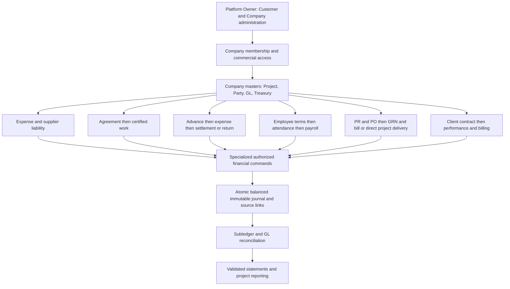

**Product terminology — LOCAL VERIFIED.** Corrected 804 existing English/Arabic text values across the application and localized role displays. Financial summaries distinguish posted accounting from imported activity; Company/certificate/retention terminology aligned. Build and 35 preservation/localization check groups pass; seven bilingual UI routes verified locally. Themes, business rules, API identifiers and hosted data unchanged. [Implementation and file list](docs/PRODUCT_TERMINOLOGY.md).

**Targeted green/contrast correction — LOCAL VERIFIED.** Restored historical medium green `#087E68`; corrected sidebar cascade and month-header foreground/background pairs. Arabic RTL 1366×768: 92 focused checks across five themes pass; Production build passes. No layout, business, hosted, storage or deployment changes. [Correction details](docs/PREMIUM_ENTERPRISE_UI.md#targeted-greencontrast-correction--2026-11-03).

**Premium UI implementation — 2026-11-03: LOCAL IMPLEMENTATION VERIFIED.** Refined Signature Emerald replaces the heavy visual execution; five shared themes and persisted Appearance control are implemented in both consoles. Projects, Parties and Subcontracts have structured record layouts; shared module typography, tables, forms and surfaces updated. No business logic, SQL, hosted data or deployment changes. Earlier R0 candidate/visual checkpoints below are historical and do not include this update. [Scope and verification](docs/PREMIUM_ENTERPRISE_UI.md).

# NARVO ERP — Master Roadmap V2.0

**Latest R0 execution — 2026-11-02: LOCAL CANDIDATE READY / RESTORE GATE BLOCKED.** R0-5e27b3c79600 freezes276 reviewed files; clean Production build/source lint and focused49 SQL/20 browser/18 workspace/11 preactivation checks pass. Existing project credentials and CA enabled an actual streaming-encrypted database/roles backup, integrity-verified and stored privately outside Git. Isolated restoration remains unperformed because a compatible local server/container engine is absent. Static visual Preview is prepared/isolated; functional shared-DB Preview remains unsafe for no-write testing. Migration65, deployments and cleanup remain unexecuted; separate migration/promotion approvals still apply. [Current execution and precise next step](docs/R0_RELEASE_EXECUTION.md). Earlier backup-unavailable labels describe provider metadata or historical checkpoints, not the new local snapshot.

Date: 2026-11-02, Asia/Dubai. Latest update: authorized R0 read-only production-impact/recovery assessment and human visual approval recording. New hosted implementation or deployment is **not authorized** by this document.

**Current R0: Emerald Enterprise identity and local visual implementation HUMAN-APPROVED; activation/release NO-GO.** Maker remains FULL under the exact pending legacy seed; 17 other Companies project to LIMITED (16 active, one inactive). Hosted64/local65 migration alignment and expected SQL hash verified; no backup/restore window evidenced. See [assessment, accessibility review and separate activation/deployment plans](docs/R0_PRODUCTION_IMPACT_AND_RECOVERY_ASSESSMENT.md). No hosted changes.

## Authority, scope and reading order

This is the single consolidated forward product roadmap, succeeding the planning portions of V1.6 and the four November 2 inputs. The [Accounting Requirements Register](NARVO_ERP_ACCOUNTING_REQUIREMENTS_REGISTER.md) is the canonical detailed requirements register; it is not a second execution plan. Read this roadmap, the register IDs for the selected milestone, the latest [handoff](PROJECT_HANDOFF.md), and the applicable technical evidence before future work.

[AGENTS.md](AGENTS.md) remains binding. Actual code and applied canonical migrations determine implementation truth; dated evidence determines the verified scope. Existing `PROJECT_ROADMAP.md` retains frozen architecture, phase history and unfinished obligations; its older sequential instructions are reconciled below, not erased. At consolidation, edits were limited to the two canonical files; the later authorized R0 batch now updates release/handoff pointers. Use this explicit precedence: constitution and actual state → latest dated execution evidence → V2.0 for forward sequencing → register for requirement detail → historical plans for provenance. V2.0 does not override accounting invariants or independently approve new policy.

Current lifecycle stage: R0 release-readiness and recovery assessment. Earlier consolidation/reconciliation statements below retain their historical scope. Fresh hosted SELECT/GET inventory and local accessibility review are recorded in the R0 assessment; genuine hosted onboarding, migration dry-run/application, recovery exercise and deployments remain deferred.

## Product vision and approved decisions

One commercially capable, multi-company, white-label accounting and business platform, initially for construction and contracting, extensible to other sectors through shared modules and explicit policies. Preserve the existing engine and build complete workflows incrementally. Product ambition does not imply current ERP completeness or regulatory certification.

- Company is the security, legal-bookkeeping context and accounting boundary. A commercial Customer groups multiple Companies for platform administration; it does not merge books, subscriptions or permissions. An owner-personal ledger needs an explicitly approved entity model; never infer a legal company from a person's name.
- Platform Owner controls Customers, Companies, invitations, memberships, activation, protected foundation setup and initially manual Company subscriptions. Owner authority is server validated with MFA and is independent of Company financial membership. `SYSTEM_ADMIN` is no financial bypass.
- Maker is the existing internal legacy Company. Preserve its identity, books and authorized users; no duplication, reset, migration or reprovisioning. It need not enter commercial enrollment. Barq/Bareq is a person/custodian/management-viewer example, not a Company. No automatic tenant creation or project relocation follows from this roadmap.
- One codebase, one canonical forward migration history and one accounting engine. Branding, roles, contract terms and policies are data/configuration; no tenant forks or tenant UUID branches.
- Maker currently uses one authorized accounting operator and permitted management reads. Preserve actual permission checks; do not grant every ACCOUNTANT all posting powers or impose new mandatory managerial approvals. Commercial roles may later support optional segregation of duties.
- Project is an analytic cost dimension; Treasury is a real money location permanently mapped to an ordinary GL account. Custody advances are receivables/assets. Supplier/subcontractor settlement never re-recognizes cost; custody settlement groups existing expenses without a journal; cash return does not reverse project cost.
- Persist money as BIGINT minor units and percentages as integer basis points. Numeric intermediates with explicit rounding may be used; no persisted floating financial truth. Journals balance, posted truth is immutable, correction is exact reversal plus a corrected event when appropriate. Account selection uses stable keys/configuration.
- Deliver approved increments through local verification, controlled Preview, human acceptance and separately authorized Production promotion. Deployment, runtime success, accounting acceptance and commercial readiness are separate facts.

## Reviewed inputs and provenance

All four supplied planning documents were read completely as **requirements inputs**, not execution instructions. The pasted Master Roadmap V2.0 request governed consolidation; the subsequent Final Historical Requirements Reconciliation request governs this focused follow-up. Older attachment instructions to wait for M2.2, resume office entry or execute other phases are historical context, not current authorization.

| Ref | Input and review result |
|---|---|
| S1 | `/home/nagham/Downloads/NARVO_ERP_MASTER_EXECUTION_AND_RELEASE_PLAN_2026-11-02.md` — complete; its pending first-release statements are superseded by E2. |
| S2 | `/home/nagham/Downloads/NARVO_HR_ATTENDANCE_PAYROLL_ROADMAP_PROMPT.md` — complete; future expansion, not current payroll specification. |
| S3 | `/home/nagham/Downloads/NARVO_PROCUREMENT_INVENTORY_WAREHOUSE_ROADMAP_PROMPT.md` — complete; integrated future scope and unresolved costing policy. |
| S4 | `/home/nagham/Downloads/NARVO_ERP_LEGACY_REQUIREMENTS_NORMALIZATION_AND_INTEGRATION_2026-11-02.md` — complete; all 23 table IDs retained in the register. |
| S5 | [V1.6](NARVO_ERP_OFFICE_TO_CODEX_MASTER_ACTION_PLAN_V1.6_2026-10-28.md) — complete, 391 lines; identifies V1.0 origin October 22 and embedded October 23–28 revisions. Only one path revision found in available Git history: `16cf326` (October 31). Working copy equals that committed content. No independently available V1.1–V1.5 history was found. |
| S6 | Original V1.0 supplied as `/home/nagham/Downloads/MAKERACC_OFFICE_TO_CODEX_MASTER_ACTION_PLAN_2026-10-22_2.md` — **read completely in final reconciliation**, all 216 lines, sections0–8 and closing references. SHA256 `27b857f5abb62fecac6141709d7246f4f48a6f213507ac255e832e2e50e11b7e`. It identifies itself as October22 V1.0; `_2` is the supplied filename, not proof of another revision. Substantive lines are also in S5; differences are title/version/project/purpose/scope and later office/development sequencing. No later revision appendix exists in this supplied original; later October23–28 updates remain in S5. The preceding unavailable-original limitation is now resolved for this supplied source. |
| S7 | [PROJECT_ROADMAP.md](PROJECT_ROADMAP.md), [PROJECT_HANDOFF.md](PROJECT_HANDOFF.md), [architecture](docs/MULTI_TENANT_WHITE_LABEL_ARCHITECTURE.md), phase evidence and targeted source/migrations — current checkpoints and relevant frozen/future obligations reconciled below. These large historical ledgers contain superseded checkpoints; not every old narrative is a current status. |

Source attachments remain in their original locations; none copied wholesale, deleted or modified. Future archival packaging should retain their original bytes and provenance.

Final historical reconciliation examined **60 explicitly enumerated material source units** (requirements, decisions, examples and acceptance/governance groups), mapped in the register. Before this follow-up: 52 fully represented, 7 partially represented, 0 missing and 1 original repair superseded by verified implementation. The seven partial representations were strengthened under existing IDs; after correction: 59 fully represented, 0 partial, 0 missing and 1 superseded repair. Representation describes documentation coverage, not implementation completion. All **35 stable requirements** remain; no new requirement ID or roadmap version was necessary. Source-specific decision/example classifications remain visible in the reconciliation matrix.

## Evidence index and review limits

| Ref | Evidence inspected and scope |
|---|---|
| E1 | [Commercial onboarding report](docs/COMMERCIAL_CUSTOMER_ONBOARDING.md), [aggregate result](docs/release/local-commercial-onboarding-result.json), its database/browser/native JSON, `src/platform/CommercialOnboarding.tsx`, and migration `20261102120000_commercial_company_onboarding.sql`. All16 recorded source hashes matched at consolidation; the later R0 presentation-only changes have their own evidence manifest (the original E1 artifact remains historical); SQL hash `76aef69124d8eccc6b7df8f6152fcddf5f37b7a17934fe3926b674f71d395f67`. Recorded local test results reviewed, not rerun. |
| E2 | [Production promotion](docs/PRODUCTION_PROMOTION.md), [machine result](docs/release/production-promotion/result.json), [candidate acceptance](docs/PRODUCTION_CANDIDATE_ACCEPTANCE.md), [candidate package](docs/release/controlled-production-candidate-manifest.json). Dated release evidence, not a fresh live inspection. |
| E3 | [M1](docs/M1_OPERATOR_CORRECTNESS.md), [M2.1](docs/COMPANY_WORKSPACE_M21.md), [M2.2](docs/COMPANY_WORKSPACE_M22.md), local result files and E2 later release acceptance. |
| E4 | [Kernel](docs/P5A_ACCOUNTING_KERNEL.md), [expenses](docs/P5B_EXPENSE_COMMANDS.md), [supplier settlement](docs/P5C_SUPPLIER_PAYMENTS.md), [custody funding](docs/P5D_CUSTODY_ADVANCES.md), [settlement/return](docs/P5E_CUSTODY_SETTLEMENTS_RETURNS.md), [subcontract certificates](docs/P5G_SUBCONTRACTOR_CERTIFICATES.md), P5F/H/I and P6D records; canonical migrations and financial source boundaries. Evidence dates differ by flow. |
| E5 | [Attendance Lite](docs/ATTENDANCE_LITE.md), [Payroll 1](docs/PAYROLL_LITE_STEP_1.md), [Payroll 2](docs/PAYROLL_LITE_STEP_2.md), [Payroll 3](docs/PAYROLL_LITE_STEP_3.md); actual attendance source, payroll register and migrations. |
| E6 | [Provisioning](docs/COMPANY_ACCOUNTING_PROVISIONING.md), [hosted execution](docs/COMPANY_ACCOUNTING_PROVISIONING_ACTIVATION_EXECUTION.md), [GL tooling](docs/GL_SYSTEM_ACCOUNT_PROVISIONING.md), subscription lifecycle evidence and handoff. Baseline provisioning is not complete fiscal setup. |
| E7 | `src/master/ProjectsList.tsx`, `ProjectMetadataForm.tsx`, `PartiesList.tsx`, `SubcontractCreationPanel.tsx`; `src/historical/sourcePosting.ts`; `src/workspace/WorkspaceReports.tsx`; `src/reports/postedJournalReport.ts`; migration inventory (65 files). Targeted inspection establishes gaps, not a repository-wide security audit. |

At the original consolidation/reconciliation checkpoint, no application tests, browser sessions, financial commands, migrations or hosted dry-runs were run. The later R0 assessment separately records fresh scoped browser and hosted read-only evidence; all other historical tests remain recorded evidence, never newly executed passes. No legal research or professional accounting signoff was performed; legal/tax/WPS and recognition policies are future validation gates, not assertions of current law.

## Current implementation and release baseline

| Capability | Implementation | Strongest reviewed verification | Release/limit |
|---|---|---|---|
| Platform Owner console, MFA, invitations, manual subscriptions, foundation provisioning | Existing implementation, later onboarding extends it | Development lifecycle/recipient evidence and E2 real owner read-only acceptance | Existing console included in promoted package; fresh commands not executed here. |
| Company workspace, M1/M2.1/M2.2 | Implemented; earlier generic M2 visual direction superseded | Recorded local suites plus real candidate and Production navigation, EN/AR and later human release acceptance | Earlier accepted package live per E2; old visual-pending notices do not reopen that accepted release. Minor accessibility issue remains. |
| Commercial Customer onboarding | Local implementation and focused local verification | E1: 49 database checks, 20 fixture-browser checks, 4 independent PostgreSQL 18.4 concurrency schedules; axe 0 violations; build pass, lint 10 existing warnings | **Local visual implementation human-approved 2026-11-02; not hosted or Preview/Production deployed; genuine hosted onboarding pending.** |
| Accounting kernel and specialized expense/AP/custody/subcontract commands | Substantial canonical DB implementation; P6D V1 cutover frozen | Earlier synthetic/rollback and concurrency evidence by flow; E2 financial definitions/data preserved | Existing frontend live; no new genuine end-to-end financial transaction acceptance in E2 or this review. Custody backend presence does not establish complete workspace workflow. |
| Attendance Lite | Daily half/full deductible absence exceptions, eligible assignments and review | Recorded Development rollback/fixture tests; route loaded in E2 | Not an explicit day-by-day presence/time matrix. UTC day boundary; absence of exception currently implies presence. |
| Payroll Lite | Draft profiles/calculation/review, restricted accrual/payment/reversal and register XLSX/print | Recorded Development 127 draft checks, 114 financial checks and 4 races; isolated output tests | Route live/read-smoked; no expanded HR, employee loans, WPS or split allocation. No new hosted payroll posting. |
| Projects and parties | Creation and scoped descriptive/name edits; Supplier metadata/status | E7; past P6C records | Project lifecycle change absent from inspected metadata form; Subcontractor remains name-only, not full Supplier edit capability. |
| GL/reporting | COA and immutable journals, posted journal/expense exports, source reports | E7 exact string/BigInt report checks in source; older test records | Posted turnover exports are not validated TB/P&L/BS/cash-flow or reconciled openings. Fiscal close and complete statements remain future work. |
| Procurement/stock/WMS | Future scope recorded | No integrated canonical item/PO/GRN/stock workflow found in inspected module/migration inventory | Planned; module labels/diagrams prove no operational functionality. |
| Client AR/revenue, fixed assets, complete fiscal setup | Future/partial foundations only | Historical roadmap obligations | Not verified complete; policy and subledger design required. |

E2 records `maker-eosin.vercel.app` promoted to candidate `dpl_8Jvbmi1GFoVPNhG36CAf1ZGkCfHP` on November 2, with focused Production smoke pass. The release preserved 46 Company-owned tables, 64 applied migrations, catalog/Auth/configuration and the 272-file accepted package. Owner and Company sessions were independently identified. This proves the recorded release and read-only paths, not comprehensive accounting or management-viewer financial acceptance. Earlier recipient misattribution is explicitly corrected in [identity reconciliation](docs/TEST_SESSION_IDENTITY_RECONCILIATION.md); do not reattribute M. Saed's acceptance to Barq or the invited recipient.

**Environment risk:** Production and Development share hosted Supabase `eqnzueginpkskbnqvgoc` (named MakerACC-Development). Names do not isolate Production. Recorded hosted history is 64 applied; local history is 65. Fresh remote alignment was not checked here. Treat every hosted mutation as Production-impacting until isolated infrastructure is actually established. Staging availability is not established.

## Commercial Onboarding: exact remaining release gates — R0

Register: SAAS-01, QA-01, OPS-02. Current status: local implementation/visual acceptance approved; read-only impact assessment complete; recovery and hosted release gates blocked/deferred. [Current evidence](docs/R0_PRODUCTION_IMPACT_AND_RECOVERY_ASSESSMENT.md).

1. **VERIFIED — human local visual approval, 2026-11-02.** Product Owner officially approved Emerald Enterprise and accepted the local visual implementation. [R0 local report](docs/R0_COMMERCIAL_ONBOARDING_VISUAL_ACCEPTANCE.md), [Emerald gallery](docs/release/emerald-enterprise/index.html). Nine incomplete accessibility groups reviewed; no confirmed bounded UI defects, with scan/assistive-technology limits retained in the current assessment. Genuine hosted onboarding acceptance is separate.
2. **VERIFIED — authorized read-only shared impact inventory.** Project eqnzueginpkskbnqvgoc; hosted64 exact local prefix, all64 normalized statement/name comparisons match; pending65 expected SHA256 unchanged. All18 Companies classified: Maker FULL, 17 others LIMITED (16 active, one already inactive). Stage D lacks only its Customer association. No automatic enrollment/exemption or Company change is authorized.
3. **BLOCKED / DEFERRED — recovery and execution preparation.** Provider metadata lists no available backups/PITR window. A later authorized local encrypted database/roles backup is captured and integrity-verified; isolated restoration is still unperformed because the compatible local server/container runtime is missing. Approve scope/frequency/retention/RPO/RTO and demonstrate authorized recovery before activation. Single-file linked dry-run remains unexecuted and must list only65 after renewed alignment/hash checks. No blanket push.
4. Separate explicit shared-hosted/Production-impact authorization before applying only the reviewed migration. Read-only postflight must verify history 65, exact legacy eligibility, empty transient initialization scope, RLS/grants/functions and unchanged Maker/membership/financial rows. No automatic subscription assignment or Customer linkage.
5. Separately authorize the frozen allowlisted frontend candidate. A functional Preview requires backend isolation or a reviewed server-enforced write boundary; the current shared-DB application is not a safe no-write Preview. An inert static visual package is separately prepared. Against the exact reviewed DB/configuration, genuine owner/member read-only acceptance and final visual approval precede Production promotion. Preserve invitation/Auth settings and rollback candidate. Local build is not deployment.
6. Separately scope one synthetic hosted commercial journey with exact Customer/Company/admin/Treasury/subscription inputs. New financial writes need their own approved inputs. Do not provision Maker or create another Maker.

Server readiness requires linked Customer, active Company/platform state, active accepted/assigned Accounting Admin/profile, COMPLETE foundation plus durable provisioning evidence, and effective TRIAL/ACTIVE Company subscription. Existing pending invitations do not satisfy membership. Readiness is derived. Private transaction/actor/Company initialization permits only protected account/Treasury creation, not ordinary business. Existing triggers enforce new-business restrictions; permitted reads and settlement/reversal remain role controlled.

Legacy exception is one private data registry seeded from existing `MAKER` without platform creation evidence, not a universal UNMANAGED bypass. New similarly named Companies cannot inherit it. Explicit enrollment's expiry/cancellation still limits an eligible legacy Company. Applying this migration changes server behavior for the **currently deployed** frontend immediately. Frontend rollback cannot undo it; use reviewed forward correction or separately authorized recovery, never rewrite applied migration or erase audit.

## Milestones, dependencies and measurable exit criteria

These are execution work packages, not promises of delivery dates or implementation permission. Product owner prioritizes/accepts; accountant approves financial policy; engineer implements; verifier validates evidence. Independent review should increase for financial/tenant/irreversible work. Each milestone follows requirements → design → bounded implementation → risk-based verification → release/operations review, revisiting earlier stages when evidence disagrees.

| ID | Priority and work | Requirements | Dependencies | Acceptance and status |
|---|---|---|---|---|
| R0 | Immediate: safely release local commercial onboarding | SAAS-01, QA-01, OPS-02 | E1 package; human acceptance; shared impact/recovery | All six gates above with separate authorizations. **Local visuals human-approved; read-only impact verified; recovery NO-GO; hosted activation and release deferred.** |
| F0 | Accounting policy and foundation specification | PRJ-03, FIN-03, FIN-07, FIN-08, EXP-02, EXP-03, CON-02, CUS-01, CUS-02, HR-02, INV-01 | Read actual commands and source evidence; accountant/product decisions | Approve recognition/dimensions/rounding/settlement/reversal policy and gap matrix before affected commands. No invented opening or OWNER_CURRENT. **Planned.** |
| M3 | Project lifecycle, allocation and daily operations | PRJ-01, PRJ-02, PRJ-03, PRJ-04, EXP-01, EXP-02, EXP-03, EXP-04, CON-03, CON-05, FIN-01, UX-01, UX-02 | F0 where financial; R0 release checkpoint; current masters | Authorized Planning→Active without ID change; stale/foreign rejection; preview of source project mapping; posted corrections immutable; expanded party edit/archive preserves links. Ownership remediation separately authorized. **Partial foundations; extensions planned.** |
| M4 | Contract, Treasury and custody completion | CON-01, CON-02, CON-03, CON-04, CON-05, CUS-01, CUS-02, CUS-03, FIN-08, EXP-02, QA-01 | F0; M3 dimensions/masters; existing P5/P6 commands | Fixed/unit/hybrid contracts, cumulative 100→200 at 50 yields incremental 5,000 each; no fabricated cap, tax or retention; existing settlement/reversal preserved; custody statement reconciles to control GL. **Existing financial core; extensions planned/policy blocked.** |
| M5A | Fiscal foundation and complete source coverage | FIN-02, FIN-03, FIN-07, FIN-08, EXP-02, EXP-03, EXP-04, QA-01 | F0; M3/M4 as needed | Approved opening TB plus subledger schedules, explicit fiscal periods/closed-period policy, supported command per economic event, duplicate-safe source links, no mass Maker posting. **Partial/planned.** |
| H1 | Employee terms, schedules and policy versions | HR-01, HR-02, HR-03 | F0 payroll policy; existing employee/attendance/privacy | Effective dates, calendars/timezone, salary components and leave rules signed off; baseline snapshots preserved. **Expanded scope planned.** |
| H2 | Explicit attendance matrix and review | HR-01, HR-03, UX-01 | H1; transition from exception-only semantics approved | 28/29/30/31 days, minute facts, explicit unknowns, keyboard/bulk/RTL, conflicts/review/correction/locks and exports meet specification below. **Planned.** |
| H3 | Expanded payroll, labor allocation and output | HR-02, HR-03, CUS-02 | H1/H2; M5A period controls; existing Payroll Lite | Deterministic policy snapshots; accrual/payment distinct; advance recovery classified separately; split-project totals reconcile; privacy/retry/overpayment/reversal verified. WPS remains separate H4. **Lite exists; expansion planned.** |
| H4 | UAE payroll/WPS acceptance | HR-02, HR-03, OPS-02 | Verified current official legal/provider specs and H3 | Approved jurisdiction and agent/bank format, validated examples, authorized submission/rejection/recovery controls; no generic-CSV compliance claim. **Policy/external verification blocked.** |
| I1 | Procurement catalog and document foundation | INV-01, CON-03, PRJ-03 | M3 masters; F0 quantity/accounting decisions | Item/UOM conversions, PR/PO and optional RFQ workflow; optional approvals fit current single operator; no GL on commitment alone. **Planned.** |
| I2 | Receiving and operational stock | INV-01 | I1; ownership/receipt policy | Append-only accepted movements, transfers, reservations/issues/returns/counts; reject duplicate/over-issue; valuation explicitly unavailable until I4. **Planned.** |
| I3 | Supplier integration and direct purchase | INV-01, EXP-03, FIN-02 | I1/I2; existing AP commands; approved GRNI/invoice matching | Partial matching/credits; liability and cost recognized once; direct-to-project has no fictional warehouse; payments clear existing payable. **Planned.** |
| I4 | Inventory valuation and project costing | INV-01, PRJ-03, FIN-03 | F0 valuation/WIP/VAT/landed cost; I2/I3; approved openings | Deterministic approved FIFO/average method, returns/reversal dependencies, stock value = control GL; project issue cost recognized once. **Policy blocked.** |
| I5 | Stock reporting and rollout | INV-01, QA-01, OPS-01, UX-01 | I2–I4 and release gates | Quantities/value/GL reconciliation, aging/commitment/issue reports, role/concurrency/export/EN-AR acceptance. **Planned.** |
| T1 | Physical tools and equipment custody | INV-02, FIN-06 | M3 persons/projects; asset policy if financial | Issue/return and condition history, lost/damaged handling; distinct from financial custody advances. **Deferred future scope.** |
| C1 | Client contracts, certificates and receivables | FIN-05, PRJ-03 | F0, M3, M5A | Customer-as-client authority distinct from platform Customer; contract/variations/invoice/retention/advance/collection/reversal subledger and aging reconcile. **Planned.** |
| C2 | Revenue, contract assets/liabilities and WIP | FIN-05, INV-01, PRJ-03 | C1; expert recognition policy; cost completeness | Approved recognition/measurement and evidence; billing, collections and revenue not conflated; profitability only on supported basis. **Policy blocked.** |
| A1 | Fixed assets and broader GL completeness | FIN-06, FIN-03, FIN-08 | F0, M5A | Capitalization/depreciation/disposal and loans/equity schedules reconcile; acquisitions not automatically expensed. **Planned/policy blocked.** |
| M5B | Statements, closing and reconciliation | FIN-01, FIN-04, FIN-07, QA-01 | M5A; relevant M4/H3/I4/C2/A1 scope | GL/TB opening+movement=closing; P&L/BS/cash-flow/aging/project reports reconcile to complete authorized basis; close/reopen/adjust/reverse tested. Can release supported subsets with explicit limitations. **Planned.** |
| O1 | Audit and private document controls | OPS-01, QA-01 | Current P7/P8 gap inventory | Company/project/document-bound signed storage, upload/replacement/retention/version/audit controls; no cross-tenant access. **Partial event audit; storage deferred.** |
| O2 | Release operations and commercial go-live | OPS-02, QA-01, UX-02 | Scope-specific accounting acceptance, O1 as needed, R0 | Required independent integrity audit, backup restore exercise, monitoring/incident/support/legal/hosting/commercial gates; explicit approval. **Not commercially launch-ready on reviewed evidence.** |

Early fiscal/recognition decisions in F0 precede new financial commands; full statements in M5B depend on actual subledger completeness. H and I tracks share masters/GL but HR is not a prerequisite to basic stock. Use one bounded active implementation workstream; dependencies do not require implementing an entire future ERP before a valid small release.

## Integrated business and accounting architecture

All future documents reuse Company, Party, Project and Treasury identities. Client commercial counterparty records must not accidentally inherit Platform Customer administrative access. Quantities may use deterministic fixed decimal precision; exact valuation converts to BIGINT money once under approved rounding. No browser arbitrary journal or system-account endpoint.

| Workflow | Recognition / settlement contract | Required controls and detailed acceptance |
|---|---|---|
| Expense/AP | Valid expense recognizes cost and evidenced VAT; credit purchase creates supplier payable; Treasury settlement clears payable | EXP-01–03, FIN-02; source/doc/journal links, duplicates and role controls. Advance/deposit/drawing never forced through expense. |
| Subcontract | Agreement/terms have no cash journal; certified current work creates cost, retention/recovery/deductions/payable under approved policy; payment clears liability | CON-01/02/04; contract-scoped caps/recovery, cumulative deltas, dependencies; tax/deduction waterfall requires expert review. |
| Custody | Treasury advance Dr custody receivable/Cr Treasury; custodian expense reduces receivable once; settlement no journal; return Dr Treasury/Cr custody | CUS-01, CUS-02, CUS-03; pooled Company/person control, inactive settlement allowed, statement-to-GL and physical reconciliation; no automatic Treasury per person. |
| Payroll | Approved earned salary creates cost/payable; salary payment clears entitlement; loan recovery must clear receivable separately from salary reduction | HR-01, HR-02, HR-03; immutable snapshots and privacy; no re-posting costs on payment; split allocation totals equal one recognized cost. |
| Stock | PO is commitment; approved ownership/receipt event may recognize inventory and receipt liability; bill clears matching and establishes AP; issue transfers value to approved expense/WIP | INV-01; receipt, invoice and payment distinct. Treatment here is design-dependent, not an implemented or signed-off journal template. |
| Client revenue | Performance recognition, billing/retention/advance, cash collection and revenue must remain distinct | FIN-05; expert-approved recognition and tax timing; no copying supplier logic as a complete AR/revenue engine. |

## HR, attendance and payroll target specification

Reuse E5 employee Parties, site assignments, revision review, locks, draft rows, financial plans, immutable entitlements and output adapters. Existing payroll allocates each employee/month to one Project or Company overhead; additions/reductions have narrowly supported meanings. Expanded leave, overtime, personal advances, reimbursements, salary versions and split allocation are not implemented by generic adjustment labels.

**Semantic transition gate (HR-03):** `AttendanceApplication.tsx` currently displays Present when no entry exists; payroll calculates calendar days less absence half-units. Current DB future-date/review boundaries use UTC, while payroll completed-month and commercial dates use Asia/Dubai. The approved future matrix requires explicit unrecorded facts and deterministic Company date/time handling. Decide effective date, historical mode identification and draft conversion; do not reinterpret old reviewed/posted payroll or silently migrate absence-free months to explicit attendance evidence.

Minimum compatible future model: effective-dated employment/salary terms; policy versions; calendar/shifts/holidays; daily facts/time segments; approved leave/overtime; review revisions and correction provenance; frozen calculation/allocation plan. Keep fact capture, expected schedule, approved exceptions and payroll interpretation separate. Extend through reviewed canonical migrations only when implementation is separately authorized.

Five coherent screens: HR overview (real readiness/exceptions), monthly matrix, exception review/lock, payroll processing, and employee profile/payslips. Matrix rows are employees and columns actual month dates; fixed identity columns and sticky date/day headers. Filters: Company/month, Project/site and employee; department only when supported. Cell editor shows expected/actual minutes, absence, reason/evidence and version. Statuses: present, absent, approved leave, partial/hour absence, late, early departure, interruption, rest, holiday and unrecorded. Symbols/text/tooltips supplement color. Keyboard navigation/editing and bounded bulk preview/confirmation must report conflicts and audit each affected row; optional import requires preview and duplicate/conflict resolution. Mobile offers a usable daily/list alternative. No blank defaults or fake zero summaries.

Flow: employee/terms → calendar → attendance facts → exceptions review → controlled lock → calculation preview → approval → posting → payments → payslip/report. Existing lock-on-post behavior remains authoritative until an approved extension defines any earlier lock. Corrections follow dependencies and reversal/replacement rules, not arbitrary unlocking.

Outputs: attendance XLSX with real dates, frozen headers, legend, recorded/expected minutes, absence/overtime/site, filters and review metadata; attendance landscape PDF with repeated headers and page breaks; expanded payroll XLSX/PDF with components, deductions/recoveries, allocation and accrual/payment status; bilingual individual payslip PDF showing actual payment only when settled. Existing register XLSX/print is reused; it is not already all four deliverables. Payroll exports stay restricted; MANAGEMENT_VIEWER currently has no payroll access.

Acceptance: leap February, 30/31-day months, partial minutes, overnight shifts/breaks, missing facts, leave overlap, unauthorized/site/tenant access, stale concurrent edits, locked corrections, duplicate run/payment, recovery versus deduction, split-project reconciliation, exact rounding and reversal; EN/AR keyboard and export pagination. WPS requires separate current official/provider research and domain approval before implementation or a compliance claim.

## Procurement, inventory and warehouse target specification

Two supported target paths: stock procurement (requirement → PR/optional approval/RFQ → PO → accepted receipt → invoice matching/AP → stock issue/return and GL) and direct project purchase (requirement/PO or approved direct expense → site acceptance → invoice/AP/payment → project cost/WIP, **without warehouse fiction**). Invoice/settlement may occur at different times from receipt; do not make payment a prerequisite for recognizing accepted owned goods.

Minimal future model: Company-scoped items/categories/UOM and validated conversions; warehouses/locations/site links; PR, optional quotation, PO lines and revisions; GRN accepted/rejected quantities; supplier bills/credits and matching; append-only movement, reservation, transfer, issue/return; counts/variance approvals; numbering, attachments, actor/version/idempotency/source links. Reuse supplier/Project/Treasury and existing settlement interfaces rather than create duplicate balances.

Explicit quantities: ordered, received, accepted, rejected, invoiced, returned, on-hand, reserved, available and issued. Define precision/conversion and correction rules before coding. Negative stock is not an accidental fallback; any permission for it requires explicit policy. Valuation method, ownership/GRNI timing, expense versus WIP, VAT/landed costs and openings are DECISION REQUIRED. Operational quantity releases must honestly mark value unavailable until validated.

Twelve integrated views: overview; PR; optional RFQ/comparison; PO; receiving/inspection; supplier bills/settlements; catalog; warehouses/locations; stock ledger; transfers/issues/returns; count/reconciliation; reports. Use dense accessible tables, scoped search/filters, responsive EN/AR layouts and explicit states. Reports include position/movement, aging, reorder, commitments, supplier performance, project issues/returns and approved value. Planned cards never masquerade as live modules.

Mandatory acceptance set for INV-01: (1) ordered 100 received 60 then 40 once; (2) only accepted goods usable; (3) 50 direct-to-project without intake; (4) warehouse transfer preserves total Company stock with no premature project expense; (5) issue and unused return trace/cost reconcile; (6) correct Project cannot be silently changed; (7) partial invoice matching and two payments create one payable/cost; (8) cancel/receipt reversal/credit/return obey dependencies; (9) approved count variance; (10) concurrent last-stock issue accepts at most available quantity; (11) absent openings/value show unavailable; (12) historical Maker fingerprints unchanged; (13) accessible EN/AR desktop/tablet. Test liability, inventory and GL effects only against an approved accounting specification. T1 retains the earlier reusable-tool custody requirement separately.

## Original-source acceptance clarifications

The final S6 comparison strengthens existing requirements without new modules or accounting rules: PRJ-01 preserves `ACTIVE` when changing a translated label; UX-01 requires business names/codes/references rather than raw UUIDs and explicit Expenses review at360/390/768px; CON-01/02 preserve contractual/signature/actual-start dates separately, milestone terms and contract-specific release/security/delay conditions; CUS-02 requires a partner statement reconciled to its approved control account. The detailed register preserves the Al-Sajour signature dates, one-month term,5%+5% release schedule, separate guarantee and unresolved unknown-total penalty cap, plus Ahd's exact reported payment dates. These are historical examples and evidence questions, not universal percentages or automated legal calculations.

Confirmed cash occurrence may be documented and linked as evidence while disputed certification, tax, retention or classification remains unresolved. No unrelated missing metadata should force loss of that evidence; no uncertain journal, guessed tax or fictitious withholding is authorized. Post only a supported, unambiguous event through its approved command after verifying it is not already recorded. An entered contract value, a signed agreement, certified work, an invoice and a payment remain distinct. Source-specific tax or retention review cannot be bypassed merely because cash is known to have moved.

## Accounting decisions, gaps and review classifications

| Finding | Classification and evidence | Required resolution |
|---|---|---|
| Shared Development/Production database | Expected documented current topology, high activation risk (E1/E2) | R0 impact/recovery gates; establish real isolation before write-heavy development tests. A project name does not establish safety. |
| Presence inferred from missing absence; UTC versus Company date boundaries | Expected Lite behavior, incompatible future assumption if reused unchanged (E5 and source) | HR-03 transition approval and explicit time/presence evidence; preserve snapshots. |
| Subcontract certificate tax waterfall | Accounting-policy validation gap, not a proven legal defect (E4 SQL computes AUTO_5 after retention/recovery/deductions) | Accountant/tax expert validates recognition, taxable base and timing before extension; do not silently change posted history or assert UAE compliance. |
| All supported subcontract deduction mappings use Revenue accounts | Accounting-design validation gap (E4) | Distinguish material supply, backcharge, compensation/other deduction and tax obligations; define netting/gross treatment, provenance and mapping per event. |
| OWNER_CURRENT/funding excluded from foundation | Expected intentional fail-closed policy gap (E6) | FIN-08/CUS-02 expert-approved nature and account type; existing OWNER expense capability does not approve a new generic funding/drawings path. |
| Fiscal calendar/openings/close and complete financial statements | Significant unimplemented/partial product scope (E6/E7) | M5A/M5B; no source totals as balances or zero openings. |
| Unknown-total unit-rate contract | Confirmed product gap (E7 requires original value; E4 certificate cap uses original+variations) | CON-01 backend and UI design together; removing HTML required alone cannot solve cap/measurement rules. |
| Project status and Subcontractor metadata | Confirmed scoped capability gaps (E7) | M3; Supplier's edit/archive workflow does not prove Subcontractor equivalence. |
| Missing deposit/employee-loan/owner-funding source commands | Confirmed coverage gaps expressly exposed by `sourcePosting.ts` | FIN-02/08, EXP-02; routes with guidance are not implemented posting paths. |
| Expense summary div aria-label lacks group semantics | Confirmed low-impact defect accepted in E2 | Bounded future UX follow-up; does not reopen accepted release. |
| Complete integrity audit, restoration drill, monitoring, private storage and legal scope | Deferred/unverified concerns, not claimed failures | O1/O2 with evidence, exact scope and production authorization; no broad audit performed now. |

Decision ownership: accountant/domain expert signs financial treatment; owner approves product scope and Company policies; qualified jurisdiction/provider review signs applicable tax/labor/WPS details; operator/engineer establishes environment/recovery. IFRS recognition/measurement review is distinct from UAE legal/tax rules, construction practice and configurable company policy. None is certified here. Detailed DECISION REQUIRED entries are in the register.

## Testing, release and operations contract

Every financial implementation must establish actor/active membership/permission, authoritative masters/lifecycle, Company/dimension consistency, normalized idempotency, source uniqueness, deterministic locking, atomic document+journal, immutable results and specialized reversal/dependency rules. Direct REST/table and private-helper paths must be denied where relevant. Test wrong role/tenant, replay with same/changed intent, simultaneous competing commands, overpayment/recovery, closed/inactive settlement, missing evidence, and report privacy.

Use the smallest sufficient mix: source/unit, disposable real SQL, independent DB connections for races, authorized hosted synthetic tests, genuine identity-bound browser acceptance and accounting reconciliation. Fixture browsers do not establish hosted MFA or real posting. Historical matrix results are not a new project-wide pass. Re-run only what changes or unresolved material concerns justify. For implementation, build/lint/diff/secret scans and migration alignment/single-file dry-run apply proportionately. No migration rewriting, no shared SQL Editor patching and no production demo fallback.

Before real production accounting/go-live, the constitution's separately scoped Production Security & Accounting Integrity Audit remains required unless verifiable completed evidence is located. Existing live promotion does not establish that this entire gate was completed. Cover tenant/session/switching, financial abuse/direct-write/replay/races/dependencies, immutable/reconciled balances, private files, report leakage, secrets and domain confusion. Do not repeat that full audit for ordinary UI changes.

O2 must establish backup scope (DB/data/schema/Auth/configuration/storage as applicable), frequency, retention, authorized restore procedure, recovery objectives and restoration verification; define failed-release recovery, incident ownership, command/Auth errors, audit visibility and monitoring. Review commercial hosting limits/cost, support/onboarding/recovery documentation, privacy/terms and NARVO trademark/domain availability. CI/CD maturity is unverified: evaluate existing GitHub/Vercel build/lint/tests/secrets/migration/Preview/approval gates before adding justified automation. A READY rollback frontend cannot restore mutated books.

## Documentation inventory and cleanup recommendation

No originals were removed, moved or rewritten. Apply this classification by path family; it inventories the current root planning set, input set and specialized evidence rather than creating another planning index.

| Paths/family | Classification and disposition |
|---|---|
| `NARVO_ERP_MASTER_ROADMAP_V2.0.md` | Current canonical forward roadmap. |
| `NARVO_ERP_ACCOUNTING_REQUIREMENTS_REGISTER.md` | Current canonical detailed requirements, statuses and decisions. |
| `AGENTS.md`; `PROJECT_HANDOFF.md` | Current constitution and factual handoff. Preserve, do not merge into roadmap. Future handoff updates should link canonical pair. |
| `PROJECT_ROADMAP.md` | Historical phase ledger plus binding frozen decisions; redundant as a competing forward plan. Preserve current bytes; recommend pointer to V2.0 and retain P0–P10 history rather than maintain two future sequences. |
| `NARVO_ERP_OFFICE_TO_CODEX_MASTER_ACTION_PLAN_V1.6_2026-10-28.md` | Historical source, superseded for sequencing; retain all observations and version history. |
| `NARVO_ERP_CODEX_AUTONOMOUS_PLATFORM_OWNER_EXECUTION_2026-10-28.md` | Historical execution authorization/context; not permission for this or future unrelated deployment. |
| Four November2 Downloads inputs plus supplied October22 original S6 | Preserved source requirements, now reviewed/integrated; redundant as independent execution plans. Archive original bytes when separately authorized, with source/date/hash. S6 resolves the prior missing-source limitation; no historical file was modified. |
| `docs/MULTI_TENANT_WHITE_LABEL_ARCHITECTURE.md`, P2–P6, GL/foundation/financial phase records | Supporting technical decisions/evidence; preserve invariants. Early “planned/unimplemented” platform/P6 statements are dated history, superseded by actual later implementation. |
| `docs/M1_*`, `COMPANY_WORKSPACE_REDESIGN.md`, `COMPANY_WORKSPACE_M21.md`, `COMPANY_WORKSPACE_M22.md`, `PLATFORM_OWNER_UI_REDESIGN.md` | Supporting accepted feature history; older visual directions/checkpoints superseded, evidence retained. |
| `docs/PLATFORM_*`, `COMPANY_ACCOUNTING_PROVISIONING*`, `MANUAL_COMPANY_SUBSCRIPTIONS*`, `TEST_*` | Supporting lifecycle/activation/recovery evidence. Earlier pending/failed attempts remain history; latest execution controls status, including identity corrections. |
| `docs/COMMERCIAL_CUSTOMER_ONBOARDING.md`; `CONTROLLED_PRODUCTION_CANDIDATE.md`; `PRODUCTION_CANDIDATE_ACCEPTANCE.md`; `PRODUCTION_PROMOTION.md` | Current scope-specific release evidence, not additional master roadmaps. Promotion supersedes pending initial-release instructions, not onboarding's unapplied state. |
| `docs/ATTENDANCE_LITE.md`, `PAYROLL_LITE_STEP_*.md`, `HISTORICAL_SOURCE_IMPORT.md`, foundation/V1 records | Supporting scope specifications/evidence; preserve intentional limits. |
| `docs/PRE_DEMO_UAT*`, `ENGINEERING_ACCOUNTING_RETROSPECTIVE*`, `POST_P5_FOCUSED_REVIEW.md`, older branding/demo records | Historical acceptance/review and supporting technical lessons; no automatic current production certification. |
| `docs/release/**`, `docs/verification/**`, scripts/SQL fixtures and canonical migrations | Supporting reproducible evidence/artifacts; retain hashes, dated limitations and migration history. No archival rewrite of applied SQL. |
| `README.md` | Entry documentation; recommend canonical pair links in a later scoped pointer update. |

Recommended structure: keep the two canonical files at root; keep factual handoff and constitution; technical decisions under existing `docs/`; execution artifacts under `docs/release/` and `docs/verification/`; original plans eventually in `docs/archive/` with links, only after separately scoped moves/pointer updates. No extra Markdown index is needed. Future work updates roadmap milestone status and register requirement evidence once, referencing phase results rather than duplicating whole plans.

## Review completion and immediate next actions

This batch changes only the two canonical documents. No application/schema/data/configuration/deployment/Git-history actions. The initial dirty tree is preserved. Validation evidence for this batch is limited to source/document comparison, source-hash matching, requirement/relative-link checks, whitespace/secret-pattern checks and preservation hashes; no new accounting execution.

| Lens | Classification for this review |
|---|---|
| Business/accounting | VERIFIED requirements normalization and documented existing semantics; expert decisions and future workflow acceptance DEFERRED. |
| Security/authorization | VERIFIED targeted source/evidence boundaries and preservation; fresh runtime matrix/full integrity audit DEFERRED. |
| Database | VERIFIED local 65-file inventory and pending migration hash; new DB work NOT APPLICABLE; fresh hosted alignment/dry-run DEFERRED. |
| Deployment | VERIFIED reconciliation of recorded promotion versus later local onboarding; new deployment NOT APPLICABLE; live revalidation DEFERRED. |
| Testing | VERIFIED documentation/traceability checks only; application build/lint/business/browser reruns NOT APPLICABLE to unchanged code. |
| Documentation | VERIFIED complete supplied-original review,60-unit dispositions and reciprocal mapping of all35 stable requirements; prior missing-source limitation resolved. Old-file pointer/archive work DEFERRED by edit scope. |

Next **three** execution tasks, each requiring its own appropriate scope:

1. **R0 release preparation:** human local visual approval and read-only impact inventory are complete. Resolve Company-impact and recovery decisions; demonstrate recovery, then authorize the exact single-migration dry-run/activation package and separate frontend Preview/Production stages. No hosted execution is authorized by this roadmap.
2. **F0 accounting decisions:** accountant/product workshop and evidence matrix for fiscal/openings, OWNER_CURRENT and historical event coverage, subcontract tax/deductions, attendance transition/payroll policy, and inventory/WIP valuation. Unresolved policies block only their affected implementation.
3. **M3 bounded design then authorized delivery:** project lifecycle and controlled source-to-project/party workflow first, preserving posted history and tenant boundaries; separately scope Villa 13 evidence/remediation. Reuse existing M1/M2/P5/P6 work rather than repeat completed fixes.

Final reconciliation validation covers all60 source units, all35 requirement IDs and their reciprocal milestone edges, source/evidence hashes, local links, whitespace, focused secret patterns and preservation of every other pre-existing repository file. No application/business/browser suite, hosted query/alignment/dry-run or legal/accounting signoff was run. Commercial Onboarding remains locally implemented/tested, migration65 unapplied hosted, frontend undeployed, human visual/hosted acceptance pending. Maker remains unchanged and exempt from mandatory commercial enrollment under the approved compatibility policy, using the shared engine.

**Master Roadmap V2.0 is ready for product-owner acceptance as a reconciled planning baseline.** This does not approve implementation, unresolved financial policy, commercial onboarding activation, statutory compliance or commercial launch readiness.
