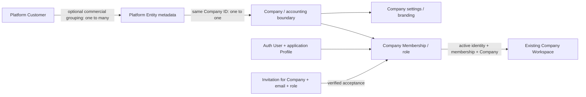

**P0 invitation onboarding — 2026-10-31: LOCAL FIX VERIFIED / HOSTED ACTIVATION PENDING.** New-user password→sign-out/sign-in→explicit acceptance→normal Company selection now preserves invitation intent through reload. Recipient-only read RPC and two-field invite-template patch are prepared; new migration is NOT applied, function/frontend NOT deployed, no real users/memberships/emails changed. Existing-user review/sign-in path does not duplicate users or use recovery as invitation delivery. Prior one-hour owner browsing remains PASS; real onboarding/sensitive-operation/Vercel acceptance remains PENDING. See [implementation, tests and exact approval-gated actions](PLATFORM_NEW_USER_ONBOARDING.md). Earlier functional findings describe the pre-fix checkpoint.

# Platform Owner functional readiness — 2026-10-31

## Assessment and evidence boundary

**The console is integrated with the existing Company/accounting authorization model, but the complete commercial onboarding journey is not ready.** It manages real Companies, profiles and memberships through hosted RPCs. It does not yet deliver a complete new-recipient invitation journey, accounting-readiness workflow, subscription system or billing system.

Reviewed branch `release/platform-owner-console`, commit `16cf326ca8ca68837892acbefdeffb43c7616640`; working tree was clean at entry. This review creates only this report. No application changes, hosted writes, customers, financial transactions, emails, migration application, commit, push or deployment occurred.

Fresh targeted Development inspection: **MakerACC-Development / `eqnzueginpkskbnqvgoc`**, healthy project; snapshot `2026-10-30T21:32:28.664482+00:00` / **2026-10-31 01:32:28 Dubai**. All **61** hosted migration versions match the local canonical history. All **20** current Platform function bodies match their latest canonical definitions. Aggregate queries ran in a read-only transaction. Hosted invitation-function availability and invite/recovery-template preparation were checked without exposing credentials, identities or records. Private aggregate evidence: `/tmp/narvo-platform-functional-review/hosted-summary.json`.

The owner-reported approximately one-hour real-session browsing test is **PASS**. The existing **20/20 migration postflight** remains retained evidence. Invitation end-to-end acceptance, sensitive-operation real-session step-up/reconfirmation, and Vercel deployment acceptance remain **PENDING**. Source/CSS review and previously recorded local browser evidence inform the UX assessment; no new authenticated browser/device test was performed here. No general security, financial reconciliation or recovery audit was repeated.

Status meanings: **IMPLEMENTED** = the named bounded capability has real code and persistence, not a declaration of commercial acceptance; **PARTIAL** = working components with missing integration/completion; **PLACEHOLDER** = presented label/screen without the promised business lifecycle; **MISSING** = no corresponding product implementation found.

## 1. Feature inventory and actual integration

Primary frontend references: [console/editor/actions](../src/platform/PlatformApplication.tsx#L90), [RPC transport/contracts](../src/platform/platformApi.ts#L7), [protected routing](../src/auth/ProtectedApplication.tsx#L24). Latest hosted read contracts are in [the P1 migration](../supabase/migrations/20261030120000_platform_read_mfa_freshness.sql#L55); latest mutation/invitation contracts are in [the revocation correction](../supabase/migrations/20261028123000_platform_invitation_revocation.sql#L106), which supersedes earlier definitions.

| Feature | Status | Actual frontend → API/RPC → persistence | Scope and limitation |
| --- | --- | --- | --- |
| Overview | IMPLEMENTED | `/platform` → `get_platform_overview()` → counts over Companies, profiles and private Platform tables | Nine real counters and server timestamp. No revenue, MRR, paid-seat, usage or financial reporting. Setup counter has incomplete coverage; see below. |
| Customers | IMPLEMENTED | `/platform/customers` → `platform_directory('customers')`; `platform_admin_command('create_customer'/'update_customer')` → `private.platform_customers` | Unique commercial code, name, optional contact email, versioned updates, search/pagination. No customer login, financial account, deletion, subscription, customer-to-users grant or customer detail portfolio. |
| Accounting Entities | PARTIAL | `/platform/entities` and `/:companyId` → `list_platform_entities()`; create/update commands → `public.companies`, `company_settings`, `private.platform_entities`; optional initial membership | Real Company provisioning and optional Customer link/classification. Creates an empty Draft Company, not configured books. “Open entity” filters the administrative listing; it does not enter a customer's accounting workspace. No complete setup/checklist/detail hub. |
| Users | IMPLEMENTED | `/platform/users` → `platform_directory('users')` → `public.profiles`; `set_user_status` → profile status and, on deactivation, session removal/invitation invalidation | Directory plus global application activation/deactivation. Counts profiles, not billable seats. No arbitrary Auth user creation/password assignment/email editing or owner creation. Platform identities are excluded from ordinary user administration. |
| Memberships | IMPLEMENTED | `/platform/memberships` or Users “Manage access” → `platform_directory('memberships')`; `set_membership` → existing `public.company_memberships` via private helper | Assign/change/revoke one of seven supported Company roles for an existing active identity; last-admin protection and version checking. Company-role mapping is authoritative; there is no custom permission editor. |
| Invitations | PARTIAL | `/platform/invitations` → `list_platform_invitations()`; invite/resend/revoke → `platform_invitation_command`; delivery → Edge Function → Auth `inviteUserByEmail`; callback → `accept_platform_invitation` → real membership | Queue, versions, expiry, fencing, cancellation and acceptance are implemented. Hosted delivery function is absent and hosted invite template is not the prepared TokenHash template. New-recipient callback sequencing is incomplete. No live invitations exist at review time. |
| Audit Log | IMPLEMENTED | `/platform/audit` → `platform_directory('audit')` → append-only `private.platform_events` | Platform command/access/delivery events, action search and pagination. Not a journal audit, complete Auth activity log, billing ledger or external observability system. Raw actor/target IDs and JSON limit operator readability. |
| Settings | PARTIAL | `/platform/settings` → `platform_directory('settings')`; `update_settings` → singleton `private.platform_settings` | Support email and EN/AR service notices persist. No Company Workspace consumer of these Platform settings was found. Workspace branding instead reads `public.company_settings`. SMTP/Auth configuration is not managed by this form. |
| Subscription Plans | PLACEHOLDER | Entity Edit → `plan_key` in `update_entity` → `private.platform_entities.plan_key` | Fixed `UNASSIGNED`, `TRIAL`, `STANDARD` labels only. No plan catalog, pricing, features, limits, versions or entitlement evaluation. |
| Subscriptions | PLACEHOLDER | `/platform/subscriptions` → static explanatory panel; its load path deliberately performs no subscription RPC | No subscription customer/entity relationship, term, renewal, cancellation, trial expiry or payment status. No product subscription table found. |
| Billing | MISSING | No billing UI/API/table/provider/webhook integration; Overview returns `billing_enabled=false` | No SaaS invoice/receipt/collection/refund/dunning flow. Do not confuse client-Company accounting documents with NARVO's own service billing. |
| Company activation/suspension | IMPLEMENTED | Entity lifecycle form → `set_lifecycle` → `platform_entities.lifecycle` and `companies.status` | Draft→Active/Archived; Active→Suspended/Archived; Suspended→Active/Archived; Archived→Suspended. Activation requires an active Accounting Admin, not completed accounts. Suspension/archive invalidate pending invitations and block normal Company access while preserving books. |
| Company workspace access | IMPLEMENTED | Accounting link `/` → `AuthContext` profile/membership/active-Company queries → Company selection → `TenantReadyApplication` and existing repositories/RPCs/RLS | Same Company UUID is used by accounting. Multi-Company selection exists. An ordinary valid member can enter an ACTIVE Company; Platform authority alone cannot. No separate customer app or new permanent hostname is required. Full first-customer onboarding-to-accounting acceptance remains pending. |

### Overview: exact KPI meaning

[Current SQL](../supabase/migrations/20261030120000_platform_read_mfa_freshness.sql#L55) computes:

| Counter | Source/predicate | Value implied by fresh aggregates |
| --- | --- | --- |
| Entities | All `public.companies` | 17 |
| Active | Companies with `status='ACTIVE'` | 16 |
| Customers | All `private.platform_customers` | 0 |
| Users | All `public.profiles`, including inactive profiles | 289 |
| Pending setup | Explicit Platform entity rows with `accounting_setup='INCOMPLETE'` | 0 |
| Pending invitations | Pending, unexpired invitation rows | 0 |
| Delivery failures | Delivery jobs whose state is FAILED | 0 |
| Suspended | Explicit lifecycle, or INACTIVE legacy Company fallback | 1 |
| Archived | Explicit Platform entity rows whose lifecycle is ARCHIVED | 0 |

These are query-equivalent aggregates, not an impersonated owner RPC invocation. They are not paid-customer counts. The current UI also uses an INCOMPLETE-label fallback for `pending_setup` rather than a dedicated KPI label.

## 2. Data relationships and explanation of the live counts

- **Customer** is a commercial organization/person buying service. Its contact email is not an Auth identity binding and confers no access.
- **Company** is the tenant and accounting boundary. Platform entity metadata has `company_id` as its primary/FK, optional `customer_id`, classification, lifecycle and plan label. One Customer may group multiple Companies; each metadata row has at most one Customer. Companies may legitimately have no such row or Customer.
- **Auth User** is a sign-in identity, paired by the same user UUID with an application profile. Company Membership is the many-to-many user/Company bridge carrying the authoritative role and status. There is no Customer Membership table or automatic grant to a Customer contact.
- **Subscription** is not an implemented relationship. It is undecided whether future subscriptions belong to a Customer, one Company, or a package of Companies; `plan_key` does not establish that decision.
- **Workspace** is a runtime view of an authorized active Company, not a second tenant table. Branding comes from Company settings; accounting queries/commands remain scoped to that Company. The stored slug is not evidence of implemented per-customer domains or slug-based authorization.

Fresh aggregates: 289 Auth users and 289 profiles with **zero missing links**; 275 active profiles; 280 memberships, 274 active membership rows; all 17 Companies have Company settings; 16 Companies have an active Accounting Admin/profile. Membership-row activity alone does not prove effective access when a Company or profile is inactive.

**All 17 Companies currently lack the optional Platform metadata layer:** there are zero `platform_entities` rows, zero linked entities and zero Platform Customers. Their listing uses a LEFT JOIN and supplies `LEGACY`, `UNASSESSED`, `UNASSIGNED`, version0 and lifecycle fallbacks. The Platform migrations create the commercial structures without backfilling/reclassifying existing books. Latest commands can adopt metadata lazily during an explicitly requested entity update/lifecycle/access action.

Thus **17 / 289 / 0 is internally consistent**, not evidence of a broken database link, missing user migration or lost customers. This read-only review does not establish which records represent real customers, demonstrations or historical test identities. Do not bulk assign them, delete them, move accounting rows or infer a commercial owner from names/emails.

A new Customer **can** be linked to a newly created entity through the existing Customer selector and `customer_id` FK, or to an explicitly selected existing Company through Edit. Linking existing metadata changes commercial grouping only; it does not move its ledger or grant the Customer contact access. Zero Customers is not itself a P0 blocker.

Schema evidence: [Customer/entity/settings definitions](../supabase/migrations/20261028120000_platform_control_plane.sql#L6); [latest create/update/access/lifecycle implementation](../supabase/migrations/20261028123000_platform_invitation_revocation.sql#L148); [Company access predicate](../supabase/migrations/20260827120000_p2_auth_profiles_memberships_roles.sql#L188).

## 3. Onboarding path and incomplete transitions

### Existing active identity: supported assisted path, real-session acceptance pending

1. Owner signs in with genuine AAL2; sensitive commands require genuine TOTP within ten minutes and explicit confirmation.
2. Create the commercial Customer with supplied real values. No login or accounting membership is created.
3. Create an Accounting Entity and select that Customer. Supply code/name/slug/locale and verified legal data only. The command creates Company + settings + Draft metadata atomically. Choose an existing eligible Accounting Admin, or leave the administrator pending.
4. If necessary use Users/Memberships “Manage access” to assign an existing active ordinary identity as ACCOUNTING_ADMIN for that Company. Other standard roles are assigned separately. This does not require email delivery. The Platform Owner identity itself is intentionally ineligible for accounting membership.
5. Activate the Company only after an active Accounting Admin exists. That enables workspace authorization; it does not configure accounting.
6. The member signs in at the existing application, selects the Company if necessary (or retries/revalidates if previously shown No Company), and reaches its workspace. Company selection is not a privilege grant.
7. Perform separately approved master setup and an agreed first-customer acceptance checklist before actual accounting use. No financial transactions were attempted in this review.

### New identity: pieces exist, complete journey blocked

Create Customer/Draft entity → queue invitation for Company/email/ACCOUNTING_ADMIN → explicit delivery attempt → trusted function calls Supabase Auth → verified callback → password establishment and explicit invitation acceptance → actual membership → owner activation → Company selection/workspace.

**Confirmed missing hosted integration:** fresh function listing contains no `platform-invitation-delivery`. Hosted invite HTML differs from the prepared template and contains neither TokenHash nor RedirectTo. Hosted recovery HTML does match the prepared recovery template, and Site URL matches the existing application. Recovery correction and SMTP delivery to a historical identity do not prove invitations. Function CORS currently accepts only its configured HTTPS origin; the loopback console cannot be treated as a working delivery test against that configuration. The existing-application/optional Preview origin must be deliberately coordinated, without creating another permanent app.

**Confirmed application workflow defect (source-proven, not exercised against real users):** [AuthCallback](../src/platform/AuthCallback.tsx#L36) shows Accept and Set Password together in `ready`. Accept moves to `accepted`, hiding the password form. Password save invokes global sign-out and moves to `passwordSaved`, hiding Accept without accepting membership. The code provides no guided resume of the invitation through that sign-in boundary. The server's components exist, but neither UI ordering reliably guides a new passwordless invitee through both outcomes. Fix and test both orderings, reload and sign-in continuation before claiming new-user onboarding. Keep recovery-only behavior and verified session/MFA protections intact; do not auto-grant membership merely because a password was saved.

**Existing-email delivery gap:** the function uses only `inviteUserByEmail`; it has no implemented existing-identity branch. Provider behavior/resend acceptance for existing Auth users is unverified. Existing active identities should use the supported membership workflow, or a deliberately specified verified-session invitation route. Do not silently replace invitations with recovery email. The accept RPC deliberately rejects an already ACTIVE membership for review, rather than overwriting a current role from an older invitation.

Queueing is not sending; `DELIVERED` in this handler means the Auth provider accepted the call, not confirmed inbox delivery. Queue resend renews the invitation record and requeues work; it is not a background worker. Invitation-record expiry defaults to seven days; Auth token validity is separate.

Evidence: [delivery entrypoint](../supabase/functions/platform-invitation-delivery/index.ts#L26), [handler](../supabase/functions/platform-invitation-delivery/handler.mjs#L23), [template](../supabase/templates/platform-invite.html), [callback session proof](../src/platform/callbackSession.ts#L9), [latest acceptance RPC](../supabase/migrations/20261028123000_platform_invitation_revocation.sql#L334).

### Accounting setup is a separate, partly assisted workflow

A new entity creates **no Chart of Accounts, system mappings, Treasury, categories, parties, projects, balances or journals**. There is no Company-insert trigger implementing that setup in the canonical migrations. Existing GL/system-key provisioning uses the separately authorized protected operator tool [provision-gl-accounts.mjs](../scripts/admin/provision-gl-accounts.mjs), documented in [GL provisioning](GL_SYSTEM_ACCOUNT_PROVISIONING.md). The workspace Accounts page provides name edits, not a complete chart creation wizard. Existing Company-scoped category, party/person-role, Project, Subcontract and Treasury master workflows remain reusable; Treasury requires an approved existing Asset GL mapping.

`platform_entities.accounting_setup` has a CHECK permitting only `INCOMPLETE`; no completion command exists. Therefore zero pending setup currently means zero metadata rows, and a later properly provisioned Company still cannot be marked ready through this model. Activation tests only active-admin presence. For the first assisted customer, a concrete operator checklist can close the operational gap without immediately building a wizard; accurate durable setup assessment/completion is subsequent product work.

If the first customer's agreed workflow requires opening balances/general funding, define and verify that business event separately: existing provisioning documentation explicitly leaves general funding/opening workflows outside scope. Do not invent amounts/accounts or treat Company activation as a financial opening. No assertion is made here that every accounting module is commercially complete simply because Company membership works.

## 4. Prioritized backlog and first-paying-customer minimum

Priority depends on the explicitly agreed first paid package. A manually contracted, assisted launch can defer automated subscriptions/billing; a self-service subscription product cannot. Commercial plan scope, payer, included Companies/users, price/term and support arrangements require owner decisions, not inferred database behavior.

### P0 — required before the corresponding real customer path

| ID | Finding type | Required closure / acceptance |
| --- | --- | --- |
| P0-1 | Confirmed missing hosted integration | For new-recipient onboarding, authorize and configure the existing-project invitation function, exact invite template, callback allowlist and compatible app/CORS origin. Verify actual deployed callback routing and provider execution. No need to repeat domain/SMTP setup. |
| P0-2 | Confirmed callback workflow defect | Implement a guided password/explicit-membership-acceptance/sign-in continuation with invitation intent preserved safely. Prove a brand-new intended recipient can set a usable password, accept exactly once and reach the correct Company. Existing Auth users follow a defined membership/invitation branch. |
| P0-3 | Acceptance gap | Complete separately authorized real-session sensitive-operation step-up/reconfirmation and onboarding acceptance: Customer→Company link, admin assignment, activation, Company selection, role access, suspension/reactivation, expired/revoked invitation and recipient sign-in continuity. Preserve previous one-hour browsing PASS; do not restart that test. |
| P0-4 | Accounting setup/operational gap | Define and execute an approved first-Company master/readiness checklist with correct GL/system mappings and any required Treasury/categories/dimensions. Verify the intended supported business workflow under the actual member. Required opening/funding policy must be resolved before that operation. No default invented financial facts. |
| P0-5 | Delivery/operating gate | Verify existing Vercel Git behavior and environment, obtain separate push/deployment approval, and pass deployed acceptance. Actual commercial accounting go-live still requires the constitution's separate pre-production gate and operational arrangements; those are not performed or waived by this functional review. Independent recovery remains incomplete/owner-managed, not claimed complete. |
| P0-6 | Product decision, not code defect | Agree first-customer service scope and billing responsibility. A documented manual external contracting/invoice/payment process can support an assisted first launch. If automated subscriptions/collection are promised, their missing backend/lifecycle/acceptance moves into P0 before that promise is sold. |

No current production breach or accounting corruption is inferred. These are functional integration, decision and acceptance gates. An existing-user assisted path can avoid the new-email dependency, but cannot skip accounting setup, member acceptance or deployment/production gates.

### P1 — essential professional usability and operations

1. **Accurate readiness and KPI semantics:** show legacy/unassessed Companies separately; support explicit assessed/ready states backed by real criteria; label users vs active users vs paying seats; display readable timestamp and exact count definitions. Do not auto-adopt all existing Companies just to populate a chart.
2. **Entity/customer detail hub:** related Companies on a Customer, clear Customer name on an entity, admin/member/invitation context, current lifecycle, readiness checklist and readable linked identity. Existing “Open entity” should be named for its actual administrative purpose.
3. **Onboarding task flow:** guided steps with clear pending-admin/awaiting acceptance/active/not-ready states. Keep Company activation distinct from account setup and service payment. Provide clear next steps for a Draft invitee seeing No Company until activation.
4. **Readable mutations and errors:** friendly labels instead of internal command/input keys in reconfirmation; distinguish invalid recipient, existing member, expired invite, conflict and uncertain delivery with safe retry guidance. Explain that global profile suspension affects all Companies and requires administrator replacement where relevant.
5. **Practical directories:** status/Company/Customer filters, role labels, consistent search coverage, sortable columns and effective empty states. Selectors currently search only the returned page and may show a selected UUID without a friendly label; preserve context during paging and exclude ineligible inactive choices earlier.
6. **Settings completion:** either wire service support/notices into an intended member-facing surface or clearly label them as stored preparation. Keep per-Company branding and Platform-wide notices separate. Do not add SMTP secrets to the browser settings page.
7. **Minimal commercial records:** if adopting assisted/manual billing, approve a simple auditable service status/term and external invoice/payment reference model before adding automated collection; decide Customer-vs-Company subscription scope first. Never use `plan_key` as evidence of payment.
8. **Release clarity and support:** consolidate current acceptance status while retaining historical records; make invitation delivery failure actionable and maintain a support runbook. The historical `verify:platform:release` pins the old HEAD/60-file batch and is not a general release gate for the current61-file history; use current scoped checks, not a manufactured pass.

### P2 — can wait beyond an assisted first release

- Configurable plan catalog/entitlements, metering and seat/Company limits after the commercial model is decided.
- Automated recurring collection, provider webhooks, proration, dunning and self-service subscription changes, unless explicitly promised for the first sale.
- Customer billing portal, self-service organization ownership and sophisticated support delegation; none should imply financial impersonation.
- Revenue/retention/usage analytics, advanced audit export/reporting, saved views, bulk operations and custom-domain automation.

## 5. Platform Owner UI/UX assessment and improvement plan

Current design is a usable administrative baseline: separate dark navigation, clear context banner, real KPI cards, consistent tables/forms, details dialogs, search,25-row pages, pending/error/receipt states, explicit sensitive-action confirmation and action-scoped MFA. [CSS](../src/platform/platform.css) includes850px navigation/form collapse and650px table-to-labelled-card behavior. Native dialog modality/focus restoration, semantic headers, form labels, status/alert roles and visible focus states are present. EN/AR text and shared document direction are implemented; `bdi`, logical spacing and `text-align:start` support mixed-script content. Previous local browser evidence covers RTL/mobile/focus; this is not a fresh device/accessibility certification.

Remaining UX work is concentrated in information architecture and completion, not another application rebuild:

| Area | Current limitation | Proposed improvement, not implemented |
| --- | --- | --- |
| Navigation | Nine top-level entries including a static subscription panel; mobile nav wraps rather than collapsing | Group overview, customer/entity access, operations and commercial status; clearly mark unavailable features. Keep existing routes and app. |
| Overview | Counts without drill-down/definitions; setup coverage misleading; raw server time | Prioritize pending operational tasks and add filtered drill-downs; distinguish legacy/unassessed, setup and commercial states. No fabricated revenue KPIs. |
| Tables/details | Wide raw UUID/JSON content, limited sorting/filtering, no Customer portfolio | Human-readable linked names, concise summaries, stable selected context, progressive details and explicit empty/loading/retry states. |
| Forms | Long generic form; choices can retain UUID-only selection; server-only eligibility feedback | Section identity, commercial linkage and admin access; preserve entered data on known validation failures; explain ineligible choices and separate required from deferred setup. |
| Sensitive actions | Internal command names/field keys shown on review; scope effects require interpretation | Business-readable action summary, affected Company/user, global-vs-local impact, required reason and clear second confirmation. Retain genuine MFA and idempotency. |
| RTL/responsiveness | Strong foundations, but no fresh small-device/zoom/keyboard/screen-reader evidence | Validate representative360/390/768/1440px, Arabic long strings,200% zoom, keyboard dialogs, tab order and contrast during the later UX implementation. Do not repeat unrelated audits. |
| Visual consistency | Platform uses dedicated custom CSS; workspace uses its existing layout/components | Agree shared typography, spacing, field/button/status tokens; reuse basic primitives where helpful without changing accounting workflows or rebuilding the workspace. |

Suggested design sequence: first an entity detail/onboarding task view and truthful Overview; then directory/forms/action summaries; then responsive/RTL polish and commercial surfaces when real models exist. **Company Workspace Dashboard redesign is a separate future design task and was not assessed for redesign or changed here.**

## 6. Responsibility boundary and implementation order

| Platform Owner responsibilities | Company Workspace responsibilities |
| --- | --- |
| Customer commercial identity/grouping; Company creation/classification/lifecycle; user access and invitations; Platform audit; global service settings; future service subscription administration | Authorized member's Company selection; Company branding/profile; chart/system mappings under approved protected provisioning where needed; Treasury, masters, projects/contracts; business documents, posting/reversal, balances and reports |
| No automatic membership for Customer contacts or Platform identities; no arbitrary journal or Company financial bypass | Company membership/permission/RLS remain authoritative; no access to other Companies via a URL/slug or Platform Customer grouping |
| Future SaaS service invoices concern NARVO's commercial service | Customer-Company accounting invoices/financial truth remain separate business workflows |

Recommended implementation order:

1. Agree assisted first-customer package, existing-vs-new identity path, intended Company and commercial/subscription scope; retain existing records unchanged.
2. Correct callback sequencing and specify existing-user invitation behavior locally, with focused integration tests and no weakening of recovery/MFA or explicit membership acceptance.
3. Prepare one controlled existing-project deployment/configuration plan for the function, invite template and callback route/origin; verify Vercel push behavior before seeking execution approval. No new infrastructure required.
4. Run the separately approved real end-to-end onboarding and sensitive-operation acceptance using an explicit fixture/recipient scope; preserve real financial records. Reuse prior tests and real browsing evidence.
5. Complete the authorized accounting-readiness checklist for the intended Company, including agreed missing funding/opening prerequisites if applicable. Expose truthful setup progress; do not infer readiness from ACTIVE.
6. Improve the Platform Owner entity/customer journey and directory UX, then implement the minimum approved commercial records. Defer automated billing if manual collection is explicitly accepted.
7. Before real commercial accounting go-live, satisfy the separate pre-production/environment/operations gates. This report is a functional work plan, not permission to publish or a production-readiness certificate.

## 7. Verification and disposition

**Performed now:** source/schema/RPC/page/configuration tracing; read-only named Development identity and aggregate inspection; exact61-version alignment and20 latest Platform body comparisons; targeted function/template availability checks; documentation consistency and report-only diff review. No data repair is recommended from the aggregate counts.

**Retained, not rerun:** prior scoped database/browser/security tests, build/lint and migration20/20 postflight; owner-reported one-hour real browsing PASS. No financial command, temporary hosted fixture, email or full security audit was executed. New callback findings are source-proven and require focused reproduction during the future authorized fix; no new-account runtime success/failure is claimed here.

Lifecycle: business/accounting integration **VERIFIED** to the Company boundary, first-customer business scope/setup **DEFERRED**; security/authority boundaries **VERIFIED** by implementation/retained evidence, real sensitive-operation acceptance **DEFERRED**; database integration **VERIFIED** with no schema changes; deployment **DEFERRED**; review evidence/report **VERIFIED**, missing journey acceptance **DEFERRED**. Documentation scope is this report only; historical handoff/roadmap were read, not rewritten.

**Recommendation: GO for a bounded onboarding-integration implementation batch; NO-GO for declaring a complete commercial/self-service Platform Owner product or launching real customer accounting today.** Resolve the P0 journey/configuration/setup/acceptance gates first. Zero Customers does not justify migration/reassignment, and missing automated billing alone need not prevent a deliberately assisted, manually billed first release.
